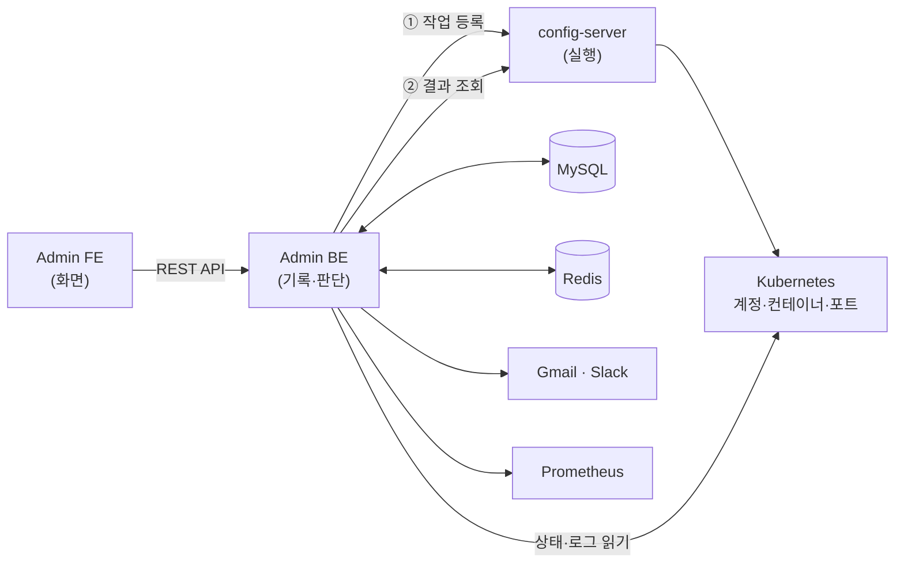

# 개요

코드를 보기 전에, 이 시스템이 왜 있고 Admin BE가 그 안에서 어디까지 책임지는지를 먼저 잡습니다.

## 1. 왜 만들었나

연구실 구성원은 한정된 GPU 서버를 나눠 씁니다. 예전에는 관리자가 신청을 받아 리눅스 계정과 컨테이너를 손으로 만들고, 기간이 끝나면 손으로 지웠습니다. 사람이 하는 일이라 늦어지고, 실수가 생기고, 기간이 끝난 자원이 그대로 남곤 했습니다.

이 시스템은 그 과정을 다음처럼 바꿉니다.

| 단계 | 누가 | 하는 일 |
| --- | --- | --- |
| 가입 | 사용자 | 학교 이메일 인증 후 가입. 이때 우분투 계정 이름을 정한다 |
| 신청 | 사용자 | GPU 종류, 개발 환경(이미지), 사용 기간, 공유 그룹, 추가 포트를 골라 신청 |
| 승인 | 관리자 | 신청 내용을 보고 승인 또는 거절. **사람이 하는 일은 여기까지** |
| 생성 | 시스템 | 리눅스 계정·홈 폴더·컨테이너·접속 포트를 만들고 접속 정보를 메일로 안내 |
| 사용 | 사용자 | SSH·Jupyter로 접속. 필요하면 기간 연장·포트 변경 등을 다시 요청 |
| 만료 | 시스템 | 7·3·1일 전에 알리고, 만료일이 지나면 컨테이너를 회수 |
| 정리 | 시스템 | 오래 쓰지 않은 계정을 비활성화하고, 보존 기간이 지난 홈 폴더를 삭제 |

## 2. 서버 환경

GPU 서버는 **LAB**과 **FARM** 두 묶음이고, 서로 네트워크가 나뉘어 있으며 장착된 GPU가 다릅니다. 사용자는 신청할 때 어느 쪽의 어떤 GPU를 쓸지 고릅니다. 코드에서는 이 구분을 "서버 이름"(`serverName`)이라고 부르고, 서버마다 다른 값(접속 주소, 알림 채널, 포트 대역)은 코드가 아니라 설정 파일에 둡니다.

컨테이너는 쿠버네티스 Pod 하나로 만들어집니다. 사용자의 홈 폴더는 컨테이너 안이 아니라 공용 저장소(NAS)에 있어서, 컨테이너를 지우거나 다른 서버로 옮겨도 홈 폴더의 파일은 남습니다.

## 3. 전체 구조

역할 분담이 이 구조의 핵심입니다.

- **Admin BE는 기록하고 판단합니다.** 누가 무엇을 신청했는지, 지금 어떤 상태인지, 다음에 무엇을 해도 되는지를 압니다.
- **config-server는 실행합니다.** 계정을 만들고 컨테이너를 띄우는 일을 여러 단계로 나눠 수행합니다.
- 둘은 **작업(job)** 으로 이어집니다. Admin BE는 "이 신청의 컨테이너를 만들어 달라"는 작업을 등록하고 바로 돌아옵니다. 그 뒤 몇 초마다 결과를 물어보고, 끝났으면 DB에 반영합니다.

이렇게 나눈 이유는 컨테이너 생성이 길게는 몇 분씩 걸리기 때문입니다. 승인 버튼이 그 시간 동안 멈춰 있으면 화면이 끊기고, 중간에 서버가 재시작되면 어디까지 됐는지 알 수 없게 됩니다. 등록과 결과 확인을 나누면 승인은 즉시 끝나고, 서버가 재시작돼도 다시 물어보면 됩니다.

## 4. Admin BE가 맡는 일

| 영역 | 내용 |
| --- | --- |
| 회원 | 학교 이메일 인증·가입, 로그인, 권한(사용자/관리자), 비밀번호 재설정 |
| 신청 | 접수, 승인·거절, 취소, 상태 관리 |
| 변경 요청 | 기간 연장, 공유 그룹 추가, 추가 포트 변경, 비밀번호 변경 |
| 컨테이너 운영 | 다른 서버로 옮기기, 재시작, 회수, 멈춘 컨테이너 알림 |
| 예약 작업 | 만료 예고와 회수, 장기 미사용 계정 비활성화, 홈 폴더 정리, 작업 결과 확인 |
| 경고·이용 정지 | 경고 부여·차감·취소, 누적에 따른 접속 차단과 해제 |
| 알림 | 사용자 메일·Slack DM, 관리자 Slack 채널 알림 |
| 조회 | 관리자 화면용 신청·사용자·Pod 상태·로그, 대시보드 지표 |

## 5. 기술 스택

| 분류 | 사용 기술 | 쓰는 곳 |
| --- | --- | --- |
| 언어·프레임워크 | Java 17, Spring Boot 3.5 | 서버 전체 |
| DB 접근 | Spring Data JPA (Hibernate) | 엔티티 저장·조회 |
| 스키마 관리 | Flyway | 표 구조 변경을 SQL 파일로 관리 |
| DB | MySQL 8 | 영구 기록 |
| 캐시·대기열 | Redis | 로그인 유지, Slack 대기열, 횟수 제한, 중복 방지 |
| 인증 | Spring Security, JWT (jjwt 0.12) | 로그인과 요청 인증 |
| 외부 호출 | WebClient, RestClient | config-server, Slack, Prometheus, Google Sheets |
| 쿠버네티스 | Fabric8 Kubernetes Client | Pod 상태·로그·이벤트 읽기 |
| 메일 | JavaMailSender (SMTP) | 사용자 안내 메일 |
| 문서 | springdoc-openapi | API 문서 (운영에서는 꺼 둠) |
| 빌드·테스트 | Gradle, JUnit 5, Mockito, H2, JaCoCo | 빌드와 테스트 |

## 6. 실행 환경

Admin BE는 쿠버네티스에 **스택** 단위로 배포됩니다. 스택 하나에는 Admin BE·Admin FE·MySQL·Redis·config-server가 한 세트로 들어 있고, 스택끼리는 네임스페이스로 나뉩니다.

| 스택 | 용도 |
| --- | --- |
| `operation` | 실제 사용자가 쓰는 운영 환경. 릴리스 태그(`vX.Y.Z`)만 배포한다 |
| `baseline` · `noprobe` · `full` | 시험용. 같은 코드이고 config-server의 실행 방식만 다르다 |

Admin BE 코드는 스택이 어느 방식인지 모릅니다. 방식의 차이는 config-server 안에서만 나고, Admin BE는 언제나 같은 방법으로 작업을 등록하고 결과를 읽습니다. 배포 방법은 [운영 가이드](운영-가이드.md)를 봅니다.

다음은 [시스템 아키텍처](시스템-아키텍처.md)에서 각 단계가 실제로 어떻게 흘러가는지 봅니다.
