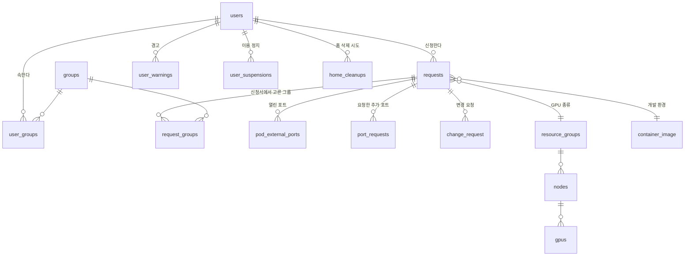
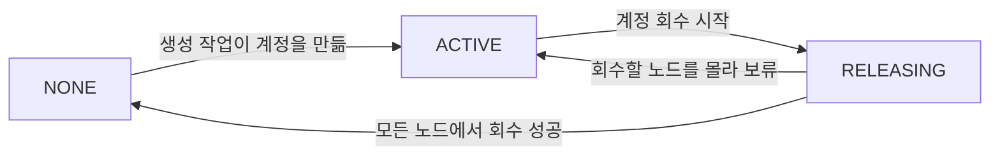

# 도메인 설명

[시스템 아키텍처](시스템-아키텍처.md)에서 본 흐름이 DB에 어떤 모양으로 남는지 정리합니다. 필드를 추가하거나 스키마를 바꾸기 전에, 해당 표의 절을 먼저 읽으세요. 이유를 모르고 고치면 다른 기능이 조용히 깨지는 필드가 여럿 있습니다.

## 한눈에 보기

가장 먼저 잡아야 할 것은 **무엇이 사람에게 붙고 무엇이 신청에 붙는가**입니다.

| 사람(`users`)에게 붙는 것 | 신청(`requests`)에 붙는 것 |
| --- | --- |
| 우분투 계정 이름, 계정 번호(UID/GID) | 컨테이너(Pod 이름, 노드) |
| 리눅스 계정의 상태 | 사용 기간(만료일) |
| 비밀번호 (웹 = SSH) | GPU 종류, 개발 환경 |
| 지금 속한 공유 그룹 | 접속 포트 |
| 홈 폴더 | 신청서에서 고른 그룹 |
| 경고, 이용 정지 | |

한 사람은 컨테이너를 여러 개 가질 수 있지만 리눅스 계정과 홈 폴더는 하나입니다. 그래서 컨테이너 하나를 지워도 계정과 파일은 남습니다.

## 1. 사용자 (`users`)

| 필드 | 설명 |
| --- | --- |
| `email` | 로그인에 쓰는 학교 이메일. 중복 불가 |
| `contactEmail` | 자주 쓰는 이메일(선택). Slack에 다른 주소로 가입한 사람을 찾는 데 쓴다 |
| `password` | 웹 로그인용 비밀번호 해시(BCrypt) |
| `ubuntuPasswordHash` | 같은 비밀번호를 리눅스 형식(SHA-512 crypt)으로 만든 해시. 컨테이너에는 이 값이 들어간다 |
| `passwordChangedAt` | 비밀번호를 바꾼 시각. 이보다 먼저 발급된 로그인 토큰은 거절한다 |
| `role` | `USER` / `ADMIN` |
| `ubuntuUsername` | 우분투 계정 이름. 한 번 정하면 바꿀 수 없고 중복 불가 |
| `ubuntuUid` / `ubuntuGid` | 리눅스 계정 번호. 첫 승인 때 받아 **영구히** 이 사람의 것이 된다 |
| `ubuntuAccountStatus` | 리눅스 계정의 상태 (아래) |
| `isActive` / `deletedAt` | 비활성화 여부와 탈퇴 시각. 행은 지우지 않는다 |
| `lastLoginAt` | 마지막 로그인 시각. 기록용이며 비활성화 판정에는 쓰지 않는다 |

!!! warning "비밀번호가 두 가지 형태로 저장되는 이유"
    웹 로그인과 SSH 로그인은 같은 비밀번호를 쓰지만 검증 방식이 다릅니다. 원문은 가입·변경하는 순간에만 있으므로, 그때 두 형태의 해시를 함께 만들어 둡니다. 한쪽만 바꾸면 웹과 SSH의 비밀번호가 달라집니다. 그래서 비밀번호 변경은 컨테이너에 반영된 것을 확인한 뒤 두 해시를 함께 바꿉니다.

### 리눅스 계정의 상태

| 값 | 뜻 |
| --- | --- |
| `NONE` | 리눅스 계정이 없다. 첫 승인 전이거나 회수가 끝난 사람 |
| `ACTIVE` | 계정이 살아 있다 |
| `RELEASING` | 회수하는 중. 컨테이너를 모두 지운 뒤 노드마다 계정을 지운다 |

상태가 `NONE`으로 돌아가도 **UID/GID와 계정 이름은 지우지 않습니다.** 다시 승인받으면 같은 번호로 계정을 되살려 홈 폴더의 파일 소유자가 그대로 맞습니다. 번호를 새로 받으면 예전 파일에 접근하지 못합니다.

### 사용자 수명

- 비활성화(`isActive=false`)되면 로그인이 막히고 컨테이너·리눅스 계정 회수가 시작됩니다.
- 행을 지우지 않는 이유는 신청 이력과 계정 번호를 남겨야 하기 때문입니다.
- 관리자가 다시 활성화할 수 있습니다. 컨테이너는 이미 회수됐으므로 사용자가 다시 신청해야 합니다.
- **마지막 남은 활성 관리자는** 권한을 내리거나 비활성화·탈퇴시킬 수 없습니다.

## 2. 신청 (`requests`)

컨테이너 하나를 쓰겠다는 요청 한 건입니다.

| 필드 | 설명 |
| --- | --- |
| `requestId` | 신청 번호. 화면·Slack·발급 내역에 그대로 보인다 (아래 "신청 번호") |
| `status` | 현재 상태. [시스템 아키텍처](시스템-아키텍처.md) 1절 |
| `user` | 신청자 |
| `resourceGroup` / `containerImage` | 고른 GPU 종류와 개발 환경 |
| `expiresAt` | 만료일 |
| `usagePurpose` | 사용 목적 |
| `enableVnc` | 원격 화면(VNC) 사용 여부 |
| `podName` / `nodeName` | 생성 결과로 받은 컨테이너 이름과 서버(노드) |
| `jobId` | 지금 기다리고 있는 작업의 번호 (아래) |
| `approvedAt` / `adminComment` | 승인 시각, 관리자 메모(거절 사유) |
| `slackMessageTs` | 신청서 채널에 올린 알림 메시지의 식별값. 이후 진행을 그 메시지의 댓글로 달 때 쓴다 |

상태는 엔티티의 메서드(`markAsProcessing`, `beginExpiry` 등)로만 바꿉니다. 허용되지 않는 이동은 예외가 납니다.

### `jobId`가 필요한 이유

작업 결과는 신청 번호로 조회합니다. 그런데 한 신청은 생성 작업을 여러 번 가질 수 있습니다(실패 후 다시 승인). 그래서 "지금 보이는 결과가 이번에 등록한 작업의 것인가"를 가려야 하고, 그 기준이 `jobId`입니다. 번호가 다르면 이전 작업의 결과이므로 반영하지 않습니다.

### 신청 번호

신청 번호는 DB의 자동 증가가 아니라 **번호 대장**(`request_numbers`)에서 발급합니다. 자동 증가는 저장이 취소돼도 번호가 올라가 버려 중간이 빕니다. 대장은 신청을 저장하는 것과 같은 트랜잭션에서 올리므로, 저장이 취소되면 번호도 함께 돌아옵니다.

!!! warning "신청 행을 직접 지우지 않는다"
    DB에서 신청 행을 손으로 지우면 번호가 비고, config-server의 작업 기록과 어긋납니다. 끝난 신청은 `DELETED` 상태로 남깁니다.

## 3. 변경 요청 (`change_request`)

사용 중인 컨테이너에 대한 요청입니다. 원래 신청과 다른 표에 있어, 거절돼도 원래 신청에는 영향이 없습니다.

| 필드 | 설명 |
| --- | --- |
| `request` | 대상 신청 |
| `changeType` | 종류 (아래) |
| `oldValue` / `newValue` | 바꾸기 전과 후의 값. 종류마다 모양이 다른 JSON |
| `status` | `PENDING`(대기) → `PROCESSING`(반영 중) → `FULFILLED`(완료) 또는 `DENIED`(거절) |
| `requestedBy` / `reviewedBy` / `reviewedAt` | 요청자, 검토자, 검토 시각 |

| 종류 | 뜻 | 새로 받는가 |
| --- | --- | --- |
| `EXPIRES_AT` | 사용 기간 연장 | 예 |
| `GROUP` | 공유 그룹 추가 | 예 |
| `PORT` | 추가 포트 변경 | 예 |
| `PASSWORD` | 비밀번호 변경 | 예 (메일 인증을 거치는 별도 경로) |
| `RESOURCE_GROUP` · `CONTAINER_IMAGE` | GPU·개발 환경 변경 | 아니오. 예전 기록을 읽기 위해 남겨 둠 |

비밀번호 변경은 새 비밀번호의 해시와 작업 번호를 함께 들고 있어야 해서 `password_reset_requests`에 짝이 되는 행을 하나 더 둡니다. 적용되거나 거절되면 해시는 비웁니다.

## 4. 공유 그룹

여러 사용자가 같은 폴더를 함께 쓰기 위한 리눅스 그룹입니다.

| 표 | 무엇을 담나 |
| --- | --- |
| `groups` | 그룹 이름과 그룹 번호(GID) |
| `user_groups` | **지금 실제로** 그 계정이 속한 그룹 |
| `request_groups` | 신청서에서 고른 그룹 (신청 시점의 기록) |

`user_groups`와 `request_groups`를 구분하는 것이 핵심입니다. 그룹은 신청이 아니라 계정에 붙기 때문에, 컨테이너에 실제로 들어가는 것은 `user_groups`입니다. `request_groups`는 "이 신청에서 무엇을 골랐는가"만 기록하고, 생성 작업이 성공하면 그 내용을 `user_groups`로 옮깁니다.

### 승인 대기 그룹

사용자가 신청하면서 새 그룹을 만들면 `groups`에 **GID가 비어 있는 행**이 생깁니다. 이 시점에는 인프라에 아무것도 만들지 않습니다. 그 그룹을 고른 신청이 승인돼 생성 작업이 성공하면, 그때 발급된 GID를 채웁니다. 그 그룹을 고른 신청이 모두 거절·취소되면 행을 지웁니다.

관리자가 승인하지 않은 그룹이 인프라 자원과 번호를 쓰지 못하게 하기 위한 구조입니다. 그룹 생성은 사용자당 하루 다섯 개까지입니다.

### 그룹 작업 (`group_operations`)

계정을 그룹에 넣거나 빼는 일은 config-server 작업으로 처리하고, 그 진행을 이 표에 남깁니다. `user_groups`는 **작업이 성공한 뒤에만** 바꿉니다. 먼저 바꾸면 화면에는 반영됐다고 나오는데 실제 권한은 그대로인 상태가 됩니다.

## 5. 포트

| 표 | 무엇을 담나 |
| --- | --- |
| `pod_external_ports` | 컨테이너에 **실제로 열려 있는** 포트. 용도, 컨테이너 안쪽 포트, 바깥에서 접속하는 포트 |
| `port_requests` | 사용자가 요청한 추가 포트. `isActive`가 참이면 실제로 열린 것 |
| `port_operations` | 포트 변경 작업의 진행 기록 |

SSH와 Jupyter 포트는 기본으로 열리고, 그 밖의 포트는 사용자가 용도와 함께 요청합니다. 접속 안내에 적는 포트는 `pod_external_ports`의 값입니다. 이동·재시작으로 포트가 바뀌면 이 표를 새 값으로 바꿉니다.

포트 표도 그룹과 같은 원칙을 따릅니다. **작업이 성공한 뒤에만** 바꿉니다.

## 6. 기준 정보

관리자가 미리 등록해 두는, 잘 바뀌지 않는 정보입니다.

| 표 | 내용 |
| --- | --- |
| `resource_groups` | 신청할 때 고르는 GPU 묶음. 서버 이름(`FARM`·`LAB`)과 GPU 종류 이름 |
| `nodes` | 서버(노드) 한 대. 어느 GPU 묶음에 속하는지, 메모리, CPU 코어 수 |
| `gpus` | 노드에 장착된 GPU. 모델명과 메모리 |
| `container_image` | 고를 수 있는 개발 환경. 이미지 이름, 버전, CUDA 버전 |
| `resource_group_images` | 어느 GPU 묶음에서 어느 이미지를 쓸 수 있는지 |

`resource_groups.serverName`은 설정 파일의 서버별 값(접속 주소, 알림 채널, 포트 대역)을 찾는 열쇠입니다. 대소문자는 가리지 않습니다. 서버가 늘면 이 표와 설정에 항목을 추가합니다.

`nodes.nodeId`는 쿠버네티스의 노드 이름과 같아야 합니다. 이동할 서버를 고를 때 이 값으로 대상을 정합니다.

## 7. 경고와 이용 정지

| 표 | 내용 |
| --- | --- |
| `user_warnings` | 경고 대장. 부여(`GRANT`)·차감(`DEDUCT`)·취소(`CANCEL`)를 한 줄씩 쌓는다 |
| `user_suspensions` | 이용 정지 한 건. 시작과 끝 시각 |
| `access_operations` | 접속을 막거나 여는 작업의 진행 기록 |

**현재 경고 횟수는 저장하지 않습니다.** 필요할 때마다 대장을 처음부터 읽어 계산합니다. 따로 저장해 두면 대장과 어긋날 수 있기 때문입니다. 취소된 경고는 처음부터 없던 것으로 셉니다.

- 차감은 경고가 3회 이상 쌓인 적이 있어야 할 수 있습니다.
- 끝나지 않은 정지가 하나라도 있으면 정지 중입니다. 정지가 겹치면 가장 늦게 끝나는 것이 실제 종료 시각입니다.
- 관리자에게는 경고를 줄 수 없습니다.

## 8. 홈 폴더 정리 (`home_cleanups`)

홈 삭제를 한 번 시도할 때마다 한 줄이 생깁니다. 홈은 계정에 붙어 있으므로 **그 계정의 마지막 컨테이너가 끝난 시각**을 기준으로 셉니다.

| 상태 | 뜻 |
| --- | --- |
| `PROCESSING` | 삭제 작업이 도는 중 |
| `DELETED` | 지웠다 (이미 없었던 경우 포함) |
| `FAILED` | 실패. 이 줄은 그대로 두고 다음 날 새 줄로 다시 시도한다 |

삭제가 도는 동안 그 사용자의 새 신청은 받지 않습니다. 지우는 중인 홈에 새 컨테이너가 붙는 것을 막기 위해서입니다.

## 9. 알림 문구 (`message_templates`)

메일·Slack 문구는 배포 없이 고칠 수 있습니다.

1. 기본 문구는 `messages.properties`에 있습니다(코드와 함께 배포).
2. 관리자가 화면에서 문구를 고치면 이 표에 그 키의 줄이 생기고, **이 표의 값이 우선**합니다.
3. "초기화"하면 줄이 지워져 기본 문구로 돌아갑니다.

문구 안의 `{0}`, `{1}` 같은 자리 표시는 코드가 값을 채우는 자리입니다. 개수와 순서는 코드에 정해져 있으므로 문구를 고칠 때 그대로 둬야 합니다.

## 10. 스키마를 바꿀 때

표 구조는 **Flyway SQL 파일로만** 바꿉니다. 엔티티만 고쳐서는 DB가 바뀌지 않고, 서버가 뜰 때 검증에서 실패합니다.

1. `src/main/resources/db/migration/`에 다음 번호로 파일을 추가합니다. 이름은 `V<번호>__<설명>.sql`입니다.
2. 엔티티를 그에 맞게 고칩니다.
3. 서버가 뜰 때 Flyway가 새 파일을 실행하고, 그 뒤 Hibernate가 엔티티와 표가 맞는지 확인합니다.

| 규칙 | 이유 |
| --- | --- |
| 이미 적용된 파일은 고치지 않는다 | 내용이 바뀌면 체크섬이 달라져 서버가 뜨지 않는다. 고칠 것이 있으면 새 번호로 추가한다 |
| 데이터를 옮길 때는 한 파일에서 칸 추가 → 값 채우기 → 옛 칸 삭제 순으로 | 중간 상태로 배포되지 않게 |
| enum 값을 추가하면 그 칸의 `enum(...)` 목록을 바꾸는 파일도 추가 | 목록에 없는 값은 저장되지 않는다 |
| 엔티티에서 제약을 빼면 그 제약을 지우는 파일도 추가 | DB에 남은 제약은 저절로 사라지지 않는다 |

예전에는 Hibernate가 표를 자동으로 고치게 했습니다(`ddl-auto: update`). 이 방식은 칸을 **추가**하기만 하고 지우거나 바꾸지 못해서, 엔티티에서 지운 중복 금지 제약이 운영 DB에 그대로 남아 장애로 이어진 적이 있습니다. 지금 방식으로 바꾼 이유입니다.

저장소의 `migrations/` 폴더는 Flyway 도입 전에 손으로 실행한 SQL의 기록입니다. 더 추가하지 않습니다.
