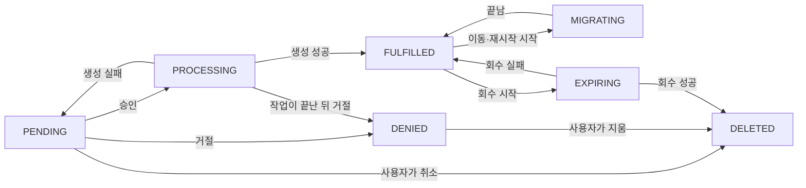
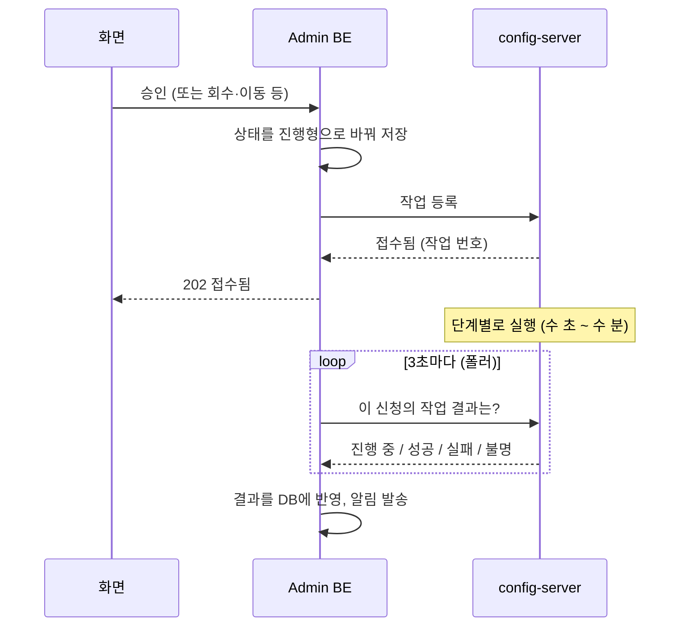
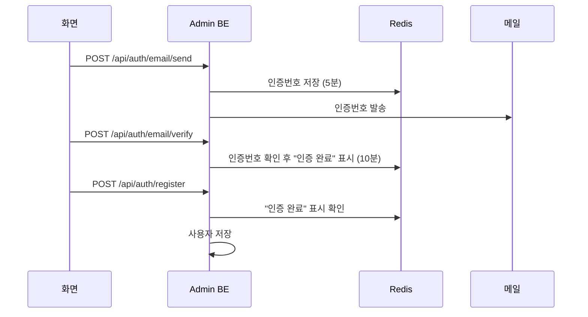
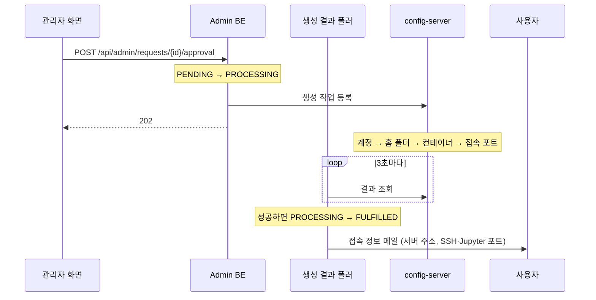
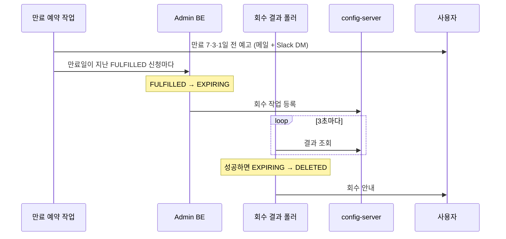

# 시스템 아키텍처

코드 한 줄을 고치기 전에, 그 코드가 전체 흐름의 어느 시점에 불리는지부터 알아야 합니다. 이 문서는 가입부터 회수까지 실제로 일어나는 일을 순서대로 따라갑니다.

## 한눈에 보기

- 신청 한 건은 **일곱 가지 상태** 가운데 하나에 있고, 정해진 길로만 옮겨 갑니다(1절).
- 인프라가 필요한 일은 모두 **"작업 등록 → 바로 응답 → 결과는 나중에 반영"** 으로 처리합니다(2절).
- 사람이 누르지 않아도 도는 **예약 작업**이 만료·정리·결과 확인을 맡습니다(4절).

## 1. 신청의 상태

신청(Request) 한 건은 아래 상태를 거칩니다.



| 상태 | 뜻 | 컨테이너 |
| --- | --- | --- |
| `PENDING` | 접수됨. 관리자 결정을 기다림 | 없음 |
| `PROCESSING` | 승인됨. 계정·컨테이너를 만드는 중 | 만드는 중 |
| `FULFILLED` | 사용 중 | 있음 |
| `MIGRATING` | 다른 서버로 옮기거나 재시작하는 중 | 있음 |
| `EXPIRING` | 회수하는 중 | 지우는 중 |
| `DENIED` | 거절됨 | 없음 |
| `DELETED` | 끝남 (취소 또는 회수 완료) | 없음 |

기억할 것은 세 가지입니다.

1. **표에 없는 이동은 코드가 거부합니다.** 허용되는 이동은 `Status` enum 한 곳에 표로 적혀 있고, 엔티티는 그 표에 있는 이동만 받아들입니다. 새 이동이 필요하면 그 표와 `lifecycle-transitions.yaml`을 함께 고칩니다(둘이 다르면 테스트가 실패합니다).
2. **진행형 상태(`PROCESSING`·`MIGRATING`·`EXPIRING`)는 "작업이 도는 중"이라는 뜻입니다.** 이 상태의 신청은 다른 요청이 건드리지 못합니다. 같은 신청에 두 가지 일이 겹치는 것을 막는 잠금 역할을 합니다.
3. **실패하면 직전 상태로 돌아갑니다.** 생성 실패는 `PENDING`, 회수 실패는 `FULFILLED`로 돌아가 다시 시도할 수 있습니다.

## 2. 작업 등록과 결과 반영

계정·컨테이너·포트를 바꾸는 일은 길게는 몇 분이 걸립니다. 그래서 Admin BE는 요청을 받은 자리에서 끝까지 기다리지 않습니다.



결과에 따라 Admin BE가 하는 일은 모든 작업에 공통입니다.

| 결과 | Admin BE가 하는 일 |
| --- | --- |
| 진행 중 | 아무것도 하지 않고 다음 바퀴에 다시 본다 |
| 성공 | 결과(계정 번호, Pod 이름, 포트 등)를 DB에 반영하고 다음 상태로 옮긴다 |
| 실패 (자원을 남기지 않음) | 직전 상태로 되돌리고 관리자에게 알린다 |
| 실패했는데 자원이 남음 / 결과 불명 | **상태를 그대로 두고** 관리자에게 한 번만 알린다 |

마지막 줄이 중요합니다. 실제로 무엇이 만들어졌는지 모르는 상태에서 "실패"로 되돌리면, 다시 승인했을 때 컨테이너가 하나 더 생깁니다. 그래서 모르는 것은 되돌리지 않고 사람에게 넘깁니다. 자세한 규칙은 [외부 연동](외부-연동.md)에 있습니다.

## 3. 단계별 흐름

### 3.1 가입



- 학교 이메일(`dgu.ac.kr`, `dongguk.edu`)만 받습니다. 허용 도메인은 설정으로 바꿀 수 있습니다.
- 가입할 때 **우분투 계정 이름**을 정합니다. 이 이름은 사람에게 붙어 바뀌지 않으며, 이후 모든 컨테이너와 홈 폴더가 이 이름을 씁니다.
- **웹 비밀번호가 곧 SSH 비밀번호입니다.** 비밀번호 원문은 저장하지 않고, 웹 로그인용과 리눅스 계정용 두 가지 형태의 해시만 저장합니다.
- 이미 가입된 주소로 인증번호를 요청해도 응답은 똑같습니다. 가입 여부를 아무나 알아낼 수 없게 하기 위해서이고, 주소 주인에게는 인증번호 대신 안내 메일이 갑니다.
- 인증 메일은 주소당 1분에 한 번, 1시간에 다섯 번까지 보냅니다. 인증번호는 다섯 번 틀리면 폐기됩니다.

### 3.2 로그인

로그인하면 수명이 짧은 **액세스 토큰**과 수명이 긴 **리프레시 토큰**을 받습니다. 리프레시 토큰은 Redis에도 저장해 두어, 서버 쪽에서 지우면 그 사용자의 로그인이 끊깁니다. 같은 이메일로 15분 안에 다섯 번 틀리면 잠시 잠깁니다. 자세한 내용은 [인증·보안](인증-보안.md)을 봅니다.

### 3.3 신청

`POST /api/requests`로 접수합니다. 접수하기 전에 아래를 차례로 확인하고, 하나라도 걸리면 거절합니다.

| 확인 | 걸리면 |
| --- | --- |
| Slack 워크스페이스 회원인가 (운영에서만 켬) | 가입 방법을 화면과 메일로 안내 |
| 이용 정지 중이 아닌가 | 403 |
| 우분투 계정 이름이 등록돼 있는가 | 마이페이지에서 먼저 등록하도록 안내 |
| 결정을 기다리는 다른 신청이 없는가 | 기존 신청을 취소하도록 안내 |
| 이 계정의 홈 폴더를 정리하는 중이 아닌가 | 잠시 뒤 다시 신청하도록 안내 |
| 하루 다섯 건을 넘지 않았는가 | 429 |

통과하면 `PENDING`으로 저장하고, 해당 서버의 **신청서 채널**(Slack)에 알립니다. 이 알림 메시지가 이후 진행 상황(취소·거절·생성 완료)을 댓글로 이어 다는 기준이 됩니다.

### 3.4 승인



- 사용자에게 살아 있는 리눅스 계정이 있으면 컨테이너만 만듭니다. 없으면 계정부터 만듭니다. 예전에 계정이 있었던 사람이면 **같은 계정 번호(UID)** 를 다시 받아 홈 폴더의 파일을 그대로 이어 씁니다.
- 한 사용자의 신청 두 건을 동시에 승인하면 한 건만 진행하고 나머지는 `PENDING`으로 돌려놓습니다. 계정 하나에 컨테이너 두 개가 잘못 붙는 것을 막기 위해서입니다.
- 화면은 승인 응답을 받은 뒤 신청 상태를 주기적으로 다시 읽어 결과를 보여 줍니다. 진행 단계는 `GET /api/admin/requests/{id}/provisioning-status`와 `/job-steps`로 봅니다.

### 3.5 거절과 취소

| 동작 | 경로 | 결과 |
| --- | --- | --- |
| 관리자 거절 | `POST /api/admin/requests/{id}/rejection` | `DENIED`. 사유를 메일로 안내 |
| 사용자 취소 | `DELETE /api/requests/{id}` | `PENDING`·`DENIED` 신청만 `DELETED`로 |

거절은 상태만 바꾸고 인프라 자원을 지우지 않습니다. 그래서 `PROCESSING` 신청은 **생성 작업이 끝난 뒤에만** 거절할 수 있습니다. 작업이 도는 중에 거절하면 그 작업이 만든 컨테이너를 가리키는 신청이 없어집니다.

### 3.6 사용 중 변경 요청

사용 중인 컨테이너에 대해 사용자가 요청하고(`POST /api/users/me/change-requests`), 관리자가 승인·거절합니다(`/api/admin/change-requests/{id}/approval`, `/rejection`).

| 종류 | 승인하면 |
| --- | --- |
| 사용 기간 연장 (`EXPIRES_AT`) | 만료일만 바꾸면 되므로 그 자리에서 끝난다 |
| 공유 그룹 추가 (`GROUP`) | 그룹 작업을 등록하고, 성공하면 반영 |
| 추가 포트 변경 (`PORT`) | 포트 작업을 등록하고, 성공하면 반영. 컨테이너는 다시 만들지 않는다 |
| 비밀번호 변경 (`PASSWORD`) | 비밀번호 작업을 등록하고, 컨테이너에 반영된 것을 확인한 뒤 DB의 해시를 바꾼다 |

작업이 필요한 세 종류는 승인 뒤 "반영 중"에 머물다가, 작업이 성공하면 완료되고 실패하면 다시 승인 대기로 돌아옵니다. 같은 종류의 변경 요청은 한 번에 하나만 대기할 수 있습니다.

비밀번호 변경은 로그인하지 못하는 사람도 써야 하므로 별도 경로로 받습니다. 가입한 메일로 인증번호를 받아(`POST /api/auth/password-reset-codes`) 새 비밀번호와 함께 신청합니다(`POST /api/auth/password-resets`). 메일을 받지 못하는 사용자는 관리자가 직접 정해 줍니다(`PUT /api/admin/users/{id}/password`). 어느 쪽이든 실제 적용은 같은 작업 경로를 탑니다.

### 3.7 이동과 재시작

| 동작 | 누가 | 경로 |
| --- | --- | --- |
| 다른 서버(노드)로 이동 | 관리자 | `POST /api/admin/requests/{id}/migrations` |
| 재시작 | 관리자 | `POST /api/admin/requests/{id}/restarts` |
| 본인 컨테이너 재시작 | 사용자 | `POST /api/requests/{id}/restarts` (1시간에 다섯 번까지) |

재시작은 "같은 서버로의 이동"으로 처리하므로 두 동작은 같은 작업과 같은 상태(`MIGRATING`)를 씁니다. 끝나면 Pod 이름과 포트가 바뀔 수 있어 새 값을 DB에 반영합니다. 홈 폴더는 그대로입니다.

### 3.8 회수

회수에는 범위가 다른 세 가지가 있습니다. 이 구분을 헷갈리면 사고가 납니다.

| 무엇을 | 누가·언제 | 지워지는 것 | 남는 것 |
| --- | --- | --- | --- |
| 컨테이너 하나 | 만료 예약 작업(매일 08:00), 또는 관리자가 `DELETE /api/admin/requests/{id}/container` | 그 컨테이너와 접속 포트 | 리눅스 계정, 홈 폴더, 같은 사용자의 다른 컨테이너 |
| 리눅스 계정 | 관리자가 `DELETE /api/admin/users/{id}/ubuntu-account`, 사용자 비활성화·탈퇴 | 그 사용자의 **모든** 컨테이너와 리눅스 계정 | 홈 폴더, 계정 번호(UID), 웹 계정(탈퇴가 아니면) |
| 홈 폴더 | 홈 정리 예약 작업(매일 09:30) | 홈 폴더 | 계정 번호(UID) |



- **계정은 신청이 아니라 사람에게 붙습니다.** 그래서 컨테이너가 만료돼도 계정은 남고, 다시 신청해 승인되면 같은 이름·같은 번호·같은 홈 폴더로 이어집니다.
- 계정 회수는 그 사용자의 컨테이너 회수가 **모두 끝난 뒤에** 진행합니다. 계정을 먼저 지우면 주인 없는 컨테이너가 남기 때문입니다.
- 홈 폴더는 마지막 컨테이너가 끝난 뒤 **30일 뒤에 지운다고 안내하고, 실제로는 40일 뒤에** 지웁니다. 안내한 날 직전에 다시 신청한 사람의 승인이 끝날 여유를 두기 위해서입니다.

### 3.9 장기 미사용 계정

매일 09:00에 확인합니다. **마지막 컨테이너가 끝난 지 1년**(컨테이너를 쓴 적이 없으면 가입한 지 1년)이 지난 사용자를 비활성화합니다. 로그인했는지는 보지 않습니다.

- 끝나지 않은 신청이 하나라도 있으면 대상이 아닙니다. 관리자도 대상이 아닙니다.
- 비활성화 7·3·1일 전에 경고합니다.
- 기한이 이미 지났는데 경고를 한 번도 받지 못한 사용자는 바로 비활성화하지 않고, 그날 경고하면서 7일의 여유를 줍니다.
- 비활성화되면 로그인이 막히고 컨테이너·리눅스 계정 회수가 시작됩니다. 기록은 지우지 않으며 관리자가 다시 활성화할 수 있습니다.

### 3.10 경고와 이용 정지

관리자가 사용자에게 경고를 주거나(`POST /api/admin/users/{userId}/warnings`), 줄이거나, 취소합니다.

| 누적 경고 | 결과 |
| --- | --- |
| 1회 | 경고만 |
| n회 (2회 이상) | 이용 정지 7 × (n − 1)일 |

정지 중에는 그 사용자의 모든 컨테이너 접속 포트가 막히고, 새 신청·재시작·변경 요청도 받지 않습니다. 컨테이너와 파일은 그대로입니다. 정지가 끝나면 1시간마다 도는 예약 작업이 접속을 다시 엽니다. 접속을 막고 여는 일도 config-server 작업으로 처리합니다.

## 4. 예약 작업

사람이 누르지 않아도 정해진 때에 도는 작업입니다. 모두 Admin BE 안에서 돕니다.

### 정해진 시각에 도는 것

| 작업 | 때 | 하는 일 |
| --- | --- | --- |
| 만료 처리 | 매일 08:00 | 만료 7·3·1일 전 예고, 만료된 컨테이너 회수 시작 |
| 장기 미사용 처리 | 매일 09:00 | 경고, 비활성화 (3.9절) |
| 홈 정리 | 매일 09:30 | 보존 기간이 지난 홈 폴더 삭제 작업 등록 |

### 결과를 확인하는 것 (폴러)

등록해 둔 작업의 결과를 조회해 DB에 반영합니다. 기본 주기는 3초이고 설정으로 바꿀 수 있습니다.

| 폴러 | 대상 |
| --- | --- |
| `ProvisionJobPoller` | 생성 중(`PROCESSING`)인 신청 |
| `MigrationJobPoller` | 이동·재시작 중(`MIGRATING`)인 신청 |
| `RevokeJobPoller` | 회수 중(`EXPIRING`)인 신청 |
| `AccountRevokeJobPoller` | 회수 중인 리눅스 계정 |
| `PasswordResetJobPoller` | 반영 중인 비밀번호 변경 |
| `GroupOperationJobPoller` | 반영 중인 그룹 작업 |
| `PortOperationJobPoller` | 반영 중인 포트 변경 |
| `AccessOperationJobPoller` | 반영 중인 접속 차단·해제 |
| `HomeCleanupJobPoller` | 진행 중인 홈 삭제 (30초 주기) |

### 살피고 맞추는 것

| 작업 | 주기 | 하는 일 |
| --- | --- | --- |
| 재조정 | 5분 | 진행형 상태에 20분 넘게 멈춘 신청을 찾는다. 작업이 아예 등록되지 않았거나 실패로 끝난 것만 되돌리고, 나머지는 폴러에 맡기거나 관리자에게 알린다 |
| 멈춘 컨테이너 감시 | 5분 | 사용 중인 컨테이너가 멈췄으면(메모리 초과 등) 관리자에게 알린다. 사용자 컨테이너는 스스로 다시 뜨지 않는다 |
| 이용 정지 맞추기 | 1시간 | 정지가 끝난 사용자의 접속을 열고, 실패한 차단·해제를 다시 시도한다 |
| 예약 이름 갱신 | 10분 | 쓸 수 없는 계정 이름 목록을 config-server에서 받아 둔다 |
| Slack 전송 (2개) | 1초 | 대기열에서 알림을 하나씩 꺼내 보낸다 |

!!! note "예약 작업을 추가할 때"
    예약 작업마다 스레드를 하나씩 씁니다. 스레드 수는 `RuntimeDefaults`에 숫자로 적혀 있고, 예약 작업 수와 맞지 않으면 테스트가 실패합니다. 예약 작업을 추가하면 그 숫자도 함께 올립니다. 스레드가 모자라면 느린 외부 호출 하나가 다른 예약 작업을 전부 멈춥니다.

## 5. 알림이 가는 곳

코드는 "어느 채널로 보낼지"를 직접 고르지 않고 **알림의 성격**만 정합니다. 채널 주소는 설정에 있습니다.

| 성격 | 가는 곳 | 예 |
| --- | --- | --- |
| 결정 요청 | 서버별 신청서 채널 | 새 신청, 변경 요청. 이후 진행은 같은 메시지의 댓글로 |
| 조치 필요 | 오류 채널 | 작업 실패, 결과 불명, 멈춘 컨테이너 |
| 처리 기록 | 알림 기록 채널 | 정상 완료, 사용자에게 보낸 안내의 기록 |
| 사용자 안내 | 메일 + Slack DM | 승인, 만료 예고, 회수, 경고 |

접속 정보처럼 민감한 내용은 Slack DM 없이 메일로만 보냅니다. 알림 전송이 실패해도 본래 처리(승인·회수 등)는 실패로 만들지 않습니다.

## 6. 코드 구조

```
admin_be
├── domain/            업무 영역별 패키지
│   ├── users          회원, 로그인, 권한, 비밀번호 재설정, 리눅스 계정 회수
│   ├── requests       신청, 승인·거절, 변경 요청, 이동, 회수, 작업 창구(job)
│   ├── groups         공유 그룹과 그룹 작업
│   ├── portRequests   추가 포트와 포트 작업
│   ├── warnings       경고, 이용 정지, 접속 차단·해제
│   ├── home           홈 폴더 보존과 삭제
│   ├── scheduler      예약 작업 전부 (만료, 미사용, 폴러, Slack 전송)
│   ├── alarm          메일·Slack 알림
│   ├── pod            Pod 상태·로그 조회, 외부 포트 기록
│   ├── issuanceSheet  발급 내역 스프레드시트 연동
│   ├── monitoring     대시보드 지표 (Prometheus)
│   ├── messageTemplate 알림 문구 관리
│   └── containerImage · resourceGroups · nodes · gpus · dashboard  기준 정보와 조회
├── global/            공통 기능
│   ├── auth           로그인 인증, 권한, 내부 토큰
│   ├── config         설정 (Flyway, Redis, WebClient, 기본값)
│   ├── server         서버(LAB·FARM)별 설정 읽기
│   ├── validation     입력 규칙 (계정 이름, 전화번호 등)
│   ├── util · alert · event · webclient  공용 도구
└── error/             오류 코드와 오류 응답
```

각 업무 영역 안은 `controller → service → repository` 순서로 부릅니다. 계층별 규칙은 [코드 컨벤션](코드-컨벤션.md), 표 구조는 [도메인 설명](도메인-설명.md)을 봅니다.
