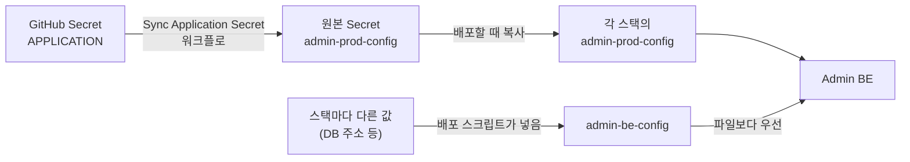

# 운영 가이드

"왜 이렇게 만들었는가"가 아니라 "지금 무엇을 확인하고 무엇을 실행해야 하는가"에 답하는 문서입니다. 원리는 줄이고 확인할 것과 판단 기준을 앞에 둡니다.

이 문서는 Admin BE만 다룹니다. 클러스터 접속 방법, config-server, 사용자 Pod 관리는 [인프라 운영 매뉴얼](../infra/operations/운영-매뉴얼.md)을 봅니다.

## 한눈에 보기

| 상황 | 먼저 볼 곳 |
| --- | --- |
| 배포하려 한다 | 2절 |
| 설정 값을 바꾸려 한다 | 4절 |
| 서버가 안 뜬다, 계속 재시작한다 | 3절 → 7절 "서버가 뜨지 않는다" |
| Slack에 "조치 필요" 알림이 왔다 | 7절 "관리자 알림이 왔을 때" |
| 신청이 "처리 중"에서 움직이지 않는다 | 7절 "신청이 진행형 상태에 멈췄다" |
| Slack 알림이 오지 않는다 | 6절 |
| 사용자가 로그인이 잠겼다고 한다 | 5절 |

!!! warning "운영에는 실제 사용자가 있다"
    `operation` 스택에는 실제 사용자의 컨테이너가 떠 있습니다. 시험은 실험 스택에서 하고, 운영에서 시험 신청을 내지 않습니다(취소해도 신청 번호가 쓰입니다). 운영 DB를 직접 고치는 일은 마지막 수단입니다.

## 1. 어디에 떠 있나

| 항목 | 값 |
| --- | --- |
| 네임스페이스 | `ailab-<스택>` (`ailab-operation`, `ailab-full` 등) |
| Deployment | `admin-prod` |
| 컨테이너 포트 | 8080 |
| 설정 파일 | Secret `admin-prod-config`가 `/app/config/application.yml`로 들어온다 |
| 스택별 덮어쓰는 값 | Secret `admin-be-config` (환경 변수) |
| DB | 같은 네임스페이스의 MySQL, 데이터베이스 `web_admin` |
| Redis | 같은 네임스페이스의 `admin-redis` |

아래 명령의 `<ns>`에는 대상 네임스페이스를 넣습니다.

## 2. 배포

**push로는 배포되지 않습니다.** 배포는 admin_infra 저장소의 **Deploy Proposed Stack** 워크플로를 사람이 실행해야만 일어납니다. 규칙 전문은 [브랜치·배포 규칙](../브랜치-규칙.md)입니다.

| 대상 | 배포할 수 있는 코드 |
| --- | --- |
| 실험 스택 (`baseline`·`noprobe`·`full`) | `main` 또는 시험할 작업 브랜치 |
| 운영 (`operation`) | 릴리스 태그 `vX.Y.Z`만. 세 저장소가 같은 태그여야 한다 |

### 흐름


1. `main`에 병합되면 CI가 테스트를 돌리고, 통과한 결과물로 이미지를 만들어 올려 둡니다.
2. 운영에 올릴 때는 관련 저장소의 `main`에 같은 이름의 태그를 찍습니다.
3. 배포 워크플로를 실행합니다.

    ```bash
    gh workflow run deploy-proposed-stack.yaml -R CSID-DGU/admin_infra \
      -f stack=operation -f ref=vX.Y.Z -f fe_ref=vX.Y.Z -f be_ref=vX.Y.Z -f action=up
    ```

4. 실행 결과를 지켜봅니다.

    ```bash
    gh run list -R CSID-DGU/admin_infra --workflow deploy-proposed-stack.yaml --limit 1
    gh run watch <실행 번호> -R CSID-DGU/admin_infra --exit-status
    ```

### 배포 뒤 확인

| 확인 | 명령 | 정상 |
| --- | --- | --- |
| Pod가 떴는가 | `kubectl -n <ns> get pods -l app=admin-prod` | `Running`, 재시작 0 |
| 뜨면서 오류가 없었는가 | `kubectl -n <ns> logs deploy/admin-prod --tail=200` | `ERROR` 없음, `Started AdminBeApplication` |
| 스키마 변경이 적용됐는가 | 로그에서 `Migrating schema` 또는 `Schema … is up to date` | 실패 문구 없음 |
| 사용자 컨테이너가 그대로인가 | `kubectl -n <ns> get pods` | 사용자 Pod의 재시작 횟수가 늘지 않음 |

화면에서 로그인과 신청 목록 조회까지 한 번 해 봅니다.

### 되돌리기

이전 태그로 같은 워크플로를 다시 실행합니다.

!!! warning "스키마를 바꾼 배포는 되돌리기 어렵다"
    Flyway는 앞으로만 갑니다. 새 버전이 칸을 지웠다면 이전 코드로 되돌려도 스키마는 돌아가지 않아, 이전 코드가 뜨지 못할 수 있습니다. 칸을 지우거나 이름을 바꾸는 변경은 "새 칸을 쓰는 코드 배포 → 옛 칸 삭제 배포"로 두 번에 나눕니다.

### 배포 중에 일어나는 일

- Admin BE는 종료 신호를 받으면 새 요청을 받지 않고 진행 중인 요청을 끝낸 뒤 내려갑니다.
- 그 사이 등록해 둔 작업은 config-server에서 계속 돕니다. 새로 뜬 Admin BE의 폴러가 결과를 이어서 반영합니다.
- 작업을 등록하기 직전에 내려가 진행형 상태에 남은 신청은 재조정(5분마다)이 20분 뒤 찾아 되돌립니다.

## 3. 상태와 로그 보기

```bash
# Pod 상태
kubectl -n <ns> get pods -l app=admin-prod

# 최근 로그 / 실시간 / 재시작 직전 로그
kubectl -n <ns> logs deploy/admin-prod --tail=200
kubectl -n <ns> logs deploy/admin-prod -f
kubectl -n <ns> logs <pod 이름> --previous

# 뜨지 못하는 이유 (아래쪽 Events)
kubectl -n <ns> describe pod <pod 이름>
```

### 로그에서 찾을 말

| 찾는 것 | 검색어 |
| --- | --- |
| 만료 처리가 돌았는가 (매일 08:00) | `🗓️ [스케줄러 시작]` |
| 장기 미사용 처리가 돌았는가 (매일 09:00) | `👤 [스케줄러 시작]` |
| 재조정이 무엇을 했는가 | `[재조정]` |
| config-server 호출이 실패했는가 | `[WEBCLIENT]` |
| 내부 토큰이 틀렸는가 | `[InternalTokenFilter]` |
| Slack 설정이 죽었는가 | `[SLACK_CONFIG_DEAD]` |
| 저장 뒤 알림이 실패했는가 | `커밋 뒤 작업 실패` |
| 사람이 봐야 하는 오류 | `ERROR` |

```bash
kubectl -n <ns> logs deploy/admin-prod --since=24h | grep -E "ERROR|\[재조정\]"
```

## 4. 설정 바꾸기

설정 파일(`application.yml`)은 이미지에 들어 있지 않고 Secret으로 들어옵니다.



### 절차

1. admin_be 저장소의 GitHub Secret `APPLICATION`을 새 내용으로 고칩니다.
2. admin_be의 **Sync Application Secret to K8s** 워크플로를 실행해 원본 Secret에 반영합니다.
3. 대상 스택을 다시 배포합니다. 배포할 때 원본을 복사하므로 **배포해야 반영됩니다.**
4. 팀 Notion의 `application.yml` 페이지도 같이 고칩니다.

!!! warning "한쪽만 고치면 어긋난다"
    클러스터의 Secret만 직접 고치면 다음에 누군가 워크플로를 돌릴 때 예전 값으로 덮입니다. 급해서 클러스터를 직접 고쳤다면 GitHub Secret도 바로 맞춥니다.

### 알아 둘 것

| 사실 | 영향 |
| --- | --- |
| 스택별 값(`admin-be-config`)이 파일보다 우선한다 | 파일을 고쳤는데 반영되지 않으면 스택별 값이 덮고 있는지 본다 |
| 실험 스택은 Slack 주소를 닿지 않는 곳으로 바꿔 쓴다 | 실험 스택에서 Slack 알림이 오지 않는 것은 정상이다. 진짜 채널에 잘못 보내지 않게 하는 안전장치 |
| 모든 환경에 같아야 하는 값은 코드에 있다 (`RuntimeDefaults`) | 메일 제한 시간, 예약 작업 스레드 수, API 문서 끄기. 설정 파일에 같은 키가 있으면 그 값이 우선 |
| 저장소가 공개돼 있다 | 설정 값·서버 주소·계정 이름을 이슈, PR, 워크플로 로그에 적지 않는다 |

### 자주 만지는 설정

| 키 | 내용 | 기본값 |
| --- | --- | --- |
| `app.servers.<서버>.*` | 서버별 접속 주소, 알림 채널, 포트 대역 | — |
| `slack-webhook-url.*`, `slack-channel-id.*`, `slack.bot-token` | Slack 채널과 봇 | — |
| `config.base-url`, `config.api-token` | config-server 주소와 내부 토큰 | — |
| `auth.allowed-email-domains` | 가입을 받는 이메일 도메인 | `dgu.ac.kr,dongguk.edu` |
| `scheduler.expiry-cron` | 만료 처리 시각 | 매일 08:00 |
| `scheduler.stale-threshold-minutes` | 재조정이 "멈췄다"고 보는 시간 | 20 |
| `home-retention.announced-days` / `delete-days` | 홈 삭제를 알리는 날 / 실제로 지우는 날 | 30 / 40 |
| `slack.membership-check.enabled` | 신청 전 Slack 가입 확인 | 꺼짐 |
| `issuance-sheet.enabled` | 발급 내역 스프레드시트 연동 | 꺼짐 |

## 5. DB와 Redis 들여다보기

**보는 것은 자유롭게, 고치는 것은 신중하게** 합니다.

### Redis

```bash
kubectl -n <ns> exec -it deploy/admin-redis -- redis-cli
```

비밀번호가 걸려 있으면 `AUTH <비밀번호>`를 먼저 입력합니다. 비밀번호는 같은 네임스페이스의 Secret에 있습니다.

| 하려는 일 | 명령 |
| --- | --- |
| 로그인 잠금 풀기 | `DEL LOGIN_FAIL:<소문자 이메일>` |
| 특정 사용자 강제 로그아웃 | `DEL RT:<사용자 번호>` |
| Slack 대기열 길이 | `LLEN slack:notification:queue` |
| 방금 Slack에 가입한 사람을 DM이 못 찾을 때 | `DEL slack:cache:users:list` |

키 전체 목록과 지워도 되는지는 [Redis 키 카탈로그](Redis-키-카탈로그.md)에 있습니다. `KEYS *`는 쓰지 않습니다.

### MySQL

접속 방법은 [인프라 운영 매뉴얼](../infra/operations/운영-매뉴얼.md)을 따릅니다. 자주 쓰는 조회입니다.

```sql
-- 진행형 상태에 머문 신청
SELECT request_id, status, job_id, pod_name, node_name, updated_at
FROM requests
WHERE status IN ('PROCESSING', 'MIGRATING', 'EXPIRING')
ORDER BY updated_at;

-- 만료일이 지났는데 사용 중으로 남은 신청
SELECT request_id, expires_at, pod_name
FROM requests
WHERE status = 'FULFILLED' AND expires_at < NOW();

-- 리눅스 계정을 회수하는 중인 사용자
SELECT user_id, ubuntu_username, ubuntu_uid, ubuntu_account_status
FROM users
WHERE ubuntu_account_status = 'RELEASING';

-- 적용된 스키마 버전
SELECT version, description, installed_on, success
FROM flyway_schema_history
ORDER BY installed_rank DESC LIMIT 5;
```

!!! danger "DB를 직접 고치기 전에"
    - **신청 행을 지우지 않는다.** 번호가 비고 config-server의 작업 기록과 어긋난다.
    - **상태만 바꾸지 않는다.** 상태를 `DELETED`로 바꿔도 컨테이너는 그대로 떠 있다. 실제 자원을 먼저 확인한다.
    - **표 구조를 손으로 바꾸지 않는다.** Flyway 파일로만 바꾼다.
    - `groups`는 MySQL 예약어라 이름을 백틱으로 감싼다: `` SELECT * FROM `groups` ``
    - 관리 화면에 같은 일을 하는 기능이 있으면 그것을 쓴다(권한 변경, 계정 회수, 회수 강제 완료 등).

## 6. Slack 알림이 오지 않을 때

순서대로 확인합니다.

| 순서 | 확인 | 판단 |
| --- | --- | --- |
| 1 | 실험 스택인가 | 실험 스택은 Slack을 막아 둔다. 정상 |
| 2 | 대기열 길이 `LLEN slack:notification:queue` | 0에 가까우면 꺼내 가고는 있다 → 3번. 계속 늘면 → 4번 |
| 3 | 로그에 `[SLACK_CONFIG_DEAD]` | 있으면 웹훅이 삭제됐거나 봇 토큰이 폐기됐다. 설정을 고친다(4절) |
| 4 | 로그에 `Slack` 관련 오류가 반복되는가 | Slack 장애이거나 Admin BE에서 Slack으로 나가는 통신이 막혔다 |
| 5 | DM만 안 가는가 | 그 사용자의 이메일로 Slack 회원을 찾지 못한다. 회원 목록 보관을 지우고(5절) 이메일을 확인한다 |
| 6 | 신청서 알림의 댓글이 안 달리는가 | 봇이 그 채널에 초대돼 있는지, `slack-channel-id`가 맞는지 |

알림이 실패해도 승인·회수 자체는 정상 처리됩니다. 알림만 빠진 것이므로 신청 상태는 화면에서 확인할 수 있습니다.

## 7. 장애 대응

### 서버가 뜨지 않는다

`kubectl -n <ns> logs <pod 이름> --previous`로 마지막 오류를 봅니다.

| 로그의 말 | 원인 | 조치 |
| --- | --- | --- |
| `Schema-validation` | 엔티티와 표 구조가 다르다 | Flyway 파일이 빠졌다. 파일을 추가해 다시 배포 |
| `Validate failed` / `checksum mismatch` | 이미 적용된 Flyway 파일이 수정됐다 | 파일을 원래대로 되돌리고, 변경은 새 번호로 |
| `Migration … failed` | Flyway SQL이 실패했다 | SQL을 고친다. 반쯤 적용된 상태를 먼저 확인 |
| `Could not resolve placeholder` | 설정 키가 없다 | 설정에 키를 추가(4절). 코드에 기본값을 두는 것도 검토 |
| `home-retention.delete-days…이상이어야 한다` | 홈 삭제 설정이 안내한 날보다 빠르다 | 설정을 고친다 |
| DB·Redis 연결 오류 | 같은 스택의 MySQL·Redis가 떠 있는지 | 인프라 쪽을 먼저 본다 |
| 오류 없이 재시작만 반복 | 메모리 초과일 수 있다 | `describe pod`의 `OOMKilled` 확인 |

### 관리자 알림이 왔을 때

Slack 오류 채널에 오는 알림은 **사람의 확인이 필요하다**는 뜻입니다. 같은 사건은 한 번만 옵니다.

| 알림의 뜻 | 신청 상태 | 할 일 |
| --- | --- | --- |
| 생성 실패 | `PENDING`으로 돌아옴 | 사유를 보고 다시 승인하거나 거절 |
| 생성 결과 불명 / 자원이 남은 실패 | `PROCESSING`에 남음 | 컨테이너와 계정이 실제로 있는지 확인한 뒤 정리. **확인 전에 다시 승인하지 않는다** |
| 생성은 성공했는데 반영 실패 | `PROCESSING`에 남음 | 알림의 사유 확인 (대개 계정 번호가 기존 기록과 다름) |
| 회수 실패 | `FULFILLED`로 돌아옴 | 다음 날 만료 처리가 다시 시도. 급하면 화면에서 다시 회수 |
| 회수 결과 불명 / 자원이 남은 실패 | `EXPIRING`에 남음 | 컨테이너가 실제로 없는지 확인한 뒤 화면의 **회수 강제 완료** |
| 이동 실패 | `FULFILLED`로 돌아옴 | 기존 컨테이너는 그대로. 다시 시도 |
| 이동이 오래 멈춤 | `MIGRATING`에 남음 | 새 Pod와 기존 Pod의 상태를 확인 |
| 계정 회수 실패 | 계정이 `RELEASING`에 남음 | 화면에서 계정 회수를 다시 누른다 |
| 컨테이너가 멈춤 | `FULFILLED` 그대로 | 사용자 컨테이너는 스스로 다시 뜨지 않는다. 원인을 보고 재시작 |
| 홈 삭제 실패 | — | 다음 날 자동으로 다시 시도 |
| 메일 발송 실패 | — | 메일 서버 설정과 통신 확인. 필요한 안내는 직접 전달 |

작업이 왜 실패했는지는 관리자 화면 신청 상세의 **단계 기록**에서 봅니다. 어느 단계에서 어떤 사유로 멈췄는지 나옵니다.

### 신청이 진행형 상태에 멈췄다

알림 없이 `PROCESSING`·`MIGRATING`·`EXPIRING`에 오래 머무는 경우입니다.

1. **20분을 기다렸는가.** 재조정이 20분 넘게 멈춘 신청을 5분마다 살핍니다. 작업이 등록되지 않았거나 실패로 끝났으면 스스로 되돌립니다.
2. **작업이 아직 도는 중인가.** 단계 기록에 진행이 보이면 기다립니다. 이미지를 처음 받는 노드에서는 생성이 오래 걸립니다.
3. **폴러가 돌고 있는가.** 로그에 config-server 호출 오류(`[WEBCLIENT]`)가 반복되면 Admin BE가 결과를 읽지 못하는 것입니다. config-server 상태와 내부 토큰을 확인합니다.
4. **결과 불명으로 남은 것인가.** 위 표의 "결과 불명" 줄을 따릅니다.

### 예약 작업이 돌지 않았다

```bash
kubectl -n <ns> logs deploy/admin-prod --since=24h | grep "스케줄러 시작"
```

- 그 시각에 Admin BE가 내려가 있었다면 그날은 건너뜁니다. 만료 처리는 "만료일이 지난 사용 중인 신청"을 대상으로 하므로 다음 날 함께 처리됩니다.
- 만료 **예고**(7·3·1일 전)는 그날을 놓치면 그 회차는 나가지 않습니다.
- 한 건이 실패해도 나머지 건은 계속 처리됩니다. 실패한 건은 `ERROR` 로그와 관리자 알림으로 남습니다.

### 로그인·인증 문제

| 증상 | 확인 |
| --- | --- |
| 한 사용자만 로그인이 안 된다 | 로그인 잠금(5절에서 풀기), 계정 비활성화 여부 |
| 모든 사용자가 갑자기 로그아웃됐다 | Redis가 비워졌거나 `jwt.secret`이 바뀌었다 |
| 승인하면 바로 502가 난다 | config-server에 닿지 못한다. 주소, 내부 토큰, config-server 상태 |
| 내부 호출이 전부 401 | 로그의 `[InternalTokenFilter]`. 양쪽의 토큰 값이 다르거나 Admin BE에 설정이 빠졌다 |
| 인증 메일이 오지 않는다 | 메일 서버 설정과 통신. 사용자 쪽 스팸함 |

## 8. 알림 문구 고치기

메일·Slack 문구는 관리자 화면에서 배포 없이 고칩니다. API로는 다음과 같습니다(관리자 로그인 필요).

| 동작 | API |
| --- | --- |
| 전체 보기 | `GET /api/admin/messages` |
| 고치기 | `PATCH /api/admin/messages/{키}` 본문 `{ "value": "새 문구" }` |
| 기본값으로 되돌리기 | `DELETE /api/admin/messages/{키}` |

고친 문구는 바로 적용됩니다. 전체 보기의 `overridden`이 참인 항목이 고쳐 쓴 문구입니다.

!!! warning "자리 표시를 지우지 않는다"
    문구 안의 `{0}`, `{1}`은 코드가 값을 채우는 자리입니다. 개수와 순서가 코드에 정해져 있으므로 그대로 둡니다. 어떤 값이 들어가는지는 `messages.properties`의 기본 문구를 보면 알 수 있습니다.

키는 이름으로 묶여 있습니다.

| 접두어 | 내용 |
| --- | --- |
| `email.*` | 사용자에게 보내는 메일 (인증, 접속 안내, 변경 승인·거절, 비밀번호) |
| `notification.pre-expiry`, `notification.expired.*`, `notification.deleted.*` | 만료 예고와 회수 안내 |
| `notification.user.*` | 장기 미사용, 경고, 이용 정지 안내 |
| `notification.home.*` | 홈 폴더 보존·삭제 안내 문장 |
| `notification.admin.*` | 관리자 Slack 알림 |

## 9. 하지 말 것

| 하지 말 것 | 이유 |
| --- | --- |
| 운영에서 시험 신청 | 신청 번호가 쓰이고 실제 채널에 알림이 간다 |
| 결과 불명인 신청을 확인 없이 다시 승인 | 컨테이너가 두 개 생길 수 있다 |
| DB에서 신청 행 삭제, 상태만 변경 | 실제 자원과 기록이 어긋난다 |
| 표 구조를 손으로 변경 | 다음 배포에서 Flyway·스키마 검증이 실패한다 |
| 클러스터의 설정 Secret만 수정 | 다음 동기화 때 예전 값으로 덮인다 |
| 설정 값·서버 주소를 이슈·PR·로그에 기록 | 저장소가 공개돼 있다 |
| 운영에 브랜치를 배포 | 무엇이 떠 있는지 태그 하나로 말할 수 없게 된다 (워크플로가 막는다) |
