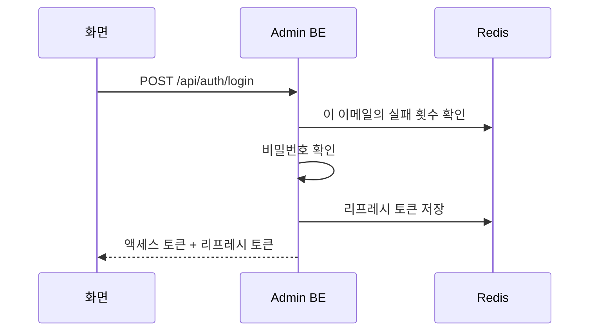
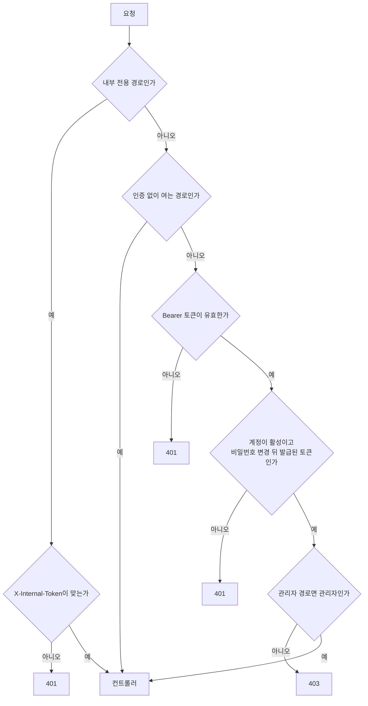

# 인증·보안

"이 요청을 보낸 사람이 누구이고, 이 일을 해도 되는가"를 확인하는 방법을 정리합니다. 인증 코드는 한 곳만 잘못 고쳐도 모두가 로그아웃되거나, 반대로 빼앗긴 로그인이 계속 살아 있는 사고로 이어집니다. 고치기 전에 이유까지 읽으세요.

## 한눈에 보기

| 항목 | 내용 |
| --- | --- |
| 로그인 방식 | JWT 토큰 두 개 — 액세스 토큰(짧음), 리프레시 토큰(긺) |
| 서버가 기억하는 것 | 리프레시 토큰만 Redis에 저장 (`RT:{사용자 번호}`) |
| 권한 | `USER`, `ADMIN`. `/api/admin/**`은 관리자만 |
| 로그인 잠금 | 이메일당 15분에 5번 틀리면 잠김 |
| 비밀번호를 바꾸면 | 그 전에 발급된 토큰이 모두 무효 |
| 서버끼리 호출 | 사용자 토큰이 아니라 내부 토큰(`X-Internal-Token`) |

## 1. 토큰 두 개

| | 액세스 토큰 | 리프레시 토큰 |
| --- | --- | --- |
| 쓰는 곳 | 모든 API 요청의 `Authorization: Bearer …` 헤더 | 액세스 토큰이 만료됐을 때 새로 받는 데 한 번 |
| 수명 | 짧다 (`jwt.access-token-expire-time`) | 길다 (`jwt.refresh-token-expire-time`) |
| 서버 저장 | 하지 않는다 | Redis에 저장 |
| 확인 방법 | 서명과 만료 시각 | 서명·만료 + Redis에 저장된 값과 같은지 |

토큰에는 사용자 번호가 들어 있고, HS256으로 서명합니다. 서명 키는 설정의 `jwt.secret`입니다.

두 개로 나눈 이유는 **속도**와 **끊을 수 있음**을 함께 얻기 위해서입니다. 액세스 토큰은 모든 요청에 붙으므로 저장소를 거치지 않고 서명만으로 확인합니다. 대신 서버가 강제로 끊을 방법이 없어서 수명을 짧게 둡니다. 리프레시 토큰은 Redis에 있으므로 지우면 그 사용자는 더 이상 로그인을 이어 가지 못합니다.

## 2. 로그인



- 같은 이메일로 15분 안에 다섯 번 틀리면 잠깁니다(`TOO_MANY_LOGIN_ATTEMPTS`). 성공하면 횟수가 지워집니다.
- 이메일이 없을 때와 비밀번호가 틀렸을 때의 응답은 같습니다. 응답 시간도 같게 맞춥니다.
- 비활성화된 계정이라는 안내는 **비밀번호가 맞은 뒤에만** 합니다. 먼저 알리면 아무 비밀번호로도 가입 여부를 알아낼 수 있습니다.
- 한 사용자에게 리프레시 토큰은 하나입니다. 다른 기기에서 로그인하면 앞선 기기의 리프레시 토큰은 쓸 수 없게 됩니다. 앞선 기기가 그 토큰으로 갱신을 시도하면 3절의 규칙에 따라 저장된 토큰까지 지워져, 양쪽 모두 다시 로그인해야 합니다.

## 3. 토큰 다시 받기

액세스 토큰이 만료되면 화면이 리프레시 토큰으로 새 토큰을 받습니다.

```
POST /api/auth/token-refresh
```

이때 **리프레시 토큰도 새것으로 바뀝니다.** 낸 토큰은 그 한 번만 통합니다.

| 상황 | 결과 |
| --- | --- |
| 낸 토큰이 Redis에 저장된 것과 같다 | 새 토큰 두 개를 발급하고 Redis의 값을 새것으로 바꾼다 |
| 낸 토큰이 저장된 것과 다르다 | 거절하고 **Redis의 토큰도 지운다** |
| 비밀번호를 바꾸기 전에 발급된 토큰이다 | 거절 |
| 계정이 비활성화됐다 | 거절 |

두 번째 줄의 이유: 서명은 맞는데 저장된 것과 다른 토큰은 **이미 한 번 쓰인 토큰**입니다. 본인과 토큰을 빼돌린 쪽 가운데 누가 먼저 썼는지 알 수 없으므로, 둘 다 다시 로그인하게 만듭니다. 지우지 않으면 빼돌린 쪽이 먼저 갱신한 뒤로 본인만 거절되고 그쪽은 계속 이어집니다.

"같은지 확인"과 "새것으로 바꾸기"는 Redis 안에서 한 번에 처리합니다. 따로 하면 같은 토큰으로 동시에 온 두 요청이 모두 통과합니다.

## 4. 로그아웃과 강제 로그아웃

**로그아웃 API는 없습니다.** 화면이 가지고 있던 토큰을 버리는 것으로 끝납니다.

서버가 리프레시 토큰을 지워 로그인을 끊는 경우는 다음과 같습니다.

| 때 | 이유 |
| --- | --- |
| 비밀번호가 바뀌었을 때 | 예전 비밀번호로 얻은 로그인을 끊는다 |
| 관리자가 비활성화·탈퇴시켰을 때 | 더 쓰지 못하게 한다 |

비밀번호를 바꾸면 리프레시 토큰을 지우는 것에 더해, **그 전에 발급된 액세스 토큰도 거절**합니다(`passwordChangedAt`보다 먼저 발급된 토큰인지 확인). 액세스 토큰은 서버에 저장하지 않아 지울 수 없으므로 이렇게 막습니다.

## 5. 요청마다 일어나는 일



필터 단계에서 거절할 때도 일반 오류와 **같은 모양**(`status`, `message`, `code`)으로 응답합니다. 화면은 `code`를 보고 "로그인 만료"와 "계정 비활성화"를 구분해 안내합니다.

### 인증 없이 여는 경로

`SecurityWhitelist.UNPROTECTED_PATHS`에 있습니다.

| 경로 | 이유 |
| --- | --- |
| `/` | 서버가 떠 있는지 확인 |
| `/api/auth/login`, `/api/auth/register` | 로그인 전에 부른다 |
| `/api/auth/token-refresh` | 액세스 토큰이 만료된 뒤에 부르므로 리프레시 토큰으로만 확인한다 |
| `/api/auth/email/**` | 가입 전 이메일 인증 |
| `/api/auth/password-reset-codes`, `/api/auth/password-resets` | 로그인하지 못하는 사용자가 쓴다 |
| `/actuator/health`, `/actuator/info` | 상태 확인. 그 밖의 `/actuator/**`는 관리자만 |
| `/swagger-ui/**`, `/v3/api-docs/**` | API 문서. 운영에서는 기능 자체가 꺼져 있다 |
| `/api/requests/config/**`, `/api/internal/**` | 사용자 토큰 대신 **내부 토큰**으로 확인한다 (6절) |

!!! warning "경로를 추가할 때"
    개인정보나 관리 기능이 있는 경로는 넣지 않습니다. 넣기 전에 "로그인하지 않은 누구나 이 응답을 볼 수 있어도 되는가"를 확인하고, PR에 이유를 적습니다. 대시보드 지표(`/api/monitoring/**`)도 예전에는 열려 있었지만 지금은 로그인이 필요합니다.

`/api/requests/config/check-username`(계정 이름 중복 확인)은 위 범위 안에 있지만 **예외로 로그인이 필요합니다.** 열어 두면 누구나 어떤 계정 이름이 쓰이는지 알아낼 수 있기 때문입니다.

## 6. 서버끼리의 호출

Admin BE와 config-server는 서로를 부릅니다. 이때는 사용자 토큰이 아니라 **내부 토큰**을 `X-Internal-Token` 헤더에 담습니다. 값은 설정의 `config.api-token`이고 양쪽이 같은 값을 씁니다.

| 방향 | 경로 | 용도 |
| --- | --- | --- |
| Admin BE → config-server | `/operations/**` 등 | 작업 등록과 결과 조회 |
| config-server → Admin BE | `/api/requests/config/**` | 컨테이너를 만들 때 신청 내용(이미지, 포트 등)을 다시 읽는다 |
| config-server → Admin BE | `/api/internal/slack/notify` | 인프라 알림을 Slack으로 보낸다 |

Admin BE는 내부 토큰이 **설정돼 있지 않으면 내부 경로를 모두 거절**합니다. 이 경로들은 비밀번호 해시 같은 값을 돌려주므로, 설정을 빠뜨렸을 때 열리는 쪽이 아니라 닫히는 쪽으로 만들었습니다.

토큰 값은 문서·로그·이슈에 적지 않습니다. 바꿀 때는 양쪽을 함께 다시 띄워야 합니다.

## 7. 권한

| 역할 | 할 수 있는 일 |
| --- | --- |
| `USER` | 자기 정보, 자기 신청과 변경 요청, 자기 컨테이너 재시작 |
| `ADMIN` | 위에 더해 `/api/admin/**` 전부 |

- 권한은 관리자가 화면에서 바꿉니다(`PATCH /api/admin/users/{id}/role`).
- **마지막 남은 활성 관리자**는 권한을 내리거나 비활성화·탈퇴시킬 수 없습니다(`LAST_ACTIVE_ADMIN`). 관리자가 한 명도 없으면 DB를 직접 고쳐야만 되살릴 수 있습니다.
- 사용자용 API는 **요청한 대상이 본인 것인지**를 서비스에서 확인합니다. 남의 신청 번호를 넣어 부르면 거절합니다.

## 8. 비밀번호

| 규칙 | 내용 |
| --- | --- |
| 길이 | 8~72자, 72바이트 이하 (한글은 한 글자가 3바이트) |
| 저장 | 원문은 저장하지 않는다. 웹용(BCrypt)과 리눅스용(SHA-512 crypt) 해시만 |
| 웹과 SSH | 같은 비밀번호 |
| 변경 | 본인 메일 인증 → 관리자 승인 → 컨테이너에 반영 → DB 변경 |

비밀번호 변경에 관리자 승인이 끼는 이유는, 변경이 웹 계정뿐 아니라 **떠 있는 컨테이너의 리눅스 계정**까지 바꾸는 인프라 작업이기 때문입니다. 사용자가 인프라를 직접 바꾸지 못하게 하고, 컨테이너에 반영된 것을 확인한 뒤에야 DB를 바꿔 웹과 SSH의 비밀번호가 어긋나지 않게 합니다.

## 9. 입력 검증

요청 DTO에서 형식을 확인하고, 맞지 않으면 400으로 돌려줍니다. 오류 응답에는 첫 번째 위반 사유 하나가 담깁니다.

### 우분투 계정 이름

이 이름은 리눅스 계정과 홈 폴더뿐 아니라 쿠버네티스 자원 이름에도 그대로 들어갑니다. 그래서 두 쪽의 규칙을 모두 만족해야 합니다.

| 규칙 | 이유 |
| --- | --- |
| 3~32자 | 리눅스 계정 이름의 한도 |
| 소문자로 시작, 소문자·숫자·하이픈만, 소문자나 숫자로 끝남 | 쿠버네티스 이름 규칙. 밑줄이 들어가면 생성 단계에서 실패한다 |

형식이 맞아도 아래와 겹치면 받지 않습니다.

| 겹치는 대상 | 응답 |
| --- | --- |
| 다른 사용자가 쓰는 계정 이름 | 409 `DUPLICATE_USERNAME` |
| 시스템이 쓰는 계정·그룹 이름 (`root`, `docker` 등) | 409 `UBUNTU_USERNAME_RESERVED` |
| 이미 있는 공유 그룹 이름 | 409 `UBUNTU_USERNAME_CONFLICTS_GROUP` |

리눅스에서는 계정마다 같은 이름의 개인 그룹이 생기므로, 계정 이름과 그룹 이름이 겹치면 계정 생성이 실패합니다. 승인한 뒤에야 실패하는 것을 막으려고 입력 단계에서 거릅니다.

시스템이 쓰는 이름의 목록은 **config-server가 원본**이고, Admin BE는 10분마다 받아 둡니다. 받아 오지 못하면 마지막으로 받은 목록을 계속 쓰고, config-server도 계정을 만들 때 한 번 더 거릅니다. 목록을 Admin BE 코드에 따로 적어 두지 않습니다.

### 그 밖의 규칙

| 대상 | 규칙 |
| --- | --- |
| 이메일 | 가입은 허용된 학교 도메인만 (`auth.allowed-email-domains`) |
| 전화번호 | 하이픈은 넣어도 빼도 되고, 저장할 때 `010-1234-5678` 모양으로 맞춘다 |
| 이름 | 콜론(`:`)과 줄바꿈 불가. 리눅스 계정 정보에 그대로 들어가기 때문 |

## 10. 그 밖의 보호 장치

| 장치 | 내용 |
| --- | --- |
| 횟수 제한 | 로그인, 인증 메일, 신청, 그룹 생성, 재시작 ([핵심 설계 패턴](핵심-설계-패턴.md) 8번) |
| 가입 여부 숨김 | 인증 메일·비밀번호 재설정·로그인 응답으로 가입 여부를 알 수 없게 ([핵심 설계 패턴](핵심-설계-패턴.md) 10번) |
| API 문서 끄기 | 운영에서는 Swagger를 켜지 않는다 |
| 실행 계정 | 컨테이너 이미지는 root가 아닌 계정으로 실행한다 |
| 로그 | 비밀번호·토큰·인증번호를 남기지 않고, 이메일은 가려서 남긴다 |
