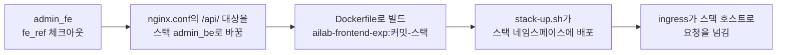

# 배포와 운영

Admin FE가 이미지로 만들어져 스택에 올라가는 과정, 이미지 안 nginx 설정의 이유, 문제가 생겼을 때 볼 곳을 설명합니다.

## 1. 배포 흐름

이 저장소에는 배포 워크플로가 없습니다. CI(`.github/workflows/ci.yml`)는 린트와 빌드만 하고, **배포는 admin_infra의 Deploy Proposed Stack 워크플로**가 합니다. 규칙 전문은 [브랜치·배포 규칙](../브랜치-규칙.md)에 있습니다.

| 단계 | 내용 |
| --- | --- |
| 입력 | 워크플로의 `fe_ref`. 실험 스택은 `main`이나 작업 브랜치, `operation`은 세 저장소에 같은 이름으로 찍은 릴리스 태그 `vX.Y.Z`만 받는다 |
| 대상 바꾸기 | `nginx.conf`의 `admin-prod.default.svc.cluster.local`을 `admin-prod.ailab-<스택>.svc.cluster.local`로 바꾼다 |
| 이미지 | `ailab-frontend-exp:<커밋 12자리>-<스택>`. 같은 커밋·같은 스택 이미지가 이미 있으면 빌드를 건너뛴다 |
| 배포 | admin_infra-proposed의 `ops/proposed-stack/stack-up.sh`가 `admin-fe.yaml`(Deployment·Service·Ingress)을 적용한다 |
| 접속 | 모든 스택이 같은 ingress 컨트롤러(HTTPS)로 들어오고, 호스트 이름으로 스택을 가른다. 주 주소는 `operation`으로 간다 |

스택마다 프록시 대상만 다를 뿐 코드는 같습니다. 그래서 스택 이름이 태그에 붙어 스택별로 따로 만들어집니다.

!!! warning "nginx.conf의 프록시 대상 이름을 바꾸지 않는다"
    워크플로는 `nginx.conf`에서 `admin-prod.default.svc.cluster.local`이라는 글자를 찾아 바꿉니다. 이 줄을 고치거나 다른 이름으로 바꾸면 "프록시 대상이 예상과 달라 중단"으로 배포가 멈춥니다. 바꿔야 한다면 admin_infra 워크플로를 같이 고칩니다.

### 운영 배포 순서

1. admin_fe에서 PR을 `main`에 squash 병합한다(CI 통과 필요).
2. 실험 스택(보통 `baseline`)에 `fe_ref=main`으로 배포해 화면을 확인한다.
3. 네 저장소에 같은 릴리스 태그 `vX.Y.Z`를 찍는다.
4. `operation`에 `ref`·`fe_ref`·`be_ref`를 모두 그 태그로 배포한다. 운영에는 실제 사용자가 있으므로 배포 전에 승인을 받는다.

화면만 바뀌었어도 `operation`은 세 저장소 태그가 같아야 하므로, 바뀌지 않은 저장소에도 같은 태그를 찍습니다.

## 2. 이미지

`Dockerfile`은 두 단계입니다.

| 단계 | 베이스 | 하는 일 |
| --- | --- | --- |
| 빌드 | `node:24-alpine` | `pnpm install --frozen-lockfile` 후 `pnpm build` |
| 실행 | `nginx:1.30-alpine` | `dist/`와 `nginx.conf`만 복사. Node는 들어가지 않는다 |

Node·pnpm 버전은 CI와 같게 맞춥니다. 다르면 CI가 통과한 것과 다른 도구로 배포 이미지를 만들게 됩니다. nginx 태그도 버전을 고정합니다.

`VITE_*` 환경 변수는 **빌드할 때** 코드에 들어갑니다. 이미지를 띄운 뒤 환경 변수로 바꿀 수 없습니다. 배포 이미지는 `.env.production`(API 주소 비움 → 같은 주소의 `/api/`)을 씁니다.

## 3. nginx 설정

`nginx.conf`는 화면 파일을 내려 주는 일 외에 보안과 캐시를 맡습니다. 줄마다 이유가 주석으로 달려 있으니, 고치기 전에 주석을 먼저 읽습니다.

### 경로별 처리

| 경로 | 처리 |
| --- | --- |
| `/api/` | 스택의 Admin BE로 넘긴다. `Origin` 헤더를 비워 CORS 검사를 거치지 않게 한다 |
| `/api/requests/config/**` (이름 중복 확인 제외), `/api/internal/**` | `404`. config-server 전용 API라 화면 밖으로 열지 않는다 |
| `/pod-status/` | `404`. config-server로 가던 옛 경로. 이제는 Admin BE가 대신 받아 준다 |
| `*.js`, `*.css`, 이미지 | 파일이 없으면 `index.html`이 아니라 `404` |
| 그 밖 | `index.html`. 화면 주소(`/admin/users` 등)는 브라우저 안의 라우터가 처리한다 |

### 보안 헤더

| 헤더 | 값과 이유 |
| --- | --- |
| `Content-Security-Policy` | 스크립트는 우리 번들과 Clarity, Google Analytics만 실행한다. 인라인 스크립트와 인라인 이벤트 핸들러는 막힌다. 로그인 토큰이 `localStorage`에 있어서다 |
| `X-Frame-Options: DENY`, `frame-ancestors 'none'` | 다른 사이트가 화면을 iframe에 넣지 못하게 한다 |
| `X-Content-Type-Options`, `Referrer-Policy`, `Permissions-Policy` | 일반적인 보호 헤더 |
| HSTS | 여기서 붙이지 않는다. 앞단 ingress가 붙인다 |

!!! note "외부 스크립트를 더할 때"
    분석 도구 같은 외부 스크립트를 더하거나 출처를 바꾸면 `src/pageBoot.js`와 `nginx.conf`의 `script-src`를 **함께** 고칩니다. 한쪽만 고치면 운영에서 스크립트가 조용히 막힙니다. `index.html`에 인라인 `<script>`나 `onload=`를 넣으면 CSP에 막히므로 `pageBoot.js`로 옮겨 씁니다.

### 캐시

| 대상 | 캐시 | 이유 |
| --- | --- | --- |
| `index.html` | `no-cache` | 해시가 붙은 JS·CSS 파일 이름을 담고 있다. 캐시하면 배포 뒤에도 옛 화면이 뜬다 |
| JS·CSS | 1년, `immutable` | Vite가 파일 이름에 내용 해시를 붙인다. 내용이 바뀌면 이름이 바뀐다 |
| `public/`의 이미지 | 7일 | 이름에 해시가 없다 |
| 오류 응답, `/api/` | 캐시 안 함 | |

`location` 안에 `add_header`를 하나라도 쓰면 `server` 단계의 헤더가 모두 사라지는 nginx 규칙이 있습니다. 그래서 캐시 값은 `map`으로 고르고 모든 헤더를 `server`에서 한 번만 붙입니다. 새 `location`에 `add_header`를 넣지 않습니다.

### 타임아웃

승인 같은 요청이 nginx 기본값(60초)에 끊기지 않도록 늘려 두었습니다. 안쪽일수록 짧아야 바깥이 먼저 끊어 원인이 가려지지 않습니다.

| 구간 | 값 |
| --- | --- |
| config-server | 500초 |
| Admin BE | 550초 |
| 이 nginx | 570초 |

## 4. 배포 뒤 확인

| 확인 | 방법 |
| --- | --- |
| 새 화면이 떴나 | 브라우저 강력 새로고침 후 개발자 도구 Network에서 `index-*.js` 이름이 바뀌었는지 |
| Pod 상태 | `kubectl -n ailab-<스택> rollout status deployment/ailab-frontend` |
| 로그인·주요 흐름 | 로그인 → 대시보드 → 신청 마법사 → 관리자 신청 관리까지 직접 눌러 본다 |
| 휴대폰 폭 | 개발자 도구 기기 모드로 사용자 대시보드와 신청 마법사 |

## 5. 막혔을 때

| 증상 | 원인과 조치 |
| --- | --- |
| 배포 워크플로가 "프록시 대상이 예상과 달라 중단" | `nginx.conf`의 `proxy_pass` 대상 이름이 바뀌었다. 1절 경고 참고 |
| 배포했는데 옛 화면이 보임 | 브라우저가 `index.html`을 캐시했는지(강력 새로고침), `fe_ref`가 맞는 커밋인지 워크플로 실행 제목에서 확인 |
| 모든 API가 `502`·`504` | 스택의 Admin BE(`admin-prod`)가 떠 있는지. 화면 Pod 문제가 아니다 |
| 특정 API만 `404` | 3절 표의 막힌 경로에 걸렸는지. 화면에서 config-server 전용 API를 부르고 있는 것이다 |
| 콘솔에 CSP 위반(`Refused to execute`) | 허용하지 않은 출처의 스크립트나 인라인 스크립트. 3절 "외부 스크립트를 더할 때" |
| 로그인 직후 화면이 하얗게 뜨고 콘솔에 모듈 로드 실패 | 배포 전부터 열어 둔 탭이 새 이미지에 없는 옛 JS 파일(로그인 뒤에 받는 콘솔 묶음)을 찾는 것. 새로고침하면 풀린다 |
| 승인 진행 안내가 끝나지 않음 | 화면 문제가 아니라 작업이 끝나지 않은 것. 관리자 신청 관리의 작업 단계 기록과 [infra 운영 매뉴얼](../infra/operations/운영-매뉴얼.md)을 본다 |
| 브라우저가 인증서 경고를 띄움 | 클러스터 인증서가 자체 서명이라 정상. 인증서 교체는 ingress 컨트롤러의 기본 인증서 Secret만 바꾸면 된다(저장소 `README.md`의 TLS 절) |
