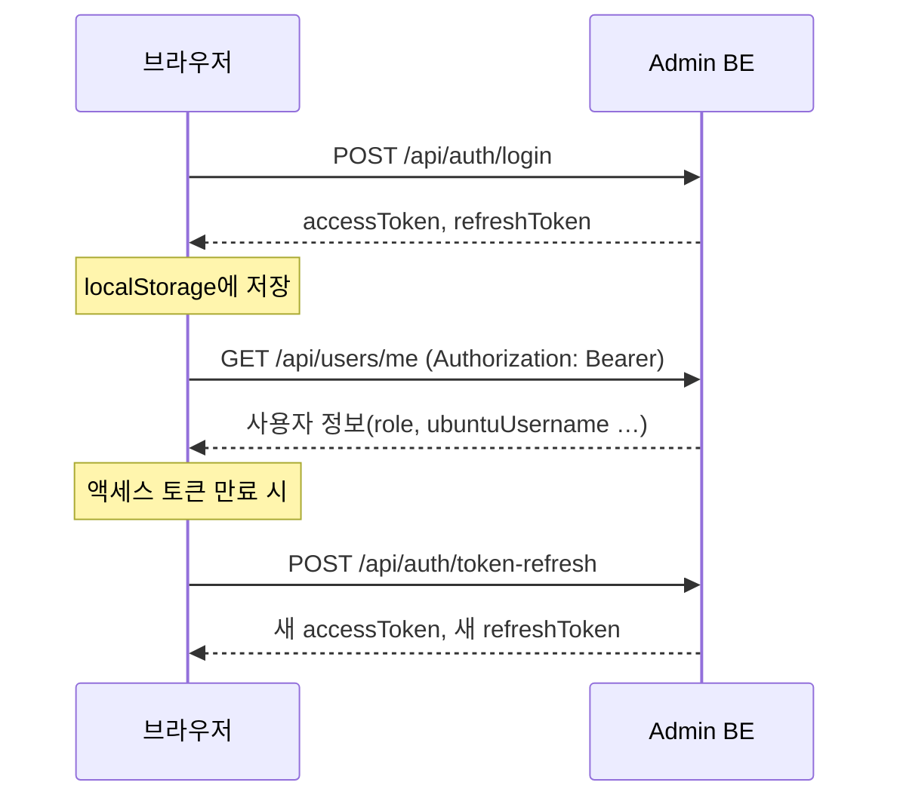

# 서버 연동과 인증

화면이 Admin BE를 부르는 방법, 로그인을 유지하는 방법, 오래 걸리는 작업의 결과를 기다리는 방법을 설명합니다. 서버 쪽 동작은 [backend 인증·보안](../backend/인증-보안.md)과 [backend 시스템 아키텍처](../backend/시스템-아키텍처.md)를 함께 봅니다.

## 1. API 클라이언트

모든 요청은 `src/services/api.js`의 `apiClient` 하나를 거칩니다. 화면이나 서비스 파일에서 `fetch`를 직접 쓰지 않습니다.

| 메서드 | 쓰임 |
| --- | --- |
| `get(path, params)` | 조회. `params`의 `null`·`undefined`는 쿼리에서 뺀다 |
| `post`, `put`, `patch` | 본문을 JSON으로 보낸다 |
| `delete(path)` | 삭제. 사유처럼 값이 필요하면 본문 대신 쿼리로 보낸다(중간 프록시가 DELETE 본문을 버릴 수 있다) |
| `request(path, options)` | 위로 안 되는 경우. `skipSessionExpiredCheck` 같은 옵션을 줄 때 |

성공하면 `{ status, data, headers }`를 돌려줍니다. 실패하면 아래 필드를 가진 `Error`를 던집니다.

| 필드 | 값 |
| --- | --- |
| `message` | Admin BE가 보낸 오류 문구. 없으면 `HTTP error! status: …` |
| `status` | HTTP 상태 코드. **네트워크 오류면 없다** |
| `code` | Admin BE의 오류 코드(`EXPIRED_ACCESS_TOKEN`, `ACCOUNT_DISABLED` …). [에러 코드 카탈로그](../backend/에러-코드-카탈로그.md) |
| `data` | 오류 응답 본문 전체 |

화면은 `status`가 있으면 서버 문구를 그대로 보여 주고, 없으면(연결 실패 등) 화면의 기본 문구를 씁니다. 서비스 파일들이 `if (error.status) throw error;`로 원본을 다시 던지는 것은 이 구분을 지키기 위해서입니다.

## 2. 로그인과 토큰

| 항목 | 내용 |
| --- | --- |
| 저장 위치 | `localStorage`의 `accessToken`, `refreshToken`. 키 이름과 저장 매체는 `services/tokenStorage.js`만 안다 |
| 붙이는 곳 | `apiClient`가 `/api/auth/` 밖의 모든 요청에 `Authorization: Bearer` 헤더를 붙인다 |
| 앱을 열 때 | 토큰 둘이 다 있으면 `/api/users/me`로 확인한다. 실패하면 토큰을 지우고 로그인 화면으로 |
| 로그인 상태 | `contexts/AuthContext.jsx`. 화면에서는 `useAuth()`로 `user`, `isAuthenticated`, `login`, `logout`, `updateUser`를 받는다 |

!!! warning "토큰이 localStorage에 있다"
    화면에 다른 스크립트가 끼어들면 토큰을 그대로 읽어 갈 수 있습니다. 그래서 nginx가 인라인 스크립트와 허용하지 않은 출처의 스크립트를 막습니다([배포와 운영](배포-운영.md) 3절). `dangerouslySetInnerHTML`, `eval`, 인라인 `onclick` 같은 코드를 넣지 않습니다.

### 토큰 갱신

액세스 토큰이 만료되면 `apiClient`가 리프레시 토큰으로 새 토큰을 받고 원래 요청을 이어 보냅니다. 갱신은 두 경우에 일어납니다.

| 경우 | 동작 |
| --- | --- |
| 보내기 전에 토큰의 `exp`가 이미 지났다 | 먼저 갱신하고 새 토큰으로 보낸다 |
| 보냈더니 서버가 `401` + `EXPIRED_ACCESS_TOKEN` | 브라우저와 서버의 시계 차이다. 한 번만 갱신하고 다시 보낸다 |

리프레시 토큰은 **한 번 쓰면 새것으로 바뀝니다.** 그래서 동시에 갱신하면 늦은 쪽이 거절돼 로그아웃됩니다. 이를 막는 장치가 두 겹입니다.

1. 같은 탭 안에서 동시에 온 요청은 진행 중인 갱신 하나를 함께 기다린다(`refreshInFlight`).
2. 탭끼리는 브라우저 잠금(`navigator.locks`, 이름 `decs-token-refresh`)으로 한 번에 한 탭만 갱신한다. 잠금을 기다리는 사이 다른 탭이 이미 갱신했으면 그 토큰을 쓴다.

갱신을 기다리는 사이 사용자가 로그아웃했거나 다른 계정으로 로그인했다면 받은 토큰을 버립니다. 저장하면 끝낸 세션이 되살아나기 때문입니다.

### 세션이 끝날 때

갱신까지 `401`로 거절되면 세션이 끝난 것입니다. `apiClient`가 `sessionEventManager`로 알리고, `AuthContext`가 토큰을 지운 뒤 "다시 로그인이 필요합니다" 창을 띄웁니다. 오류 코드가 `ACCOUNT_DISABLED`면 "계정 비활성화" 창을 띄우고 로그인 화면으로 보내지 않습니다. 네트워크 오류나 서버 장애로 갱신하지 못한 것은 세션 만료로 보지 않습니다.

### 로그인 직후 강제 창

우분투 유저네임이 없는 계정은 컨테이너를 신청할 수 없습니다. 그래서 `AuthContext`가 로그인 직후 **닫을 수 없는 창**으로 등록을 요구합니다. 관리자 계정도 예외가 아닙니다. 입력 규칙은 `components/Auth/UbuntuUsernameRegisterForm.jsx`가 가입 화면, 마이페이지와 함께 씁니다. 서버 규칙과 반드시 같아야 하므로 이 컴포넌트 하나만 고칩니다.

## 3. 작업 등록 후 결과 확인

승인, 재시작처럼 컨테이너를 실제로 만드는 일은 Admin BE가 config-server에 **작업을 등록만 하고 바로 `202`로 돌아옵니다.** 끝났는지는 화면이 몇 초마다 다시 물어 확인합니다. 응답이 `200`이면 작업 없이 바로 끝난 것입니다.

| 작업 | 시작 API | 결과를 보는 곳 | 간격 / 한도 | 코드 |
| --- | --- | --- | --- | --- |
| 신청 승인 | `POST /api/admin/requests/{id}/approval` | 신청 상태 `GET /api/admin/requests/{id}` + 진행 단계 `…/provisioning-status` | 3초 / 없음 | `admin/RequestManagementPage.jsx` |
| 컨테이너 이동 | `POST /api/admin/requests/{id}/migrations` | `…/migrations/latest` | 3초 / 15분 | `utils/migrationResult.js` |
| 재시작(관리자) | `POST /api/admin/requests/{id}/restarts` | `…/migrations/latest` | 3초 / 15분 | `components/RestartContainerModal.jsx` |
| 재시작(사용자) | `POST /api/requests/{id}/restarts` | `GET /api/requests/{id}/restarts/latest` | 3초 / 15분 | 위와 같음 |
| 그룹 멤버 추가·제거 | 사용자 관리의 그룹 창 | `GET /api/groups/operations/{id}` | 1.5초 / 3분 | `services/groupOperation.js` |
| 변경 요청 승인 | `POST /api/admin/change-requests/{id}/approval` | 변경 요청 목록 다시 읽기 | 3초 | `admin/ChangeRequestManagementPage.jsx` |

### 승인 판정 규칙

승인 결과는 **신청 상태로만** 판정합니다. 진행 단계의 `ready`는 컨테이너가 막 만들어진 시점이고, 접속 확인은 그 뒤에 돌기 때문입니다.

| 신청 상태 | 화면 안내 |
| --- | --- |
| `FULFILLED` | 완료 |
| `PENDING`으로 돌아옴 | 실패. 진행 단계의 실패 사유를 함께 보여 주고 다시 승인하라고 안내 |
| `DENIED` | 처리 중에 거절됨 |
| `PROCESSING`인데 진행 단계가 `failed`로 3번 연속 | 자동 복구되지 않은 실패. 자원이 남아 있을 수 있으니 **다시 승인하지 말고** 확인하라고 안내 |

목록에 `PROCESSING` 신청이 있으면(다른 관리자가 승인했거나 내가 새로고침한 경우) 화면을 열자마자 그 신청의 폴링을 이어 갑니다.

### 폴링 코드를 쓸 때 지킬 것

기존 코드가 이미 겪은 문제들입니다.

- **끝나면 멈춘다.** 끝난 뒤에도 같은 결과가 계속 오므로, 멈추지 않으면 3초마다 목록이 다시 그려지며 깜빡인다.
- **늦게 온 응답이 새 값을 덮지 않게 한다.** 응답을 받은 뒤에만 다음 요청을 예약하거나(`ContainerDetail`), 요청마다 번호를 매겨 가장 최근 것만 반영한다(`RequestManagementPage`의 `fetchSeqRef`).
- **화면을 떠나면 멈춘다.** `useEffect` 정리 함수에서 `cancelled = true`와 타이머 해제를 한다.
- **한 번의 조회 실패로 판정하지 않는다.** 다음 바퀴에 다시 본다.
- **한도에 걸려도 작업은 서버에서 계속 돈다.** 시간이 지나면 "아직 끝나지 않았다"고 안내하고, 실패로 단정하지 않는다.

## 4. 화면이 부르지 않는 길

| 경로 | 이유 |
| --- | --- |
| config-server 직접 호출 | config-server에는 인증이 없다. 진행 단계는 Admin BE가 관리자 확인 뒤 대신 받아 준다 |
| `/api/internal/**`, `/api/requests/config/**` | config-server가 Admin BE를 부르는 내부용 API. 사용자 비밀번호 정보를 돌려주는 조회가 섞여 있어 nginx가 404로 막는다. 예외는 신청 화면의 이름 중복 확인(`check-username`) 하나 |

새 화면에서 이런 정보가 필요하면 Admin BE에 관리자 전용 API를 만들고 그것을 부릅니다.
