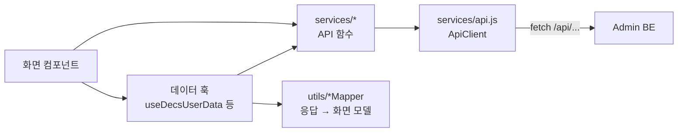

# 화면과 코드 구조

어떤 화면이 어느 파일에 있고, 서버의 데이터가 어떤 길을 거쳐 화면에 그려지는지 설명합니다.

## 1. 디렉터리

```text
src/
├── main.jsx            진입점. pageBoot → CSS → i18n → App 순서로 불러온다
├── pageBoot.js         글꼴 적용과 방문 분석 스크립트 로드 (index.html의 인라인 스크립트를 옮긴 것)
├── App.jsx             최상위 라우팅. 로그인 여부와 권한으로 /user, /admin을 가른다
├── i18n.js             한국어·영어 설정
├── locales/            ko.json, en.json — 화면 문구
├── contexts/           AuthContext — 로그인 상태와 전역 모달
├── hooks/              useAuth, 대시보드 데이터 훅, 탭 제목 훅
├── services/           API 호출. 화면은 fetch를 직접 쓰지 않고 여기를 거친다
├── utils/              서버 응답 → 화면 모델 변환, 입력 검사, 작업 대기
├── components/         여러 화면이 함께 쓰는 모달과 폼
├── pages/              화면
│   ├── auth/                    로그인, 가입, 비밀번호 재설정
│   ├── decs-console/admin/      관리자 콘솔 틀과 대시보드·컨테이너 화면
│   ├── decs-console/user/       사용자 포털 틀과 대시보드·신청 마법사·내 컨테이너
│   ├── admin/                   관리자 콘솔 안의 관리 화면(신청, 변경 요청, 사용자, 이미지, 안내 문구)
│   └── *.jsx                    사용자 포털 안의 화면(신청 현황, 변경 요청, 마이페이지, 모니터링)
└── design-system/      DECS 화면 부품과 색·간격 토큰
```

폴더가 기능별로 깔끔하게 나뉘어 있지는 않습니다. 관리자 콘솔의 화면이 `decs-console/admin/`과 `admin/` 두 곳에 있는 것은 콘솔 틀을 새로 만들면서 기존 관리 화면을 옮기지 않고 끼워 넣었기 때문입니다. 새 화면을 어디에 둘지는 아래 표를 기준으로 정합니다.

## 2. 라우팅

라우팅은 두 단계입니다. `App.jsx`가 큰 영역을 고르고, 각 영역의 틀(`AdminConsoleApp`, `UserPortalApp`)이 그 안의 화면을 고릅니다.

| 주소 | 들어가는 조건 | 화면 |
| --- | --- | --- |
| `/login`, `/signup`, `/password-reset` | 로그인 **안 한** 상태. 로그인했으면 홈으로 보낸다 | `pages/auth/` |
| `/user/*` | 로그인 | `UserPortalApp` |
| `/admin/*` | 로그인 + `role === "ADMIN"`. 아니면 `/user`로 보낸다 | `AdminConsoleApp` |
| `/` | — | 권한에 맞는 홈 또는 `/login` |
| 그 밖 | — | 404 화면 |

로그인·권한 확인은 `components/Auth/ProtectedRoute.jsx`가 합니다. 다만 이것은 **화면을 가리는 것일 뿐 보안 장치가 아닙니다.** 관리자 API의 권한은 Admin BE가 매 요청마다 확인합니다. 화면 쪽 검사는 일반 사용자가 쓸 수 없는 메뉴를 보지 않게 하는 용도입니다.

두 영역의 틀은 로그인 뒤에만 필요하므로 `lazy()`로 따로 묶어, 로그인 화면을 열 때는 내려받지 않습니다.

### 사용자 포털 (`/user`)

| 주소 | 파일 | 하는 일 |
| --- | --- | --- |
| `/user` | `decs-console/user/UserDashboard.jsx` | 만료가 가장 가까운 컨테이너, 경고 현황, 최근 신청 3건 |
| `/user/container` | `decs-console/user/UserContainerDetail.jsx` | 내 컨테이너 접속 정보(SSH, Jupyter, 추가 포트), 재시작 |
| `/user/request` | `decs-console/user/RequestWizard.jsx` | 신청 마법사: 사용 목적 → 서버 → GPU → 기간 → 개발 환경 → 확인 |
| `/user/requests` | `RequestStatusPage.jsx` | 내 신청 목록, 대기 중인 신청 취소 |
| `/user/change-requests` | `MyChangeRequestsPage.jsx` | 변경 요청을 내는 유일한 화면과 그 목록 |
| `/user/monitoring` | `ResourceMonitoringPage.jsx` | 서버별 GPU 사용률과 활성 컨테이너 수 |
| `/user/account` | `AccountPage.jsx` | 전화번호, 자주 사용하는 이메일, 우분투 유저네임(미등록 시) |

승인을 기다리는 신청(`PENDING`·`PROCESSING`)이 이미 있으면 `/user/request`는 마법사 대신 안내만 보여 줍니다. 서버가 그런 신청을 한 건만 허용하기 때문입니다.

### 관리자 콘솔 (`/admin`)

| 주소 | 파일 | 하는 일 |
| --- | --- | --- |
| `/admin` | `decs-console/admin/AdminDashboard.jsx` | GPU 사용률, 컨테이너 상태 분포, 만료 예정, 최근 활동 |
| `/admin/containers` | `decs-console/admin/ContainerManagement.jsx` | 실행 중인 컨테이너 목록 |
| `/admin/containers/:id` | `decs-console/admin/ContainerDetail.jsx` | Pod 상세·로그·이벤트, 다른 노드로 이동, 재시작, 컨테이너 회수 |
| `/admin/requests` | `admin/RequestManagementPage.jsx` | 신청 승인·거절, 승인 진행 상황, 작업 단계 기록(`JobStepsTimeline`) |
| `/admin/change-requests` | `admin/ChangeRequestManagementPage.jsx` | 변경 요청 승인·거절 |
| `/admin/users` | `admin/UserManagementPage.jsx` | 비활성화, 권한 변경, 경고, 그룹, 비밀번호 초기화, 우분투 계정 회수 |
| `/admin/images` | `admin/ImageManagementPage.jsx` | 신청할 때 고르는 컨테이너 이미지 목록 |
| `/admin/message-templates` | `admin/MessageTemplatePage.jsx` | 메일·Slack 안내 문구 수정과 기본값 복원 |

`:id`는 **신청 번호**입니다. 한 사람이 컨테이너를 여러 개 가질 수 있어 우분투 유저네임으로는 컨테이너를 구별할 수 없기 때문입니다.

!!! warning "회수 버튼 두 가지"
    컨테이너 상세의 회수는 **그 컨테이너 하나만** 지웁니다(`DELETE /api/admin/requests/{id}/container`). 사용자 관리의 우분투 계정 회수는 그 사람의 **컨테이너 전부와 계정**을 지웁니다(`DELETE /api/admin/users/{id}/ubuntu-account`). 새 버튼을 만들 때 둘을 바꿔 부르지 않습니다.

## 3. 데이터가 화면까지 오는 길



| 층 | 하는 일 | 하지 않는 일 |
| --- | --- | --- |
| `services/api.js` | 토큰 붙이기, 토큰 갱신, 오류를 `Error`로 바꾸기, 세션 만료 알리기 | 화면 문구, 데이터 가공 |
| `services/*Service.js` | API 하나당 함수 하나. 경로와 요청 본문 모양을 여기서만 안다 | 화면 상태 |
| `utils/decsMapper.js` 등 | 서버 응답을 화면이 쓰는 모양으로 바꾼다. 상태 이름 → 표시 색·문구, NodePort → 접속 명령 | API 호출 |
| `hooks/useDecs*Data.js` | 대시보드처럼 여러 API를 한꺼번에 불러 묶는 화면용 | 단일 화면 전용 조회(그런 것은 화면 안에서 직접 부른다) |

상태 관리 라이브러리(Redux 등)는 쓰지 않습니다. 전역 상태는 로그인 정보(`AuthContext`) 하나이고, 나머지는 각 화면이 `useState`로 들고 있다가 필요할 때 다시 불러옵니다.

### 응답 모양

Admin BE는 거의 모든 응답을 `{ status, message, data }`로 감싸 보냅니다. `apiClient`는 HTTP 응답을 `{ status, data, headers }`로 돌려주므로 실제 값은 **`response.data.data`**에 있습니다. 일부 화면은 둘 다 받아 주기 위해 `res?.data?.data ?? res?.data` 형태로 읽습니다.

### 부분 실패를 견딘다

대시보드 훅은 API 여러 개를 `Promise.allSettled`로 동시에 부릅니다. 하나가 실패해도 나머지는 그대로 그리고, 실패한 항목만 경고 띠(`Flashbar`)에 이름을 적어 알립니다. 새 조회를 더할 때도 이 방식을 유지합니다. 경고 현황처럼 안내용인 값은 실패해도 아무것도 띄우지 않습니다.

### 상태 표시는 한 곳에서

신청 상태(`PENDING`, `FULFILLED` …), Pod 상태(`Running`, `CrashLoopBackOff` …), 생성 진행 단계(`creating_pod` …)를 화면 색과 문구로 바꾸는 표는 `utils/decsMapper.js`의 `STATUS_MAP` 하나입니다. Admin BE나 config-server에 새 상태가 생기면 이 표에 한 줄을 더합니다. 표에 없는 값은 원래 문자열 그대로, 회색으로 보입니다.

### 접속 정보 만들기

SSH 명령과 Jupyter 주소는 화면이 직접 만듭니다. 서버(FARM, LAB)마다 공인 주소와, NodePort를 밖에서 접속하는 포트로 바꾸는 규칙이 달라서 그 값을 `src/utils/publicEndpoint.js` 한 곳에 둡니다. 서버가 늘거나 방화벽 포트 대역이 바뀌면 이 파일만 고칩니다. 바꾸는 대역 밖의 NodePort는 밖에서 닿지 않으므로 주소를 안내하지 않습니다.

## 4. 신청 마법사와 변경 요청

### 신청 마법사

`RequestWizard.jsx`는 여섯 단계 화면이고, 마지막에 `UserPortalApp`의 `toRequestPayload`가 입력을 `POST /api/requests` 본문으로 바꿉니다. 몇 가지 규칙은 서버와 같은 값을 화면에도 두어, 제출하기 전에 걸러 줍니다.

| 규칙 | 화면 쪽 위치 | 최종 판정 |
| --- | --- | --- |
| 사용 목적 최소 글자 수 | `RequestWizard.jsx` 상단 상수 | Admin BE `SaveRequestRequestDTO` |
| 그룹을 새로 만들면 바로 생기고, 리눅스 그룹은 승인 때 만들어진다 | 마법사 그룹 단계 | Admin BE |
| Slack 미가입자 안내 | `SlackMembershipModal`, 마법사 안내 | 신청할 때 Admin BE가 다시 확인 |

### 변경 요청 등록표

변경 요청 종류는 `pages/decs-console/user/changeRequest/changeRequestTypes.js`의 `CHANGE_REQUEST_TYPES` 한 곳에 모여 있습니다. 항목마다 입력 폼, 처음 값, 검사, 서버로 보낼 값(`newValue`) 변환이 들어 있고, 창(`ChangeRequestModal`)은 종류를 모릅니다.

| 종류 | 보내는 값 |
| --- | --- |
| `EXPIRES_AT` | 새 만료일 `YYYY-MM-DDT23:59:59` |
| `GROUP` | 승인 뒤 계정이 갖게 될 **그룹 전체**의 gid 목록 |
| `PORT` | 승인 뒤 열려 있을 **추가 포트 전체**. 빈 목록이면 모두 닫는다 |
| `PASSWORD` | 계정 단위라 대상 컨테이너가 없다. 메일 인증을 거치는 별도 폼(`PasswordResetForm`)이 직접 낸다 |

새 종류를 더할 때는 폼 컴포넌트 하나와 등록표 한 항목만 추가합니다. SSH·Jupyter·noVNC 포트(22, 8888, 6080)처럼 바꿀 수 없는 값은 `changeRequestRules.js`에 있고, 최종 판정은 Admin BE가 합니다.

## 5. 시간대

Admin BE는 시각을 **시간대 없이** 주고받습니다(`2026-10-14T23:59:59`). `Date.toISOString()`은 UTC로 바꿔 아홉 시간을 밀어 버리므로, 서버로 보내는 시각은 `requestService.js`의 `toLocalDateTime` 같은 현지 시각 변환을 씁니다. 날짜 입력칸의 값은 `changeRequestRules.js`의 `toLocalDateInput`으로 만듭니다.
