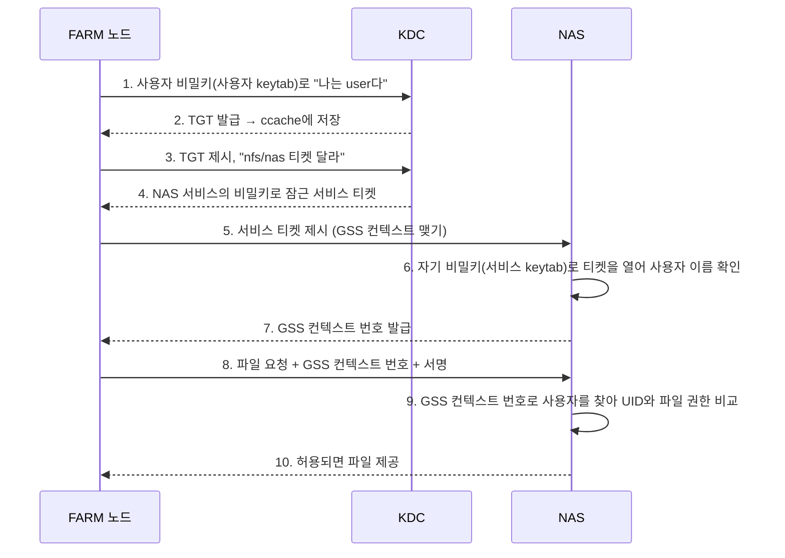
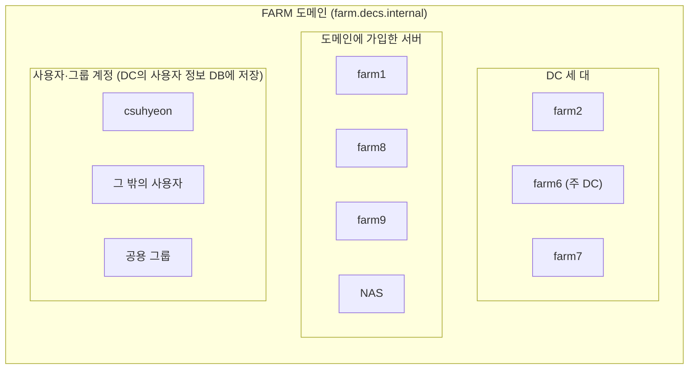
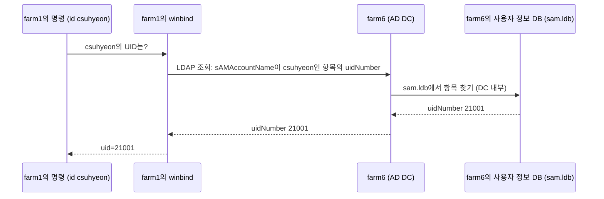
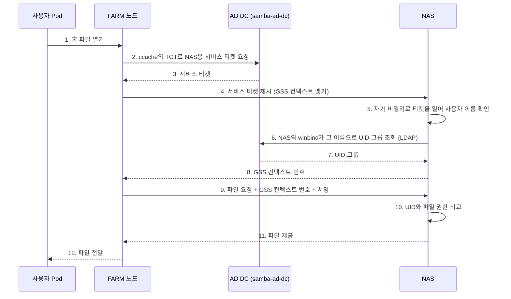
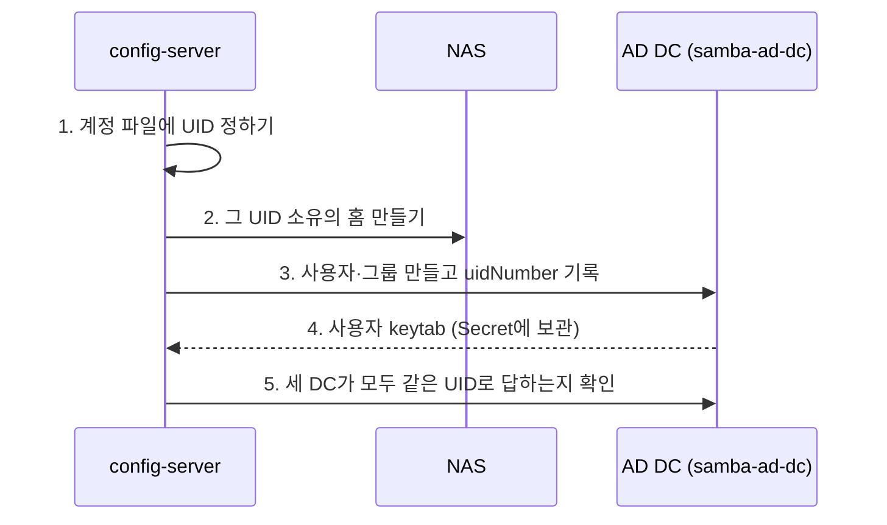
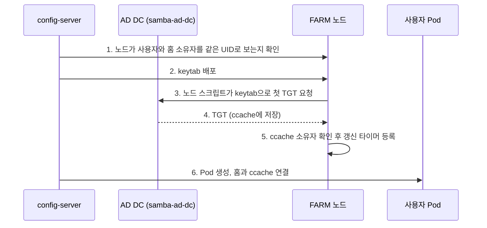
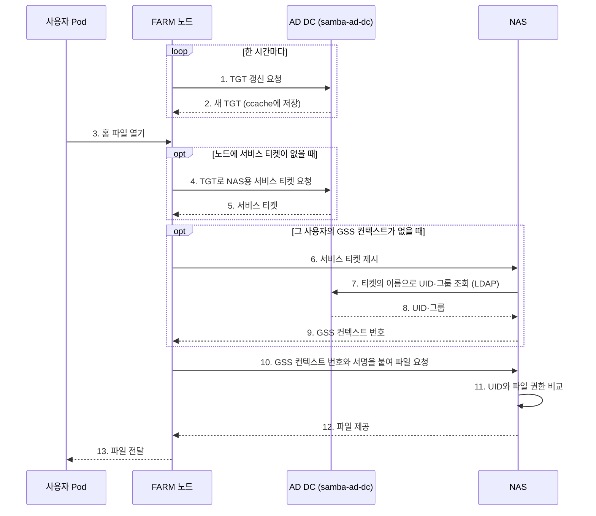
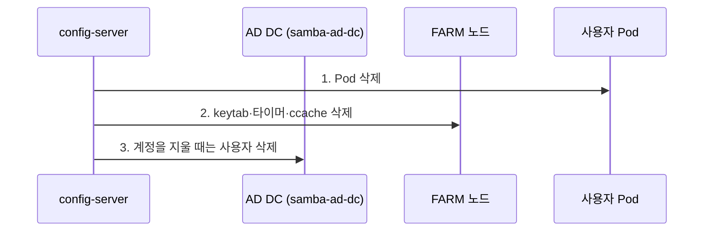
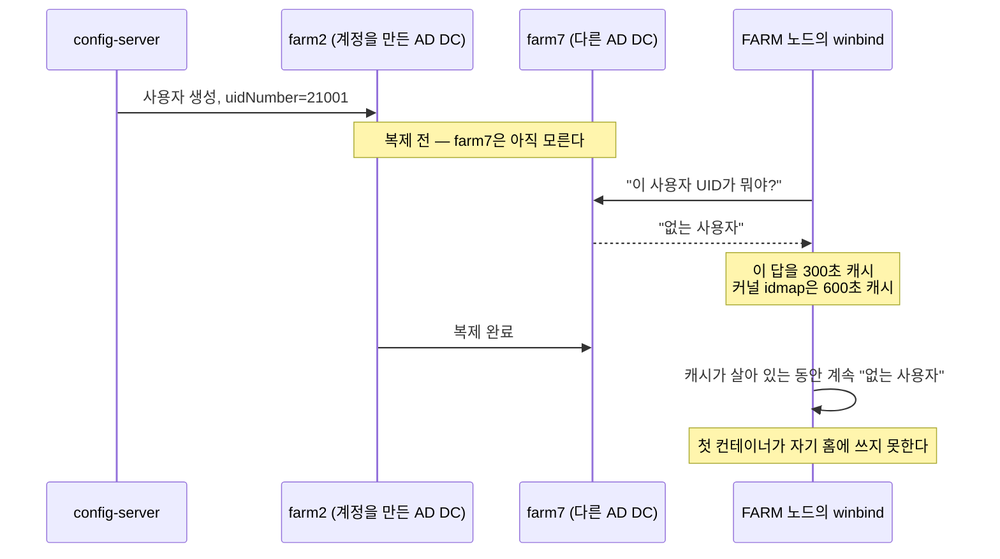
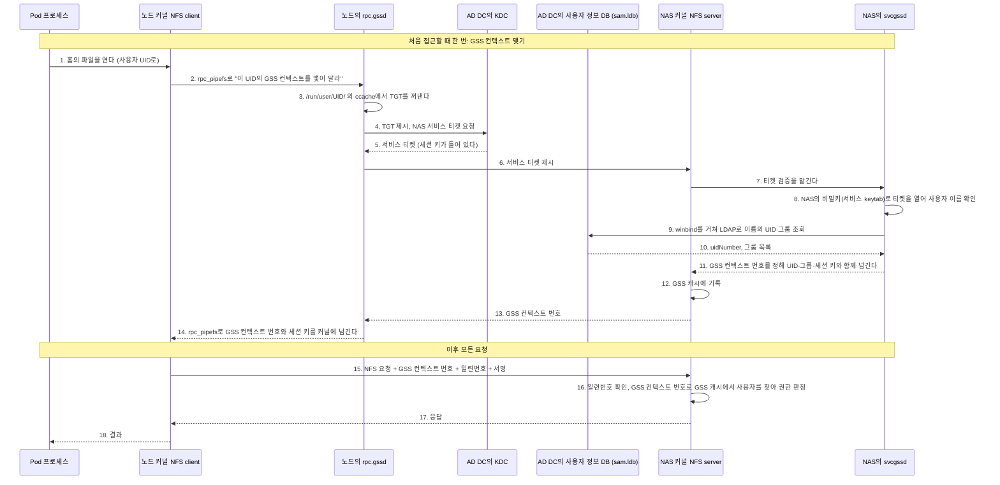

# Kerberos, AD, Samba

## 이 문서에서 다루는 내용

- 홈 디렉터리를 쓰는데 Kerberos가 필요한 이유
- Kerberos와 AD(Active Directory), Samba는 무엇이고 서로 어떤 연관이 있는지 설명

세 가지를 먼저 요약하면 다음과 같다.

| 이름 | 요약 |
| --- | --- |
| Kerberos | 비밀번호 대신 **티켓**으로 "내가 누구인지" 증명하는 인증 방식 |
| AD | 사용자·그룹 정보와 Kerberos 티켓 발급 기능을 한 서버에 묶어 둔 **중앙 계정 관리 시스템** |
| Samba | 원래는 Windows와 리눅스 사이에서 파일을 공유하게 해 주는 소프트웨어. 이 시스템에서는 파일 공유가 아니라 **리눅스 서버를 AD 서버로 만들고, NAS와 노드를 그 AD에 가입시키는 데** 쓴다 |

**읽는 순서:** [NFS, RPC, GSS](NFS-RPC-GSS.md)를 먼저 읽는다. 홈 파일 요청이 NAS에서 처리되는 과정, `sec=krb5`, GSS 컨텍스트를 그 문서에서 설명하고, 이 문서는 GSS 컨텍스트를 맺을 때 쓰는 Kerberos 티켓과 사용자 이름을 UID로 바꾸는 AD를 설명한다.

## 참고

| 필요할 때 | 문서 |
| --- | --- |
| NFS 요청 경로, 마운트 옵션, GSS 컨텍스트를 본다 | [NFS, RPC, GSS](NFS-RPC-GSS.md) |
| 다른 배경 용어를 찾아본다 | [기초 개념](기초-개념.md) |
| config-server가 AD에 하는 작업의 순서를 본다 | [시스템 아키텍처](시스템-아키텍처.md) 3.3절 |
| keytab, ccache의 위치와 운영 절차를 본다 | [kdc-setup](../kdc-setup/index.md) |
| 티켓이 NFS 요청으로 바뀌는 12단계, KVNO, SPN을 본다 | [Kerberos/NFS 설계](../../system/kerberos-nfs/design.md) |
| AD DC, NAS, 노드를 처음부터 구성하는 절차를 본다 | [FARM Kerberos 설정 가이드](../../system/kerberos-nfs/farm-setup.md) |

## 1. 왜 Kerberos가 필요한가

사용자 홈은 NAS에 있다. FARM 노드가 NAS를 NFS로 마운트하고, 그 경로를 hostPath로 사용자 Pod의 `/home`으로 넘겨준다. 문제는 NFS가 기본 설정(`sec=sys`)에서 **요청한 사람이 누구인지 확인하지 않는다**는 점이다. 클라이언트가 "나는 UID 21001이다"라고 보내면 NAS는 그대로 믿으므로, 한 노드에서 root 권한을 얻은 사람이 UID만 바꿔 다른 사람의 홈을 읽을 수 있다. 그래서 홈을 `sec=krb5`로 마운트하고, NAS는 Kerberos 티켓으로 요청자를 확인한다. 두 방식의 차이는 [NFS, RPC, GSS](NFS-RPC-GSS.md) 2장에서 그림으로 확인할 수 있다.

대신 비용이 생긴다. **어떤 사용자가 홈을 쓰려면 그 사용자의 유효한 티켓이 노드에 항상 있어야 한다.** config-server의 Kerberos 관련 단계는 전부 이 티켓을 만들고 유지하는 일이다.

## 2. Kerberos는 어떻게 동작하나

### 2.1 놀이공원에 비유하면

1. 입구 매표소에서 신분증을 **한 번만** 보여 주고 자유이용권 팔찌를 받는다. 팔찌에는 매표소에서만 찍을 수 있는 도장과 유효 시간이 있다.
2. 놀이기구를 타려면 공원에 하나뿐인 발권기에 팔찌를 보여 주고 **그 기구 전용 탑승권**을 받는다. 탑승권에는 발권기와 그 기구의 직원만 아는 도장이 찍혀 있다.
3. 손님이 탑승권을 내밀면 직원은 도장만 확인하고 태운다. 매표소에 전화하지 않고, 손님의 신분증도 보지 않는다.

실제 Kerberos는 다음과 같이 동작한다.

1. 사용자가 자기 비밀키로 KDC에 신원을 증명하고 TGT를 받는다. 사용자의 비밀키는 이 단계에서만 쓰인다.
2. NAS의 NFS 서비스를 쓰려면 KDC에 TGT를 제시하고 그 서비스 전용 서비스 티켓을 받는다. KDC는 이 티켓을 그 서비스의 비밀키로 잠가서 준다.
3. 사용자가 서비스 티켓을 서비스에 제시하면, 서비스는 자기 비밀키로 티켓을 열어 본다. 열리면 KDC가 발급한 진짜 티켓이므로, KDC에 다시 묻지 않고 사용자를 확인한다.

| 비유 | Kerberos 용어 | 이 시스템에서 |
| --- | --- | --- |
| 놀이공원 전체 | **Realm** - 인증 관리 영역 | `FARM.DECS.INTERNAL` |
| 입장객, 놀이기구 | **Principal** - Kerberos에 등록된 이름 | 사용자 `<user>@FARM.DECS.INTERNAL`, NAS `nfs/nas.farm.decs.internal@FARM.DECS.INTERNAL` |
| 매표소 + 발권기 | **KDC**(Key Distribution Center) - 티켓을 발급하는 서버 | AD 서버(DC)가 KDC 역할도 한다(3장) |
| 자유이용권 팔찌 | **TGT**(Ticket Granting Ticket) - 다른 티켓을 받을 때 쓰는 티켓 | 노드의 ccache 파일에 저장된다 |
| 놀이기구 탑승권 | **서비스 티켓** - 그 서비스의 비밀키로 잠겨 있다 | NAS에 제시하는 `nfs/nas.farm.decs.internal@FARM.DECS.INTERNAL`용 티켓 |
| 손님의 신분증 | **사용자 keytab**(key table) - 사용자의 비밀키를 저장한 **파일**. 비밀키는 계정의 비밀번호로 만든 암호 키이고, KDC도 같은 비밀키를 AD DB에 갖고 있다. keytab은 그 키 자체가 아니라 키를 꺼내 담아 둔 파일이다. 유출되면 비밀번호가 유출된 것과 동일하다 | 노드 `/etc/decs-krb/keytabs/<user>.keytab`. root만 읽을 수 있다 |
| 직원이 도장을 확인하는 도구 | **서비스 keytab** - 서비스의 비밀키를 저장한 **파일** | NAS `/etc/nfs/krb5.keytab` |
| 팔찌와 탑승권을 넣는 지갑 | **ccache**(credential cache) - 받은 티켓을 저장하는 파일 | 노드 `/run/user/<uid>/krb5cc_ailab` |

### 2.2 티켓을 받아 NAS에 접근하는 과정



그림의 "FARM 노드"와 "NAS" 안에서 실제로 일하는 프로그램은 단계마다 다르다. 노드 쪽은 1~2단계를 노드 관리 스크립트(`ailab-krb5-admin`)가, 3~5단계를 `rpc.gssd`가, 8단계를 노드 커널이 맡는다. NAS 쪽 6단계는 `svcgssd`가 맡는다. 이 프로그램들까지 나눠 그린 그림은 [NFS, RPC, GSS 4.1절](NFS-RPC-GSS.md#gss-context)에 있고, 거기에 Kerberos와 AD까지 더한 그림은 [5.5절](#gss-establish)에 있다.

네트워크에는 잠긴 티켓만 오가고 비밀번호나 키는 오가지 않는다. 티켓에는 시각이 들어 있어서 서버끼리 시계가 5분 넘게 어긋나면 거부된다.

1~2단계는 TGT를 미리 받아 두는 과정이다. Pod를 만들 때 노드가 keytab으로 첫 TGT를 받아 ccache에 저장하고, 그 뒤로는 노드의 갱신 타이머가 한 시간마다 확인해 만료되지 않게 유지한다.

3~7단계는 사용자가 NAS에 처음 접근할 때 한 번 일어난다. 사용자 프로세스는 파일을 열기만 하고 티켓은 노드가 챙긴다. 노드 커널이 NAS에 보낼 요청을 만들다가 그 사용자의 GSS 컨텍스트가 없으면, 노드의 `rpc.gssd` 프로그램이 ccache의 TGT로 서비스 티켓을 받아 NAS와 GSS 컨텍스트를 맺는다. GSS 컨텍스트는 [NFS, RPC, GSS](NFS-RPC-GSS.md#gss-context) 4장에서 보았고, 맺는 과정의 세부는 [5.5절](#gss-establish)에서 본다.

8~10단계는 파일을 열고 읽고 쓸 때마다 일어난다. 요청에는 티켓이 아니라 GSS 컨텍스트 번호와 서명만 붙고, NAS는 그 GSS 컨텍스트 번호로 처음 접근할 때 확인해 둔 사용자를 찾는다. 서비스 티켓과 GSS 컨텍스트는 유효 시간 동안 계속 쓰므로, 파일을 열 때마다 KDC에 가거나 티켓을 다시 내지 않는다.

각 단계의 세부는 [Kerberos/NFS 설계](../../system/kerberos-nfs/design.md) 3장에 있다.

### 2.3 Kerberos 외에 필요한 것

Kerberos는 프로토콜이므로 위 순서대로 실제로 돌아가려면 다음 세 가지가 더 필요하며, **AD가 이 세 가지를 모두 제공한다.**

| 필요한 것 | 필요한 이유 | AD의 구성 요소 |
| --- | --- | --- |
| 티켓을 발급하는 서버와 모든 principal의 비밀키 저장소 | 2, 4단계를 처리할 서버가 있어야 한다 | **KDC** |
| 티켓의 사용자 이름(`user@REALM`)과 UID의 대응 정보 | 6단계에서 NAS가 확인한 것은 이름인데, 9단계의 파일 권한은 UID로 판정한다 | **사용자 정보 DB**와, 거기에 UID를 적는 **RFC2307 속성**(3.4·3.6절) |
| KDC와 사용자 정보 DB의 위치를 찾는 방법 | 노드와 NAS가 둘이 있는 서버의 주소를 알아야 한다 | **DNS** |

## 3. AD와 도메인

### 3.1 AD란 무엇인가

AD(Active Directory)는 Microsoft가 만든 중앙 계정 관리 시스템이다. 서버마다 계정을 따로 만들지 않고 사용자와 그룹을 한곳에 등록해 두면, 여러 서버가 같은 계정 정보를 쓴다. 2.3절에서 본 세 가지가 AD에 모두 들어 있고, 이 시스템의 Kerberos도 AD 위에서 동작한다.

| 구성 요소 | 하는 일 |
| --- | --- |
| DNS | KDC와 사용자 정보 DB가 있는 서버의 위치를 알려 준다 |
| KDC | 사용자가 본인인지 확인하고 티켓을 발급한다 |
| 사용자 정보 DB | 사용자의 UID와 그룹 정보를 저장한다. 다른 서버는 LDAP 프로토콜로 조회한다(3.4절) |

이 기능들을 서로 다른 소프트웨어로 구성할 수도 있다. 그러면 사용자를 만들 때 KDC에는 사용자 이름과 비밀키를, 사용자 정보 DB에는 UID와 그룹을 따로 등록해야 한다. 한쪽을 빠뜨리면 "사용자 정보는 있는데 티켓이 발급되지 않는" 문제가 생긴다.

AD에서는 KDC가 비밀키를 따로 보관하지 않고 사용자 정보 DB에 함께 저장한다. 그래서 **사용자를 한 번 만들면 사용자 정보와 비밀키가 한 항목에 같이 생긴다.** config-server가 계정을 만들 때도 DC에서 `samba-tool user create`를 실행하면 사용자와 비밀키가 함께 생기고, UID는 같은 항목에 덧붙인다(3.5절). Kerberos 쪽에 따로 등록하는 단계는 없다.

### 3.2 도메인과 DC

AD가 관리하는 범위를 **도메인**이라고 한다. 사용자, 그룹, 서버가 한 도메인에 속하고, 같은 도메인 안에서는 같은 계정 정보를 쓴다. 이 시스템의 FARM 도메인 이름은 `farm.decs.internal`이다.

2.1절의 Realm은 이 도메인 이름을 대문자로 쓴 `FARM.DECS.INTERNAL`이다. AD에서는 도메인 하나가 Realm 하나에 대응하므로, 같은 범위를 AD에서는 도메인, Kerberos에서는 Realm이라고 부른다고 보면 된다. LAB은 `lab.decs.internal`이라는 별도 도메인을 쓴다.

도메인을 관리하는 서버가 **DC**(Domain Controller, 도메인 컨트롤러)다. 사용자 정보 보관, KDC, DNS를 모두 DC가 맡는다. DC는 보통 여러 대를 두고, 한 대에서 바꾼 내용을 서로 주고받아 같은 정보를 유지한다. 이것이 **복제**(replication)다. 한 대가 죽어도 나머지가 티켓을 발급하고 조회에 답한다.

이 시스템의 DC는 `farm2`, `farm6`, `farm7` 세 대다. 세 대 모두 사용자를 만들고 바꿀 수 있고, 2026-11-04 기준 주 DC는 `farm6`이다. 복제가 끝나기 전에는 세 대의 정보가 잠깐 다를 수 있다. 
이로 인해 어떤 문제가 발생하는지는 5.3절에서 확인할 수 있다.

FARM 도메인에 속한 서버와 계정을 그림으로 보면 다음과 같다. DC가 아닌 서버는 도메인에 가입해서 들어오고(3.3절), 사용자 정보를 조회하거나 티켓을 받을 때 DC에 요청한다. 사용자와 그룹 계정도 도메인에 속하며, DC의 사용자 정보 DB에 저장된다.



AD 계정은 NAS가 홈 접근을 판정하는 데 쓰고, FARM 노드에 로그인하는 용도가 아니다. 노드의 SSH는 정해진 관리 그룹만 허용하고, AD 사용자의 셸도 `nologin`이나 `/bin/false`로 막혀 있다.

### 3.3 도메인 가입

DC가 아닌 서버가 도메인의 사용자 정보를 조회하고 Kerberos를 쓰려면 먼저 도메인에 **가입**(join)해야 한다. 도메인은 자기에게 등록된 대상만 믿으므로, 서버도 사용자처럼 도메인에 계정과 비밀키를 가져야 한다. 가입하면 다음 두 가지가 만들어진다.

| 구분 | 설명 | 저장되는 곳 |
| --- | --- | --- |
| **컴퓨터 계정** | 서버를 위해 도메인에 만드는 계정이다. 사람이 아니라 서버의 계정이라는 점만 다르고, 사용자 계정처럼 이름과 비밀키를 가지며 Kerberos의 principal로 쓰인다 | DC의 사용자 정보 DB |
| **머신 keytab** | 컴퓨터 계정의 비밀키를 서버에 저장해 둔 파일이다. 2.1절의 사용자 keytab과 같은 종류의 파일이고, 사용자가 아니라 서버 자신의 신원을 증명할 때 쓴다 | 가입한 서버 |

예를 들어 관리자가 새 서버 `farm10`에서 가입 명령을 실행해 `farm10`을 FARM 도메인에 가입시키면, 다음 두 가지가 만들어진다.

- **컴퓨터 계정 `FARM10$`:** DC의 사용자 정보 DB에 생긴다. 이름 끝의 `$`는 사용자 계정과 구분하려고 붙는다. Kerberos의 principal 이름은 `FARM10$@FARM.DECS.INTERNAL`이다.
- **머신 keytab `/etc/krb5.keytab`:** `farm10`에 저장되고, 위 계정의 비밀키가 들어 있다. root만 읽고 쓸 수 있다(`600`).

가입이 끝나면 `farm10`은 머신 keytab으로 KDC에 자기 신원을 증명할 수 있고, 다음 일을 할 수 있게 된다.

- `id <user>`처럼 도메인 사용자의 UID를 조회한다. 조회는 Samba의 [winbind](#samba-roles)가 맡는다(4.1절).
- NAS의 홈을 `sec=krb5`로 마운트한다. 마운트는 사용자가 아니라 서버 자신(root)이 하는 일이라, 사용자 keytab이 아니라 머신 keytab으로 인증한다.

가입은 서버를 구성할 때 관리자가 한 번 하는 작업이고, 사용자 계정과 달리 config-server가 하지 않는다. 가입만으로 사용자 Pod가 `farm10`에 뜨지도 않는다. 노드 관리 채널과 홈 마운트를 준비하고 시험 사용자로 검증한 뒤 config-server의 노드 목록에 추가해야 한다([kdc-setup 운영](../kdc-setup/operations.md) 5장). NAS도 같은 방식으로 가입해 있고, 여기에 더해 NFS 서비스용 keytab을 따로 갖는다(2.1절). 가입 절차는 [FARM Kerberos 설정 가이드](../../system/kerberos-nfs/farm-setup.md)에 있다.

### 3.4 사용자 정보 DB와 LDAP

AD의 사용자 정보 DB는 전화번호부처럼 사용자 한 명당 항목 하나가 있고, 항목마다 여러 속성이 붙어 있다. AD 문서에서는 이 DB를 **디렉터리**라고 부르는데, 파일 시스템의 폴더와는 관계없다. 이 DB는 DC 안에 있고, Samba AD에서는 `sam.ldb`라는 DB 파일에 저장된다. 2.1절의 비밀키도 같은 DB에 들어 있어서, 사용자를 한 번 만들면 principal과 사용자 정보가 함께 생긴다(3.1절).

DC에서 `samba-tool user show <user>`를 실행하면 한 사용자의 항목을 볼 수 있다. 아래는 그중 일부이고 값은 예시다.

```text
sAMAccountName:    <user>                      ← 로그인 이름
userPrincipalName: <user>@farm.decs.internal   ← Kerberos principal과 같은 이름
uidNumber:         21001                       ← 리눅스 UID (3.6절)
gidNumber:         21001                       ← 리눅스 기본 GID (3.6절)
```

**LDAP**(Lightweight Directory Access Protocol)은 도메인에 가입한 서버가 DC에 있는 이 DB를 조회할 때 쓰는 프로토콜이다. "이름이 `<user>`인 항목의 `uidNumber`를 달라"처럼 조건과 원하는 속성을 보내면 DC가 값을 돌려준다. 이 시스템에서는 사람이 LDAP을 직접 쓸 일이 거의 없고, NAS와 FARM 노드의 winbind(4장)가 대신 조회한다. 노드에서 `id <user>`를 실행하면 UID가 나오는 것도 winbind가 이 DB를 조회한 결과다.

`farm1`에서 `id csuhyeon`을 실행하면 다음과 같이 조회한다. 어느 DC에 물을지는 DNS로 찾는데(3.1절), 그림은 `farm6`에 묻는 경우다. winbind와 DC 사이는 LDAP로 묻고 답하고, DC는 받은 질문을 자기 DB 파일(`sam.ldb`)에서 찾아 답한다. 값은 예시다.



### 3.5 계정 파일 { #account-file }

**계정 파일**은 config-server가 사용 신청이 승인될 때 사용자 계정을 적어 두는 파일이다. 리눅스의 `/etc/passwd`, `/etc/group`, `/etc/shadow`와 같은 형식이고, 새 사용자의 UID도 여기서 정한다. 파일은 NAS의 공유 폴더에 있고 config-server가 `/kube_share`로 마운트해 쓴다. 운영 스택이 쓰는 폴더는 NAS의 `/volume1/share/kube_share/exp-operation`이다.

계정 파일은 AD와 별개다. config-server는 여기서 정한 UID를 AD 사용자 정보 DB의 `uidNumber`에도 똑같이 적는다(3.6절). 둘의 역할 차이는 5.2절에서 본다. 계정 파일 자체에 대한 자세한 내용은 [기초 개념](기초-개념.md) 1.1·1.2절에 있다.

### 3.6 RFC2307: 이름과 UID 연결

사용자 정보 DB의 항목에는 원래 리눅스 UID가 없다. Windows는 사용자를 SID라는 다른 식별자로 구분하기 때문이다. 그래서 항목에 리눅스용 속성을 추가하는 표준을 쓰는데, 이것이 RFC2307이다.

| AD 속성 | 뜻 | 이 시스템의 값 |
| --- | --- | --- |
| `sAMAccountName` | 로그인 이름 | 사용자 이름 |
| `uidNumber` | 리눅스 UID | [계정 파일](#account-file)(`/kube_share/passwd`)과 같은 UID |
| `gidNumber` | 기본 그룹 GID | UID와 같은 값(`<user>_gid` 그룹) |

NAS는 티켓에서 `user@FARM.DECS.INTERNAL`을 확인한 뒤, AD에서 그 사용자의 `uidNumber`를 찾아 파일 소유자와 비교한다. **티켓은 사용자 이름을 증명하고, RFC2307 속성은 그 이름을 UID에 연결한다.** 그룹 권한도 같은 경로로 판정하므로, 계정 파일에만 쓴 그룹은 NFS에서 효력이 없고 AD에도 반영해야 한다.

## 4. Samba의 역할

### 4.1 Samba가 하는 일 { #samba-roles }

Samba는 Windows와 리눅스 사이에서 파일을 공유하는 데 주로 쓰지만, 이 시스템에서는 다른 역할로 Samba를 쓴다. **사용자 홈은 NFS로 공유하고, Samba의 파일 공유 기능은 쓰지 않는다.**

Samba는 프로토콜이 아니라 여러 프로그램을 묶은 소프트웨어다. 아래 표의 세 기능은 그 안의 서로 다른 프로그램이 맡고, 서버마다 필요한 것만 설치해 켠다.

| Samba의 역할 | 하는 일 | 이 시스템에서 |
| --- | --- | --- |
| 파일 공유(`smbd`) | 리눅스 서버의 폴더를 Windows에서 네트워크 드라이브로 쓰게 한다 | 쓰지 않는다 |
| 도메인 가입(`winbind`) | 리눅스 서버를 AD 도메인에 가입시키고, 도메인 사용자를 그 서버의 리눅스 사용자처럼 조회하게 한다 | NAS, `farm1`·`farm8`·`farm9` |
| DC(`samba-ad-dc`) | 리눅스 서버가 DC로 동작하게 한다. 3장의 사용자 정보 DB, KDC, DNS를 모두 이 서버가 제공한다 | `farm2`, `farm6`, `farm7` |

AD는 Microsoft 제품이라, 보통은 Windows Server를 설치한 서버를 DC로 쓴다. Samba를 쓰면 리눅스 서버도 DC 역할을 할 수 있다. 이 시스템에는 Windows 서버가 없고, 리눅스 서버인 `farm2`, `farm6`, `farm7`에 Samba를 설치해 DC로 쓴다. 그래서 운영 문서에서 AD를 확인하는 명령이 모두 `samba-tool`이다.

### 4.2 서버별 Samba 역할

| 어디서 | Samba가 하는 일 | 확인 명령 |
| --- | --- | --- |
| `farm2`, `farm6`, `farm7` | AD DC. 사용자·그룹 정보, KDC, DNS | `samba-tool user show <user>` |
| NAS (Synology) | winbind로 FARM 도메인에 가입. 티켓의 이름을 RFC2307 `uidNumber`로 변환 | NAS에서 `wbinfo -i 'FARM\<user>'` |
| FARM 노드 | winbind로 FARM 도메인에 가입. `id <user>`가 AD 사용자를 돌려주게 함 | 노드에서 `id <user>` |

Synology NAS의 운영체제도 리눅스 기반이고, AD 가입 기능이 내부적으로 Samba의 winbind로 되어 있다. 그래서 NAS 설정 문서에 `smb.conf`와 `idmap config ... schema_mode = rfc2307`이 나온다.

### 4.3 전체 구성도

사용자가 Pod 안에서 홈의 파일을 열 때 각 서버가 하는 일을 순서대로 그리면 다음과 같다. 2.2절과 3.4절의 그림을 Pod부터 이어 붙인 것이다.



2~3단계는 노드에 서비스 티켓이 없을 때만, 4~8단계는 그 사용자의 GSS 컨텍스트가 없을 때만 일어난다. 그래서 파일을 열 때마다 DC에 다녀오지는 않는다. GSS 컨텍스트를 맺는 세부는 [5.5절](#gss-establish)에서 본다.

계정을 만들고 노드에 keytab을 두는 준비 과정은 config-server가 하며, 5.1절에서 본다.

## 5. 이 시스템에 적용된 모습

### 5.1 계정 생성부터 회수까지

사용자 한 명의 계정이 만들어지고, Pod가 뜨고, 회수될 때까지를 네 단계로 나눠 본다. 계정 생성, Pod 생성, 회수 단계의 일은 config-server가 하고, Pod 사용 중 단계의 일은 노드와 NAS가 한다. 단계마다 그림 바로 아래 표에 하는 일과 쓰이는 구성 요소를 정리했다. 표의 "그림" 열은 그림의 화살표 번호이고, 구성 요소 열은 앞에서 설명한 Kerberos, AD, Samba가 각각 어느 단계에서 쓰이는지 보여 준다. 단계의 정확한 순서와 실패 처리는 [시스템 아키텍처](시스템-아키텍처.md) 3장에 있다.

#### 계정 생성



| 그림 | 하는 일 | 쓰이는 구성 요소 |
| --- | --- | --- |
| 1~2 | [계정 파일](#account-file)에 UID를 정하고, NAS에 그 UID 소유의 홈을 만든다 | [계정 파일](#account-file), NAS |
| 3 | DC에 사용자와 `<user>_gid` 그룹을 만들고 `uidNumber`·`gidNumber`를 기록한다. 이때 principal이 생긴다 | AD(사용자 정보 DB + KDC) |
| 4 | DC가 사용자 keytab을 내보내고, config-server가 Kubernetes Secret `krb5-keytab-<user>`에 보관한다 | Kerberos |
| 5 | 세 DC 모두 이 사용자를 그 UID로 돌려줄 때까지 기다린다 | AD 복제 |

#### Pod 생성



| 그림 | 하는 일 | 쓰이는 구성 요소 |
| --- | --- | --- |
| 1 | 노드를 고른 뒤, 그 노드에서 사용자 이름이 같은 UID로 풀리고 NFS 홈 소유자도 그 UID로 보일 때까지 기다린다(`check-identity`) | winbind(Samba), 커널 idmap |
| 2~5 | Secret의 keytab을 노드의 root만 읽을 수 있는 경로에 두고, 노드 관리 스크립트(`ailab-krb5-admin`)가 그 keytab으로 첫 TGT를 받아 ccache에 저장한다. ccache 소유자가 사용자 UID인지 확인한 뒤 갱신 타이머를 건다 | Kerberos |
| 6 | Pod를 만들고 노드의 NFS 홈과 ccache 경로를 연결한다 | Kubernetes |

#### Pod 사용 중

파일을 여는 과정(3~13)은 4.3절 그림과 같고, GSS 컨텍스트를 맺는 세부는 [5.5절](#gss-establish)에서 본다.



| 그림 | 하는 일 | 쓰이는 구성 요소 |
| --- | --- | --- |
| 1~2 | 타이머가 한 시간마다 TGT를 갱신한다 | Kerberos, KDC |
| 3~6, 9~10 | 파일을 열면 노드가 TGT로 NAS용 서비스 티켓을 받아 NAS와 GSS 컨텍스트를 맺고, 이후 요청에는 GSS 컨텍스트 번호와 서명을 붙인다 | Kerberos, KDC |
| 7~8, 11 | NAS는 GSS 컨텍스트를 맺을 때 티켓의 이름을 `uidNumber`와 그룹으로 바꿔 두고, 요청마다 파일 소유자와 비교한다 | AD(RFC2307), winbind(Samba) |

#### 회수



| 그림 | 하는 일 | 쓰이는 구성 요소 |
| --- | --- | --- |
| 1~2 | Pod를 지우면 노드의 keytab·타이머·ccache를 지운다 | Kerberos |
| 3 | 계정을 지우면 DC의 사용자와 Secret도 지운다 | Kerberos, AD |

같은 노드에 같은 사용자의 다른 Pod가 남아 있으면 keytab과 타이머를 남긴다. 지우면 살아 있는 Pod의 티켓이 갱신되지 않아 홈이 `nobody`로 보인다.

### 5.2 계정 파일과 AD의 역할

config-server는 사용자 계정을 [계정 파일](#account-file)과 AD 두 곳에 만든다. 두 곳은 하는 일이 다르다.

| | 계정 파일 (`/kube_share/passwd`) | AD |
| --- | --- | --- |
| 이 정보를 쓰는 곳 | config-server | NAS, FARM 노드, KDC |
| 맡는 일 | 새 사용자의 UID·GID를 정한다. 한 번 준 UID·GID는 다른 사람에게 다시 주지 않는다 | 티켓을 발급하고, 티켓의 사용자 이름을 UID로 바꿔 알려 준다 |
| 정보가 없으면 | 다음 사용자에게 줄 UID를 정할 수 없다 | NAS가 요청한 사용자를 알아보지 못해, 홈 소유자가 `nobody`로 보인다 |

NAS는 계정 파일을 읽지 않고 AD만 본다. 그래서 config-server는 계정 파일에서 정한 UID를 AD의 `uidNumber`에 똑같이 적는다. 한 사용자의 UID는 계정 파일, AD, NAS 홈 소유자, 노드 ccache 경로 네 곳에서 같아야 한다. 하나라도 다르면 티켓은 유효한데 파일이 열리지 않는다. 운영 매뉴얼 8.2절의 대조표가 이 네 곳을 비교하는 이유다.

### 5.3 config-server가 DC 복제를 기다리는 이유

계정을 만든 뒤 config-server는 세 DC가 모두 이 사용자를 같은 UID로 돌려줄 때까지 기다린다. 복제가 끝나기 전에 노드가 사용자를 조회하면 다음 문제가 생기기 때문이다.



노드는 조회 결과를 두 곳에 저장해 둔다(캐시).

- **winbind:** 사용자 이름과 UID의 대응을 300초 동안 기억한다.
- **커널 idmap:** NFSv4는 파일 소유자를 UID 숫자가 아니라 `이름@도메인` 같은 문자열로 주고받는다. 노드 커널이 이 문자열을 UID로 바꾸는 기능이 idmap이고, 바꾼 결과를 600초 동안 기억한다.

NAS도 같은 식으로 조회 결과를 캐시한다. winbind 캐시와 NAS 캐시는 config-server가 비울 수 없으므로, **노드가 사용자를 조회하기 전에** 세 DC가 같은 답을 돌려주는지 먼저 확인한다. 노드를 고른 뒤에도 그 노드에서 사용자 이름과 홈 소유자가 모두 같은 UID로 보일 때까지 최대 900초 더 기다리는데(`check-identity`), 이 한도는 캐시가 모두 만료되는 시간보다 길게 잡은 값이다. 이름은 풀렸는데 홈 소유자가 아직 다르게 보이고 노드 커널에 그 사용자의 옛 idmap 기록이 있으면, 노드 스크립트가 커널 idmap 캐시를 비워 600초를 다 기다리지 않게 한다. 실측에서는 DC 복제 뒤 노드가 홈 소유자를 맞게 보기까지 약 6분이 걸렸다.

### 5.4 Pod에 keytab 대신 ccache만 연결하는 이유

keytab과 ccache는 둘 다 사용자의 인증 정보지만, 유출됐을 때의 위험이 다르다.

| | keytab | ccache |
| --- | --- | --- |
| 들어 있는 것 | 사용자의 비밀키 | 유효 시간(24시간)과 연장 한도(7일)가 정해진 TGT |
| 유출됐을 때 | 비밀키로 새 TGT를 계속 받을 수 있다. 비밀번호가 유출된 것과 같다 | 만료 전에 연장(`kinit -R`)하면 연장 한도(최대 7일)까지 쓸 수 있고, 그 뒤에는 새 TGT를 받을 수 없다 |
| 저장 위치 | 노드. root만 읽을 수 있다 | 노드의 `/run/user/<uid>`. Pod도 이 경로를 함께 쓴다 |

keytab을 Pod에 넣으면, 컨테이너가 뚫렸을 때 그 사용자의 신원을 계속 쓸 수 있게 넘겨주는 셈이다. 그래서 keytab은 노드에만 두고 Pod에는 ccache만 연결한다. TGT는 노드의 타이머가 한 시간마다 연장하고, 연장 한도가 가까워지면 keytab으로 새로 받는다.

### 5.5 GSS 컨텍스트를 맺을 때 Kerberos와 AD가 하는 일 { #gss-establish }

[NFS, RPC, GSS](NFS-RPC-GSS.md#gss-context) 4장에서 NAS는 사용자가 처음 접근할 때 티켓으로 한 번 확인하고 GSS 컨텍스트를 맺는다고 했다. 그 "티켓으로 확인한다"를 Kerberos와 AD까지 펼치면 다음과 같다. 2.2절 그림의 3~10단계를 노드와 NAS 안의 프로그램 단위로 나눈 것이다. 1~14단계에서 GSS 컨텍스트를 맺고, 15단계부터 그 GSS 컨텍스트로 요청을 보낸다.



4~5단계는 ccache에 NAS 서비스 티켓이 없을 때만, 9~10단계는 NAS의 winbind가 그 사용자 정보를 캐시해 두지 않았을 때만 일어난다. KDC와 사용자 정보 DB는 같은 AD DC 안에 있지만 하는 일이 다르다. KDC는 티켓을 발급하고(2장), 사용자 정보 DB는 이름에 대응하는 UID와 그룹을 알려 준다(3.4·3.6절).

2~6단계와 13~14단계는 노드의 `rpc.gssd`가 한다. `rpc.gssd`는 ccache(5.4절)의 TGT로 KDC에서 NAS 서비스 티켓을 받고(4~5단계), 그 티켓을 NAS에 낸다(6단계). 서비스 티켓에는 세션 키가 들어 있어서, GSS 컨텍스트를 맺은 뒤 노드 커널이 요청마다 붙이는 서명은 이 세션 키로 계산한다(15단계).

root(uid 0)의 요청에는 사용자 ccache 대신 노드의 머신 keytab(`/etc/krb5.keytab`, 3.3절)으로 GSS 컨텍스트를 맺는다. 노드 커널이 사용자 대신 NAS에 보내는 관리용 요청이 이것을 쓰며, 대표적인 것이 **임대(lease) 갱신**이다. NFSv4에서는 NAS가 클라이언트마다 열린 파일과 잠금을 기억하는데, 클라이언트가 정해진 시간(임대 시간) 안에 "아직 살아 있다"고 알리지 않으면 NAS는 그 기억을 지운다. 노드 커널은 이 알림을 주기적으로 보낸다.

7~12단계는 NAS 쪽이다. NAS 커널의 NFS server는 받은 서비스 티켓을 직접 풀지 않고, 사용자 영역의 `svcgssd`에게 맡긴다(7단계). `svcgssd`는 NAS 서비스의 비밀키(서비스 keytab, 2.1절)로 티켓을 열어 사용자 이름을 확인하고(8단계), winbind를 거쳐 LDAP로 UID와 그룹을 얻는다(9~10단계). 그리고 GSS 컨텍스트 번호를 정해 UID·그룹·세션 키와 함께 커널에 넘기고(11단계), 커널은 이것을 GSS 캐시에 적는다(12단계).

#### NAS의 GSS 캐시와 공용 그룹 { #nas-gss-cache }

NAS는 GSS 컨텍스트를 맺을 때 티켓의 사용자 이름(`user@FARM.DECS.INTERNAL`)을 UID와 그룹 목록으로 바꾼다. NAS의 winbind가 AD DC의 사용자 정보 DB에 LDAP로 묻는 것이다(3.4·3.6절, 그림 9~10단계). 그 결과를 GSS 컨텍스트 번호와 함께 [GSS 캐시](NFS-RPC-GSS.md#gss-context)에 적고(11~12단계), 그 뒤 요청마다 **이 표만 보고** 권한을 판정한다(16단계). AD에 다시 묻지 않으며, Pod 안의 `id` 결과나 노드가 보내는 그룹 정보, 티켓에 함께 실린 그룹 정보(PAC)는 판정에 쓰이지 않는다.

표의 기록은 GSS 컨텍스트가 유지되는 동안(최대 24시간) 바뀌지 않는다. 그래서 공용 그룹에 사용자를 넣거나 빼는 변경은 티켓으로 전달되지 않고, 노드에서 티켓을 다시 받아도 반영되지 않는다. config-server는 NAS가 AD의 새 멤버십을 알게 된 것을 확인한 뒤 NAS의 GSS 캐시를 비워 반영한다. 비우면 다음 요청 때 노드가 GSS 컨텍스트를 자동으로 다시 맺고, 그때 그룹을 새로 조회한다. 이 작업은 승인 직후에 하고, 30분마다 재조정 때 다시 확인한다.

## 정리

1. 홈을 `sec=krb5`로 마운트하므로 사용자마다 유효한 Kerberos 티켓이 노드에 있어야 한다.
2. Kerberos에는 KDC, 이름과 UID의 대응 정보, 그 서버를 찾는 DNS가 필요하고, AD가 이 셋을 한 서버에 묶어 준다.
3. Samba는 리눅스 서버를 AD DC로 만들고(`farm2`·`farm6`·`farm7`), NAS와 노드를 그 도메인에 가입시키는(winbind) 데 쓴다. SMB 파일 공유는 쓰지 않는다.
4. UID는 [계정 파일](#account-file)에서 정하고 AD `uidNumber`에 똑같이 쓴다. NAS는 AD만 본다.
5. DC 복제와 노드 캐시 때문에 생성 뒤 기다리는 단계가 있고, keytab은 노드에만 두고 Pod에는 ccache만 준다.
6. GSS 컨텍스트를 맺을 때 노드의 `rpc.gssd`는 ccache의 TGT로 서비스 티켓을 받아 내고, NAS는 `svcgssd`로 티켓을 열고 winbind로 UID·그룹을 조회해 GSS 캐시에 적는다. 이 기록은 GSS 컨텍스트가 유지되는 동안 바뀌지 않으므로, 공용 그룹 변경은 NAS의 GSS 캐시를 비워 반영한다.
