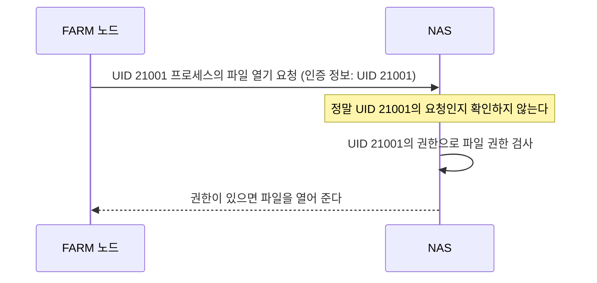
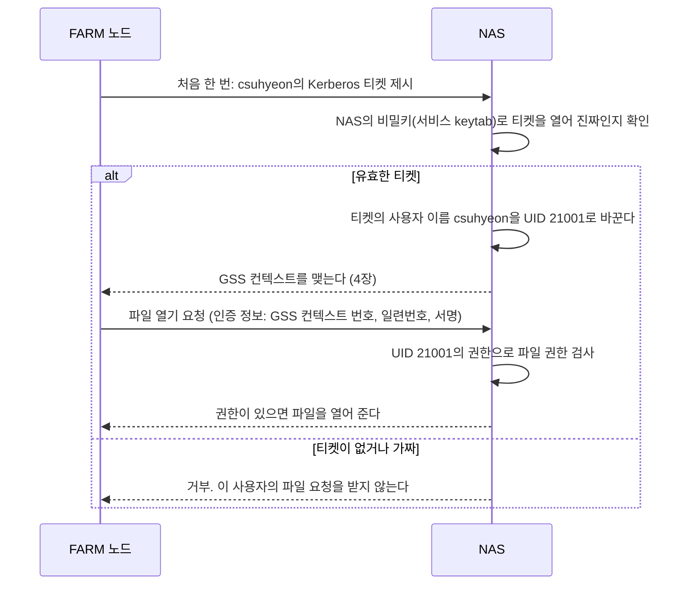
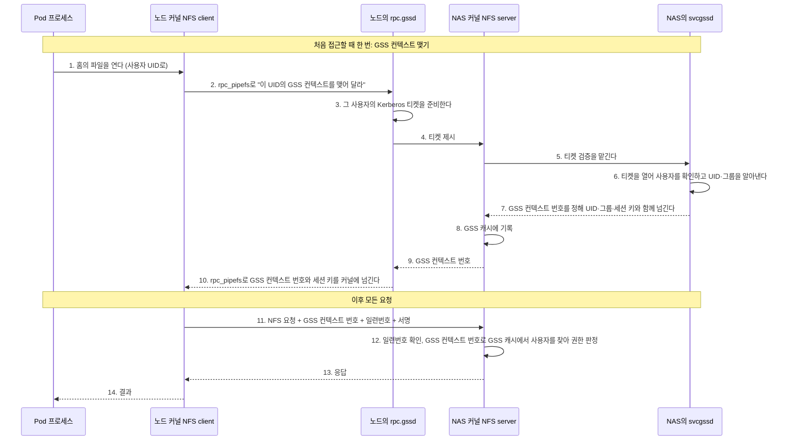
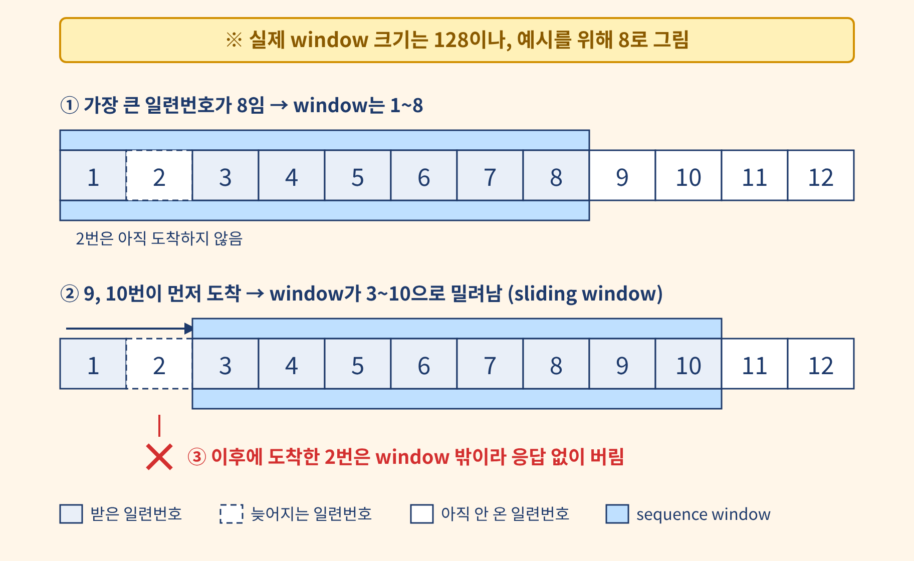

# NFS, RPC, GSS

## 이 문서에서 다루는 내용

- Pod가 홈 디렉터리의 파일을 읽고 쓸 때 NFS 요청이 처리되는 과정
- NFS 인증 방식(`sec=sys`, `sec=krb5`)과 이 시스템이 `sec=krb5`를 쓰는 이유
- 홈 마운트 옵션과, NAS가 응답하지 않을 때 프로세스가 멈추는 이유(D state)
- NAS가 사용자를 처음 한 번 확인하고 그 뒤의 요청을 알아보는 방식(GSS 컨텍스트)
- `sec=krb5` 마운트에서 지켜야 하는 규칙(`nconnect=1`)

세 가지를 먼저 요약하면 다음과 같다.

| 이름 | 요약 |
| --- | --- |
| NFS | 다른 서버의 디렉터리를 내 디렉터리처럼 쓰게 하는 파일 공유 방식. 사용자 홈이 NAS에 있고 FARM 노드가 NFS로 마운트한다 |
| RPC | 별도의 원격 제어를 위한 코딩 없이 다른 서버(정확히는 다른 주소 공간)에서 함수를 실행할 수 있게 하는 프로세스 간 통신 기술. NFS의 OPEN·READ·WRITE 요청도 RPC 메시지로 NAS에 전달되고, 메시지마다 누가 보냈는지 적는 인증 정보가 붙는다 |
| GSS | RPC 메시지의 인증 정보를 Kerberos 같은 인증 기술로 채울 때 쓰는 공통 인터페이스(Generic Security Service). 인증 기술을 바꿔도 프로그램은 같은 함수로 신원 확인과 서명을 한다. GSS로 인증 정보를 채우는 RPC 인증 방식을 RPCSEC_GSS라고 하며, NFS를 `sec=krb5`로 마운트하면 이 방식을 쓴다 |

**읽는 순서:** 이 문서를 먼저 읽고 [Kerberos, AD, Samba](Kerberos-AD-Samba.md)로 넘어간다. 이 문서는 NAS가 사용자를 **어떻게 알아보는지**를 설명하고, 그 확인에 쓰는 Kerberos 티켓과 사용자 이름을 UID로 바꾸는 AD는 다음 문서가 설명한다. 1~3장은 Kerberos를 몰라도 읽을 수 있다.

## 참고

| 필요할 때 | 문서 |
| --- | --- |
| NFS, NAS, root_squash, hostPath 같은 배경 용어를 본다 | [기본 용어](기본-용어.md) 2장·3.5절 |
| Kerberos 티켓, keytab, ccache, AD를 본다 | [Kerberos, AD, Samba](Kerberos-AD-Samba.md) |
| FARM과 LAB의 마운트 설정값과 NAS 쪽 설정을 본다 | [Kerberos/NFS 설계](../../system/kerberos-nfs/design.md) 4장 |

## 1. NFS 요청 처리 과정

### 1.1 NFS server와 NFS client

NFS는 파일을 제공하는 **NFS server**와 그 파일을 읽고 쓰는 **NFS client**로 나뉜다. 이 시스템에서 NFS server는 NAS이고, NFS client는 FARM 노드에 있다. NFS client는 따로 설치하는 프로그램이 아니라 **노드 커널 안의 기능**이다. 노드가 NAS를 마운트하면 커널이 NAS와 통신할 NFS client를 만들고, 그 마운트 아래에서 일어나는 파일 작업을 이 client가 NAS에 전달한다.

### 1.2 요청 처리 순서

```text
Pod 프로세스가 파일을 열고 쓴다
 → 노드 커널: 이 경로는 NFS 마운트 아래다
 → NFS client: 파일 작업을 NFS 요청(OPEN, READ, WRITE 등)으로 바꾼다
 → RPC: 요청을 RPC 메시지로 만들고 요청 번호(XID)와 인증 정보를 붙인다
 → TCP 연결로 NAS에 보낸다
 → NAS의 NFS server가 요청을 처리하고, 같은 TCP 연결로 응답을 돌려준다
```

Pod 안에는 NFS 프로그램이 없다. Pod는 hostPath로 받은 디렉터리([기본 용어](기본-용어.md) 3.5절)에 파일을 쓸 뿐이고, NAS와 통신하는 것은 노드 커널이다.

### 1.3 NFS client는 몇 개 생기나

같은 NAS를 같은 네트워크 공간(network namespace)에서 여러 번 마운트해도, 커널은 NFS client를 **하나만** 만들어 함께 쓴다. 다른 network namespace에서 마운트하면 별도의 NFS client가 생긴다.

지금 노드는 호스트 네트워크에서 NAS를 한 번 마운트하고, 그 노드의 모든 Pod가 hostPath로 나눠 쓴다. 그래서 **노드 하나에 NFS client 하나**이고, 같은 노드의 Pod들은 NAS로 가는 TCP 연결을 함께 쓴다. 한 Pod가 일으킨 정체가 같은 노드의 다른 Pod 요청에도 영향을 줄 수 있다.

## 2. RPC와 인증 방식

### 2.1 RPC와 인증 정보

RPC(Remote Procedure Call)는 다른 서버(정확히는 다른 주소 공간)의 함수를 내 함수처럼 실행하게 하는 통신 방식이고, NFS는 그 위에서 동작한다. 모든 NFS 요청은 RPC 메시지로 전달되며, 메시지 헤더에는 누가 보낸 요청인지를 적는 **인증 정보**(credential)가 있다. 여기에 무엇을 적을지 정하는 것이 마운트 옵션 `sec`다.

| `sec` | 인증 정보에 적는 것 | NAS가 요청자를 판단하는 방법 |
| --- | --- | --- |
| `sec=sys` (기본) | UID·GID 숫자 | 클라이언트가 "나는 UID 21001이다"라고 적어 보내면 **그대로 믿는다** |
| `sec=krb5` (이 시스템) | GSS 컨텍스트 번호, 일련번호, 서명 | Kerberos 티켓으로 요청한 사용자가 누구인지 확인한다. 확인은 처음 한 번만 하고, 그 뒤에는 GSS 컨텍스트 번호와 서명으로 같은 사용자의 요청인지 알아본다(4장) |

`krb5`는 보낸 사람만 확인하고 요청 내용은 보호하지 않는다. `krb5i`는 내용이 중간에 바뀌면 알아채고(무결성), `krb5p`는 내용을 암호화해 엿볼 수도 없게 한다(기밀성). FARM 홈은 `krb5`를 쓴다.

### 2.2 `sec=krb5`를 쓰는 이유

`sec=sys`에서는 한 노드에서 root 권한을 얻은 사람이 UID만 바꿔 다른 사람의 홈을 읽을 수 있다. 한 노드에 여러 사용자의 컨테이너가 함께 뜨는 환경이라 이 방식에 맡길 수 없다. 그래서 홈을 `sec=krb5`로 마운트한다.

두 방식의 차이를 순서로 보면 다음과 같다. 티켓은 Kerberos가 발급하는, 위조할 수 없는 신원 증명이다. 티켓을 받는 방법은 [Kerberos, AD, Samba](Kerberos-AD-Samba.md) 2장에서 본다.

아래의 다이어그램에서 `csuhyeon`은 사용자 계정 이름이고, UID는 21001이다.

**`sec=sys`: 요청에 적힌 UID를 그대로 믿는다**



노드의 root가 프로세스의 UID를 21002로 바꿔 요청하면, NAS는 그 요청을 UID 21002의 것으로 처리한다.

**`sec=krb5`: Kerberos 티켓으로 사용자를 확인한다**



노드는 UID를 보내지 않는다. NAS가 티켓의 사용자 이름으로 UID를 직접 알아내므로, 노드의 root가 프로세스의 UID를 바꿔도 다른 사람의 티켓 없이는 그 사람의 홈을 열 수 없다. 티켓 확인은 사용자마다 처음 한 번만 하고, 그 뒤 요청은 GSS 컨텍스트로 알아본다. `sec=krb5` 에서는 Kerberos 티켓으로 사용자를 확인한다는 것만 이해하고, 자세한 과정은 4장에서 본다.

## 3. 마운트 옵션과 D state

### 3.1 마운트 옵션 { #mount-options }

FARM 노드는 부팅할 때 `/etc/fstab`에 적힌 대로 홈을 마운트한다. 아래는 farm7의 해당 줄에서 이 절이 설명하는 옵션만 남기고 나머지는 생략한 것이다. 앞에서부터 'NAS의 공유 경로', '노드의 마운트 지점', '파일시스템 종류', '옵션'이다. 다른 노드도 마운트 지점(`/home/tako<N>/share`)만 다르고 옵션은 같다.

```text
nas.farm.decs.internal:/volume1/share  /home/tako7/share  nfs4  vers=4.0,sec=krb5,hard,timeo=600,retrans=2,nconnect=1
```

| 옵션 | 뜻 | FARM 값 |
| --- | --- | --- |
| `vers` | NFS 버전 | `4.0` |
| `sec` | 인증 방식 | `krb5` |
| `hard` | NAS가 응답하지 않으면 끝없이 다시 보낸다 | 사용 |
| `timeo`, `retrans` | 응답을 기다리는 시간(0.1초 단위)과, "not responding"을 기록하기 전까지 다시 보내는 횟수 | `600`(60초), `2` |
| `nconnect` | NFS client 하나가 NAS와 여는 TCP 연결 수 | `sec=krb5`에서는 `1`이어야 한다([5장](#gss-sequence-window)) |

### 3.2 hard 마운트와 D state

`hard` 마운트에서 NAS가 응답하지 않으면, 그 요청을 보낸 프로세스는 응답이 올 때까지 커널 안에서 기다린다. 이 상태가 `ps`에 보이는 **D**(uninterruptible sleep)이고, `kill -9`로도 끝나지 않는다.

그래서 NAS 쪽 문제는 노드에서 "프로세스가 멈췄다"로 보인다. 이때 노드 커널 로그에는 다음이 찍힌다.

```text
nfs: server nas.farm.decs.internal not responding, still trying
```

`hard` 대신 `soft`로 마운트하면 NAS가 일정 시간 응답하지 않을 때 요청을 중단하고 프로그램에 오류를 돌려준다. 읽기는 그 자리에서 오류가 나지만, 쓰기는 다르다. 노드는 프로그램이 쓰는 내용을 먼저 노드 메모리(페이지 캐시)에 저장하고 프로그램에 바로 성공을 알린 뒤, 나중에 NAS로 보낸다(NFS 마운트 기본값인 `async` 동작). 이 전송이 중단되면 오류는 프로그램이 파일을 닫을 때(`close`)나 저장을 확정할 때(`fsync`)에야 전달되는데, 이 결과를 확인하지 않는 프로그램이 많다. 그러면 프로그램은 저장에 성공한 것으로 알지만 NAS의 파일에는 그 내용이 없다. 그래서 홈에는 `hard`를 쓴다.

마운트 옵션은 `findmnt -t nfs4 -o TARGET,SOURCE,OPTIONS`로, 요청 종류별 횟수와 시간 초과 횟수는 `/proc/self/mountstats`로 본다.

## 4. GSS 컨텍스트 { #gss-context }

### 4.1 GSS 컨텍스트란

NAS는 요청마다 사용자를 새로 확인하지 않는다. 사용자가 처음 접근할 때 한 번만 Kerberos 티켓으로 확인하고 그 사용자에게 GSS 컨텍스트 번호를 정해 준다. 그 뒤 요청의 인증 정보에는 티켓 대신 그 GSS 컨텍스트 번호와 일련번호, 위조할 수 없는 서명이 붙는다. 이렇게 한 번 확인해 맺어 둔 상태가 **GSS 컨텍스트**다. 정식 이름은 RPCSEC_GSS 컨텍스트이고, `sec=krb5` 옵션으로 마운트하면 사용된다. 아래 그림의 1~10단계에서 GSS 컨텍스트를 맺고, 11단계부터 그 GSS 컨텍스트로 요청을 보낸다.



3단계에서 티켓을 준비하고 6단계에서 `svcgssd`가 티켓을 열어 UID·그룹을 알아내는 과정에는 Kerberos와 AD가 쓰인다. 이 문서에서는 "티켓으로 사용자를 확인한다"까지만 보고, 같은 그림을 Kerberos와 AD까지 펼친 것은 [Kerberos, AD, Samba](Kerberos-AD-Samba.md#gss-establish) 5.5절에서 본다.

| 용어 | 뜻 | 이 시스템에서 |
| --- | --- | --- |
| **GSS 컨텍스트 맺기**(수립) | 티켓으로 사용자를 한 번 확인하고 GSS 컨텍스트 번호와 세션 키를 정하는 과정 | 노드의 한 사용자와 NAS 사이에서 한 번 |
| **GSS 컨텍스트 번호**(핸들) | NAS가 GSS 컨텍스트마다 정해 주는 식별 번호. 요청이 누구의 것인지 알아보는 데 쓴다 | 이후 모든 NFS 요청의 인증 정보에 붙는다 |
| **일련번호**(시퀀스 번호) | 같은 GSS 컨텍스트로 보내는 요청마다 1씩 늘려 붙이는 순번. 지나간 요청을 복사해 다시 보내는 공격을 막는다 | NAS는 최근 128개 범위(sequence window) 안의 처음 보는 일련번호만 받는다(5장) |
| **서명(MIC)** | GSS 컨텍스트를 맺을 때 노드와 NAS가 나눠 가진 비밀 값(세션 키)으로 요청마다 새로 계산하는 값 | 남이 GSS 컨텍스트 번호만 베껴서는 요청을 만들 수 없다 |
| **GSS 캐시** | NAS 커널이 GSS 컨텍스트마다 사용자를 적어 두는 표(`auth.rpcsec.context`) | GSS 컨텍스트 번호마다 사용자 이름, UID, 그룹 목록, 세션 키를 적는다 |
| **`rpc.gssd`** | 노드에서 GSS 컨텍스트를 대신 맺는 사용자 영역 프로그램(4.2절) | 노드에서 systemd 서비스 `rpc-gssd.service`로 실행된다. 상태는 `systemctl status rpc-gssd`로 확인할 수 있다 |
| **`svcgssd`** | 받은 티켓을 NAS에서 검증하는 사용자 영역 프로그램. 노드의 `rpc.gssd`가 하는 일을 NAS 쪽에서 맡는다 | NAS에서 실행된다. 원래 systemd 서비스 `rpc-svcgssd.service`가 띄운다. 실행 여부는 NAS에서 `ps -C svcgssd -o pid,lstart,args`로 본다 |
| **`rpc_pipefs`** | 커널이 `rpc.gssd`에 GSS 컨텍스트를 맺어 달라고 요청하고 그 결과를 돌려받는 통로. 가상 파일시스템이다 | 노드 `/run/rpc_pipefs` |

GSS 컨텍스트는 TCP 연결과 다르다. TCP 연결은 노드와 NAS가 데이터를 주고받는 통신 통로이고, GSS 컨텍스트는 NAS가 "이 GSS 컨텍스트 번호로 오는 요청은 이 사용자의 것"이라고 기억해 둔 기록이다. 그래서 TCP 연결이 끊겼다 다시 이어져도 GSS 컨텍스트는 그대로 사용되고, TCP 연결 하나로 여러 사용자의 요청이 각자의 GSS 컨텍스트 번호를 달고 오간다.

### 4.2 커널 영역과 사용자 영역

리눅스는 실행되는 코드를 **커널 영역**과 **사용자 영역**으로 나눈다.

| | 커널 영역 | 사용자 영역 |
| --- | --- | --- |
| 무엇이 도나 | 운영체제의 핵심. 파일시스템, TCP, NFS client가 여기 있다 | 일반 프로그램. `bash`, `python`, `sshd`, [`winbindd`](Kerberos-AD-Samba.md#samba-roles), `rpc.gssd` |
| 할 수 있는 일 | 디스크·네트워크·모든 메모리를 직접 다룬다 | 자기 메모리만 쓴다. 파일이나 네트워크가 필요하면 커널에 요청한다(시스템 콜) |
| 오류가 나면 | 노드 전체가 멈추거나 재부팅된다 | 그 프로그램만 죽는다 |

영역을 나누는 이유는 보호와 안정성이다. 커널 안의 코드는 무엇이든 할 수 있으므로, 버그 하나가 노드 전체를 멈추거나 다른 프로그램의 메모리를 망가뜨릴 수 있다. 그래서 커널에는 꼭 필요하고 검증된 코드만 두고, 나머지는 사용자 영역에서 돌린다. 사용자 영역의 프로그램은 서로 격리돼 있어서 하나가 죽어도 다른 프로그램과 커널은 영향을 받지 않는다.

`rpc.gssd`가 사용자 영역에 있는 것도 같은 이유다. GSS 컨텍스트를 맺으려면 사용자의 티켓 파일(ccache)을 찾아 읽고, Kerberos 설정 파일(`/etc/krb5.conf`)을 해석하고, 네트워크로 티켓 발급 서버(KDC)와 통신해야 한다. 이런 복잡한 일을 커널에 넣으면 커널이 커지고 위험해진다. 게다가 이 일은 사용자마다 처음 한 번, 또는 GSS 컨텍스트가 만료될 때만 일어나므로, 커널 밖의 사용자 영역 프로그램에 맡겨도 느려지지 않는다.

### 4.3 rpc.gssd가 하는 일

커널과 `rpc.gssd`는 일을 이렇게 나눈다. 커널은 요청마다 해야 하는 가벼운 일만 직접 한다. NAS가 정해 준 GSS 컨텍스트 번호를 적고, 일련번호를 매기고, 세션 키로 서명을 계산하는 일이다. 드물게 일어나는 복잡한 일, 즉 GSS 컨텍스트를 맺는 일은 `rpc.gssd`가 한다. 두 영역은 서로의 함수를 직접 부를 수 없으므로 `rpc_pipefs`를 통로로 쓴다.

위 그림에서 2~4단계와 9~10단계가 `rpc.gssd`의 일이다. 커널이 `rpc_pipefs`로 GSS 컨텍스트를 맺어 달라고 요청하면(2단계), `rpc.gssd`는 그 사용자의 티켓을 준비해 NAS와 GSS 컨텍스트를 맺고, GSS 컨텍스트 번호와 세션 키를 `rpc_pipefs`로 커널에 돌려준다(10단계). 그 뒤의 읽기·쓰기는 커널이 혼자 처리하고 `rpc.gssd`는 관여하지 않는다.

GSS 컨텍스트가 만료되면(티켓의 유효 시간) 커널이 `rpc.gssd`를 다시 부른다(4.5절). 그래서 `rpc.gssd`가 멈춰도 이미 맺은 GSS 컨텍스트는 한동안 동작하고, 처음 접근하는 사용자나 만료된 GSS 컨텍스트부터 실패한다.

NAS 쪽도 같은 구조다. NAS 커널의 NFS server도 받은 티켓을 직접 풀지 않고, 사용자 영역의 `svcgssd`에게 맡긴다(5~7단계). `svcgssd`가 티켓을 열고 사용자를 조회하는 과정은 [Kerberos, AD, Samba](Kerberos-AD-Samba.md#gss-establish) 5.5절에서 본다.

### 4.4 NAS의 GSS 캐시

NAS는 GSS 컨텍스트를 맺을 때 알아낸 사용자 이름, UID, 그룹 목록을 GSS 컨텍스트 번호와 함께 GSS 캐시에 적고(그림 7~8단계), 그 뒤 요청마다 **이 표만 보고** 권한을 판정한다(12단계). 요청마다 사용자 정보를 다시 조회하지 않는다.

표의 기록은 GSS 컨텍스트가 유지되는 동안(최대 24시간) 바뀌지 않는다. 그래서 그 사이 사용자의 그룹이 바뀌어도 NAS는 옛 그룹 목록으로 판정한다. 공용 그룹 변경을 반영하는 방법은 [Kerberos, AD, Samba](Kerberos-AD-Samba.md#nas-gss-cache) 5.5절에서 본다.

GSS 컨텍스트는 노드 커널의 NFS client 하나와 사용자 한 명 사이에 하나씩 생긴다. 노드마다 NFS client가 하나이므로(1.3절), 같은 노드에 같은 사용자의 Pod가 여러 개 떠도 GSS 컨텍스트 하나를 함께 쓴다.

### 4.5 GSS 컨텍스트를 다시 맺는 경우

GSS 컨텍스트는 한 번 맺으면 영원히 쓰는 것이 아니다. 다음 세 경우에 새로 맺으며, 사용자가 따로 할 일은 없고 노드가 자동으로 처리한다.

첫째, 만료될 때다. GSS 컨텍스트의 유효 시간은 그것을 맺을 때 쓴 티켓의 유효 시간과 같다. 노드 커널은 만료 몇 분 전에 `rpc.gssd`를 다시 불러 새 GSS 컨텍스트를 맺어 둔다. 2026-11-06 NAS 로그를 보면 csuhyeon의 GSS 컨텍스트가 09:30에 맺어졌고, 만료 직전인 18:30에 새로 맺어졌다.

둘째, NAS가 GSS 컨텍스트 기록을 지웠을 때다. config-server가 공용 그룹 변경을 반영하려고 GSS 캐시를 비우거나 NAS가 재부팅되면, NAS는 노드가 보낸 GSS 컨텍스트 번호를 찾지 못해 오류로 답한다. 노드는 이 오류를 받으면 새 GSS 컨텍스트를 맺고 같은 요청을 다시 보낸다.

셋째, 노드에 NFS client가 새로 생길 때다. 홈을 다시 마운트하거나 노드를 재부팅하면 NFS client가 새로 만들어지고, 사용자마다 첫 요청에서 새 GSS 컨텍스트를 맺는다.

어느 경우든 새로 맺으려면 ccache에 유효한 TGT가 있어야 한다. TGT가 만료됐거나 ccache가 없으면 GSS 컨텍스트를 맺지 못하고, 그 사용자의 요청은 거부된다. 노드의 갱신 타이머가 TGT를 계속 연장하는 이유가 이것이다([Kerberos, AD, Samba](Kerberos-AD-Samba.md) 5.4절). 반대로 TCP 연결이 끊겼다 다시 이어지는 것은 새로 맺을 이유가 되지 않는다(4.1절).

## 5. sequence window와 nconnect=1 { #gss-sequence-window }

GSS 컨텍스트로 보내는 요청에는 1, 2, 3, … 순서로 **일련번호**가 붙는다. 누가 지나간 요청을 복사해 다시 보내는 공격을 막기 위해서다. NAS는 GSS 컨텍스트마다 지금까지 받은 가장 큰 일련번호를 기억하고, 거기서부터 아래로 128개까지를 받을 수 있는 범위로 둔다. 이 범위가 **sequence window**(시퀀스 창)다. 더 큰 일련번호가 도착하면 범위도 그만큼 앞으로 밀려나는 sliding window 방식이다. NAS는 window보다 오래된 일련번호와 **이미 받은 일련번호**를 응답 없이 버린다. window 크기 128은 NAS 커널에 고정된 값이라 설정으로 바꿀 수 없다.

아래 그림은 늦게 도착한 일련번호가 window 밖으로 밀려 버려지는 과정이다.



[`nconnect`](#mount-options)는 NFS client 하나가 NAS와 여는 TCP 연결 수다(3.1절). `nconnect=1`이면 요청이 TCP 연결 하나로 차례대로 가므로 일련번호가 거의 순서대로 도착한다.

`nconnect`가 2 이상이면 같은 GSS 컨텍스트의 요청이 여러 TCP 연결로 나뉘어 간다. 대량 WRITE 중 한 연결이 밀리면 다른 연결로 간 뒤쪽 일련번호가 먼저 도착해 NAS가 기억하는 가장 큰 일련번호가 앞서 나간다. 밀렸던 요청은 도착했을 때 이미 window 밖이라 버려진다. 노드는 응답을 기다리다 `timeo`(60초)가 지나서야 새 일련번호를 붙여 다시 보내고, 그동안 WRITE를 보낸 프로세스는 D state(3.2절)로 멈춘다. 대량 WRITE가 이어지면 이것이 반복돼 몇 분씩 멈춘다.

`nconnect=1`이어도 응답을 기다리는 요청이 너무 많으면 같은 일이 생길 수 있다. NFS client가 응답을 기다리며 TCP 연결 하나에 동시에 보내 둘 수 있는 요청 수를 **슬롯**이라고 한다. 리눅스는 요청이 몰리면 슬롯을 `sunrpc.tcp_max_slot_table_entries`(기본값 65536)까지 늘린다. NAS는 TCP 연결 하나로 순서대로 도착한 요청도 nfsd 스레드 여러 개가 나눠 처리하므로, 일련번호를 확인하는 순서가 조금씩 바뀐다. 응답을 기다리는 요청이 128개보다 많으면, 조금 늦게 확인된 요청의 일련번호가 이미 window 밖일 수 있다. 슬롯 상한을 128보다 작게(예: 64) 두면 응답을 기다리는 요청이 window 크기를 넘지 않는다.

**규칙: `sec=krb5` 마운트는 `nconnect=1`로 한다.**

이 규칙의 근거는 [261103 주간 리포트](https://app.notion.com/p/261103-40cc7692a26380109d38d92c696994ab#40cc7692a263809995fcd3bc44a7e9a8)의 "C. NFS 옵션 추가 실험" 표에 있다.

## 정리

1. NFS client는 노드 커널 안에 있고, Pod는 hostPath로 받은 디렉터리에 쓸 뿐이다. 노드마다 NFS client가 하나라 같은 노드의 Pod들은 NAS 연결을 함께 쓴다.
2. NFS 요청은 RPC 메시지로 전달되고, 그 인증 정보에 무엇을 적을지 `sec`가 정한다. `sec=sys`는 UID를 그대로 믿고 `sec=krb5`는 Kerberos로 확인한다. FARM 홈은 `sec=krb5`다.
3. `hard` 마운트에서 NAS가 응답하지 않으면 그 요청을 보낸 프로세스는 D state로 멈추고, `kill -9`로도 끝나지 않는다.
4. NAS는 처음 접근할 때 사용자를 한 번 확인해 GSS 캐시에 적고, 이후 요청은 GSS 컨텍스트 번호, 일련번호, 서명만 쓴다. 이 GSS 컨텍스트는 노드의 `rpc.gssd`가 맺는다.
5. 일련번호가 sequence window(128) 밖으로 밀리면 버려지므로 `sec=krb5` 마운트는 `nconnect=1`로 한다.
