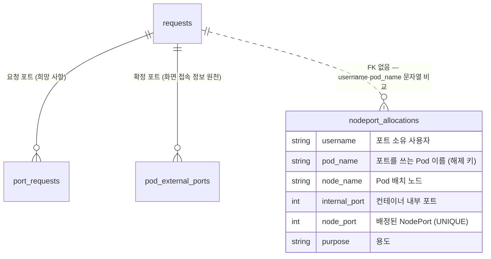

# 데이터베이스

## 이 문서에서 다루는 내용

- 스택 MySQL이 어떤 데이터베이스와 테이블을 가지고 있고 config-server가 어디에 쓰는지
- NodePort를 동시에 안전하게 배정하고, 작업을 한 프로세스만 실행하게 하는 기록과 잠금
- 스키마를 만드는 방법, 백업, DB를 확인하거나 복구할 때 함께 볼 것

## 빠른 이동

| 필요할 때 | 문서 |
| --- | --- |
| 승인부터 Pod 생성까지 전체 흐름을 본다 | [시스템 아키텍처](시스템-아키텍처.md) |
| 운영 중 포트 충돌이나 잔여 기록을 확인한다 | [운영 매뉴얼](../operations/운영-매뉴얼.md) |
| API 응답과 오류 형식을 확인한다 | [API 레퍼런스](../operations/API-레퍼런스.md) |

---

## 1. 사용하는 저장소

스택마다 MySQL 한 대와 Redis를 따로 띄운다. 운영(operation)과 실험 스택은 DB를 공유하지 않는다.

| 저장소 | 데이터베이스 | 쓰는 쪽 | 용도 |
| --- | --- | --- | --- |
| 스택 MySQL | `pod_port_db` | config-server | NodePort 배정 기록, Kerberos 정리 재시도 목록, 계정 대장 잠금 |
| 스택 MySQL | `operation_state_db` | config-server, admin_be(결과 조회는 API로) | 작업 이력(`operation_log`)과 작업 소유권(`job_control`) |
| 스택 MySQL | `web_admin` | admin_be | 신청·사용자 정보. 이 문서에서는 이름만 다룬다 |
| config-server용 Redis | — | config-server | 작업 입력·결과, 생성 진행 상황, 사용자 이미지 작업 상태 |
| admin_be용 Redis | — | admin_be | 인증·알림 등. 이 문서에서는 다루지 않는다 |

세 데이터베이스는 같은 MySQL 프로세스에 있지만 서로 조인하지 않는다. config-server와 admin_be는 API로만 통신한다.

MySQL은 Service 이름 셋(`infra-mysql`, `log-mysql`, `admin-mysql`)으로 열려 있고, 셋 다 같은 Pod(`mysql-0`)를 가리킨다. 예전에는 세 DB가 서로 다른 인스턴스였고, 코드가 그 이름을 그대로 쓰기 때문에 이름만 남겼다.

---

## 2. 배포 형태

`admin_infra-proposed`의 `ops/proposed-stack/` 매니페스트로 배포한다. 설치 스크립트(`stack-up.sh`)가 스택마다 적용한다.

| 리소스 | 내용 |
| --- | --- |
| StatefulSet `mysql` | `mysql:8.0.36`, replicas 1. 노드를 하나로 고정한다 |
| PVC `data-mysql-0` | `local-path` 저장소 10Gi. 노드 로컬 디스크 |
| Service `infra-mysql`·`log-mysql`·`admin-mysql` | ClusterIP 3306. 클러스터 밖에 열지 않는다 |
| NetworkPolicy `mysql-ingress` | 같은 스택의 config-server·admin_be·백업 작업만 접속하게 한다 |
| Secret `stack-db` | DB 비밀번호. 처음 설치할 때 무작위로 만들고 이후 유지한다 |

데이터 디스크가 노드 로컬이라, 실사용 데이터가 있는 스택(`uid-ranges.yaml`의 `keep_data: true`, 지금은 operation만)은 볼륨 반환 정책을 `Retain`으로 바꿔 PVC를 지워도 폴더가 남게 한다. NAS에 두지 않는 이유는 이 클러스터의 NFS 저장소 종류로 NAS가 붙지 않기 때문이다(2026-10-08 실측, 연결 시간 초과).

구 운영(`ailab-infra`)은 `infra-sql/`의 `infra-mysql`(NAS 위 `sc-mysql`)과 `log-mysql`을 따로 썼다. 지금은 내려 두었고 쓰지 않는다.

---

## 3. 스키마

### 3.1 스키마를 만드는 방법

테이블 정의는 `infra-sql/`의 SQL 파일에 있다. 설치 스크립트가 배포할 때마다 다시 적용한다.

| 파일 | 대상 DB | 테이블 |
| --- | --- | --- |
| `pod_port_db.sql` | `pod_port_db` | `nodeport_allocations`, `krb5_cleanup_pending`, `server_nodes`(쓰지 않음) |
| `operation_log.sql` | `operation_state_db` | `operation_log`, `job_control`, `fault_arming`(실험 스택 전용) |
| `trial_manifest.sql` | `operation_state_db` | `trial_manifest`(실험 측정용) |

모두 `CREATE TABLE IF NOT EXISTS`라 여러 번 적용해도 결과가 같다. 이미 있는 테이블에 열을 더할 때는 열이 없을 때만 `ALTER TABLE`을 실행하는 구문을 같은 파일에 둔다(MySQL 8.0에는 `ADD COLUMN IF NOT EXISTS`가 없다). 운영 DB를 손으로 고치지 않고, 바꿀 구조는 이 파일에 적어 다음 배포에 반영한다.

### 3.2 `nodeport_allocations`

| 컬럼 | 역할 |
| --- | --- |
| `username` | 포트를 소유한 사용자 |
| `pod_name` | 포트를 쓰는 사용자 Pod. 포트 해제와 정리(reconcile)의 키 |
| `node_name` | Pod가 배치된 노드 |
| `internal_port` | 컨테이너 내부 포트(22, 8888 등) |
| `node_port` | 배정한 NodePort. **UNIQUE** |
| `purpose` | 용도(`ssh`, `jupyter`, 신청자가 적은 글). 최대 255자 |
| `created_at` | 행을 넣은 시각. 정리 유예(900초) 판정에 쓴다 |

### 3.3 `krb5_cleanup_pending`

Pod나 계정을 지울 때 FARM 노드의 keytab, timer, ccache 정리가 실패하면 이 테이블에 남긴다. 30분마다 도는 `krb5-reconcile`이 다시 정리하고, 성공하면 행을 지운다.

| 컬럼 | 역할 |
| --- | --- |
| `username`, `node_name` | 정리할 사용자와 노드. 두 칸 조합이 **UNIQUE** |
| `failed_at` | 마지막으로 정리에 실패한 시각 |

같은 사용자에게 그 노드로 keytab을 다시 배포하면, 배포가 성공한 직후 그 조합의 행을 지운다. 지우지 않으면 재조정이 방금 배포한 keytab을 뒤늦게 지운다.

### 3.4 `operation_log`

모든 작업과 단계가 시작·끝을 한 행씩 남긴다.

| 컬럼 | 역할 |
| --- | --- |
| `job_id` | 작업 번호. 작업 시작 행의 `id`이고, 그 작업의 모든 행에 붙는다. 동기 경로(고아 Pod 삭제)는 NULL |
| `request_id` | 신청 번호. 다른 번호로 등록한 작업은 접두어가 붙는다(`password-reset-`, `group-op-`, `port-change-`, `access-op-`, `home-cleanup-`) |
| `username`, `pod_name`, `node_name` | 알게 되면 채운다 |
| `resource_type` | 단계가 다룬 대상(`account`, `storage`, `kerberos`, `pod` 등). 재시도 행이면 다시 돌린 단계 이름, 접근 시험 행이면 시험 이름 |
| `action` | 작업 단위(`PROVISION` 등 여덟 가지) 또는 단계 이름(`CREATE_ACCOUNT`, `WAIT_READY` 등) |
| `phase` | `START`, `SUCCESS`, `FAIL`, `RETRY`, `UNKNOWN` |
| `attempt` | 몇 번째 시도인지 |
| `duration_ms` | 끝 행에만. 같은 시도의 시작 행부터 걸린 시간. 양 끝을 모두 DB 시계로 잰다 |
| `error_code`, `error_detail` | 실패 원인 |
| `target_state` | 작업 시작 행에만. 목표 상태(입력). 비밀번호 해시는 넣지 않는다 |
| `created_at` | UTC, 밀리초 |

제어기는 이 테이블에서 **시작 행만 있고 끝 행(SUCCESS·FAIL·UNKNOWN)이 없는 작업**을 찾아 실행한다. 작업 목록을 따로 두지 않는다.

### 3.5 `job_control`

작업마다 한 행. 제어기 프로세스 하나가 작업의 한시적 소유권(lease)을 갖는다.

| 컬럼 | 역할 |
| --- | --- |
| `job_id` | `operation_log` 작업 시작 행의 id |
| `request_id`, `action` | 작업 식별 |
| `owner` | 제어기 프로세스 식별자(호스트-pid-난수) |
| `lease_until` | 이 시각(epoch 초)이 지나면 다른 제어기가 인수한다. 기본 30초, 실행 중 계속 갱신 |
| `done_steps` | 끝난 단계 이름 목록(JSON) |
| `saved_ctx` | 이어하기에 필요한 값(Pod 이름, UID, 포트 등, JSON) |

만료된 lease를 인수할 때는 `WHERE`에 직전 소유자와 시각을 걸어 한 프로세스만 이기게 한다. 소유자가 아닌 프로세스의 기록은 거부된다. 작업이 끝나면 행을 지운다.

---

## 4. 잠금과 트랜잭션

### 4.1 접속 방식

config-server는 PyMySQL로 접속한다. 포트 배정·해제·정리 같은 작업 단위마다 새 연결을 열고 `finally`에서 닫는다. `autocommit=False`라 명시적으로 `commit()`해야 반영된다. 접속 정보는 환경 변수(`DB_HOST`, `DB_USER`, `DB_PASSWORD`, `DB_NAME`, 작업 이력은 `LOG_DB_*`)로 받는다.

### 4.2 포트 배정 트랜잭션

1. 사용 중인 포트를 `FOR UPDATE`로 조회한다.

```sql
SELECT node_port FROM nodeport_allocations FOR UPDATE;
```

2. 클러스터 모든 네임스페이스의 Service가 쓰는 NodePort도 모은다. 이 조회가 실패하면 로그를 남기고 MySQL 목록만으로 진행한다. 다른 Service가 이미 쓰는 포트를 고르면 Service 생성 단계에서 실패한다.
3. 스택의 NodePort 대역에서 빈 포트를 고른다.
4. 필요한 개수만큼 행을 넣고 `commit()`한다. 예외가 나면 `rollback()`으로 전부 취소한다.

`FOR UPDATE`가 없으면 거의 동시에 들어온 두 작업이 같은 빈 포트를 읽고 둘 다 그 번호를 배정할 수 있다. 잠금이 있으면 두 번째 작업은 첫 번째가 끝날 때까지 기다린다. `node_port`의 UNIQUE 제약이 마지막 방어선이다.

### 4.3 포트 해제와 정리

| 함수 | 동작 |
| --- | --- |
| `release_nodeports(pod_name)` | 그 Pod의 행을 모두 지우고 commit한다 |
| `reconcile_nodeport_allocations(namespace)` | MySQL 기록과 Kubernetes Service를 비교해 남은 기록을 지운다 |

정리는 Kubernetes를 기준으로 한다. `app=ailab-nodeport` 라벨과 같은 `pod_name`의 Service가 하나도 없고, 그 Pod의 **가장 최근 행이 900초보다 오래됐으면** 그 Pod의 행을 지운다. 행은 Service보다 먼저 들어가고 그 사이에 Ready 대기(최대 500초)가 끼므로, 유예가 없으면 지금 만들고 있는 Pod의 배정을 지운다. 나이는 DB 시계(`NOW()`)로 잰다.

포트를 배정하기 직전에 이 정리를 부르지만, 마지막 시도 뒤 5분이 지나야 다시 돈다(실패한 시도도 포함). 이 간격은 조회 부하를 줄이려는 것이고 프로세스마다 따로 센다. 생성 중인 Pod를 지키는 것은 900초 유예다.

포트 변경 작업은 뺄 포트의 Service를 먼저 지우고 행을 지운다. 행부터 지우면 Service가 살아 있는 외부 포트가 다른 Pod에 배정된다. 접속 차단도 Service를 지우지 않는다(지우면 정리가 배정을 풀어 버린다).

### 4.4 계정 대장 잠금

`/kube_share`의 계정 파일은 NFS 위에 있다. NFS 파일 잠금 대신 `pod_port_db`의 이름 잠금(`SELECT GET_LOCK(...)`)으로 순서를 맞춘다. API 서버와 제어기는 서로 다른 Pod라 프로세스 안 잠금으로는 서로를 막지 못한다. 30초 안에 잠금을 잡지 못하면 잠금 없이 진행하지 않고 실패한다.

---

## 5. 운영 절차

### 5.1 상태 확인

```bash
ns=ailab-operation
# 비밀번호는 화면에 찍지 않고 컨테이너 안의 환경 변수로 쓴다
kubectl -n "$ns" exec -it mysql-0 -- sh -c 'mysql -uroot -p"$MYSQL_ROOT_PASSWORD" pod_port_db'
```

현재 점유 중인 포트:

```sql
SELECT username, pod_name, node_port, purpose FROM nodeport_allocations ORDER BY node_port;
```

다시 정리해야 할 Kerberos 파일:

```sql
SELECT username, node_name, failed_at FROM krb5_cleanup_pending ORDER BY failed_at;
```

끝나지 않은 작업(`operation_state_db`):

```sql
SELECT s.id AS job_id, s.request_id, s.action, s.username, s.created_at
FROM operation_log s
WHERE s.job_id = s.id AND s.phase = 'START'
  AND NOT EXISTS (SELECT 1 FROM operation_log e
                  WHERE e.request_id = s.request_id AND e.action = s.action AND e.id > s.id
                    AND e.phase IN ('SUCCESS','FAIL','UNKNOWN'))
ORDER BY s.id;
```

한 작업의 단계 기록은 API(`GET /operations/{kind}/{request_id}/steps`)로 보는 것이 쉽다. 직접 볼 때는 `WHERE job_id = <번호> ORDER BY id`로 조회한다.

### 5.2 백업

CronJob `mysql-backup`이 매일 04:00에 세 데이터베이스(`pod_port_db`, `operation_state_db`, `web_admin`)를 `mysqldump --single-transaction`으로 떠서 gzip으로 저장한다.

| 항목 | 값 | 이유 |
| --- | --- | --- |
| 저장 위치 | DB와 **다른 노드**의 `local-path` PVC `mysql-backup`(20Gi) | DB 디스크가 고장 나거나 PVC를 잘못 지워도 사본이 남는다 |
| 보관 | 14일. 이보다 오래된 파일은 지운다 | |
| 계정 | 읽기 전용 백업 계정. `mysql` 스키마(DB 계정 정보)는 뜨지 않는다 | 계정은 설치 스크립트가 다시 만든다 |
| 권한 | 파일과 폴더는 root만 읽는다 | 덤프에 사용자 정보가 들어 있다 |
| 완결성 | `.part`로 쓰고 gzip 검사·`Dump completed` 확인 뒤에만 이름을 바꾼다 | 중간에 끊긴 덤프가 정상 사본처럼 남지 않게 한다 |

### 5.3 복구할 때

1. 스택을 다시 설치하면(`stack-up.sh`) MySQL, 계정, 스키마가 만들어진다. 스키마는 SQL 파일이 다시 적용하므로 손으로 만들지 않는다.
2. 데이터는 백업 노드의 가장 최근 `*.sql.gz`로 되살린다.
3. 포트 배정 기록이 백업 이후 바뀌었으면, Kubernetes의 실제 Service(`app=ailab-nodeport`)를 기준으로 맞춘다. 정리(reconcile)는 Service 없는 행만 지우고, Service는 있는데 행이 없는 경우는 채우지 않는다.
4. 작업 이력이 백업 이후 끊겼으면, 끝 행이 없는 작업이 제어기에 다시 잡힌다. 실제 자원 상태를 먼저 확인한 뒤 진행한다.

---

## 6. admin_be DB와 포트 정보를 비교하는 방법



`web_admin`과 `pod_port_db` 사이에는 외래 키가 없다. 대조는 다음 순서로 한다.

1. admin_be에서 신청과 확정 포트 정보를 조회한다.
2. `nodeport_allocations`를 조회한다.
3. `username`과 `pod_name`으로 비교한다.
4. 어긋나면 Kubernetes의 실제 Service 상태까지 함께 확인한다.

---

## 핵심 구조 요약

1. 스택마다 MySQL 한 대에 `pod_port_db`, `operation_state_db`, `web_admin` 세 DB를 둔다. 스택끼리 DB를 공유하지 않는다.
2. 테이블 정의는 `infra-sql/`의 SQL 파일이 원본이고, 배포 때마다 다시 적용한다.
3. NodePort 배정은 `FOR UPDATE` 트랜잭션과 `node_port` UNIQUE로 중복을 막는다.
4. 작업 목록은 따로 없다. `operation_log`의 끝 행 없는 시작 행이 실행할 작업이다.
5. 작업은 `job_control`의 lease로 한 프로세스만 실행한다.
6. 계정 대장 잠금은 DB 이름 잠금이라 API 서버와 제어기 사이에서도 통한다.
7. 정리(reconcile)는 Service 없는 행 중 900초가 지난 것만 지운다.
8. 매일 다른 노드로 백업하고 14일 보관한다. `Retain`은 삭제 방지일 뿐 백업이 아니다.
