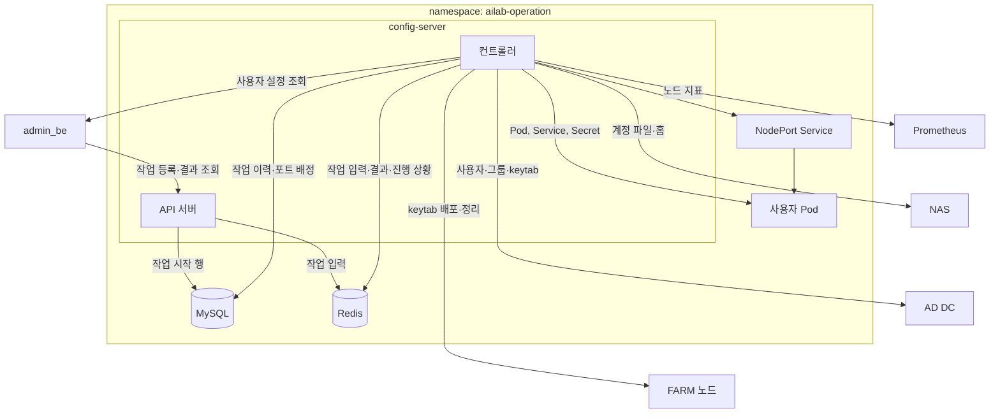
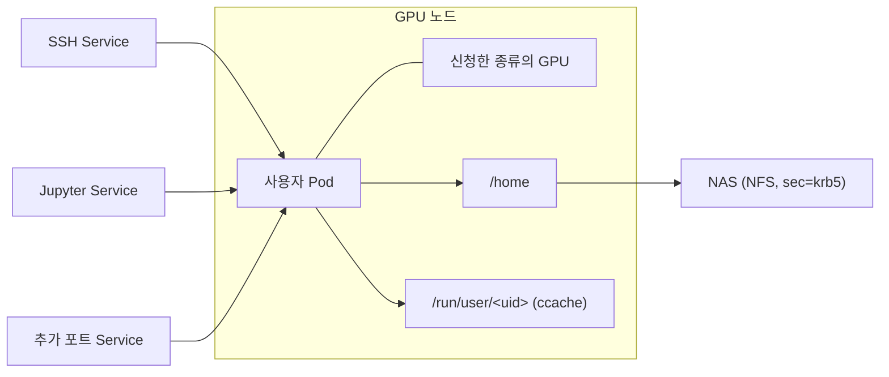
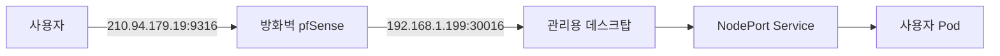
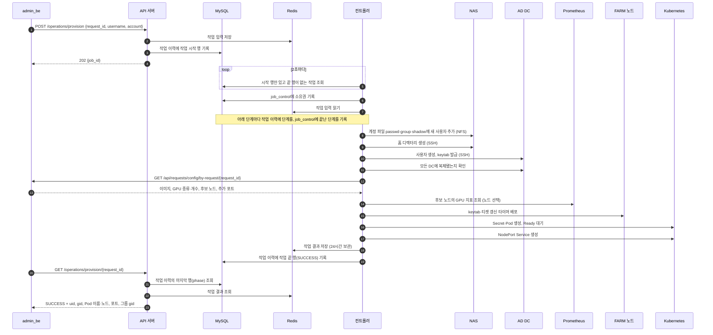

# 시스템 아키텍처

## 이 문서에서 다루는 내용

`admin_infra-proposed`의 config-server는 `admin_be`의 요청을 받아 사용자 계정, 홈 디렉터리, 컨테이너(Pod), 접속 포트(사용자가 SSH·Jupyter 등으로 Pod에 접속할 때 쓰는 포트)를 실제로 만들고 바꾸고 지우는 서버다. 이 문서는 config-server가 이 일을 어떤 구성으로 하는지, 실제 사용자가 쓰는 운영 환경(Kubernetes 네임스페이스 `ailab-operation`)을 기준으로 설명한다. 같은 코드를 실험용으로 따로 설치한 환경(실험 스택)과의 차이는 [개요](../개요.md) 5절에 있다.

- config-server가 일을 하면서 호출하는 서버와 서비스(`admin_be`, Kubernetes, NAS, AD DC, Prometheus, MySQL, Redis), 그리고 각각에게 맡기는 일
- 사용자 계정 번호(UID), 접속 포트 배정, 요청 처리 기록 같은 데이터를 어디에 저장하는지
- config-server가 요청을 처리하는 방식과, 모든 요청에 공통적으로 적용되는 실행 규칙
- 사용자 Pod의 구성과, 외부 사용자가 사용자 Pod에 접속하는 경로

요청 종류마다 config-server가 실행하는 단계와 규칙, 단계가 실패했을 때 되돌리는 것과 남기는 것은 [작업별 동작](작업별-동작.md)에서 설명한다.

## 빠른 이동

| 필요할 때 | 문서 |
| --- | --- |
| 요청 종류별 단계와 실패 처리를 확인한다 | [작업별 동작](작업별-동작.md) |
| 실제 운영 명령과 점검 순서를 확인한다 | [운영 매뉴얼](../operations/운영-매뉴얼.md) |
| 요청 형식과 응답을 확인한다 | [API 레퍼런스](../operations/API-레퍼런스.md) |
| config-server가 쓰는 DB 테이블을 확인한다 | [데이터베이스](데이터베이스.md) |
| Kerberos, AD, Samba의 개념과 쓰는 이유를 읽는다 | [Kerberos, AD, Samba](Kerberos-AD-Samba.md) |
| Kerberos 준비 단계를 자세히 확인한다 | [kdc-setup](../kdc-setup/index.md) |

## 1. 서버마다 하는 일 

신청을 받고 승인하는 일, 계정과 Pod를 만드는 일, 파일을 저장하고 사용자를 인증하는 일은 서로 다른 서버가 맡는다.

| 하는 일 | 서버 또는 서비스 | 설명 |
| --- | --- | --- |
| 신청과 승인 | `admin_fe`, `admin_be` | `admin_fe`는 신청·승인 화면을 제공한다. `admin_be`는 신청 상태와 사용자 설정을 저장하고, 언제 어떤 요청을 config-server에 보낼지 정한다 |
| 요청 처리 | `admin_infra-proposed`의 config-server | `admin_be`의 요청을 받아 계정, 홈 디렉터리, Pod, 접속 포트를 만들고 바꾸고 지운다. 요청을 처리하는 방식은 [2.1절](#connections)에 있다 |
| 컨테이너 실행 | Kubernetes | 사용자 Pod와, 외부에서 그 Pod에 접속하게 해 주는 NodePort Service를 실행한다 |
| 파일 저장 | NAS | 사용자 홈 디렉터리와 [계정 파일](Kerberos-AD-Samba.md#account-file)을 저장한다 |
| 사용자 정보와 인증 | AD DC | 사용자·그룹 정보를 저장하고 Kerberos 인증을 제공한다. NAS는 이 정보로 파일 권한을 판정한다 |
| GPU 지표 | Prometheus | 노드별 GPU 사용량을 모은다. config-server는 Pod를 올릴 노드를 고를 때 이 값을 읽는다 |

`admin_be`는 신청 상태를 보고 config-server에 보낼 요청을 정한다. 예를 들어 신청이 승인되면 컨테이너 생성을, 신청 기간이 끝나면 회수를, 홈 보존 기간이 지나면 홈 삭제를 요청한다. config-server는 승인 여부나 보존 기간 같은 판단을 하지 않는다. 받은 요청을 지금 실행해도 되는 상태인지만 확인하고 실행한다.

## 2. 서버와 서비스의 연결

### 2.1 config-server의 처리 방식과 호출하는 서비스 

config-server는 `admin_be`의 요청을 비동기로 처리한다. 요청을 받으면 할 일을 **작업**(job)으로 기록하고 바로 답한다. 기록된 작업은 config-server 안에서 따로 실행되는 프로세스인 **컨트롤러**(controller)가 이어서 실행하고, `admin_be`는 작업 결과를 나중에 조회한다. 컨테이너 하나를 만드는 데 이미지 다운로드까지 몇 분이 걸리기 때문에 이 방식을 쓴다([4.1절](#register-execute)). 작업 하나는 "사용자 한 명의 컨테이너를 만든다"처럼 `admin_be`가 맡기는 일 한 건이고, 종류는 다음 여덟 가지다.

- **생성**: 신청이 승인되면 계정, 홈 디렉터리, Pod, 접속 포트를 만든다.
- **회수**: 컨테이너 회수는 신청 기간이 끝나거나 관리자가 회수하면 Pod와 접속 포트를 지운다. 계정 회수는 관리자가 사용자를 삭제·비활성화하거나 사용자의 리눅스 계정을 회수하면 계정을 지운다. 홈 디렉터리는 어느 쪽에서도 지우지 않는다.
- **마이그레이션·재시작**: 컨테이너를 같은 리소스 그룹(같은 종류의 GPU를 가진 노드 묶음)의 다른 노드로 옮기거나(마이그레이션), 같은 노드에서 다시 만든다(재시작).
- **비밀번호 교체**: 비밀번호 재설정 신청이 승인되면 계정 파일, Pod마다 있는 로그인 비밀번호 Secret, 실행 중인 Pod의 비밀번호 해시를 바꾼다.
- **그룹**: 공용 그룹(여러 사용자가 폴더를 함께 쓰려고 만드는 리눅스 그룹)을 만들거나, 사용자를 공용 그룹에 넣고 뺀다.
- **포트 변경**: 실행 중인 Pod의 추가 포트(SSH·Jupyter 말고 사용자가 신청서에 더 적은 포트)를 바꾼다.
- **접속 차단·해제**: 경고가 쌓여 이용이 정지된 계정의 모든 접속 포트를 막거나 푼다.
- **홈 삭제**: 사용자의 마지막 컨테이너가 끝나고 보존 기간이 지난 홈 디렉터리를 지운다([작업별 동작 5.5절](작업별-동작.md#home)).

요청이 실제로 처리되는 순서(API 서버가 작업을 기록하고, 컨트롤러가 그 작업을 가져가 실행하고, `admin_be`가 결과를 조회하는 과정)는 [4.1절](#register-execute)에 있다. 작업 종류마다 실행하는 단계와 규칙은 [작업별 동작](작업별-동작.md)에 있다.

그림의 config-server 묶음 안에는 두 프로그램이 있다. 요청을 받아 작업으로 기록하고 작업 결과를 돌려주는 API 서버와, 기록된 작업을 실행하는 컨트롤러다. 두 프로그램 모두 config-server 코드(`admin_infra-proposed`의 `config-server/` 디렉터리)에 들어 있고, 운영에서는 각각 별도의 Pod로 실행된다([4.1절](#controller)).

API 서버는 작업을 기록할 때 작업 입력(요청에 담겨 온 값)을 Redis에 저장하고, 작업 시작 행(이 작업을 받았다는 기록)을 MySQL의 작업 이력(`operation_log` 테이블)에 쓴다. 컨트롤러는 작업을 실행하면서 다음 서비스를 호출한다.

- **`admin_be`**: 사용자 설정(이미지, GPU 종류·개수, 후보 노드, 추가 포트)을 조회한다. 생성 요청에는 계정 정보(사용자 이름, 비밀번호 해시, 그룹)만 들어 있고 이 값들은 없다. 컨트롤러가 Pod를 만들 차례가 되면 신청 번호로 `admin_be`에서 조회한다.
- **MySQL**: 작업 이력, 작업 소유권([4.4절](#lease)), NodePort 배정을 기록한다.
- **Redis**: 작업 입력을 읽고, 작업 결과와 진행 상황을 기록한다.
- **Prometheus**: 노드를 고를 때 쓰는 GPU 지표와, 노드에 있는 GPU의 UUID 목록을 조회한다.
- **Kubernetes**: 사용자 Pod, NodePort Service, Secret을 만들고 지운다. 실행 중인 사용자 Pod 안에서 명령을 실행해(Pod exec) 그룹과 비밀번호를 고친다. 재시작할 때 기존 컨테이너를 이미지로 저장하는(커밋하는) 일회용 Pod도 만든다([작업별 동작 4.2절](작업별-동작.md#restart)).
- **NAS**: NFS로 마운트한 계정 파일(`/kube_share`)을 고친다. SSH로 NAS에 접속해 홈 디렉터리를 만들거나 지우고, 홈 소유자와 사용자의 그룹을 조회하고, [NAS의 GSS 캐시](Kerberos-AD-Samba.md#nas-gss-cache)를 비운다.
- **AD DC**: SSH로 접속해 사용자와 그룹을 만들거나 지우고, 그룹 구성원을 바꾸고, keytab(사용자의 Kerberos 비밀키를 저장한 파일, [Kerberos, AD, Samba](Kerberos-AD-Samba.md) 2.1절)을 발급받는다. 새 사용자가 모든 DC에 복제됐는지도 확인한다.
- **FARM 노드**: SSH로 접속해 keytab과, 티켓을 주기적으로 갱신하는 타이머를 배포하거나 지운다. 배포 전에는 그 노드에서 사용자 이름을 조회하면 계정 파일과 같은 UID가 나오는지, 노드에서 본 홈 디렉터리의 소유자도 그 UID인지 확인한다. 공용 그룹 이름을 노드의 `/etc/idmapd.conf`에 등록하는 일도 한다.

### 2.2 사용자 Pod 

사용자 Pod는 NodePort Service(SSH, Jupyter, 추가 포트마다 하나씩), 신청한 종류의 GPU, 홈 디렉터리, ccache(받은 Kerberos 티켓을 저장하는 파일)를 쓴다. UID·GID·그룹은 Pod를 만들 때 환경 변수로 넣는다. 홈 디렉터리는 노드가 NAS에서 Kerberos 인증(`sec=krb5`)으로 마운트한 디렉터리이고, Pod에는 hostPath 볼륨(노드의 디렉터리를 Pod 안에 그대로 연결하는 Kubernetes 볼륨, [기본 용어](기본-용어.md) 3.5절)으로 연결한다. **사용자 Pod에는 keytab과 `/kube_share`를 연결하지 않는다.** keytab이 있으면 비밀번호 없이 언제든 그 사용자의 Kerberos 티켓을 새로 받을 수 있으므로, Pod에는 유효 기간이 있는 티켓(ccache)만 연결한다. `/kube_share`에는 모든 사용자의 계정 파일(비밀번호 해시 포함)이 있으므로 config-server만 마운트한다. Pod 설정값은 [작업별 동작 2.4절](작업별-동작.md#pod-spec)에 있다.

### 2.3 외부 사용자가 사용자 Pod에 접속하는 경로 

외부 사용자는 공인 IP `210.94.179.19`의 9300번대 포트로 사용자 Pod에 접속한다. 방화벽(pfSense)은 9300번대 포트로 들어온 연결을 끝 두 자리가 같은 30000번대 NodePort로 바꿔, 관리용 데스크탑(`csid-dgu-desktop`, 192.168.1.199)에 전달한다. 그림은 NodePort 30016을 배정받은 Pod에 외부 포트 9316으로 접속하는 예다. 방화벽 규칙은 9300~9397(NodePort 30000~30097)까지만 있고, 9398·9399는 전달되지 않는다.

관리용 데스크탑은 Kubernetes 클러스터의 control-plane 노드(클러스터 전체를 관리하는 Kubernetes 프로그램이 실행되는 노드)이기도 하다. NodePort Service는 클러스터의 모든 노드에서 같은 포트 번호로 열려 있으므로, 연결이 관리용 데스크탑에 도착하면 Kubernetes가 사용자 Pod가 실행 중인 FARM 노드로 넘긴다.

`admin_fe`와 `admin_be`는 사용자에게 접속 주소를 안내할 때 NodePort 번호를 같은 규칙으로 바꿔 보여 준다(30016 → 9316). 외부에서 접속되지 않으면, 안내된 외부 포트와 Service의 NodePort가 이 규칙대로 대응하는지 확인한다.

사용자 Pod에 배정하는 NodePort 대역(30000~30079)은 방화벽 규칙이 있는 30000~30097 안에 있어야 한다. 이 가운데 30080~30083은 인프라 서비스(Grafana, 웹 화면용 인그레스 등)가 고정으로 쓴다. 구간 밖의 번호를 배정하면 클러스터 안에서는 접속되지만 외부에서는 접속되지 않는다. 클러스터 안에서 하는 점검으로는 이 문제를 찾을 수 없다. NodePort 대역 설정은 [Helm 차트 레퍼런스](../operations/Helm-차트-레퍼런스.md#stack-ranges)에 있다.

## 3. 데이터 저장 위치 

config-server가 다루는 데이터는 다음 위치에 저장된다.

| 데이터 | 저장 위치 | 읽는 쪽 |
| --- | --- | --- |
| 신청 상태와 사용자 설정 | `admin_be`의 DB(MySQL의 `web_admin`) | `admin_be`. config-server는 `admin_be` API로 조회한다 |
| UID, GID, 그룹, 비밀번호 해시 | NAS의 `/kube_share`에 있는 계정 파일(`passwd`, `group`, `shadow`) | config-server |
| 지금까지 발급한 UID·GID의 최댓값 | `/kube_share/issued_id_max.json` | config-server. 한 번 준 번호를 다시 주지 않으려고 읽는다 |
| NFS 권한 판정에 쓰는 사용자·그룹 | AD DC (farm2·farm6·farm7에서 실행) | NAS, FARM 노드 |
| NodePort 배정 | MySQL `pod_port_db.nodeport_allocations` | config-server |
| 작업 이력과 작업 소유권 | MySQL `operation_state_db` (`operation_log`, `job_control`) | config-server. `admin_be`는 API 서버를 통해 결과를 조회한다 |
| 작업 입력·결과·진행 상황 | config-server용 Redis(`redis-bg-master`, 재시작해도 남도록 디스크에 저장) | config-server |
| 사용자 홈 | NAS | FARM 노드, 사용자 Pod |

UID·GID는 계정 파일에서 정하고, AD DC에 같은 값을 옮겨 적는다. NAS는 AD DC의 값으로 파일 권한을 판정하므로, 계정 파일에만 쓰고 AD DC에 쓰지 않은 값은 NFS에서 효력이 없다([작업별 동작 2.3절](작업별-동작.md#kerberos-ad)).

MySQL과 Redis는 `ailab-operation` 네임스페이스의 Pod로 실행되고, 데이터는 Pod가 실행되는 FARM 노드의 로컬 디스크에 저장된다. MySQL(`mysql-0`)은 farm2에서만 실행되도록 고정돼 있고, 데이터도 farm2 디스크에 있다. 백업은 매일 04:00에 farm7 디스크로 받는다([데이터베이스](데이터베이스.md) 5.2절). config-server용 Redis(`redis-bg-master`)는 데이터가 farm7 디스크에 있어서 farm7에서 실행된다.

## 4. 작업 등록과 실행

### 4.1 비동기 처리와 컨트롤러 

다음 그림은 config-server가 요청 하나를 처리하는 순서를, 새 계정을 만드는 생성 작업을 예로 들어 보여 준다. API 서버가 받은 작업을 컨트롤러가 MySQL과 Redis를 거쳐 가져가는 과정도 함께 보여 준다. 단계별 규칙은 [작업별 동작 2절](작업별-동작.md#provision)에 있다. 생성 요청에 보조 그룹(사용자를 넣을 공용 그룹)이 함께 오면 그룹 단계가 더해지는데, 이 그림에는 넣지 않았다. 그룹 단계는 [작업별 동작 5.2절](작업별-동작.md#provision-groups)에 있다.

**API 서버와 컨트롤러가 MySQL과 Redis를 쓰는 방식.** MySQL에는 어떤 작업이 있고 끝났는지가 기록되고, Redis에는 작업 입력과 작업 결과가 저장된다. API 서버는 컨트롤러에게 작업을 직접 넘기지 않는다. API 서버가 두 저장소에 작업을 기록해 두면, 컨트롤러가 MySQL에서 새 작업을 찾고 그 작업 입력을 Redis에서 읽어 가져간다. 그림의 구간별로 보면 다음과 같다.

- **등록(1~4)**: API 서버는 작업 입력(요청에 담겨 온 값)을 Redis에 저장하고, MySQL 작업 이력에 작업 시작 행을 쓴 뒤 202로 답한다. 작업 시작 행의 id가 작업 번호(`job_id`)다. 같은 작업의 입력이 Redis에 이미 있으면 등록하지 않고 409(`JOB_ALREADY_REGISTERED`)로 답한다.
- **작업 가져가기(5~7)**: 컨트롤러는 2초마다 작업 이력에서 시작 행만 있고 끝 행이 없는 작업을 찾는다. 찾은 작업의 소유권을 MySQL `job_control`에 기록하고([4.4절](#lease)), 작업 입력을 Redis에서 읽는다.
- **단계 실행(8~17)**: 컨트롤러는 단계마다 시작·끝 행을 작업 이력에, 끝난 단계를 `job_control`에 기록한다. 생성·마이그레이션·재시작 작업은 화면에 보여 줄 진행 상황도 Redis에 기록한다.
- **마무리(18~19)**: 컨트롤러는 작업이 만든 자원의 값(uid, gid, Pod 이름·노드, 포트)을 Redis에 작업 결과로 저장한다(24시간 보관). 그다음 작업 이력에 작업 끝 행을 쓴다. 그 뒤 Redis의 작업 입력과 `job_control`의 소유권을 지운다(그림에서는 생략).
- **결과 조회(20~23)**: API 서버는 작업 이력의 마지막 행에서 `phase`(START·SUCCESS·FAIL·UNKNOWN)를, Redis에서 작업 결과를 읽어 돌려준다. 작업이 아직 끝나지 않았으면 `phase`가 START이므로, `admin_be`는 끝날 때까지 다시 조회한다.

**비동기로 바꾼 이유.** config-server는 처음에는 요청을 받은 자리에서 모든 단계를 끝까지 실행한 뒤 답했다(동기 방식). 그런데 Pod 하나를 만드는 데 이미지 다운로드까지 몇 분이 걸리고, 그동안 `admin_be`와 config-server 사이의 HTTP 연결이 열려 있어야 한다. 그 사이 config-server를 배포하거나 재시작하면 이 연결이 끊긴다. 그러면 `admin_be`는 처리 중이던 요청이 어디까지 실행됐는지 알 수 없다. 그래서 요청은 작업으로 기록만 하고 바로 답하고, 실행은 컨트롤러가 따로 하도록 바꿨다(커밋 `576c177`, #24). 작업이 기록으로 남아 있으므로, 컨트롤러가 다시 시작돼도 그 작업을 다시 찾아 처리할 수 있다([4.4절](#lease)).

**API 서버와 컨트롤러가 실행되는 곳.** API 서버와 컨트롤러는 config-server 코드에 들어 있는 두 프로그램이다. 운영에서는 두 프로그램이 Kubernetes Deployment 두 개로 나뉘어, 각각 Pod 하나로 실행된다.

| | API 서버 | 컨트롤러 |
| --- | --- | --- |
| 프로그램 | `main.py`(HTTP 요청을 받는 웹 서버) | `controller.py` |
| Deployment | `config-server-operation` | `config-server-operation-controller` |
| 실행 노드 | 관리용 데스크탑 | 관리용 데스크탑 |
| 하는 일 | `admin_be`의 HTTP 요청을 받아 검사하고, 작업을 기록하고, 작업 결과를 돌려준다(위 그림의 1~4, 20~23) | 2초마다 작업 이력을 조회해 시작 행만 있고 끝 행이 없는 작업을 찾고, 동시에 최대 4개까지 단계별로 실행한다(위 그림의 5~19) |

두 Deployment는 config-server 코드로 만든 컨테이너 이미지(프로그램과 실행에 필요한 파일을 묶은 것) 하나를 함께 쓴다. 이미지에는 두 프로그램이 모두 들어 있고, Deployment마다 컨테이너가 시작될 때 실행할 프로그램만 다르게 지정한다. 그래서 config-server를 새 버전으로 배포하면 두 Deployment가 같은 이미지로 함께 바뀐다.

API 서버는 컨트롤러를 직접 호출하지 않는다. 두 프로그램은 작업 이력과 Redis를 거쳐서만 작업을 주고받는다. 로그를 보거나 재시작할 때는 두 Deployment를 구분해야 한다([운영 매뉴얼](../operations/운영-매뉴얼.md)).

Kubernetes에도 controller라는 개념(Kubernetes 리소스의 실제 상태를 감시하다가, 선언된 상태와 다르면 리소스를 바꾸는 프로그램)이 있지만, config-server의 컨트롤러는 그것과 다르다. 작업 이력을 주기적으로 조회하는 일반 Python 프로그램이다.

API 서버는 작업을 등록하기 전에 입력을 검사한다. 형식 오류나 이름 충돌처럼 몇 번을 다시 보내도 실패할 요청, 같은 번호로 등록한 같은 종류의 작업이 아직 끝나지 않은 요청은 작업으로 등록하지 않고 바로 오류로 답한다. 응답 코드는 [API 레퍼런스](../operations/API-레퍼런스.md) 1절(공통 사항), 3절(작업 등록 공통)과 작업 종류별 절에 있다.

### 4.2 작업 종류 

[2.1절](#connections)의 작업 여덟 가지는 작업 이력에 다음 값으로 기록된다. 작업 이력에는 작업마다 `request_id` 값이 남는다. 생성, 회수, 마이그레이션·재시작 작업은 컨테이너 신청 하나를 대상으로 하므로 `admin_be`의 그 신청 번호를 그대로 쓴다. 그 밖의 작업은 신청 번호가 아닌 다른 번호로 등록하므로, 작업 이력에서 신청 기록과 섞이지 않게 번호 앞에 작업 종류별 접두어를 붙인다.

| 종류 | 작업 이력의 `action` 값 | 작업 이력의 `request_id` 값 | 단계 설명 |
| --- | --- | --- | --- |
| `provision` 생성 | `PROVISION` | 신청 번호 | [작업별 동작 2절](작업별-동작.md#provision) |
| `revoke` 회수 | `REVOKE` | 신청 번호 | [작업별 동작 3절](작업별-동작.md#revoke) |
| `migrate` 마이그레이션·재시작 | `MIGRATE` | 신청 번호 | [작업별 동작 4절](작업별-동작.md#migrate) |
| `password` 비밀번호 교체 | `CHANGE_PASSWORD` | `password-reset-<번호>` | [작업별 동작 5.1절](작업별-동작.md#password) |
| `group` 그룹 | `CHANGE_GROUP` | `group-op-<번호>` | [작업별 동작 5.2절](작업별-동작.md#group) |
| `port` 포트 변경 | `CHANGE_PORT` | `port-change-<번호>` | [작업별 동작 5.3절](작업별-동작.md#port) |
| `access` 접속 차단·해제 | `CHANGE_ACCESS` | `access-op-<번호>` | [작업별 동작 5.4절](작업별-동작.md#access) |
| `home` 홈 삭제 | `PURGE_HOME` | `home-cleanup-<번호>` | [작업별 동작 5.5절](작업별-동작.md#home) |

### 4.3 실행 방식 

실행 방식(`RUN_MODE`)은 단계가 실패했을 때 재시도할지, 컨트롤러가 다시 시작됐을 때 하던 작업을 이어서 실행할지, 작업이 끝난 뒤 접근 시험(사용자가 Pod를 실제로 쓸 수 있는지 확인하는 시험)을 할지를 정하는 config-server 설정값이다. 운영은 `baseline`으로 실행하고, 컨트롤러는 다음처럼 동작한다.

- 단계가 실패하면 재시도하지 않고 작업을 실패로 끝낸다.
- 컨트롤러가 작업 도중 다시 시작되면, 하던 작업을 이어서 실행하지 않고 실패(`INTERRUPTED`)로 끝낸다.
- 작업이 끝난 뒤 접근 시험을 하지 않는다.

실험 스택은 재시도와 이어서 실행하기를 하는 `noprobe`, 여기에 접근 시험까지 하는 `full`로도 실행한다. 세 방식의 차이, 실패 코드, 실패했을 때 계정을 되돌리는 조건은 [작업별 동작 1.1절](작업별-동작.md#run-mode-rules)에 있다.

### 4.4 작업 소유권과 중단된 작업 

컨트롤러는 작업을 실행하기 전에 그 작업의 소유권(lease)을 MySQL의 `job_control` 테이블에 기록한다. 소유권을 가진 컨트롤러 프로세스만 그 작업을 실행하고 작업 이력에 기록할 수 있다. 그래서 두 프로세스가 한 작업을 동시에 실행하지 않는다.

컨트롤러는 작업을 실행하는 동안 소유권을 계속 갱신한다. 컨트롤러 프로세스가 죽으면 갱신이 끊겨 소유권이 만료된다. 그러면 다른 컨트롤러 프로세스(보통은 다시 시작된 컨트롤러)가 그 작업의 소유권을 가져간다.

컨트롤러는 단계가 하나 끝날 때마다 끝난 단계를 `job_control`에 기록한다. 운영(`baseline`)에서는 소유권을 가져간 컨트롤러가 이 기록으로 중단된 작업임을 확인하고 실패로 끝낸다. 실험 스택의 `noprobe`·`full`은 이 기록을 보고 남은 단계부터 이어서 실행한다. 소유권이 만료되는 시간, 단계마다 저장하는 값, 실패한 단계를 되감는 규칙은 [작업별 동작 1.2절](작업별-동작.md#lease-rules)에, 테이블 구조는 [데이터베이스](데이터베이스.md) 3.5절에 있다.

## 5. 주기적으로 실행되는 CronJob 

config-server Helm 차트는 CronJob 두 개를 함께 설치한다. Kubernetes가 정해진 주기마다 두 CronJob을 실행한다.

| CronJob | 실행 주기 | 하는 일 |
| --- | --- | --- |
| `config-server-operation-gpu-check` | 10분 | 문제가 있는 사용자 Pod와 노드를 찾아 관리자 Slack 채널에 알린다(아래 목록). Pod를 다시 시작하지는 않는다 |
| `config-server-operation-krb5-reconcile` | 30분 | Kerberos와 공용 그룹에 관한 정리 네 가지를 한다(아래 목록) |

`gpu-check`가 찾는 문제는 다음과 같다. 같은 Pod의 문제는 1시간에 한 번만 알린다. 알림은 `admin_be`의 내부 알림 API(`/api/internal/slack/notify`)에 메시지와 Slack 웹훅 주소(`INFRA_SLACK_WEBHOOK_URL`)를 보내는 방식이다. 웹훅 주소가 비어 있으면 로그만 남기고 알리지 않는다.

1. Pod에 배정된 GPU(`NVIDIA_VISIBLE_DEVICES`의 UUID)가 컨테이너 안에서 보이지 않는다. GPU는 컨테이너를 만들 때만 컨테이너에 연결된다. 그래서 노드에서 GPU 장치가 새로 만들어지면, 이미 실행 중인 컨테이너는 새 장치를 받지 못해 GPU가 보이지 않는다. 이때 `nvidia-smi` 출력과 노드 커널 로그를 ConfigMap에 남긴다.
2. Pod의 sshd가 응답하지 않는다.
3. 노드가 재부팅됐다(boot id가 바뀜). 이때 그 노드의 SSH·NFS·GPU 점검 결과와 내려간 Pod 목록을 알린다.

자동으로 재시작하지 않는 이유는, 사용자가 실행 중인 작업을 동의 없이 끊을 수 있기 때문이다. 재시작 여부는 관리자가 판단한다.

`krb5-reconcile`이 하는 일은 다음과 같다.

1. `krb5_cleanup_pending` 테이블에 남은 keytab 정리를 다시 시도한다. Pod나 계정을 지울 때 FARM 노드의 keytab 정리가 실패하면 이 테이블에 기록이 남는다. 그 사이 그 노드에서 같은 사용자의 keytab을 다시 쓰게 됐으면 keytab은 지우지 않고 테이블의 기록만 지운다.
2. 노드에 keytab이 있는데 포트 배정 기록에는 없는 사용자(어느 Pod도 쓰지 않는 것으로 보이는 keytab)를 로그에 남긴다. config-server를 쓰기 전에 만든 계정의 keytab과 구분할 수 없어서 자동으로 지우지는 않는다.
3. 그룹 파일(`/kube_share/group`)이 마지막으로 NAS의 GSS 캐시를 비운 뒤에 바뀌었으면, [NAS의 GSS 캐시](Kerberos-AD-Samba.md#nas-gss-cache)를 비운다. 비우기 전에 NAS에 SSH로 접속해 계정 파일의 모든 계정마다 `id -G`로 공용 그룹을 조회하고, NAS의 답이 계정 파일과 모두 같을 때만 비운다. 한 계정이라도 다르면 이번 주기에는 비우지 않고 다음 주기에 다시 시도한다.
4. 공용 그룹 이름을 모든 FARM 노드의 `/etc/idmapd.conf`(NFS가 사용자·그룹 이름과 번호를 서로 바꿀 때 읽는 설정 파일)에 등록한다. 등록하지 않으면 사용자가 노드에서 `chgrp`로 폴더 그룹을 공용 그룹으로 바꿀 때 NAS가 그 그룹 이름을 거부한다.

3번에서 NAS의 답을 먼저 확인하는 이유는 다음과 같다. NAS는 GSS 컨텍스트를 만들 때 그 계정의 그룹 목록을 한 번 정하고, 컨텍스트가 유지되는 동안(티켓 수명 24시간) 다시 조회하지 않는다. 그런데 NAS가 AD DC의 새 그룹 정보를 알기까지 몇 분이 걸린다. NAS가 새 그룹 정보를 알기 전에 캐시를 비우면, 다음 GSS 컨텍스트가 옛 그룹 목록으로 다시 만들어져 최대 하루 동안 바뀐 그룹이 반영되지 않는다.

두 CronJob 모두 동시 실행을 막고(`concurrencyPolicy: Forbid`), 한 번 실행할 때 쓸 수 있는 시간을 각각 5분, 15분으로 제한한다. 끝나지 않은 실행이 다음 주기의 실행과 겹쳐 쌓이지 않게 하려는 것이다.
