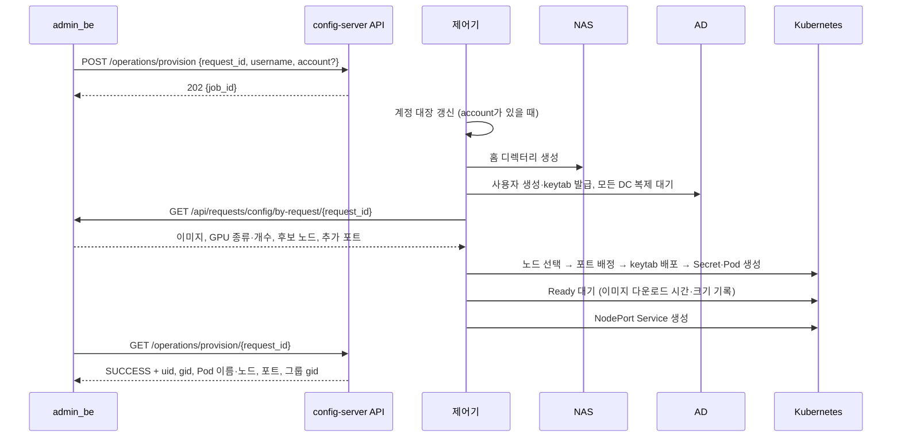
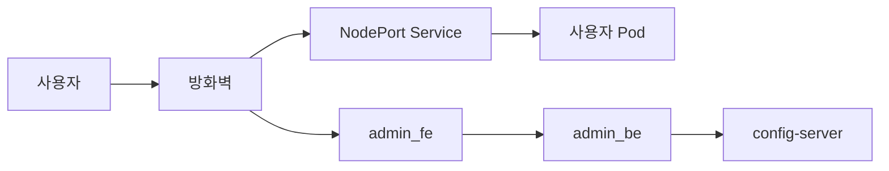
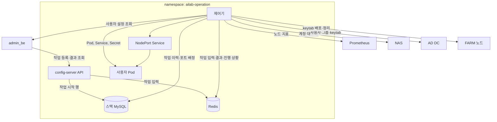
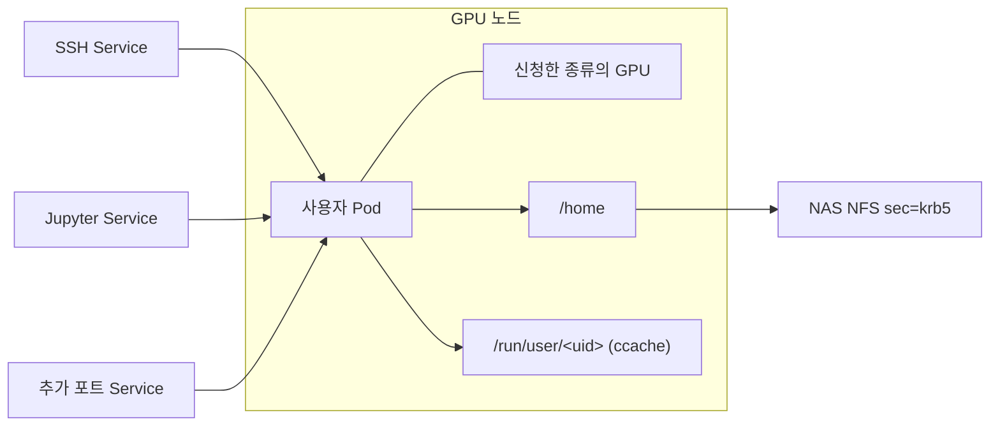

# 시스템 아키텍처

## 이 문서에서 다루는 내용

- config-server가 작업을 받아 계정, 홈 디렉터리, Pod, NodePort를 어떤 순서로 만들고 지우는지
- 어떤 정보가 `admin_be`, 스택 DB, Redis, `/kube_share`, NAS, AD에 나뉘어 저장되는지
- 작업 종류별 단계와 실패했을 때 무엇이 남고 무엇이 되돌려지는지

## 빠른 이동

| 필요할 때 | 문서 |
| --- | --- |
| 실제 운영 명령과 점검 순서를 본다 | [운영 매뉴얼](../operations/운영-매뉴얼.md) |
| 요청 형식과 응답을 확인한다 | [API 레퍼런스](../operations/API-레퍼런스.md) |
| 작업 이력·포트 배정 테이블을 본다 | [데이터베이스](데이터베이스.md) |
| Kerberos 준비 단계를 자세히 본다 | [kdc-setup](../kdc-setup/index.md) |

## 1. 서버마다 하는 일

신청을 받고 승인하는 일, Pod와 계정을 만드는 일, 파일과 인증을 제공하는 일은 서로 다른 서버가 맡는다.

| 하는 일 | 서버 또는 서비스 | 설명 |
| --- | --- | --- |
| 신청과 승인 | `admin_fe`, `admin_be` | 신청을 받고 승인 결과와 사용자 설정을 저장한다. 언제 무엇을 할지 정한다. |
| 작업 등록·조회 | config-server API | 요청을 검사해 작업으로 등록하고 결과·진행 상황을 돌려준다. |
| 작업 실행 | config-server 제어기 | 등록된 작업을 단계별로 실행한다. |
| 실행에 필요한 서비스 | Kubernetes, NAS, AD(KDC), Prometheus | 컨테이너를 실행하고, 파일을 저장하고, 계정·Kerberos 인증과 GPU 노드 정보를 제공한다. |

중요한 정보는 다음 위치에 저장한다. 한 정보의 기준(원본)은 한 곳뿐이다.

| 정보 | 기준 위치 | 사용하는 곳 |
| --- | --- | --- |
| 신청 상태와 사용자 설정 | `admin_be` DB | `admin_be`, config-server(사용자 설정 조회) |
| UID, GID, 그룹, 비밀번호 해시 | `/kube_share`의 계정 파일(계정 대장) | config-server |
| 발급한 UID·GID의 최댓값 | `/kube_share/issued_id_max.json` | config-server(번호 재사용 방지) |
| NFS 권한 판정용 사용자·그룹 | AD | NAS, FARM 노드 |
| NodePort 배정 | 스택 DB `pod_port_db.nodeport_allocations` | config-server |
| 작업 이력과 작업 소유권 | 스택 DB `operation_state_db` (`operation_log`, `job_control`) | config-server, `admin_be`(결과 조회) |
| 작업 입력·결과·진행 상황 | 스택 Redis(영속화 켬) | config-server |
| 사용자 홈 | NAS | FARM 노드, 사용자 Pod |

`admin_be`는 어떤 사용자에게 무엇을 할지 정한다. config-server는 작업을 받아 실제 자원을 맞춘다. Pod를 만들 때 필요한 이미지, GPU 종류·개수, 후보 노드, 추가 포트는 작업에 싣지 않고 실행 시점에 `admin_be`에서 다시 받는다.

## 2. 작업 등록과 실행

### 2.1 등록과 실행을 나눈 구조

`admin_be`는 계정과 Pod를 직접 순서대로 부르지 않고 **작업을 등록**한다. API는 입력을 검사해 Redis에 작업 입력을 저장하고, 작업 이력(`operation_log`)에 작업 시작 행을 남긴 뒤 **202**로 답한다. 이 시작 행의 id가 작업 번호(`job_id`)다. 같은 이미지로 뜨는 **제어기**(별도 Deployment)가 끝나지 않은 작업을 찾아 단계별로 실행한다.



등록 단계에서 막는 것은 다음과 같다. 다시 해도 같은 결과인 입력은 작업으로 넘기지 않는다.

| 막는 경우 | 응답 |
| --- | --- |
| 형식 오류(이름 규칙, 신청 번호, 포트 범위 등) | 400 `INVALID_REQUEST` |
| 새 계정 이름이 예약 이름이거나 공용 그룹 이름과 겹침 | 400 `USERNAME_CONFLICTS_GROUP` |
| 실험 스택에서 접두어 없는 계정 | 403 `ACCOUNT_PREFIX_MISMATCH` |
| 같은 번호의 같은 종류 작업이 아직 끝나지 않음 | 409 `JOB_ALREADY_REGISTERED` |
| 그룹 작업의 이름 충돌·없는 사용자·없는 그룹 | 400·404·409 |

### 2.2 작업 종류와 단계

작업 종류는 여덟 가지다. 컨테이너 신청에 딸린 작업(생성·회수·마이그레이션)은 신청 번호를 그대로 키로 쓰고, 다른 번호로 등록하는 작업은 작업 이력에서 신청 기록과 섞이지 않게 접두어를 붙인다.

| 종류 | 작업 이력 action | 기록 키 | 단계 |
| --- | --- | --- | --- |
| `provision` 생성 | `PROVISION` | 신청 번호 | 3절 |
| `revoke` 회수 | `REVOKE` | 신청 번호 | 4절 |
| `migrate` 이동·재시작 | `MIGRATE` | 신청 번호 | 5절 |
| `password` 비밀번호 교체 | `CHANGE_PASSWORD` | `password-reset-<번호>` | 6.1절 |
| `group` 그룹 | `CHANGE_GROUP` | `group-op-<번호>` | 6.2절 |
| `port` 포트 변경 | `CHANGE_PORT` | `port-change-<번호>` | 6.3절 |
| `access` 접속 차단·해제 | `CHANGE_ACCESS` | `access-op-<번호>` | 6.4절 |
| `home` 홈 삭제 | `PURGE_HOME` | `home-cleanup-<번호>` | 6.5절 |

### 2.3 실행 방식

실행 방식(`RUN_MODE`)은 세 가지이고 같은 제어기·같은 단계 함수를 쓴다. 운영(operation)은 `baseline`으로 돈다.

| 방식 | 단계 실패 | 결과 불명(응답 유실) | 제어기 재시작 | 접근 시험 |
| --- | --- | --- | --- | --- |
| `baseline` | 재시도 없이 뒷정리(이번 작업이 만든 계정 되돌리기) 후 FAIL | 조회 없이 FAIL | 이어하지 않고 뒷정리 후 FAIL(`INTERRUPTED`) | 없음 |
| `noprobe` | 최대 3번 재시도, 넘으면 FAIL(`DEGRADED`) | 실제 상태를 먼저 조회 | 끝난 단계는 건너뛰고 이어서 | 없음 |
| `full` | noprobe와 같음 | noprobe와 같음 | noprobe와 같음 | 생성·이동 뒤 실제 접근 시험, 회수 뒤 차단 시험 |

`full`의 접근 시험은 다섯 가지다. 발급한 UID로 명령이 실행되는지, Kerberos 티켓이 있는지, 홈에 쓰고 읽을 수 있는지, 신청한 GPU가 보이는지, SSH 포트가 열려 있는지를 본다. 다섯 시험을 모두 통과해야 작업이 SUCCESS로 기록된다.

`DEGRADED`는 재시도를 다 썼는데도 끝나지 않아 **자원을 남긴 채** 멈춘 실패다. 되돌리면 재승인 때 같은 자원이 중복으로 만들어질 수 있어서, 제어기는 되돌리지 않고 관리자에게 넘긴다.

### 2.4 작업 소유권과 이어하기

제어기는 작업마다 `job_control`에 소유권(lease)을 잡는다. lease는 30초짜리이고 실행 중에 계속 갱신한다. 제어기 프로세스가 죽어 갱신이 끊기면 다른 제어기(또는 다시 뜬 제어기)가 인수한다. 소유자가 아닌 프로세스의 기록은 거부되므로 한 작업을 두 프로세스가 동시에 실행하지 않는다.

`noprobe`·`full`은 끝난 단계 목록(`done_steps`)과 이어하기에 필요한 값(`saved_ctx`: Pod 이름, UID, 포트 등)을 단계마다 저장해, 인수한 쪽이 남은 단계부터 실행한다. 계정 단계는 계정 파일에 쓰기 전에 "이 작업이 쓰기 시작했다"는 표시를 남긴다. 그래서 단계 도중에 죽어도 인수한 쪽이 이 작업이 만든 계정과 예전 신청이 만든 계정을 구분한다.

단계가 앞 단계의 자원까지 정리하고 실패하면(예: 홈 단계가 실패하며 계정을 되돌림) 같은 단계만 다시 돌리지 않고 그 자원을 만든 단계부터 되감아 재시도한다. 계정 쪽은 계정 생성부터, Pod 쪽은 포트 배정(Pod 스펙)부터 다시 한다.

## 3. 생성 작업

### 3.1 단계 순서

| 경우 | 단계 순서 |
| --- | --- |
| 새 계정 (`account` 있음) | 계정 → 홈 → Kerberos principal → AD 복제 대기 → AD 그룹 반영 → 사용자 설정 조회 → Pod 준비 → 노드 선택 → Pod 스펙 → Pod 생성 → Ready 대기 → 접속 포트 연결 |
| 기존 계정 + 그룹 추가 | 그룹 추가 → AD 그룹 반영 → NAS 그룹 캐시 비우기 → 홈 확인 → (Pod 단계 같음) |
| 기존 계정 | 홈 확인 → (Pod 단계 같음) |

- 보조 그룹 중 gid 없이 온 것(admin_be에서 승인 대기 중인 새 그룹)이 있으면 맨 앞에서 gid를 정한다.
- `full`이면 맨 뒤에 접근 시험 다섯 단계가 붙는다.
- **홈 확인**은 기존 계정의 홈이 보존 기간이 지나 지워졌을 때 계정 대장의 UID·GID로 빈 홈을 다시 만든다. 이미 있는 홈은 사용자 데이터라 소유자·권한도 건드리지 않는다.

계정을 새로 만든 뒤 그다음 단계에서 실패하면 작업이 계정을 되돌린다. 다만 계정을 지울 노드를 모르거나 같은 사용자의 컨테이너가 남아 있으면 되돌리지 않고 보류한다(`held`). 홈은 되돌릴 때도 지우지 않는다. 예전 회수에서 보존된 같은 이름의 홈일 수 있기 때문이다. 이번 작업이 새로 만든 빈 홈만 지운다.

### 3.2 계정과 홈 디렉터리

계정 단계는 `/kube_share`의 `passwd`, `group`, `shadow`에 새 사용자를 쓴다. 파일은 임시 파일에 다 쓴 뒤 바꿔 끼우므로, 쓰는 도중 프로세스가 죽어도 줄이 잘린 파일이 남지 않는다. 대장을 읽고 쓰는 동안에는 스택 DB의 이름 잠금(`GET_LOCK`)을 잡는다. API 서버와 제어기가 서로 다른 프로세스라도 같은 번호를 두 번 고르지 않는다.

새 UID는 다음 규칙으로 정한다.

| 규칙 | 이유 |
| --- | --- |
| 대역(`accounts.uidMin`~`uidMax`) 안에서, 대장에 있는 관리 계정 최댓값과 **발급 기록 최댓값** 중 큰 쪽 + 1부터 빈 번호를 찾는다 | 한 번 준 번호는 계정이 지워져도 다른 사람에게 다시 주지 않는다. 재사용하면 보존된 옛 홈을 새 사용자가 넘겨받는다 |
| 돌아온 사용자는 `expected_uid`가 NAS 홈 소유자와 같으면 그 번호를 되돌려 준다 | 새 번호를 주면 보존해 둔 홈의 소유자와 어긋나 영영 막힌다 |
| 되돌려 줄 번호를 지금 다른 계정·그룹·홈이 쓰면 `EXPECTED_UID_CONFLICT`로 멈춘다(재시도 없음) | 남의 홈까지 넘겨받지 않게 한다 |
| 대장에 같은 이름·같은 UID의 계정이 남아 있으면 새로 만들지 않고 이어받는다 | admin_be 쪽 계정 기록만 빠진 경우다. 새로 만들면 `USER_ALREADY_EXISTS`로 막힌다 |

기본 GID는 UID와 같은 번호이고, 기본 그룹 이름은 `primary_group_name`(없으면 사용자 이름)이다. 공용(팀) 그룹 GID는 UID 대역과 떨어진 별도 대역(`accounts.sharedGidMin`~`sharedGidMax`)에서 준다. 두 할당기가 한 대역을 나눠 쓰면 공용 그룹이 다음 UID 번호를 먼저 가져가, 그 계정의 기본 그룹이 남의 팀 그룹이 된다.

비밀번호는 admin_be가 보낸 SHA-512 crypt 해시를 그대로 `shadow`에 쓴다. 평문은 작업 입력에도, 작업 이력에도 남지 않는다. sudo 허용 명령이 설정된 경우에만 사용자별 sudoers 파일을 만든다.

홈 디렉터리는 Pod보다 먼저 NAS에 만든다. NFS의 `root_squash` 때문에 Pod 안의 root는 NAS에 홈을 만들 수 없다. config-server가 NAS에 SSH로 접속해 디렉터리를 만들고, UID·GID로 소유자를 정한 뒤 권한을 **`711`** 로 둔다.

| 권한 | 의미 |
| --- | --- |
| 홈 `711` | 다른 사용자는 목록을 볼 수 없고 지나가기만 할 수 있다. 사용자가 홈 아래 폴더의 그룹을 팀 그룹으로 바꾸면(`chgrp` + `chmod 2770`) 팀원이 그룹 권한으로 들어온다 |
| 컨테이너 `umask 007` | 그 밖의 파일은 기타 사용자 권한이 빠진 채 만들어져, 이름을 알아도 열리지 않는다 |

이미 있는 홈의 소유자가 배정하려는 UID와 다르면 덮어쓰지 않고 `HOME_OWNER_MISMATCH`로 멈춘다(재시도 없음). 덮어쓰면 그 사용자가 자기 홈을 통째로 잃는다.

### 3.3 Kerberos와 AD

FARM 환경(`KRB5_REALM` 설정)에서는 계정 단계 뒤에 AD 작업이 이어진다.

1. AD DC에 사용자를 같은 UID·GID로 만들고 keytab을 받아 Kubernetes Secret `krb5-keytab-<user>`에 저장한다.
2. 도메인의 모든 DC가 이 사용자를 그 UID로 돌려줄 때까지 기다린다(`AD_REPLICATION_TIMEOUT`). 복제 전에 노드가 사용자를 조회하면 "없는 사용자"가 노드에 캐시되어 첫 컨테이너가 자기 홈에 쓰지 못한다.
3. 보조 그룹을 AD에 반영한다. 홈은 `sec=krb5`로 마운트되어 NAS가 AD 기준으로 그룹 권한을 판정하므로, 계정 파일에만 쓴 그룹은 NFS에서 효력이 없다.

Pod를 만들 때는 선택한 노드에 keytab과 갱신 타이머를 두고 사용자 ccache를 만든다. 배포 전에 그 노드가 사용자를 그 UID로 확인할 수 있을 때까지 최대 900초 기다린다. Pod에는 keytab을 넣지 않고 ccache(`/run/user/<uid>`)만 연결한다. 자세한 내용은 [kdc-setup](../kdc-setup/index.md)에서 본다.

### 3.4 사용자 설정과 Pod 생성

생성 작업은 `admin_be`의 `GET /api/requests/config/by-request/{request_id}`로 이미지, GPU 종류·개수, 후보 노드, 추가 포트를 받는다. 이 호출에도 같은 내부 토큰을 붙인다.

| Pod 설정 | 값 | 이유 |
| --- | --- | --- |
| 이름 | `ailab-<user>-<무작위>` | 한 사용자가 여러 신청으로 Pod를 여러 개 가질 수 있다 |
| 노드 | config-server가 고른 노드를 직접 지정 | GPU 지표로 고른다(7.1절) |
| 보이는 GPU | `NVIDIA_VISIBLE_DEVICES`에 그 노드에서 **신청한 종류의 GPU UUID 전부**. GPU 없음은 `void` | GPU를 독점 할당하지 않고 함께 쓴다. 다른 종류의 GPU는 보이지 않는다. 종류를 모르거나 노드에 없으면 Pod를 만들지 않는다 |
| 로그인 비밀번호 | Pod마다 만드는 Secret `<pod>-account`(Pod가 소유자) | 환경 변수 평문을 피하고, Pod를 지우면 함께 지워진다. 비어 있으면 `LOGIN_PASSWORD_MISSING`(422) |
| 계정 정보 | UID, 기본 GID, 그룹 목록을 환경 변수로 | 컨테이너 시작 스크립트가 컨테이너 안에 사용자를 만든다. Pod에는 `/kube_share`를 붙이지 않는다 |
| noVNC | 추가 포트에 내부 포트 `6080`이 있거나 용도가 `novnc`·`vnc`이면 `ENABLE_VNC=true` | |
| 임시 디스크 | 요청 5Gi, 한도 50Gi | 요청이 없으면 노드 디스크가 찰 때 실제 사용량과 무관하게 먼저 축출된다 |
| 우선순위 등급 | `ailab-user-workload` | 노드 디스크가 쪼들릴 때 사용자 Pod를 뒤에 내보낸다 |
| 노드 장애 허용 | `not-ready`·`unreachable` 무기한 허용 | 노드가 5분 넘게 끊겨도 Pod를 지우지 않는다. 노드가 돌아오면 멈춘 컨테이너의 변경분을 살릴 수 있다 |

Pod를 만든 뒤 Ready까지 최대 500초 기다린다. 이 대기는 안에서 이미지 다운로드(`PULL_IMAGE`) → 컨테이너 시작(`START_CONTAINER`)으로 나뉘고, 볼륨 마운트를 재시도하면 `MOUNT_VOLUME`이 끼어든다. 세 세부 단계도 다른 단계처럼 시작·성공·실패와 걸린 시간이 작업 이력에 남는다.

Pod가 Ready가 되면 포트마다 NodePort Service를 만들고 작업 결과에 Pod 이름과 포트 목록을 남긴다. Pod나 Service 생성이 실패하면 그 Pod의 Service, 포트 배정 행, Pod를 정리한다.

## 4. 회수 작업

컨테이너 회수와 계정 회수는 같은 `/operations/revoke`로 등록한다.

| 경우 | 단계 순서 |
| --- | --- |
| 컨테이너 회수 (`pod_name`) | 접속 포트 해제 → 포트 배정 반환 → Pod 삭제 → 구운 노드 이미지 삭제 → 그 노드 keytab 정리 |
| 계정 회수 (`delete_account: true`) | (컨테이너 회수 단계) → 회수 가능 확인 → 계정 삭제 → Kerberos 정리 |

`full`이면 삭제 전에 시험 대상(노드·외부 포트)을 잡아 두고, 삭제가 끝난 뒤 차단을 확인한다. 차단 확인은 "자원 부재 관찰 + 시험 경로가 살아 있음 + 옛 포트가 모두 닫힘" 셋이 맞을 때만 차단으로 기록한다. 그 사이 다른 Pod가 같은 포트 번호를 배정받았으면 그 포트는 확인 대상에서 뺀다.

| 규칙 | 이유 |
| --- | --- |
| **홈 디렉터리는 지우지 않는다** | 회수 뒤 다시 승인되는 사용자가 같은 데이터를 쓴다. 홈은 보존 기간이 지난 뒤 홈 삭제 작업(6.5절)으로만 지운다 |
| 계정을 지울 노드(`node_name`)를 모르면 보류(`ACCOUNT_NODE_UNKNOWN`) | 모든 노드를 훑으면 같은 이름의 무관한 옛 계정까지 지울 수 있다 |
| 같은 사용자의 컨테이너가 남아 있으면 보류(`ACCOUNT_IN_USE`) | 남은 컨테이너가 홈에 접근하지 못하게 된다 |
| 같은 노드에 같은 사용자의 다른 Pod가 있으면 keytab을 남긴다 | keytab을 지우면 갱신 타이머도 사라져 살아 있는 Pod의 홈이 `nobody`로 보인다 |
| 이미 없는 Pod는 성공으로 끝난다 | 같은 회수를 다시 보내도 결과가 같다 |
| 계정이 이미 없으면, 지운 기록이 있을 때만 목표 도달로 본다 | 기록 없이 "없음"만 보고 성공으로 두면 엉뚱한 이름을 회수한 것을 놓친다 |

## 5. 마이그레이션과 재시작

같은 `/operations/migrate`로 두 가지를 한다.

| 모드 | 하는 일 |
| --- | --- |
| 이동 (기본) | 후보 노드 중 GPU가 더 여유 있는 노드로 옮긴다 |
| 재시작 (`recreate: true`) | 노드를 고르지 않고 지금 노드에서 다시 만든다. GPU 목록 갱신·재시작에 쓴다 |

단계는 다음과 같다. Pod 준비·스펙·생성·Ready 대기·Service는 생성 작업과 같은 단계를 쓴다.

```text
옮길 노드 선택 → 사용자 설정 조회 → 기존 Pod 로그인 비밀번호 이어받기 → Pod 준비
 → (재시작이면) 변경분 굽기 → Pod 스펙 → Pod 생성 → Ready 대기 → 접속 포트 연결
 → (full이면) 접근 시험 → 기존 Pod 정리
```

- 이동은 현재 노드가 후보에 있어야 한다(`CURRENT_NODE_NOT_IN_CANDIDATES`). 다른 후보가 없거나(`no_candidate_node`) 가장 좋은 후보가 개선 비율(기본 0.2)을 넘지 못하면(`no_significant_improvement`) 남은 단계를 돌리지 않고 **성공**으로 끝나며 결과 `status`가 `skipped`다. `force`면 개선 비율을 보지 않는다.
- 새 Pod가 준비된 뒤에 기존 Pod·Service·포트 배정·비밀번호 Secret·기존 노드 keytab을 지운다. 새 Pod가 실패하면 새 Pod와 새 포트만 정리하고 기존 Pod는 그대로 둔다.
- 기존 Pod 정리가 실패해도 새 Pod가 서비스 중이므로 작업은 성공이고 결과 `old_pod_cleanup`이 `failed`다. 실패로 돌리면 호출자가 다시 옮기려다 Pod가 하나 더 생긴다.
- 홈 디렉터리는 NAS라 그대로 이어진다. 이동은 NodePort가 새로 배정된다.

**재시작의 변경분 유지.** `keep_changes`(기본 참)면 기존 컨테이너의 변경분(설치한 패키지 등)을 그 노드의 이미지(`ailab.local/user-image/<네임스페이스>:<pod>`)로 구워 새 Pod에 이어 준다. 굽기는 노드에 띄우는 일회용 도우미 Pod가 containerd로 한다.

| 규칙 | 이유 |
| --- | --- |
| 구운 이미지는 레지스트리에 올리지 않고 그 노드에만 둔다. 새 Pod는 내려받지 않는다(`imagePullPolicy: Never`) | 다른 노드로 옮길 때는 쓸 수 없다. 이동은 변경분을 유지하지 않는다 |
| 굽지 못하면 기본 이미지로 넘어가지 않고 작업을 실패로 끝낸다. 기존 Pod는 그대로 | 조용히 넘어가면 설치한 것이 사라진 Pod를 받는다 |
| 변경분이 압축 기준 50GiB를 넘으면 `IMAGE_CHANGES_TOO_LARGE` | 구우면 임시 디스크 사용량이 0부터 다시 시작해, 상한이 없으면 재시작을 반복해 디스크 한도를 넘겨 쌓을 수 있다 |
| 회수할 때 구운 이미지도 지운다 | 회수된 사용자의 변경분이 노드 디스크에 남지 않게 한다 |

실행 중이던 프로세스, 저장하지 않은 Jupyter 커널 상태는 어느 모드에서도 이어지지 않는다.

## 6. 그 밖의 작업

### 6.1 비밀번호 교체

계정 대장(`shadow`), 사용자의 모든 계정 Secret, 떠 있는 모든 Pod의 `/etc/shadow`를 같은 해시로 바꾼다. 대장을 먼저 바꾸고, 중간에 실패하면 옛 해시로 되돌린 뒤 실패로 끝낸다. 되돌리기까지 끝난 실패는 "아무것도 바뀌지 않음"을 뜻하므로 재시도하지 않는다. Pod가 하나도 없어도 성공이다.

### 6.2 그룹

| `op` | 하는 일 |
| --- | --- |
| `create` | 공용 GID 대역에서 번호를 정해 대장에 쓰고, AD에 그룹과 멤버를 만들고, FARM 노드의 NFS 이름 변환(idmapd)에 등록한다 |
| `add` | AD에 먼저 멤버를 넣고, 대장에 쓰고, 떠 있는 Pod의 그룹 목록을 맞춘 뒤 NAS 그룹 캐시를 비운다 |
| `remove` | `add`의 반대. 사용자의 기본 그룹은 뺄 수 없다(`PRIMARY_GROUP`) |

AD를 먼저 맞추는 이유는 AD가 실패해도 대장이 더럽혀지지 않게 하려는 것이다. 실패해도 앞서 한 일을 되돌리지 않는다. 되돌리면 AD에 남은 그룹과 다시 배정한 GID가 어긋나 같은 요청을 다시 처리할 수 없다. 이미 맞춰진 조각은 그대로 두므로 같은 작업을 다시 등록하면 이어서 끝난다.

컨테이너 이미지가 이미 가진 그룹 이름(`sudo`, `docker`, `video` 등)은 공용 그룹 이름으로 쓸 수 없다(`GROUP_NAME_RESERVED`). 그 이름으로 그룹을 만들면 컨테이너 시작 스크립트가 "같은 이름, 다른 GID"로 판단해 컨테이너를 죽인다.

### 6.3 포트 변경

떠 있는 Pod의 추가 포트를 Pod를 다시 만들지 않고 바꾼다. 입력은 "바뀐 뒤 추가 포트 전체 목록"이고, 지금 배정·Service와 비교해 남는 것만 지우고 모자란 것만 만든다. 기본 포트(22·8888)와 noVNC(6080)는 이 작업으로 바꿀 수 없다. 추가 포트는 10개까지다.

뺄 포트는 Service를 먼저 지우고 배정 행을 지운다. 배정 행부터 지우면 Service가 살아 있는 외부 포트가 다른 Pod에 다시 배정된다.

### 6.4 접속 차단·해제

계정의 모든 Pod의 모든 접속 포트를 막거나 푼다. Service를 지우지 않고 선택자에 `ailab.dgu/access-blocked` 조건을 붙여 넘길 대상만 없앤다. 지우면 외부 포트 배정이 풀려 그 번호가 다른 Pod로 넘어가고, 풀었을 때 같은 포트로 돌아오지 못한다.

늦게 다시 실행된 옛 작업이 그 뒤의 결정을 덮지 못하게, 작업이 등록된 시각을 Service 주석(`ailab.dgu/access-decided-at`)에 적는다. 더 나중 결정으로 반대 상태가 된 Service가 있으면 이 작업은 아무것도 바꾸지 않고 `ACCESS_SUPERSEDED`로 실패한다. 차단 중인 계정의 이동·포트 변경은 새로 만드는 Service도 막힌 채로 만든다.

### 6.5 홈 삭제

보존 기간이 지난 홈을 NAS에서 지운다. 보존 기간이 지났는지는 `admin_be`가 판단하고, config-server는 지금 지워도 되는 상태인지만 본다. 지우는 일은 되돌릴 수 없으므로 셋 중 하나라도 어긋나면 지우지 않고 실패로 끝낸다(재시도 없음).

1. 그 계정의 컨테이너가 없다 (`HOME_IN_USE`)
2. 그 계정의 생성·이동 작업이 돌고 있지 않다 (`HOME_IN_USE`)
3. 홈 소유자가 `admin_be`가 아는 그 계정의 UID다 (`HOME_OWNER_MISMATCH`)

홈이 이미 없으면 성공이다(`result.deleted`가 `false`). 다만 홈들이 놓인 경로 자체가 안 보이면 "없음"과 구별되지 않으므로 성공으로 두지 않는다(`HOME_ROOT_UNREACHABLE`). 계정과 UID는 그대로 둔다.

## 7. GPU 노드와 포트 고르는 방식

### 7.1 노드 선택

config-server는 `admin_be`가 전달한 `gpu_nodes` 목록에서 Pod를 올릴 노드를 고른다. 목록이 비어 있으면 Kubernetes에서 준비가 끝난 워커 노드를 가져오고, control-plane 노드(`NoSchedule`)는 뺀다.

```text
score = avg(DCGM_FI_DEV_GPU_UTIL) + avg(DCGM_FI_DEV_FB_USED) / 1024 + avg(DCGM_FI_DEV_GPU_TEMP) / 100
```

점수가 가장 낮은 노드를 고르고, 같으면 목록 앞쪽을 고른다. 지표마다 `or vector(0)`이 붙어 있어 지표가 없으면 0으로 계산한다. Prometheus 조회가 실패하거나 결과가 비면 그 노드는 고르지 않고, 모든 후보를 조회하지 못하면 Pod를 만들지 않는다. 고른 노드가 `gpu_nodes`에 있으면 그 항목의 CPU, 메모리, GPU 개수를 Pod 설정에 넣는다.

### 7.2 NodePort 배정

사용자 Pod에는 SSH(22), Jupyter(8888), 추가 포트마다 NodePort Service를 하나씩 만든다. Service 이름은 `ailab-<user>-<무작위 8자>`다. 용도는 신청자가 자유롭게 적는 글이라 이름에 넣으면 Kubernetes가 거절하고, 외부 포트는 다시 만들 때 바뀔 수 있어 이름에 넣지 않는다. 조회·삭제는 모두 `pod_name` 라벨로 한다.

포트를 고르고 기록하는 일은 한 번의 DB 트랜잭션이다.

1. `nodeport_allocations`의 포트 기록을 `FOR UPDATE`로 잠근다.
2. MySQL에 적힌 포트와 클러스터 전체 Service가 이미 쓰는 NodePort를 모은다. 클러스터 조회가 실패하면 MySQL 기록만으로 진행한다.
3. 스택의 NodePort 대역(`nodeport.min`~`max`)을 오름차순으로 훑어 빈 포트를 고른다.
4. 고른 포트를 `username`, `pod_name`, `node_name`, 내부 포트, 용도와 함께 저장한다.
5. Pod가 Ready가 되면 기록된 포트마다 Service를 만든다.

포트를 고르기 전에 MySQL 기록과 Kubernetes Service를 맞추는 정리(reconcile)가 돈다. 마지막 시도 뒤 5분이 지나야 다시 돌고, Service가 하나도 없는 `pod_name`의 행을 지운다. 다만 행은 Service보다 먼저 들어가고 그 사이에 Ready 대기(최대 500초)가 끼므로, 마지막 행이 **900초보다 오래된** Pod만 지운다. 그래야 지금 만들고 있는 Pod의 배정을 지우지 않는다.

| 구분 | 저장 위치 | 의미 |
| --- | --- | --- |
| 요청 포트 | `admin_be` DB의 `port_requests` | 사용자가 요청한 컨테이너 내부 포트 |
| 확정 포트 | `admin_be` DB의 `pod_external_ports` | 실제 NodePort와 내부 포트의 연결 정보 |
| 배정 기록 | `pod_port_db.nodeport_allocations` | Pod와 NodePort Service를 정리할 때 쓰는 기록 |

### 7.3 스택별 대역

UID·GID·NodePort 대역은 `ops/proposed-stack/uid-ranges.yaml` 한 곳에 선언하고, 설치 스크립트가 배포 전에 다른 스택과 겹치는지 검사한다. AD·NAS·FARM 노드를 스택끼리 공유하므로 대역이 겹치면 다른 스택의 계정을 덮어쓴다.

| 스택 | UID | 공용 GID | 사용자 NodePort | 계정 접두어 |
| --- | --- | --- | --- | --- |
| operation | 21000~49999 | 70000~79999 | 30000~30079 | 없음 |
| noprobe | 50000~54999 | 80000~84999 | 32000~32249 | `exp-np-` |
| full | 55000~59999 | 85000~89999 | 32250~32499 | `exp-fu-` |
| baseline | 60000~64999 | 90000~94999 | 32500~32749 | `exp-bl-` |

운영의 NodePort 대역은 방화벽이 외부로 여는 구간 안이어야 한다. 그 구간 밖의 번호를 배정하면 내부에서는 접속되는데 외부에서는 안 되고, 내부 점검으로는 드러나지 않는다. 실험 스택은 외부 접속을 쓰지 않는다. 접두어가 있는 스택은 그 접두어로 시작하지 않는 계정 요청을 403으로 거절해, 운영 계정을 덮어쓰거나 지우지 못하게 한다.

### 7.4 외부 접근 경로

외부 사용자는 방화벽을 거쳐 `admin_fe` 또는 사용자 Pod의 NodePort Service에 접속한다. 방화벽은 외부 포트를 NodePort로 전달하므로 두 번호가 같을 필요는 없다. 외부 접속이 되지 않으면 Service의 NodePort와 방화벽 전달 대상이 같은지 확인한다.



## 8. 서버와 서비스가 연결되는 모습

### 8.1 config-server가 연결하는 서비스



### 8.2 사용자 Pod



사용자 Pod는 접속용 Service, 신청한 종류의 GPU, 홈 디렉터리, ccache를 쓴다. UID·GID·그룹은 Pod를 만들 때 환경 변수로 넣고, 홈은 노드의 NFS 마운트를 hostPath로 연결한다. **사용자 Pod에는 keytab, `/kube_share`, 이미지 저장소가 붙지 않는다.**

### 8.3 주기 작업

| 작업 | 주기 | 하는 일 |
| --- | --- | --- |
| `<release>-gpu-check` | 10분 | GPU가 보이지 않는 사용자 Pod를 찾아 admin_be 내부 알림 API로 보낸다 |
| `<release>-krb5-reconcile` | 30분 | `krb5_cleanup_pending`에 남은 keytab 정리를 다시 시도하고, 포트 배정 기록에 없는 사용자의 keytab을 고아 후보로 로그에 남기고(구 시스템 계정과 구분할 수 없어 자동 삭제하지 않음), 공용 그룹이 바뀌었으면 NAS가 따라잡은 것을 확인한 뒤 NAS 그룹 캐시를 비우고, 새 공유 그룹을 노드 idmapd에 등록한다 |

두 작업 모두 동시 실행을 막고(`concurrencyPolicy: Forbid`) 제한 시간(5분·15분)을 둔다. 끝나지 않는 실행이 주기마다 쌓이지 않게 하려는 것이다.
