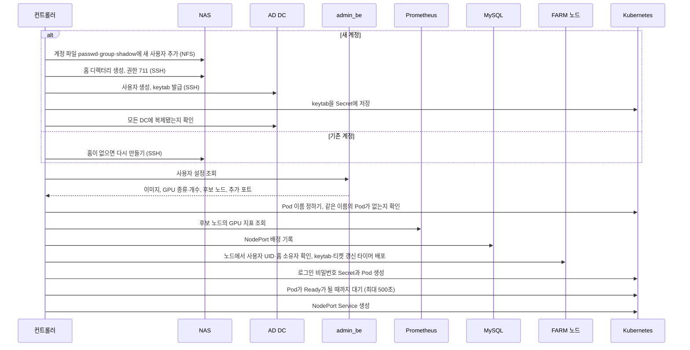
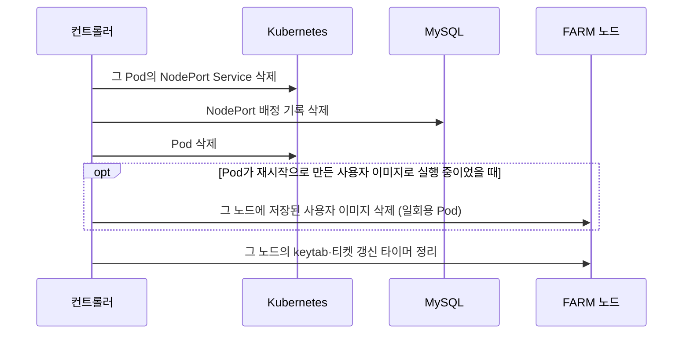
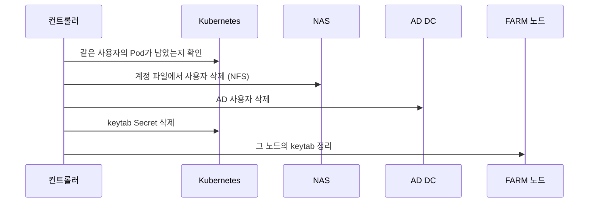
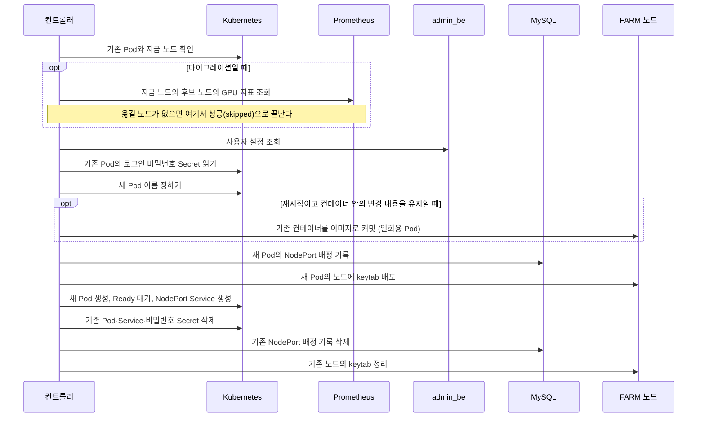
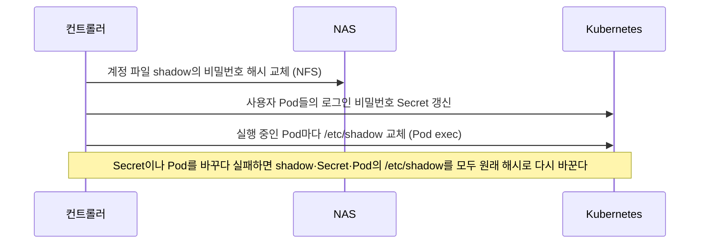
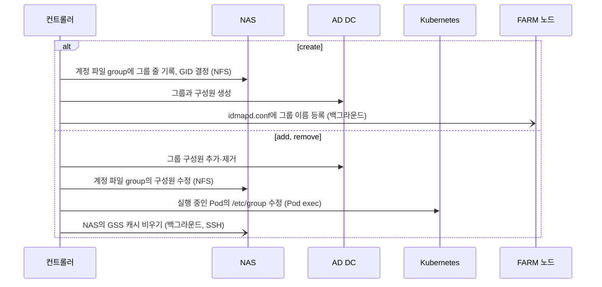
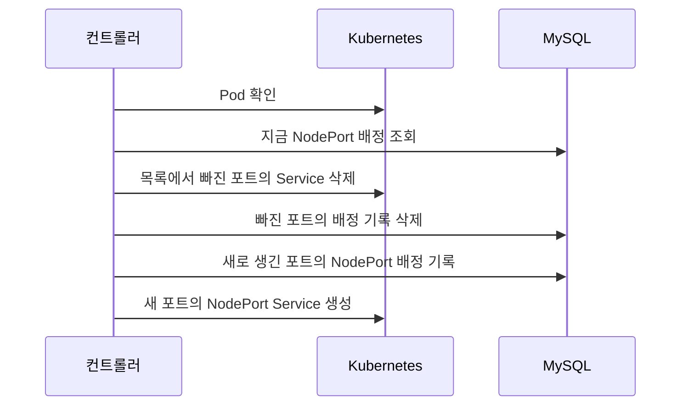
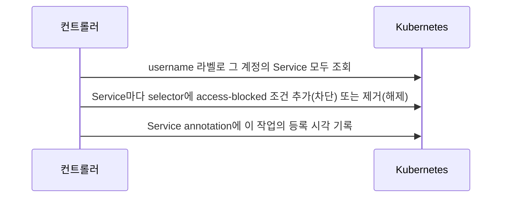
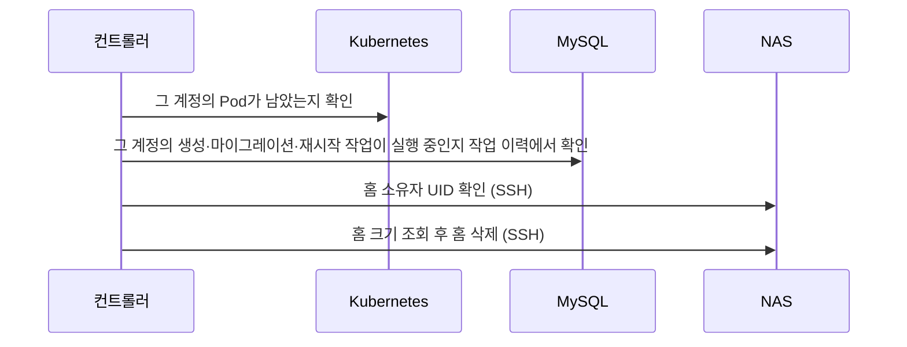

# 작업별 동작

## 이 문서에서 다루는 내용

- config-server 컨트롤러가 작업 종류마다 실행하는 단계와 그 순서
- 단계가 실패했을 때 무엇을 되돌리고 무엇을 남기는지
- UID·GID를 정하는 규칙, 홈 디렉터리 권한, 사용자 Pod 설정, GPU 노드와 NodePort를 고르는 방식

작업(`admin_be`가 config-server에 맡기는 일 한 건)과 컨트롤러(작업을 실행하는 config-server 프로세스)의 뜻, 작업을 등록하고 실행하는 구조, 실행 방식(`RUN_MODE`)은 [시스템 아키텍처](시스템-아키텍처.md)에서 먼저 설명한다. 이 문서의 단계와 값은 운영 환경(`ailab-operation`)이 쓰는 config-server v3.3.108(커밋 `ed86ddb`) 코드와 대조했다.

2~5절의 각 작업 절에는 그림이 있다. 그림은 컨트롤러가 작업을 가져간 뒤 단계를 실행하며 다른 서비스를 호출하는 순서만 보여 준다. 작업을 등록하고 결과를 조회하는 과정과, 단계마다 작업 이력에 기록하는 일은 [시스템 아키텍처 4.1절](시스템-아키텍처.md#register-execute)에 있다.

## 빠른 이동

| 필요할 때 | 문서 |
| --- | --- |
| 서버 구성과 작업 등록·실행 구조를 확인한다 | [시스템 아키텍처](시스템-아키텍처.md) |
| 작업 등록 입력과 오류 코드를 확인한다 | [API 레퍼런스](../operations/API-레퍼런스.md) |
| 작업 이력·작업 소유권·포트 배정 테이블을 확인한다 | [데이터베이스](데이터베이스.md) |
| 작업이 실패했을 때 운영 절차를 확인한다 | [운영 매뉴얼](../operations/운영-매뉴얼.md) |
| AD·keytab 작업을 자세히 확인한다 | [kdc-setup](../kdc-setup/index.md) |

## 1. 모든 작업에 공통적으로 적용되는 실행 규칙

### 1.1 실행 방식별 실패 처리 <a id="run-mode-rules"></a>

실행 방식(`RUN_MODE`, [시스템 아키텍처 4.3절](시스템-아키텍처.md#run-mode))은 `baseline`, `noprobe`, `full` 세 가지다. 운영은 `baseline`으로 실행하고, 실험 스택은 세 방식을 하나씩 쓴다([개요](../개요.md) 5절). 세 방식은 단계가 실패했을 때, 단계의 결과를 알 수 없을 때, 컨트롤러가 다시 시작됐을 때를 다음처럼 처리한다. "단계의 결과를 알 수 없을 때"는 단계가 NAS·AD DC 등에 보낸 요청의 응답을 받지 못해(시간 초과 등), 그 요청이 실제로 처리됐는지 모르는 경우다.

| 방식 | 단계가 실패하면 | 단계의 결과를 알 수 없으면 | 컨트롤러가 다시 시작되면 | 작업이 끝난 뒤 |
| --- | --- | --- | --- | --- |
| `baseline` | 다시 실행하지 않고 작업을 실패로 끝낸다 | 요청이 처리됐는지 확인하지 않고 작업을 실패로 끝낸다 | 하던 작업을 이어서 실행하지 않고 실패(`INTERRUPTED`)로 끝낸다 | 시험하지 않는다 |
| `noprobe` | 그 단계를 첫 실행을 포함해 최대 3번 실행한다. 3번 모두 실패하면 `DEGRADED`로 끝낸다 | 그 단계가 하려던 일(예: 계정 생성)이 실제로 처리됐는지 먼저 확인한다. 처리됐으면 성공으로 보고 다음 단계로 넘어간다 | 끝난 단계는 건너뛰고 남은 단계부터 실행한다 | 시험하지 않는다 |
| `full` | `noprobe`와 같다 | `noprobe`와 같다 | `noprobe`와 같다 | 접근 시험을 한다(아래) |

- `noprobe`·`full`도 다시 실행해도 결과가 같은 실패는 재시도하지 않는다. 4xx 오류(입력 오류, 중복 등)와, 단계가 "재시도하지 않음"으로 표시한 실패가 여기에 해당한다.
- `noprobe`·`full`에서 결과를 알 수 없는 단계 가운데, 처리됐는지 확인할 방법이 없고 다시 실행하기도 안전하지 않은 단계는 바로 `DEGRADED`로 끝낸다.
- `baseline`은 결과를 알 수 없었다는 사실을 작업 이력의 오류 내용(`error_detail`)에 남긴다.
- 생성 작업이 실패로 끝날 때 이번 작업이 새 계정을 만든 뒤였으면, 컨트롤러는 그 계정을 되돌린다. 조건은 [2.1절](#provision-undo)에 있다.

접근 시험은 `full`에서만 한다. 생성·마이그레이션·재시작 작업 뒤에는 사용자가 Pod를 실제로 쓸 수 있는지 다섯 가지를 시험한다. 발급한 UID로 명령이 실행되는지, Kerberos 티켓이 있는지, 홈에 쓰고 읽을 수 있는지, 신청한 GPU가 보이는지, SSH 포트가 열려 있는지를 시험한다. GPU를 신청하지 않은 Pod는 GPU 시험을, 접속이 차단된 계정의 Pod는 SSH 포트 시험을 건너뛴다. 컨트롤러는 나머지 시험을 모두 통과해야 작업을 SUCCESS로 기록한다. 접근 시험 단계는 다른 단계와 달리 최대 5번까지 실행한다. 컨테이너 회수 뒤에는 접속이 실제로 막혔는지 시험한다([3.1절](#revoke-container)).

`DEGRADED`는 재시도를 다 쓰고도 단계를 끝내지 못한 실패다. 이때 컨트롤러는 그 작업이 만든 자원을 되돌리지 않고 **남겨 둔 채** 작업을 끝낸다. 재시도를 다 쓰고도 실패했거나 결과를 알 수 없으면, 자원이 실제로 어떤 상태인지 컨트롤러가 판단할 수 없기 때문이다. 대신 작업 이력의 오류 내용에 실패한 단계와, 그 단계가 다루던 자원의 실제 상태를 확인하라는 안내를 남긴다. 작업 이력(MySQL의 `operation_log` 테이블)의 끝 행은 마지막 시도의 결과를 알 수 없었으면 `UNKNOWN`, 그 밖에는 `FAIL`이다. 남은 자원은 관리자가 확인해 처리한다.

`INTERRUPTED`는 `baseline`에서 컨트롤러가 작업 도중 죽었다가 다시 시작됐을 때의 실패다. 다시 시작된 컨트롤러는 그 작업을 이어서 실행하지 않고, 계정 되돌리기만 시도한 뒤 작업을 끝낸다. 계정 되돌리기는 keytab을 지울 노드의 이름이 있어야 실행된다. 그런데 이때 컨트롤러는 Pod를 배포하던 노드의 이름을 계정 되돌리기에 주지 않는다. 그래서 Kerberos realm이 설정된 환경(운영 포함)에서는 계정 되돌리기가 `ACCOUNT_NODE_UNKNOWN`으로 보류되고 계정이 남는다. 노드를 넘기지 않는 이유는, `baseline`이 예전 운영 방식을 그대로 재현하기 위한 방식이기 때문이다. 예전에는 config-server가 요청을 처리하다 죽으면 `admin_be`가 어느 노드에 배포하던 중이었는지 모른 채 계정을 정리했다.

### 1.2 작업 소유권과 이어하기 <a id="lease-rules"></a>

작업 소유권이 무엇이고 왜 쓰는지는 [시스템 아키텍처 4.4절](시스템-아키텍처.md#lease)에서 설명한다. 여기서는 값과 세부 규칙만 적는다.

- 소유권(lease)은 `job_control`에 기록한 뒤 30초가 지나면 만료된다. 컨트롤러는 작업을 실행하는 동안 만료 시각을 계속 뒤로 미룬다(갱신).
- 소유권이 없는 컨트롤러 프로세스는 그 작업의 진행 기록을 쓸 수 없다. 쓰려 하면 거부된다.
- 컨트롤러는 세 방식 모두 단계가 끝날 때마다 끝난 단계 목록(`done_steps`)과 이어서 실행하는 데 필요한 값(`saved_ctx`: Pod 이름, UID, 포트 등)을 `job_control`에 기록한다. `noprobe`·`full`에서 소유권을 가져간 컨트롤러는 이 기록을 보고 남은 단계부터 실행한다. `baseline`에서는 이 기록으로 중단된 작업임을 확인하고 `INTERRUPTED`로 끝낸다(1.1절).
- `noprobe`·`full`의 계정 단계는 [계정 파일](Kerberos-AD-Samba.md#account-file)에 쓰기 전에 "이 작업이 쓰기 시작했다"는 표시를 남긴다. 그래서 컨트롤러가 계정 단계 도중에 죽어도, 소유권을 가져간 컨트롤러가 이 작업이 만든 계정과 예전 신청이 만든 계정을 구분할 수 있다.

어떤 단계가 실패하면서 앞 단계가 만든 자원까지 정리하는 경우가 있다(예: 홈 단계가 실패하면서 계정을 되돌림). 이때는 실패한 단계만 다시 실행하지 않고, 그 자원을 만든 단계로 돌아가 거기서부터 다시 실행한다. 계정 쪽은 계정 생성 단계부터, Pod 쪽은 NodePort를 배정하는 단계부터 다시 실행한다.

## 2. 생성 작업 <a id="provision"></a>

생성 작업은 승인된 신청 하나마다 사용자 Pod(컨테이너)를 하나 만든다. 반면 리눅스 계정과 홈 디렉터리는 사용자 한 명에 하나만 만들고, 그 사용자의 Pod가 모두 함께 쓴다. 예를 들어 한 사용자가 신청을 두 건 승인받으면 Pod는 두 개 생기지만, 두 Pod 모두 같은 계정과 같은 홈 디렉터리를 쓴다. 컨테이너를 회수할 때는 계정을 지우지 않는다. 마지막 Pod를 회수한 뒤에도 계정은 남고, 같은 사용자가 다시 신청하면 그 계정을 그대로 쓴다. 계정은 관리자가 사용자를 삭제하거나 비활성화할 때만 회수한다([3.2절](#revoke-account)).

그래서 생성 작업은 두 경우로 나뉜다. `admin_be`는 신청을 승인할 때 그 사용자에게 이 서버의 리눅스 계정이 이미 있는지 확인한다.

- **새 계정**: 사용자에게 계정이 없을 때다. 첫 신청이거나, 계정이 회수된 뒤에 낸 신청이다. `admin_be`는 생성 요청에 계정을 만들 정보(`account`: 비밀번호 해시, 기본 그룹 이름, 예전 UID 등)를 넣는다. 컨트롤러는 계정, 홈, AD 사용자를 만든 뒤 Pod를 만든다.
- **기존 계정**: 계정이 이미 있을 때다. 다른 컨테이너를 쓰는 중이거나, 예전 컨테이너만 회수되고 계정은 남아 있는 경우다. `admin_be`는 `account`를 빼고 보낸다. 컨트롤러는 계정 단계를 건너뛰고 Pod만 만든다. 새 Pod는 기존 홈을 그대로 쓴다.

다음 그림은 컨트롤러가 생성 작업의 단계를 실행하며 다른 서비스를 호출하는 순서다. 위의 두 경우를 나눠 보여 준다. 생성 요청에 보조 그룹(사용자를 넣을 공용 그룹)이 함께 오면 그룹 단계가 더해진다. 그 단계는 [5.2절](#provision-groups)에 있다.



### 2.1 홈 확인과 실패했을 때 계정 되돌리기

- `full`이면 그림의 마지막 단계 뒤에 접근 시험 다섯 단계([1.1절](#run-mode-rules))가 붙는다.
- 기존 계정은 Pod를 만들기 전에 홈이 있는지 확인한다(그림의 "홈이 없으면 다시 만들기"). 보존 기간이 지나 홈이 지워졌으면([5.5절](#home)), 계정 파일의 UID·GID로 빈 홈을 다시 만든다. 이미 있는 홈은 사용자 데이터가 들어 있으므로 소유자와 권한도 바꾸지 않는다.

<a id="provision-undo"></a>**실패했을 때 계정 되돌리기.** 새 계정을 만드는 생성 작업이 실패하면, 이번 작업이 만든 계정을 지운다.

- 계정을 만드는 단계(계정 파일에 사용자 추가, 홈 생성, AD 사용자 생성) 안에서 실패하면, 그 단계가 계정을 직접 되돌린다. AD 사용자 생성 단계에서 실패하면 이번 작업이 새로 만든 빈 홈도 지운다.
- AD 사용자를 만든 뒤 그다음 단계(DC 복제 확인이나 Pod 단계)에서 실패하면, 컨트롤러가 작업을 끝내기 전에 계정 파일의 계정, AD 사용자, keytab을 지운다. 이때 홈은 지우지 않는다. 예전 회수에서 보존된 같은 이름의 홈일 수 있기 때문이다.
- 계정을 지울 노드(Pod를 올리려던 FARM 노드)를 고르기 전에 실패했거나 같은 사용자의 컨테이너가 남아 있으면, 계정을 지우지 않고 보류한다(`held`). 보류 조건은 계정 회수와 같다([3.2절](#revoke-account)).

### 2.2 계정과 홈 디렉터리 <a id="account-home"></a>

계정 단계는 `/kube_share`의 `passwd`, `group`, `shadow`에 새 사용자를 쓴다. 컨트롤러는 새 내용을 임시 파일에 모두 쓴 뒤 그 파일로 원래 파일을 교체한다. 그래서 쓰는 도중 프로세스가 죽어도 줄이 잘린 파일이 남지 않는다. 계정 파일을 읽고 쓰는 동안에는 MySQL의 이름 잠금(`GET_LOCK`)을 잡는다. 그래서 API 서버와 컨트롤러가 서로 다른 프로세스여도 같은 UID를 두 번 고르지 않는다.

새 UID는 다음 규칙으로 정한다.

| 규칙 | 이유 |
| --- | --- |
| 대역(`accounts.uidMin`~`uidMax`) 안에서, 계정 파일에 있는 관리 계정 최댓값과 **발급 기록 최댓값**(`/kube_share/issued_id_max.json`에 적어 둔, 지금까지 발급한 번호의 최댓값) 중 큰 쪽 + 1부터 빈 번호를 찾는다 | 한 번 준 번호는 계정이 지워져도 다른 사람에게 다시 주지 않는다. 재사용하면 보존된 옛 홈을 새 사용자가 넘겨받는다 |
| 예전에 계정이 있었다가 다시 신청한 사용자는 `expected_uid`가 NAS 홈 소유자와 같으면 그 번호를 되돌려 준다 | 새 UID를 주면 보존해 둔 홈의 소유자 UID와 달라져, 그 사용자가 자기 홈의 파일을 읽거나 쓸 수 없다 |
| 되돌려 줄 번호를 지금 다른 계정·그룹·홈이 쓰면 `EXPECTED_UID_CONFLICT`로 멈춘다(재시도 없음) | 남의 홈까지 넘겨받지 않게 한다 |
| 계정 파일에 같은 이름·같은 UID의 계정이 남아 있으면 새로 만들지 않고 이어받는다 | admin_be 쪽 계정 기록만 빠진 경우다. 새로 만들면 `USER_ALREADY_EXISTS`로 막힌다 |

기본 GID는 UID와 같은 번호이고, 기본 그룹 이름은 `primary_group_name`(없으면 사용자 이름)이다.

비밀번호는 admin_be가 보낸 SHA-512 crypt 해시를 그대로 `shadow`에 쓴다. 평문은 작업 입력에도, 작업 이력에도 남지 않는다. sudo 허용 명령이 설정된 경우에만 사용자별 sudoers 파일을 만든다.

홈 디렉터리는 Pod보다 먼저 NAS에 만든다. NFS의 `root_squash`(NFS 클라이언트의 root를 NAS에서 권한 없는 사용자로 바꾸는 설정, [기본 용어](기본-용어.md) 2.2절) 때문에 Pod 안의 root는 NAS에 홈을 만들 수 없다. config-server가 NAS에 SSH로 접속해 디렉터리를 만들고, UID·GID로 소유자를 정한 뒤 권한을 **`711`** 로 설정한다.

| 권한 | 의미 |
| --- | --- |
| 홈 `711` | 다른 사용자는 홈의 목록을 볼 수 없고, 홈을 거쳐 그 아래 폴더로 들어가기만 할 수 있다. 사용자가 홈 아래 폴더의 그룹을 공용 그룹으로 바꾸면(`chgrp` + `chmod 2770`), 그 공용 그룹의 구성원이 그룹 권한으로 그 폴더에 접근할 수 있다 |
| 컨테이너 `umask 007` | 사용자가 컨테이너에서 만드는 파일에는 기타 사용자 권한이 없다. 다른 사용자는 파일 이름을 알아도 열 수 없다 |

이미 있는 홈의 소유자가 배정하려는 UID와 다르면 덮어쓰지 않고 `HOME_OWNER_MISMATCH`로 멈춘다(재시도 없음). 덮어쓰면 그 사용자가 자기 홈을 통째로 잃는다.

### 2.3 Kerberos와 AD <a id="kerberos-ad"></a>

Kerberos realm(Kerberos 인증을 관리하는 도메인 이름, 설정값 `KRB5_REALM`)이 설정된 환경(FARM)에서는 계정 단계 뒤에 AD DC 작업이 이어진다.

1. AD DC에 사용자를 계정 파일과 같은 UID·GID로 만들고 keytab(사용자의 Kerberos 비밀키를 저장한 파일)을 받아 Kubernetes Secret `krb5-keytab-<user>`에 저장한다.
2. 도메인의 모든 DC가 이 사용자를 그 UID로 돌려줄 때까지 기다린다(`AD_REPLICATION_TIMEOUT`). 복제가 끝나기 전에 노드가 사용자를 조회하면, 노드는 "없는 사용자"라는 조회 결과를 캐시에 저장한다. 그러면 그 사용자의 첫 컨테이너가 자기 홈에 쓰지 못한다.

Pod를 만들 때는 선택한 노드에 keytab과, 티켓을 주기적으로 갱신하는 타이머를 배포하고 사용자 ccache(받은 Kerberos 티켓을 저장하는 파일)를 만든다. 배포 전에는 그 노드에서 두 가지를 확인한다. 사용자 이름을 조회하면(`getent passwd`) 계정 파일과 같은 UID가 나와야 하고, 노드에서 본 홈 디렉터리의 소유자도 그 UID여야 한다. 새 계정은 AD DC에 복제된 뒤에도 노드와 NAS의 캐시 때문에 몇 분 동안 옛 결과(없는 사용자, 소유자 `nobody`)가 보일 수 있다. 그래서 컨트롤러는 두 가지가 맞을 때까지 10초 간격으로 확인하며 최대 900초 기다린다. Pod에는 keytab을 넣지 않고 ccache(`/run/user/<uid>`)만 연결한다. 자세한 내용은 [kdc-setup](../kdc-setup/index.md)에 있다.

### 2.4 사용자 설정과 Pod 생성 <a id="pod-spec"></a>

컨트롤러는 Pod를 만들기 전에 `admin_be`의 `GET /api/requests/config/by-request/{request_id}`를 불러 이미지, GPU 종류·개수, 후보 노드, 추가 포트를 받는다. 후보 노드는 신청이 고른 리소스 그룹([4절](#migrate))의 노드다.

이 조회 API는 웹 화면이 아니라 config-server가 부르는 API다. 응답에 신청서에 적은 로그인 비밀번호의 해시(`passwd_hash`, 계정을 만든 뒤에는 비어 있다)가 들어 있으므로, `admin_be`는 웹 화면에 로그인한 사용자라도 이 API에는 응답하지 않는다. 대신 요청 헤더 `X-Internal-Token`에 미리 정한 비밀 문자열(내부 토큰)이 있어야 응답하고, 없거나 틀리면 401로 거절한다. 내부 토큰은 config-server와 `admin_be`에 같은 값으로 설정한다. 컨트롤러는 config-server 설정의 `CONFIG_API_TOKEN` 값을 이 헤더에 넣어 보낸다. `admin_be`도 config-server API를 부를 때 같은 값을 넣는다([API 레퍼런스](../operations/API-레퍼런스.md) 1절).

| Pod 설정 | 값 | 이유 |
| --- | --- | --- |
| 이름 | `ailab-<user>-<무작위>` | 한 사용자가 여러 신청으로 Pod를 여러 개 가질 수 있다 |
| 노드 | config-server가 고른 노드를 직접 지정 | GPU 지표로 고른다([6.1절](#node-select)) |
| 보이는 GPU | `NVIDIA_VISIBLE_DEVICES`에 그 노드에서 **신청한 종류의 GPU UUID 전부**. GPU 없음은 `void` | GPU를 독점 할당하지 않고 함께 쓴다. 다른 종류의 GPU는 보이지 않는다. 종류를 모르거나 노드에 없으면 Pod를 만들지 않는다 |
| GPU 드라이버 기능 | `NVIDIA_DRIVER_CAPABILITIES=all` | 컨테이너에 계산용 드라이버 라이브러리뿐 아니라 그래픽·디스플레이용도 넣게 한다. CUDA 이미지 기본값(compute, utility)이면 Vulkan이 없어 Isaac Sim이 실행되지 않는다 |
| 로그인 비밀번호 | Pod마다 만드는 Secret `<pod>-account`(Pod가 소유자) | Pod 정의(환경 변수)에 비밀번호 값이 그대로 보이지 않게 한다. Pod를 지우면 Secret도 함께 지워진다. 비어 있으면 `LOGIN_PASSWORD_MISSING`(422) |
| 계정 정보 | UID, 기본 GID, 그룹 목록을 환경 변수로 | 컨테이너 시작 스크립트가 컨테이너 안에 사용자를 만든다. Pod에는 `/kube_share`를 마운트하지 않는다 |
| noVNC | 추가 포트에 내부 포트 `6080`이 있거나 용도가 `novnc`·`vnc`인 포트가 있으면 `ENABLE_VNC=true` | 컨테이너 시작 스크립트는 이 값이 있을 때만 noVNC(웹 브라우저로 컨테이너의 데스크탑 화면을 쓰게 하는 프로그램)를 실행한다 |
| 준비 확인 | readinessProbe: 22번 포트 TCP 연결 | 컨테이너 시작 스크립트가 계정을 만들고 sshd를 띄운 뒤에야 Pod가 Ready가 된다. 이 확인이 없으면 SSH로 접속할 수 없는데도 Ready가 된다 |
| 임시 디스크(컨테이너 안에서 홈 밖에 쓴 파일이 저장되는 노드 디스크 공간) | 요청 5Gi, 한도 50Gi | Pod에 임시 디스크 요청값(requests)이 없으면, 노드 디스크가 찰 때 실제 사용량과 상관없이 먼저 축출된다 |
| 우선순위 등급 | `ailab-user-workload` | 노드 디스크가 부족해 Kubernetes가 Pod를 축출할 때, 사용자 Pod가 다른 Pod보다 나중에 축출되게 한다 |
| 노드 장애 때 Pod 유지 | `not-ready`·`unreachable` toleration, 기한 없음 | Kubernetes는 기본으로 노드가 5분 넘게 응답하지 않으면 그 노드의 Pod를 지운다. 이 설정(toleration)이 있으면 지우지 않는다. 노드가 돌아오면 재시작([4.2절](#restart))으로 컨테이너 안의 변경 내용을 이어 받은 Pod를 만들 수 있다 |
| 재시작 정책 | `restartPolicy: Never` | 컨테이너가 끝나도 Kubernetes가 다시 시작하지 않는다 |
| Kubernetes API 토큰 | `automountServiceAccountToken: false` | Pod 안에 Kubernetes API 토큰을 넣지 않는다 |

`admin_be`는 신청서의 noVNC 선택값(`enable_vnc`)도 사용자 설정 응답에 넣는다. 그러나 config-server v3.3.108은 이 값을 읽지 않는다. noVNC를 켤지는 추가 포트만 보고 정한다.

Pod를 만든 뒤 Ready까지 최대 500초 기다린다. 이 동안 Pod를 실제로 준비하는 쪽은 노드의 kubelet(Kubernetes가 노드마다 실행하는 프로그램)이다. kubelet은 이미지를 내려받고, Pod의 볼륨을 컨테이너에 연결한 뒤 컨테이너를 시작한다. 사용자 Pod의 볼륨은 노드가 NAS를 마운트한 경로(`/home/tako<N>/share/user`, N은 노드 번호)를 `/home`으로 연결한다. Kerberos realm이 설정된 환경에서는 노드의 ccache 디렉터리도 `/run/user/<uid>`로 연결한다. 컨트롤러는 이 일을 직접 하지 않는다. 대신 5초마다 Pod 이벤트(kubelet이 남기는 진행 기록)를 읽어, 지금 어느 세부 단계인지 작업 이력에 기록한다.

| 세부 단계 | 기록되는 때 |
| --- | --- |
| `PULL_IMAGE` | 이미지를 내려받는 중. 노드에 이미지가 이미 있으면 기록되지 않는다 |
| `START_CONTAINER` | 컨테이너를 만들고 시작한 뒤 준비 확인(22번 포트)을 기다리는 중 |
| `MOUNT_VOLUME` | kubelet이 볼륨 연결에 실패해 다시 시도하는 중(이벤트 `FailedMount`). 정상이면 기록되지 않는다 |

`MOUNT_VOLUME`은 예를 들어 Pod 설정이 가리키는 마운트 경로가 그 노드에 없을 때 기록된다. 세 세부 단계도 다른 단계처럼 시작·성공·실패와 걸린 시간이 작업 이력에 남는다.

Pod가 Ready가 되면 포트마다 NodePort Service를 만들고 작업 결과에 Pod 이름과 포트 목록을 남긴다. Pod나 Service 생성이 실패하면 그 Pod의 Service, 포트 배정 행, Pod를 정리한다.

## 3. 회수 작업 <a id="revoke"></a>

회수 작업은 두 가지다. 컨테이너 회수는 사용자 Pod 하나를 지우고, 계정 회수는 리눅스 계정과 AD 사용자를 지운다. 홈 디렉터리는 어느 쪽에서도 지우지 않는다. 회수 뒤 다시 승인되는 사용자가 같은 데이터를 쓰기 때문이다. 홈은 보존 기간이 지난 뒤 홈 삭제 작업([5.5절](#home))으로만 지운다.

두 회수는 같은 API(`POST /operations/revoke`)와 같은 작업 종류(`revoke`)로 등록한다. 컨트롤러는 입력을 보고 실행할 단계를 정한다. 입력에 `pod_name`이 있으면 컨테이너 회수 단계를, `delete_account: true`가 있으면 계정 회수 단계를 실행한다. 둘을 함께 보내면 한 작업에서 컨테이너 회수 뒤에 계정 회수를 이어서 실행한다.

운영 `admin_be`(커밋 `5c63b45`)는 두 회수를 따로 등록한다.

- **컨테이너 회수**: 신청의 사용 기간이 끝났을 때, 관리자가 화면에서 컨테이너를 회수할 때 등록한다. 계정과 홈은 남는다.
- **계정 회수**: 관리자가 사용자를 삭제하거나 비활성화할 때, 또는 사용자 관리 화면에서 리눅스 계정을 회수할 때 등록한다. `admin_be`는 먼저 그 사용자의 컨테이너를 모두 컨테이너 회수로 지운다. 모두 끝나면, 그 사용자가 컨테이너를 썼던 노드마다 계정 회수를 하나씩 등록한다. 이때 `pod_name` 없이 `username`과 `node_name`을 보낸다.

### 3.1 컨테이너 회수 <a id="revoke-container"></a>



Pod가 재시작([4.2절](#restart))으로 만든 사용자 이미지로 실행 중이었으면, 컨트롤러는 Pod를 지운 뒤 그 이미지도 노드에서 지운다. 이 이미지에는 사용자가 컨테이너 안에서 바꾼 내용이 들어 있고, 이미지는 그 노드에만 저장돼 있다. 지우지 않으면 회수된 사용자의 파일이 노드 디스크에 남는다. 이미지를 지우는 일도 커밋과 같은 일회용 Pod가 한다.

| 규칙 | 이유 |
| --- | --- |
| 같은 노드에 같은 사용자의 다른 Pod가 있으면 keytab을 남긴다 | keytab을 지우면 티켓 갱신 타이머도 사라져, 실행 중인 다른 Pod에서 홈 파일의 소유자가 `nobody`로 보인다 |
| 이미 없는 Pod는 성공으로 끝난다 | 같은 회수를 다시 보내도 결과가 같다 |

`full`에서는 삭제 전에 시험 대상(노드·외부 포트)을 저장해 두고, 삭제가 끝난 뒤 차단을 확인한다. 컨트롤러는 다음 세 가지가 모두 맞을 때만 "차단됨"으로 기록한다. ① Pod·Service·포트 배정 행이 실제로 없다. ② 시험에 쓰는 노드의 SSH 포트에 접속된다(접속되지 않으면 판정할 수 없으므로 다시 시도한다). ③ 회수 전에 이 Pod가 쓰던 NodePort가 모두 닫혔다. 그 사이 다른 Pod가 같은 포트 번호를 배정받았으면 그 포트는 ③의 확인 대상에서 뺀다.

### 3.2 계정 회수 <a id="revoke-account"></a>



| 규칙 | 이유 |
| --- | --- |
| 계정을 지울 노드(`node_name`)를 모르면 보류(`ACCOUNT_NODE_UNKNOWN`) | 모든 노드를 훑으면 같은 이름의 무관한 옛 계정까지 지울 수 있다 |
| 같은 사용자의 컨테이너가 남아 있으면 보류(`ACCOUNT_IN_USE`) | 남은 컨테이너가 홈에 접근하지 못하게 된다 |
| 계정이 이미 없으면, 그 계정을 지운 작업 기록이 있을 때만 성공으로 처리한다(`noprobe`·`full`). 기록이 없으면 `ACCOUNT_ABSENT_UNVERIFIED`로 실패한다 | 계정이 없는 이유가 회수 때문인지 알 수 없다. 계정 파일이 손상됐거나, 처음부터 없던 이름으로 요청했을 수도 있다. 그래서 회수 완료로 기록하지 않는다 |

`baseline`은 계정이 이미 없으면 `USER_NOT_FOUND`로 실패한다. `full`은 마지막에 계정 파일의 `passwd`와 keytab Secret이 없어졌는지 확인한다.

## 4. 마이그레이션과 재시작 <a id="migrate"></a>

두 작업은 실행 중인 사용자 Pod를 새 Pod로 바꾼다. 컨트롤러는 새 Pod를 먼저 만들고, 새 Pod가 준비되면 기존 Pod를 지운다. 두 작업은 같은 API(`POST /operations/migrate`)로 등록하고, 입력의 `recreate`로 구분한다.

| 작업 | 하는 일 | 요청하는 사람 |
| --- | --- | --- |
| 마이그레이션 (기본) | Pod를 같은 리소스 그룹의 다른 노드로 옮긴다 | 관리자 |
| 재시작 (`recreate: true`) | 지금 노드에서 Pod를 다시 만든다 | 관리자, 사용자(자기 컨테이너) |

리소스 그룹은 `admin_be`가 같은 종류의 GPU를 가진 노드를 묶은 단위다(예: `3090ti`). 사용자는 신청할 때 리소스 그룹 하나를 고르고, 그 신청의 Pod는 그 그룹의 노드에만 만들어진다.

다음 그림은 컨트롤러가 두 작업의 단계를 실행하며 다른 서비스를 호출하는 순서다. 사용자 설정 조회부터 NodePort Service 생성까지는 생성 작업과 같은 단계를 쓴다.



- 기존 Pod의 로그인 비밀번호 Secret을 읽는 이유는, 신청에 담긴 비밀번호 해시가 승인이 끝나면 지워지기 때문이다. 새 Pod는 기존 Pod의 Secret에서 해시를 이어받는다.
- 새 Pod가 준비되면 컨트롤러는 기존 Pod의 Service·포트 배정·Pod·비밀번호 Secret을 지운다. 기존 Pod가 재시작으로 만든 사용자 이미지로 실행 중이었으면 그 이미지도 지우고, 기존 노드의 keytab을 정리한다. 새 Pod가 실패하면 새 Pod와 새 포트만 정리하고 기존 Pod는 그대로 둔다.
- 기존 Pod 정리가 실패해도 새 Pod가 서비스 중이므로 작업은 성공이고, 결과의 `old_pod_cleanup`이 `failed`다. 작업을 실패로 기록하면 `admin_be`가 다시 마이그레이션하려 하면서 Pod가 하나 더 생긴다.
- 홈 디렉터리는 NAS에 있어서 그대로 이어진다. 두 작업 모두 새 Pod에 NodePort를 새로 배정하므로 외부 포트 번호가 바뀐다.
- 실행 중이던 프로세스와 저장하지 않은 Jupyter 커널 상태는 두 작업 모두 이어지지 않는다.

### 4.1 마이그레이션 <a id="migration"></a>

마이그레이션은 Pod를 같은 리소스 그룹 안에서 GPU를 덜 쓰는 노드로 옮기는 작업이다. 관리자가 관리자 화면에서 후보 노드를 골라 요청한다.

- 후보 목록(`nodes`)은 그 신청의 리소스 그룹에 속한 노드 목록이다. `admin_be`는 다른 리소스 그룹의 노드가 섞여 있으면 작업을 등록하지 않고 거절한다(`MIGRATION_NODE_OUTSIDE_RESOURCE_GROUP`). 다른 그룹의 노드에는 신청한 GPU가 없어서, 새 Pod가 GPU 확인에서 실패하기 때문이다.
- 후보 목록에는 지금 Pod가 있는 노드도 들어 있어야 한다. config-server는 리소스 그룹 정보를 갖고 있지 않아서, `admin_be`가 보낸 목록을 그대로 쓴다. 이 목록에 지금 노드가 없으면 컨트롤러는 아무것도 바꾸지 않고 `CURRENT_NODE_NOT_IN_CANDIDATES`(400)로 실패한다.
- 컨트롤러는 지금 노드와 나머지 후보 노드의 점수를 노드 선택과 같은 식([6.1절](#node-select))으로 구한다. 가장 낮은 후보 점수가 지금 노드 점수의 80% 이하일 때만 옮긴다. 80%는 1에서 개선 비율(`min_improvement_ratio`, 기본 0.2)을 뺀 값이다. `force`면 이 조건을 검사하지 않는다.
- 다른 후보가 없거나(`no_candidate_node`) 위 조건을 넘지 못하면(`no_significant_improvement`) 남은 단계를 실행하지 않고 **성공**으로 끝난다. 이때 결과 `status`는 `skipped`다.
- 마이그레이션은 컨테이너 안의 변경 내용([4.2절](#restart))을 옮기지 않는다. 새 노드의 Pod는 신청한 이미지로 새로 만들어진다.

### 4.2 재시작 <a id="restart"></a>

재시작은 노드를 고르지 않고 지금 노드에서 Pod를 다시 만드는 작업이다. 컨테이너에서 GPU가 보이지 않을 때([시스템 아키텍처 5절](시스템-아키텍처.md#cronjobs)의 `gpu-check`가 알림) 새 Pod에 노드의 지금 GPU 목록을 다시 넣거나, 컨테이너를 다시 시작할 때 쓴다. 관리자는 재시작하면서 이미지를 바꿀 수 있다. 사용자는 자기 컨테이너를 1시간에 5번까지 재시작할 수 있고, 이용 정지 중에는 재시작할 수 없다([5.4절](#access)).

**컨테이너 안의 변경 내용 유지.** 관리자 화면과 사용자 화면의 재시작 창에는 "설치한 내용 유지" 선택지가 있고, 처음부터 선택되어 있다. 이 선택은 작업 입력의 `keep_changes` 값으로 컨트롤러에 전달된다. 이 선택지가 필요한 이유와, 선택했을 때 컨트롤러가 하는 일은 다음과 같다.

1. 컨테이너는 이미지에서 시작한다. 이미지는 운영체제와 프로그램 파일을 묶어 둔 것으로, 사용자가 신청할 때 고른 것(예: `cuda:11.8`)이다.
2. 사용자가 컨테이너 안에서 홈 밖의 파일을 바꾸면(apt로 패키지를 설치하거나 `/etc`의 설정 파일을 고치면), 바뀐 파일은 이미지가 아니라 그 컨테이너에만 저장된다. 홈(`/home`)은 NAS에 있으므로 여기에 해당하지 않는다.
3. 재시작은 기존 Pod를 지우고 새 Pod를 만든다. 새 컨테이너는 1의 이미지에서 다시 시작하므로, 2에서 바뀐 파일은 새 컨테이너에 없다.
4. 그래서 `keep_changes`가 참이면, 컨트롤러는 새 Pod를 만들기 전에 원래 이미지의 파일에 2에서 바뀐 파일을 더해 새 이미지로 저장한다. 이 일을 커밋이라고 한다.
5. 새 Pod는 신청한 이미지 대신 4에서 저장한 이미지로 만든다. 그래서 설치한 패키지와 고친 설정 파일이 새 Pod에도 있다.

4에서 저장한 이미지의 이름은 `ailab.local/user-image/<네임스페이스>:<새 Pod 이름>`이고, 작업 이력에는 `COMMIT_IMAGE` 단계로 기록된다.

**커밋을 맡는 일회용 Pod.** 커밋은 그 컨테이너가 실행 중인 노드에서만 할 수 있다. 컨테이너를 실행하는 프로그램(containerd)이 노드마다 따로 있고, containerd는 그 노드 안의 소켓 파일(`/run/containerd/containerd.sock`)로만 명령을 받기 때문이다. 컨트롤러는 관리용 데스크탑에서 실행되므로 FARM 노드의 이 소켓에 직접 접근할 수 없다. 그래서 컨트롤러는 그 노드에 커밋만 하고 끝나는 Pod(이름 `ailab-image-helper-<무작위>`)를 하나 만든다. 이 Pod는 노드의 containerd 소켓을 마운트하고, config-server 이미지에 들어 있는 커밋 프로그램(`node_image_cli.py`, `nerdctl` 사용)을 실행한다. 컨트롤러는 이 Pod가 끝날 때까지 최대 900초 기다리고, 끝나면 이 Pod를 지운다.

커밋 프로그램은 다음 순서로 커밋한다.

1. 실행 중인 기존 컨테이너를 cgroup freeze(프로세스를 그대로 일시 정지하는 리눅스 기능)로 멈춘다(최대 60초 기다림). 커밋하는 동안 컨테이너 안의 파일이 바뀌지 않게 하려는 것이다.
2. `nerdctl commit`으로 컨테이너의 지금 파일 상태를 이미지로 저장한다.
3. 멈춘 컨테이너를 다시 실행 상태로 돌린다.

"설치한 내용 유지"를 끄면(`keep_changes`가 거짓이면) 커밋하지 않고 신청한 이미지로 새 Pod를 만든다. 관리자가 재시작하면서 이미지를 바꿀 때도 `keep_changes`를 거짓으로 보낸다. 이때는 `admin_be`가 보낸 `image`로 새 Pod를 만들고, 작업 결과의 `image`에 그 이미지를 돌려준다.

| 규칙 | 이유 |
| --- | --- |
| 커밋한 이미지는 레지스트리에 올리지 않고 그 노드의 containerd에만 저장한다. 새 Pod는 이미지를 내려받지 않는다(`imagePullPolicy: Never`) | 다른 노드에서는 이 이미지를 쓸 수 없다. 그래서 마이그레이션은 컨테이너 안의 변경 내용을 유지하지 않는다 |
| 커밋하지 못하면 신청한 이미지로 넘어가지 않고 작업을 실패로 끝낸다(재시도 없음). 기존 Pod는 그대로 남는다 | 알리지 않고 신청한 이미지로 만들면, 사용자는 설치한 패키지가 없는 Pod를 받는다 |
| 커밋하려고 멈춘 기존 컨테이너를 다시 실행 상태로 돌리지 못하면 `IMAGE_LEFT_PAUSED`로 실패한다 | 이때 기존 Pod는 멈춘 채 남아, 사용자가 접속할 수 없다 |
| 재시작으로 이미지에 쌓인 커밋 층의 압축 크기 합이 50GiB를 넘으면, 방금 만든 이미지를 지우고 `IMAGE_CHANGES_TOO_LARGE`로 실패한다 | 아래 설명 |
| 컨테이너를 회수할 때 커밋한 이미지도 지운다([3.1절](#revoke-container)) | 회수된 사용자의 파일이 노드 디스크에 남지 않게 한다 |

50GiB 상한을 정한 이유는 다음과 같다. 커밋할 때마다 이미지에는 그 컨테이너에서 바뀐 파일을 담은 층(layer)이 하나 더해진다. 커밋한 이미지로 새 Pod를 만들면, 새 Pod의 임시 디스크 사용량은 0부터 다시 센다. 상한이 없으면 사용자가 재시작을 반복하면서 임시 디스크 한도(50Gi)보다 많은 파일을 이미지에 계속 쌓을 수 있다. 그래서 상한은 한 번의 커밋이 아니라 이미지에 쌓인 커밋 층 전체의 크기에 적용한다.

## 5. 그 밖의 작업

### 5.1 비밀번호 교체 <a id="password"></a>



컨트롤러는 사용자의 비밀번호 해시를 다음 세 곳에서 같은 값으로 바꾼다. 사용자에게 Pod가 하나도 없으면 1만 바꾸고 성공으로 끝낸다.

1. NAS의 계정 파일 `shadow`: 사용자 계정의 비밀번호 해시가 기록된 파일이다.
2. 로그인 비밀번호 Secret(`<pod>-account`): 사용자의 Pod마다 하나씩 있다. 컨테이너가 시작할 때 시작 스크립트가 이 Secret의 해시를 컨테이너의 `/etc/shadow`에 넣는다. Pod가 실행 중이 아니어도 바꾼다. 나중에 그 Pod를 재시작하거나 마이그레이션하면 새 Pod가 이 Secret의 해시를 이어받기 때문이다([4절](#migrate)).
3. 실행 중인 Pod의 `/etc/shadow`: 사용자가 SSH로 그 Pod에 로그인할 때 비밀번호를 확인하는 파일이다. 이미 시작한 컨테이너에는 2를 바꿔도 반영되지 않으므로, 컨트롤러가 Pod 안에서 이 파일을 직접 바꾼다(Pod exec).

컨트롤러는 1을 먼저 바꾼다. 그 뒤 2나 3을 바꾸다 실패하면, 1~3을 모두 원래 해시로 다시 바꾼 뒤 작업을 실패로 기록한다. 세 곳에 서로 다른 해시가 남으면, 사용자가 지금 Pod에 로그인할 때와 Pod를 다시 만든 뒤 로그인할 때의 비밀번호가 달라질 수 있기 때문이다. 1~3을 모두 원래대로 되돌린 실패는 아무것도 바뀌지 않은 상태이므로 재시도하지 않는다. 되돌리기도 실패했으면 재시도해 새 해시로 맞춘다(`noprobe`·`full`).

### 5.2 그룹 <a id="group"></a>

공용 그룹은 여러 사용자가 함께 쓰는 그룹이다. 사용자가 홈 아래 폴더의 그룹을 공용 그룹으로 바꾸면, 그 그룹의 구성원이 그 폴더에 접근할 수 있다([2.2절](#account-home)). 사용자 계정에서 공용 그룹은 기본 그룹이 아닌 보조 그룹(supplementary group)으로 들어간다.

공용 그룹을 만들거나 구성원을 바꾸는 요청은 두 가지다. 하나는 그룹 작업(`create`·`add`·`remove`)이고, 다른 하나는 생성 요청에 보조 그룹이 함께 오는 경우다.

#### 그룹 작업(create·add·remove)



| `op` | 하는 일 |
| --- | --- |
| `create` | 계정 파일 `group`에 그룹 줄을 먼저 써서 GID를 정한다(`admin_be`가 `gid`를 주지 않으면 공용 GID 대역에서 고른다). 그다음 AD DC에 그룹과 구성원을 만들고, 모든 FARM 노드의 `/etc/idmapd.conf`(NFS가 사용자·그룹 이름과 번호를 서로 바꿀 때 읽는 설정 파일)에 그룹 이름을 등록하는 요청을 백그라운드로 보낸다 |
| `add` | AD DC의 그룹에 사용자를 먼저 넣고, 계정 파일에 구성원을 쓴다. 그다음 그 사용자의 실행 중인 Pod마다 `/etc/group`에 그룹을 더하고, [NAS의 GSS 캐시](Kerberos-AD-Samba.md#nas-gss-cache) 비우기를 백그라운드로 시작한다 |
| `remove` | `add`와 같은 순서로 사용자를 그룹에서 뺀다. 사용자의 기본 그룹은 뺄 수 없다(`PRIMARY_GROUP`) |

`add`·`remove`가 AD DC를 먼저 바꾸는 이유는, AD DC 작업이 실패했을 때 계정 파일이 바뀌지 않은 상태로 남게 하려는 것이다. 그러면 다시 실행할 때 같은 상태에서 시작한다.

그룹 작업은 중간에 실패해도 앞서 한 일을 되돌리지 않는다. 되돌리면(계정 파일의 그룹 줄을 지우면), 같은 요청을 다시 처리할 때 새 GID가 배정되어 AD DC에 남아 있는 그룹의 GID와 어긋난다. 그러면 그 요청을 다시 처리할 수 없다. 이미 반영된 부분(계정 파일의 그룹 줄, AD DC의 그룹 등)은 그대로 남으므로, 같은 작업을 다시 등록하면 남은 부분만 반영하고 끝난다. idmapd 등록과 NAS의 GSS 캐시 비우기는 실패해도 작업을 실패시키지 않는다. 남은 일은 30분 주기 `krb5-reconcile`이 다시 한다([시스템 아키텍처 5절](시스템-아키텍처.md#cronjobs)).

실행 중인 Pod의 `/etc/group`은 컨트롤러가 Kubernetes API의 Pod exec(`kubectl exec`와 같은 기능)로 Pod 안에서 root로 고친다. 그룹이 없으면 `groupadd`로 만들고 `usermod -aG`로 사용자를 넣는다(`remove`는 `gpasswd -d`로 뺀다). 바뀐 그룹은 새로 여는 세션에만 반영되고, 이미 실행 중인 프로세스에는 반영되지 않는다. Pod에 반영하지 못해도 작업은 성공하고, 실패한 Pod는 작업 결과의 `result.pods.failed`에 남는다.

컨테이너 이미지가 이미 가진 그룹 이름(`sudo`, `docker`, `video` 등)은 공용 그룹 이름으로 쓸 수 없다(`GROUP_NAME_RESERVED`). 그 이름으로 그룹을 만들면 컨테이너 시작 스크립트가 "같은 이름, 다른 GID"로 판단해 컨테이너를 종료한다.

#### 생성 요청에 보조 그룹이 함께 올 때 <a id="provision-groups"></a>

생성 요청에 보조 그룹이 있으면 생성 작업([2절](#provision))에 다음 단계가 더해진다.

| 경우 | 더해지는 단계 |
| --- | --- |
| 새 계정 | 계정 단계에서 보조 그룹 구성원도 계정 파일에 쓴다. AD 복제 대기 뒤에 AD 그룹 반영 → NAS 그룹 반영 대기가 이어진다 |
| 기존 계정 | 홈 확인 전에 그룹 추가(계정 파일) → AD 그룹 반영 → NAS의 GSS 캐시 비우기 시작이 실행된다 |

보조 그룹 가운데 gid 없이 온 그룹(`admin_be`에서 승인을 기다리는 새 그룹)이 있으면, 컨트롤러는 단계 순서의 맨 앞에서 그 그룹의 gid를 정한다.

**AD 그룹 반영.** 컨트롤러는 보조 그룹 구성원을 AD DC에 반영한다. 홈은 `sec=krb5`로 마운트되어 NAS가 AD DC의 정보로 그룹 권한을 판정하므로, 계정 파일에만 쓴 그룹은 NFS에서 효력이 없다.

**NAS 그룹 반영 대기.** 이 단계는 새 계정에 보조 그룹이 있고 Kerberos realm이 설정된 환경에서만 실행한다. 컨트롤러는 AD DC 사이에 복제될 시간으로 10초를 먼저 기다린다. 그다음 NAS에 SSH로 접속해 `id -G`로 그 사용자의 그룹을 20초 간격으로 최대 420초 동안 조회한다. NAS가 새 보조 그룹을 모두 답하면 다음 단계로 넘어간다.

이 단계가 필요한 이유는 다음과 같다.

1. NAS는 AD DC에서 조회한 그룹 정보를 자체 캐시에 300초 동안 보관한다. 이 캐시는 NAS의 GSS 캐시와 다른 캐시다.
2. NAS는 계정의 GSS 컨텍스트를 처음 만들 때 그 계정의 그룹 목록을 한 번 정하고, NAS의 GSS 캐시를 비우기 전까지 다시 조회하지 않는다.
3. 그래서 컨테이너가 NAS에 처음 접근할 때 NAS가 새 그룹을 모르면, `krb5-reconcile`이 NAS의 GSS 캐시를 비울 때까지(최대 30분) 그 사용자는 공용 그룹 폴더에 접근하지 못한다. 2026-11-13에는 21분 넘게 접근이 거절됐다.

420초 안에 확인하지 못해도 작업은 실패하지 않는다. 컨트롤러는 `NAS_GROUPS_UNCONFIRMED`를 기록하고, NAS의 GSS 캐시 비우기를 시작한 뒤 다음 단계로 넘어간다.

**NAS의 GSS 캐시 비우기 시작.** 이 단계는 [NAS의 GSS 캐시](Kerberos-AD-Samba.md#nas-gss-cache)를 비우는 일을 백그라운드로 시작하고 바로 다음 단계로 넘어간다. 백그라운드 작업은 20초 간격으로 최대 10분 동안, NAS에 `id -G`로 조회한 공용 그룹이 계정 파일과 같아진 것을 확인한 뒤 캐시를 비운다. 이 일이 실패해도 작업은 실패하지 않는다.

#### 공용 그룹 GID 대역

공용 그룹의 GID는 UID 대역과 겹치지 않는 별도 대역(`accounts.sharedGidMin`~`sharedGidMax`)에서 고른다. 두 번호를 한 대역에서 고르면, 공용 그룹이 다음 새 계정의 UID가 될 번호를 먼저 가져갈 수 있다. 그러면 그 새 계정의 기본 그룹(UID와 같은 번호의 GID)이 다른 사람들의 공용 그룹이 된다.

### 5.3 포트 변경 <a id="port"></a>



실행 중인 Pod의 추가 포트를 Pod를 다시 만들지 않고 바꾼다. 입력은 "바뀐 뒤 추가 포트 전체 목록"이다. 컨트롤러는 이 목록을 지금의 포트 배정·Service와 비교해, 목록에서 빠진 포트의 배정·Service는 지우고 목록에 새로 생긴 포트의 배정·Service만 만든다. 기본 포트(22·8888)와 noVNC 포트(6080)는 이 작업으로 바꿀 수 없다. noVNC는 Pod를 만들 때 환경 변수(`ENABLE_VNC`, [2.4절](#pod-spec))로 켜진다. 그래서 실행 중인 Pod에 6080 포트만 더해도 noVNC는 실행되지 않는다. 같은 이유로 용도 이름 `ssh`·`jupyter`·`novnc`·`vnc`도 추가 포트에 쓸 수 없다. `admin_be`와 `admin_fe`의 포트 변경 신청도 같은 포트와 이름을 받지 않는다. 추가 포트는 10개까지다.

목록에서 빠진 포트는 NodePort Service를 먼저 지우고, 그다음 MySQL의 포트 배정 행(`nodeport_allocations`)을 지운다. 순서를 반대로 하면, 배정 행을 지운 뒤 Service를 지우기 전까지 MySQL에는 그 외부 포트가 빈 번호로 남는다. 그 사이 다른 Pod의 작업이 그 번호를 배정받을 수 있지만, 그 번호는 아직 이 Pod의 Service가 쓰고 있다. Kubernetes는 같은 NodePort를 쓰는 Service를 두 개 만들지 않으므로, 그 Pod의 Service 생성이 실패한다.

### 5.4 접속 차단·해제 <a id="access"></a>

이 작업은 경고 제도의 이용 정지에 쓴다. 서버 관리팀은 오류를 신고하면서 사용자 매뉴얼과 오류 Q&A를 확인하지 않거나 안내된 신고 절차를 지키지 않은 사용자에게 경고를 준다. 이런 신고는 확인과 재문의 업무를 늘려 다른 사용자의 오류 처리를 늦춘다. 경고가 2회 이상 쌓이면 계정 이용이 7 × (경고 횟수 − 1)일 정지된다(2회 7일, 3회 14일).

`admin_be`는 정지가 시작되면 그 사용자의 접속 차단 작업을 등록하고, 정지가 끝나거나 경고가 취소되면 해제 작업을 등록한다. 정지 시작과 경고 취소는 그 자리에서 등록한다. 정지가 끝나는 것은 1시간마다 확인한다. 이때 정지 기록과 실제 차단 상태가 어긋난 사용자도 다시 맞춘다. 정지 중인 사용자는 접속이 막히는 것 말고도 새 신청과 변경 신청을 낼 수 없고, 자기 컨테이너를 재시작할 수 없다. 관리자도 그 사용자의 새 컨테이너를 승인할 수 없다.



계정의 모든 Pod의 모든 접속 포트를 막거나 푼다. 컨트롤러는 `username` 라벨로 그 계정의 Service를 모두 찾는다. 막을 때 Service를 지우지 않는다. 대신 Service의 selector(Service가 연결을 전달할 Pod를 고르는 조건)에 `ailab.dgu/access-blocked` 조건을 더해, 그 Service가 연결을 전달할 Pod가 없게 만든다.

Service를 지우지 않는 이유는 다음과 같다. Service를 지우면 그 Service의 NodePort 배정이 풀리고, 그 번호가 다른 Pod에 배정될 수 있다. 그러면 나중에 차단을 풀었을 때 원래 포트 번호로 돌아오지 못한다.

작업은 등록된 순서와 다른 순서로 실행될 수 있다. 예를 들어 먼저 등록된 작업이 실패해 다시 실행되는 동안, 나중에 등록된 작업이 먼저 끝날 수 있다. 그래서 컨트롤러는 Service를 바꿀 때마다 그 작업이 등록된 시각을 Service의 annotation `ailab.dgu/access-decided-at`에 적는다. annotation은 Kubernetes 객체에 붙여 두는 메모(키와 값)로, Service의 동작에는 영향을 주지 않는다. 작업은 Service를 바꾸기 전에 이 값을 읽어, 자기보다 나중에 등록된 작업이 이미 Service를 반대 상태로 바꿔 놓았는지 확인한다.

예를 들어 10:00에 차단 작업 A가, 10:05에 해제 작업 B가 등록됐는데 B가 먼저 실행됐다고 하자.

1. B는 Service를 열고 annotation에 10:05를 적는다.
2. 나중에 A가 실행된다. A는 열린 Service에 자기 등록 시각(10:00)보다 늦은 10:05가 적혀 있는 것을 확인한다.
3. A는 Service를 바꾸지 않고 `ACCESS_SUPERSEDED`로 실패한다. 이 확인이 없으면 A가 Service를 다시 막아, 정지가 풀린 사용자가 접속하지 못한다.

A를 성공이 아니라 실패로 기록하는 이유는, 바꾼 것이 없는데 성공으로 남기면 `admin_be`가 A의 차단이 반영됐다고 기록하기 때문이다. 두 작업의 등록 시각이 같으면 차단을 따른다.

차단 중인 계정의 마이그레이션·재시작·포트 변경은 새로 만드는 Service도 막힌 채로 만든다.

### 5.5 홈 삭제 <a id="home"></a>



보존 기간이 지난 홈을 NAS에서 지운다. 보존 기간이 지났는지는 `admin_be`가 판단하고(아래), config-server는 지금 지워도 되는 상태인지만 확인한다. 지우는 일은 되돌릴 수 없으므로 셋 중 하나라도 어긋나면 지우지 않고 실패로 끝낸다(재시도 없음).

1. 그 계정의 컨테이너가 없다 (`HOME_IN_USE`)
2. 그 계정의 생성·마이그레이션·재시작 작업이 실행 중이 아니다 (`HOME_IN_USE`)
3. 홈 소유자가 `admin_be`가 아는 그 계정의 UID다 (`HOME_OWNER_MISMATCH`)

홈이 이미 없으면 성공이다(`result.deleted`가 `false`). 다만 홈 디렉터리들이 있는 NAS 경로 자체에 접근할 수 없으면 "없음"과 구별되지 않으므로 성공으로 두지 않는다(`HOME_ROOT_UNREACHABLE`). 계정과 UID는 그대로 둔다.

**`admin_be`가 홈 삭제를 등록하는 규칙.** 운영 `admin_be`(커밋 `5c63b45`)의 규칙이다. 운영은 보존 기간 설정을 바꾸지 않고 기본값을 쓴다(2026-11-14 확인).

- 기준일은 그 계정의 마지막 컨테이너가 끝난 날이다. 승인됐던 신청 가운데 회수가 가장 늦게 끝난 신청의 회수 완료 시각을 쓴다. 홈은 그 계정의 Pod가 모두 함께 쓰므로, 컨테이너가 하나라도 남아 있으면 지우지 않는다.
- 사용자에게는 끝난 날로부터 30일 뒤를 삭제 예정일로 알린다. 컨테이너 종료 예정 안내 메일과 종료 안내 메일에 이 날짜를 적는다. 그 계정의 다른 컨테이너가 더 오래 남으면, 홈이 유지된다고 적는다.
- 삭제 예정일 7일 전과 1일 전에 메일과 Slack DM으로 다시 알린다(매일 09:00에 대상을 찾는다).
- 실제 삭제 작업은 끝난 날로부터 40일이 지난 계정에 대해 등록한다(매일 09:30). 알린 날보다 10일 늦게 지우는 이유는, 삭제 예정일 직전에 다시 신청한 사용자의 승인이 끝날 시간을 두기 위해서다.
- 끝나지 않은 신청(승인 대기, 처리 중, 사용 중, 마이그레이션 중, 회수 중)이 하나라도 있으면 등록하지 않는다.
- 홈 삭제 작업이 진행 중인 동안에는 그 사용자의 새 신청을 받지 않는다. 받으면 지워지고 있는 홈 위에 컨테이너가 만들어질 수 있다.
- 결과는 관리자에게만 알린다. 성공은 알림 기록 채널, 실패는 오류 채널로 보낸다. 실패한 계정은 다음 날 다시 등록한다.

## 6. GPU 노드와 포트를 고르는 방식

### 6.1 노드 선택 <a id="node-select"></a>

config-server는 `admin_be`가 전달한 `gpu_nodes` 목록에서 Pod를 올릴 노드를 고른다. 목록이 비어 있으면 Kubernetes에 등록된 노드 가운데 Ready 상태인 노드를 후보로 쓰고, control-plane 노드(`NoSchedule`)는 뺀다.

```text
score = avg(DCGM_FI_DEV_GPU_UTIL) + avg(DCGM_FI_DEV_FB_USED) / 1024 + avg(DCGM_FI_DEV_GPU_TEMP) / 100
```

세 지표는 DCGM(NVIDIA GPU 지표 수집기)이 노드의 GPU마다 내보내는 값이다. `DCGM_FI_DEV_GPU_UTIL`은 GPU 사용률(%), `DCGM_FI_DEV_FB_USED`는 사용 중인 GPU 메모리(MiB), `DCGM_FI_DEV_GPU_TEMP`는 GPU 온도(°C)다. 지표 수집 구조는 [기본 용어](기본-용어.md) 4.2절에 있다.

점수가 가장 낮은 노드를 고르고, 점수가 같으면 목록 앞쪽 노드를 고른다. 지표마다 `or vector(0)`이 붙어 있어 지표가 없으면 0으로 계산한다. Prometheus 조회가 실패하거나 결과가 비면 그 노드는 고르지 않고, 모든 후보를 조회하지 못하면 Pod를 만들지 않는다. 고른 노드가 `gpu_nodes`에 있으면 그 항목의 CPU, 메모리, GPU 개수를 Pod 설정에 넣는다.

### 6.2 NodePort 배정 <a id="nodeport"></a>

사용자 Pod에는 SSH(22), Jupyter(8888), 추가 포트마다 NodePort Service를 하나씩 만든다. Service 이름은 `ailab-<user>-<무작위 8자>`다. 용도는 신청자가 자유롭게 적는 글이라 이름에 넣으면 Kubernetes가 거절하고, 외부 포트는 다시 만들 때 바뀔 수 있어 이름에 넣지 않는다. Pod 단위로 Service를 찾거나 지울 때는 `pod_name` 라벨을 쓴다. 접속 차단·해제는 `username` 라벨로 그 계정의 Service를 모두 찾는다(5.4절).

포트 번호는 노드를 고른 뒤 Pod를 만들기 전에 고르고, MySQL의 `nodeport_allocations`에 기록한다(2절 그림의 "NodePort 배정 기록"). Pod가 Ready가 되면 기록된 포트마다 Service를 만든다. 포트를 고르고 기록하는 트랜잭션과, 배정 기록을 실제 Service와 비교해 남은 기록을 지우는 정리(reconcile)는 [데이터베이스](데이터베이스.md) 4.2·4.3절에 있다. 스택별 NodePort 대역은 [Helm 차트 레퍼런스](../operations/Helm-차트-레퍼런스.md#stack-ranges)에 있다.
