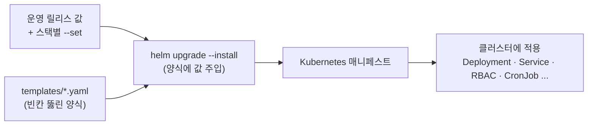

# Helm 차트 레퍼런스

## 이 문서에서 다루는 내용

- config-server Helm 차트가 어떤 리소스를 만드는지
- `values.yaml`과 템플릿이 Deployment, Service, RBAC, CronJob에 어떻게 반영되는지
- 스택 설치 스크립트가 어떤 값을 덮어쓰는지, 값을 바꾸기 전에 어디를 확인해야 하는지

## 빠른 이동

| 필요할 때 | 문서 |
| --- | --- |
| Kubernetes 기본 용어를 먼저 본다 | [기초 개념](../design/기초-개념.md) |
| 배포와 장애 대응 순서를 본다 | [운영 매뉴얼](운영-매뉴얼.md) |
| Kerberos 설정 값의 위치를 본다 | [kdc-setup 설정](../kdc-setup/config.md) |

쿠버네티스 기본 용어(Pod, Service, PVC, namespace 등)는 [기초 개념](../design/기초-개념.md)을 참고한다.

---

## 0. Helm 기본 개념

### 0.1 왜 Helm을 쓰는가

쿠버네티스에 무언가를 배포하려면 YAML 파일(매니페스트)을 여러 장 써야 한다. config-server 하나만 해도 Deployment 두 개, Service, 권한(RBAC), 설정(ConfigMap), CronJob 두 개가 있다. 이 파일들 곳곳에 **배포 환경마다 달라지는 값**(이미지 태그, 네임스페이스, UID 대역, 포트 번호)이 들어간다. 값이 바뀔 때마다 여러 파일을 뒤져 고치면 실수하기 쉽다.

- **템플릿(templates/)** — 매니페스트의 구조를 적어 둔 양식이다. 달라지는 자리는 `{{ .Values.image.tag }}`처럼 빈칸으로 뚫어 둔다.
- **values.yaml** — 그 빈칸에 채워 넣을 값들의 모음이다.
- **차트(Chart)** — 템플릿 묶음 + values.yaml + 메타데이터(Chart.yaml)를 합친 패키지다.
- **릴리스(release)** — 차트를 클러스터에 설치한 결과물의 이름이다. 같은 차트를 이름만 다르게 여러 번 설치할 수 있다. 이 시스템은 스택마다 `config-server-<스택>` 릴리스를 하나씩 둔다(운영은 `config-server-operation`).



### 0.2 자주 쓰는 명령

```bash
ns=ailab-operation
release=config-server-operation

# 릴리스 이력과 현재 값(비밀 값은 values에 없다)
helm -n "$ns" history "$release"
helm -n "$ns" get values "$release"

# 새 Pod가 정상적으로 떴는지 확인
kubectl -n "$ns" rollout status deploy/"$release"
kubectl -n "$ns" rollout status deploy/"$release"-controller
```

배포 자체(`helm upgrade --install`)는 손으로 하지 않고 Deploy Proposed Stack 워크플로가 `stack-up.sh` 안에서 실행한다(1.5절).

---

## 1. Chart/ — config-server 차트

위치는 `admin_infra-proposed` 저장소의 `config-server/Chart/`다.

### 1.1 이 차트가 클러스터에 만드는 것

| 리소스 | 이름 | 왜 필요한가 |
|--------|------|------------|
| Deployment | `<release>` | API 서버(gunicorn 워커 4개) 1개. 시작할 때 2초마다 `/health`를 확인해 준비되는 즉시 넘어가고(최대 2분), 뜬 뒤에는 10초마다 확인한다. 종료 유예 630초 |
| Deployment | `<release>-controller` | 제어기. 같은 이미지로 `controller.py`를 실행해 등록된 작업을 처리한다. `controller.enabled`가 참일 때만 만든다(replicas 1, Recreate) |
| Service (NodePort) | `containerssh-config-service` | API의 고정 주소. 내부 80 → 컨테이너 8000 |
| ServiceAccount | `config-server` | config-server가 Kubernetes API를 부를 때 쓰는 신원 |
| Role + RoleBinding | `config-server-role` | 네임스페이스 안에서 Pod(`exec`·`log` 포함)·Service·PVC·Secret을 만들고 지우고, 이벤트를 읽는다. 사용자 Pod 생성·삭제, Pod 안 명령 실행(비밀번호·그룹 반영), 이미지 다운로드 이벤트 판정에 쓴다 |
| ClusterRole + Binding | `<release>-node-reader` | 노드 목록 조회. 노드는 네임스페이스에 속하지 않아 ClusterRole이 필요하다 |
| ClusterRole + Binding | `<release>-service-reader` | 클러스터 전체 Service 조회. 다른 네임스페이스가 이미 쓰는 NodePort를 피한다 |
| ConfigMap | `krb5-conf` | Kerberos 클라이언트 설정(`krb5.conf`). 지금 계정·Pod 작업에는 쓰지 않는다([kdc-setup 설정](../kdc-setup/config.md)) |
| CronJob | `<release>-gpu-check` | 10분마다 GPU가 보이지 않는 사용자 Pod를 점검해 admin_be 내부 알림 API로 보낸다. 동시 실행 금지, 제한 5분 |
| CronJob | `<release>-krb5-reconcile` | 30분마다 `reconcile_krb5.py`를 실행한다. `krb5_cleanup_pending` 재시도, 고아 keytab 후보 기록, NAS 그룹 캐시 비우기, 공유 그룹 idmapd 등록. 동시 실행 금지, 제한 15분 |

### 1.2 파일 구성

| 파일 | 역할 |
|------|------|
| `Chart.yaml` | 차트 이름(`containerssh-config-server`)·버전 |
| `values.yaml` | 기본값(1.3절) |
| `templates/_helpers.tpl` | 리소스 이름(릴리스 이름 그대로)과, API 서버·제어기가 함께 쓰는 환경 변수·마운트를 한 곳에서 정의한다 |
| `templates/deployment.yaml` | API 서버 Deployment |
| `templates/controller.yaml` | 제어기 Deployment |
| `templates/service.yaml` | NodePort Service |
| `templates/rbac.yaml` | Role/RoleBinding + ClusterRole/ClusterRoleBinding |
| `templates/serviceaccount.yaml` | ServiceAccount |
| `templates/configmap.yaml` | `krb5-conf` ConfigMap |
| `templates/cronjob-gpu-check.yaml` | GPU 유실 점검 CronJob |
| `templates/cronjob-krb5-reconcile.yaml` | Kerberos 재조정 CronJob |

values의 값은 `_helpers.tpl`의 `env` 정의를 거쳐 컨테이너 환경 변수로 들어간다. API 서버와 제어기는 같은 정의를 쓰므로 둘의 설정이 어긋나지 않는다. 예를 들어 `nas.ssh.host`는 `NAS_SSH_HOST`, `verifyMode`는 `RUN_MODE`가 된다.

### 1.3 values.yaml에 넣는 값

아래 기본값은 저장소 `values.yaml` 기준이다. `""`(빈 값)인 키는 배포 때 운영 릴리스 값에서 가져온다. 저장소에는 주소·계정 같은 운영 값을 두지 않는다.

#### image

| 키 | 의미 | 기본값 |
|----|------|--------|
| `image.repository` | 이미지 저장소 | `dguailab/config-server` |
| `image.tag` | 이미지 태그. **반드시 지정한다**(비우면 렌더링이 실패한다) | `""` |
| `image.pullPolicy` | 태그가 고정이라 노드에 있는 이미지를 그대로 쓴다 | `IfNotPresent` |

#### service · resources

| 키 | 의미 | 기본값 |
|----|------|--------|
| `service.type` / `port` / `targetPort` | Service 타입과 포트 | `NodePort` / `80` / `8000` |
| `service.nodePort` | 외부 NodePort. 스택마다 `uid-ranges.yaml`의 `config_nodeport`로 덮어쓴다 | `30082` |
| `resources.requests` | CPU/메모리/임시 디스크 요청 | `500m` / `512Mi` / `1Gi` |
| `resources.limits` | CPU/메모리 상한 | `2000m` / `1024Mi` |

임시 디스크 요청이 없으면 노드 디스크가 찰 때 우선순위와 무관하게 먼저 내려간다. 한도는 두지 않는다.

#### nfs / nas / farm — 연결할 서버

| 키 | 의미 | 기본값 |
|----|------|--------|
| `nfs.server` / `userSharePath` | 사용자 홈 NFS | `""` |
| `nfs.kubeSharePath` | 계정 대장(`/kube_share`) 경로. 스택마다 운영 경로 아래 하위 폴더로 덮어쓴다 | `""` |
| `nas.ssh.host` / `port` / `user` / `keyPath` | NAS 홈 생성·삭제용 SSH | `""` |
| `farm.ssh.user` / `keyPath` / `nodes` | FARM 노드 keytab 배포용 SSH와 노드 목록 | `""` / `[]` |
| `farm.adSsh.user` / `keyPath` / `nodes` | AD DC(계정·keytab·그룹)용 SSH와 DC 목록 | `""` / `[]` |

#### security / krb5 / infra

| 키 | 의미 | 기본값 |
|----|------|--------|
| `security.sudoAllowedCommands` | 사용자별 sudoers 허용 명령. **비어 있으면 sudoers 파일을 만들지 않는다** | `""` |
| `krb5.realm` | Kerberos realm. 비어 있으면 Kerberos·AD 단계를 모두 건너뛴다 | `""` |
| `infra.adminBeInternalUrl` | admin_be 내부 주소. 사용자 설정 조회와 GPU 점검 알림이 여기로 간다. 스택마다 `http://admin-prod.<네임스페이스>`로 덮어쓴다 | `http://admin-prod.default` |

#### 대역 · 실행 방식 · 제어기

| 키 | 의미 | 기본값 |
|----|------|--------|
| `accounts.uidMin` / `uidMax` | 새 계정 UID 대역. `uidMax` 0은 상한 없음 | `20000` / `0` |
| `accounts.sharedGidMin` / `sharedGidMax` | 공용(팀) 그룹 GID 대역. UID 대역과 겹치면 안 된다 | `70000` / `0` |
| `accounts.prefix` | 이 접두어로 시작하는 계정만 받는다(실험 스택 전용, 운영은 비움) | `""` |
| `nodeport.min` / `max` | 사용자 Pod NodePort 대역 | `30000` / `32767` |
| `verifyMode` | 실행 방식 `baseline` / `noprobe` / `full` (`RUN_MODE`로 주입). 허용 밖의 값이면 기동하지 않는다 | `noprobe` |
| `faultInjection` | 장애 주입 훅. 실험 스택 셋에서만 켠다. **운영은 항상 끈다** | `false` |
| `controller.enabled` / `pollSec` / `workers` | 제어기 사용 여부, 작업 조회 주기(초), 동시 실행 수 | `false` / `2` / `4` |

스택별 실제 대역은 [시스템 아키텍처](../design/시스템-아키텍처.md) 7.3절에 있다.

#### db / logDb / redis — 상태 저장소

| 키 | 의미 | 기본값 |
|----|------|--------|
| `db.host` / `name` / `user` | 포트 배정·계정 대장 잠금 DB | `infra-mysql` / `pod_port_db` / `pod_port_user` |
| `logDb.host` / `name` / `user` | 작업 이력·작업 소유권 DB | `log-mysql` / `operation_state_db` / `log_db_user` |
| `redis.host` / `port` | 작업 입력·결과·진행 상황 Redis | `redis-bg-master.ailab-infra.svc.cluster.local` / `6379` |

스택에서는 세 이름 모두 같은 스택 MySQL을 가리키고, Redis는 스택 네임스페이스의 `redis-bg-master`로 덮어쓴다. DB 비밀번호는 values에 없고 Secret에서 주입된다.

#### 배치 · 기타

| 키 | 의미 | 기본값 |
|----|------|--------|
| `namespace` / `config.namespace` | 배포 대상 네임스페이스. ConfigMap 템플릿은 `.Values.namespace`, 나머지는 `.Values.config.namespace`를 읽는다. 두 값은 항상 같게 둔다 | `ailab-infra` |
| `priorityClassName` | config-server Pod의 우선순위 등급. 없는 이름을 적으면 Pod 생성이 거부되므로 기본은 비우고, 등급을 만들어 두는 스택 설치에서만 채운다 | `""` |
| `imageStore.claimName` | 사용자 이미지 저장소 PVC. 비우면 임시 디스크(`emptyDir`) | `pvc-image-store` |
| `nodeSelector` / `tolerations` | config-server를 control-plane 노드에 고정하고 그 노드의 `NoSchedule`을 허용한다. 둘은 짝으로 있어야 Pod가 뜬다 | control-plane 노드 |
| `apiToken.secretName` | 내부 API 토큰 Secret | `config-server-api-token` |
| `sshKnownHosts.secretName` | FARM·AD·NAS SSH 호스트 키 Secret | `config-server-ssh-known-hosts` |
| `cleanup.image` | 템플릿에서 읽지 않는 값 | `config-server:latest` |

### 1.4 미리 만들어 둘 Secret

민감값(비밀번호, SSH 개인키, 토큰)은 values에 넣지 않고 Secret으로 관리한다. 차트는 Secret을 만들지 않는다. 스택 설치 스크립트가 SSH 개인키는 구 운영 네임스페이스에서 복사하고, SSH 호스트 키는 배포 서버에서 접속 대상마다 수집해 넣고(하나라도 못 받으면 기존 값을 유지하고, 기존 값도 없으면 배포를 멈춘다), DB 비밀번호와 내부 API 토큰은 처음 설치할 때 무작위로 만들어 `stack-db`에 두고 아래 Secret으로 나눠 준다.

| Secret 이름 | 내용 | 없으면 |
|-------------|------|--------|
| `config-server-api-token` | 내부 API 토큰 (key: `token`) → `CONFIG_API_TOKEN` | **Pod가 뜨지 않는다.** 토큰 검사를 끄는 경로는 없다(로컬 개발의 `CONFIG_API_AUTH_DISABLED=true`만 예외) |
| `nas-ssh-key` | NAS 접속용 SSH 개인키 → `/etc/nas-ssh` | Pod가 뜨지 않는다 |
| `farm-ssh-key` | FARM 노드 접속용 SSH 개인키 → `/etc/farm-ssh` | Pod가 뜨지 않는다 |
| `farm-ad-ssh-key` | AD DC 접속용 SSH 개인키 → `/etc/farm-ad-ssh` | Pod가 뜨지 않는다 |
| `config-server-ssh-known-hosts` | FARM·AD·NAS 호스트 키 (key: `known_hosts`) → `/etc/ssh-known-hosts` | Pod는 뜨지만 **SSH 접속을 모두 거절한다**. 확인 없이 붙으면 중간에 끼어든 서버가 홈 생성·삭제 명령을 받아 간다 |
| `config-server-db-secret` | `pod_port_db` 비밀번호 (key: `password`) → `DB_PASSWORD` | Pod가 뜨지 않는다 |
| `log-mysql-secret` | `operation_state_db` 비밀번호 (key: `MYSQL_PASSWORD`) → `LOG_DB_PASSWORD` | Pod가 뜨지 않는다 |
| `config-server-infra-slack-secret` | GPU 점검 알림 대상 (key: `webhookUrl`) | 알림을 건너뛰고 로그만 남긴다 |

토큰·호스트 키 Secret 값을 바꾼 뒤에는 API 서버와 제어기를 재시작해야 새 값을 읽는다. Pod 템플릿에 값이 드러나지 않아 helm 업그레이드만으로는 재시작되지 않는다.

이 외에 config-server는 사용자별 `krb5-keytab-<user>` Secret과 Pod별 로그인 비밀번호 Secret(`<pod>-account`, Pod 소유)을 만든다. Role의 Secret 권한은 이 작업에 필요하다.

### 1.5 스택 설치가 값을 넣는 방법

`stack-up.sh`는 운영 릴리스 값(NFS·NAS·FARM·Kerberos 설정)을 바탕으로 쓰고, 스택마다 달라야 하는 값만 `--set`으로 덮어쓴다.

| 덮어쓰는 값 | 출처 |
|------|------|
| `namespace`, `config.namespace` | `ailab-<스택>` |
| `image.*` | 워크플로가 고른 ref로 만든 이미지 |
| `service.nodePort` | `uid-ranges.yaml`의 `config_nodeport` |
| `nfs.kubeSharePath` | 스택별 계정 대장 경로 |
| `infra.adminBeInternalUrl` | `http://admin-prod.<네임스페이스>` |
| `accounts.*`, `nodeport.*` | `uid-ranges.yaml` |
| `verifyMode` | 실험 스택은 스택 이름, operation은 `baseline` |
| `faultInjection` | 실험 스택 셋만 `true` |
| `redis.host`, `db.host`, `logDb.host` | 스택 안의 Redis·MySQL |
| `imageStore.claimName` | 비움(임시 디스크) |
| `controller.enabled` | `true` |
| `priorityClassName` | `ailab-stack-component` |

설치 직전에 이전 설치가 `failed`로 남아 있으면 지우고 다시 설치한다. 첫 설치가 실패한 릴리스는 `upgrade`가 받지 않을 수 있기 때문이다. `--wait`로 준비될 때까지 기다린다.

차트 값을 바꿀 때는 `values.yaml` 또는 `stack-up.sh`를 고쳐 PR로 병합하고 워크플로로 배포한다. 클러스터에서 `helm upgrade --set`으로 바꾼 값은 다음 배포 때 사라진다. 운영 릴리스 값이 원본인 항목(NFS·NAS·FARM·Kerberos)은 admin_infra의 GitHub Secret을 고친 뒤 **Sync Config Server Secrets** 워크플로로 구 운영 릴리스 값에 반영하고, 그다음 스택을 다시 배포한다. 이 워크플로는 구 운영 config-server를 0개로 둔 채 값만 바꾼다.

---

## 2. pvc-image-chart/ — 이미지 저장소

사용자 컨테이너 이미지를 tar로 보관하는 공용 PVC `pvc-image-store`를 배포하는 작은 차트다. 마운트하는 것은 config-server뿐이다(`/image-store`). **지금 스택들은 이 PVC를 쓰지 않는다**(`imageStore.claimName` 비움). 재시작 때 변경분을 유지하는 기능은 노드에 이미지를 굽는 방식으로 바뀌었다([시스템 아키텍처](../design/시스템-아키텍처.md) 5절).

| 키/장치 | 값 | 의미 |
|---------|-----|------|
| `imageStore.size` | `500Gi` | PVC 요청 용량 |
| `storageClass` | `nfs-nas-v3-expandable` | NFS CSI 기반 StorageClass |
| accessModes | `ReadWriteMany` | 여러 Pod가 동시에 마운트할 수 있다 |
| `helm.sh/resource-policy: keep` | annotation | 릴리스를 지워도 PVC는 남긴다 |

---

## 3. infra-sql/ — 테이블 정의

`infra-sql/`에는 테이블 정의 SQL(`pod_port_db.sql`, `operation_log.sql`, `trial_manifest.sql`)과 구 운영 MySQL 매니페스트(`nfs-mysql.yaml`, `log-mysql.yaml`)가 있다. 스택 MySQL 자체는 `ops/proposed-stack/mysql.yaml`로 배포하고, 설치 스크립트가 SQL 파일을 배포 때마다 다시 적용한다. 스키마는 [데이터베이스](../design/데이터베이스.md)를 본다.
