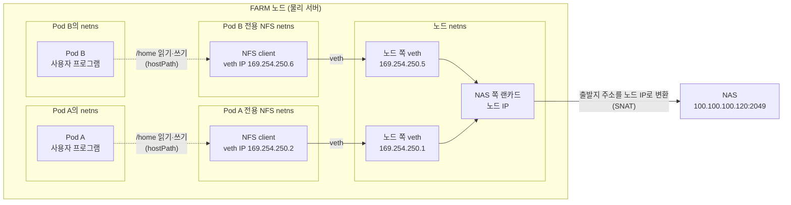

# Pod별 독립 NFS client 도입

## 도입 근거

| 문서 | 결정 내용 |
| --- | --- |
| [261013 주간 리포트 C. Storage 서버 옵션 비교](https://app.notion.com/p/261013-3f7c7692a26380e3981ed4911deea86f#3f7c7692a26380649621cb498dd4fbec) | 모든 FARM 서버에 `async`, `nconnect=4` 옵션 결정 및 테스트 진행, 문제 없을 시 모든 LAB 서버에도 같은 옵션 적용 |
| [261103 주간 리포트 C. NFS 옵션 추가 실험](https://app.notion.com/p/261103-40cc7692a26380109d38d92c696994ab#40cc7692a263809995fcd3bc44a7e9a8) | 모든 LAB 서버 컨테이너, FARM 서버의 Pod별로 독립 NFS client 도입  |

## 주요 변화

FARM Pod를 기준으로 바뀌는 점은 다음과 같다.

| 항목 | 도입 전 | 도입 후 |
| --- | --- | --- |
| NFS client | 노드에 하나 있고, 그 노드의 Pod가 모두 함께 쓴다 | Pod마다 하나씩 있다 |
| 마운트 | 노드가 부팅할 때 노드 netns에서 `/home/tako<N>/share`에 한 번 마운트한다 | Pod를 만들 때 그 Pod의 NFS 전용 netns에서 `/run/provi/nfs/<네임스페이스>/<Pod 이름>`에 마운트하고, Pod를 지우면 해제한다 |
| Pod의 `/home` | 노드 공용 마운트 안의 `/home/tako<N>/share/user`를 hostPath로 받는다 | 자기 전용 마운트를 hostPath로 받는다 |
| TCP 연결 | 노드의 client가 TCP 연결을 `nconnect` 값만큼 연다(261013 결정에 따르면 4개). 모든 Pod의 요청이 이 TCP 연결들로 나뉘어 나간다 | Pod의 client가 TCP 연결을 하나만 연다(`nconnect=1`). 그 Pod의 요청만 이 TCP 연결로 나간다 |
| 슬롯 상한 | 65536(기본값) | 64 |
| 요청이 버려지는 경우 | TCP 연결이 여러 개라, 한 TCP 연결이 늦어지는 동안 다른 TCP 연결로 간 요청이 먼저 처리된다. 늦게 도착한 요청은 GSS 일련번호 범위 밖으로 밀려 버려질 수 있다. 응답을 기다리는 요청 수에도 제한이 없어서, TCP 연결이 하나여도 같은 일이 생길 수 있다 | TCP 연결이 하나라 요청이 보낸 순서대로 도착한다. 응답을 기다리는 요청도 64개를 넘지 않아서, NAS가 처리 순서를 조금 바꿔도 요청이 GSS 일련번호 범위 밖으로 밀려나기 어렵다 |
| 다른 Pod와의 관계 | 같은 노드의 Pod가 TCP 연결과 슬롯을 함께 쓴다. 한 Pod가 요청을 몰아 보내면 다른 Pod의 요청은 같은 TCP 연결에서 그 요청들 뒤에 보내지고, 그 TCP 연결이 막히면 모두 함께 기다린다 | Pod마다 TCP 연결과 슬롯이 따로 있다. 한 Pod의 TCP 연결이 막혀도 다른 Pod의 요청은 계속 처리된다 |

- **netns**: 리눅스가 네트워크 장치, IP 주소, 라우팅 표를 따로 갖도록 나눈 공간이다. 정식 이름은 network namespace다. **NFS 전용 netns**는 Pod마다 NFS 통신에만 쓰려고 만드는 netns다.
- **NFS client**: NAS에 요청을 보내고 응답을 받는 커널 안의 주체다. netns마다 하나씩 생긴다.
- **TCP 연결**: client와 NAS 사이의 통신 회선이다. client 하나가 TCP 연결을 몇 개 열지는 `nconnect` 값으로 정한다.
- **슬롯**: TCP 연결 하나에서 응답을 기다리며 동시에 보내 둘 수 있는 요청 수다. 슬롯이 다 차면 다음 요청은 client 안에서 기다린다.
- **GSS 일련번호**: `sec=krb5`에서 요청마다 붙는 번호다. NAS는 지금까지 받은 가장 큰 번호에서 128 안쪽의 번호만 받고, 그보다 오래된 번호의 요청은 응답 없이 버린다.

요청이 버려지지 않게 하는 것은 `nconnect=1`과 슬롯 64다. 노드 공용 마운트에도 두 값을 줄 수 있지만, 그러면 노드의 모든 Pod가 TCP 연결 하나에 의존하게 된다. Pod별 client는 Pod마다 TCP 연결을 하나씩 준다. 그래서 요청이 보낸 순서대로 도착하면서도, 한 Pod의 요청이 다른 Pod의 요청 뒤에서 기다리지 않는다.

NAS 디스크는 도입 후에도 모든 Pod가 함께 쓴다. 그래서 여러 Pod가 큰 파일을 동시에 읽고 써도 전체 처리량이 늘지는 않는다.

2026-11-10 기준으로 FARM에서는 farm7의 csuhyeon Pod 하나에만 적용해 시험하고 있다.

## 구성


### Pod마다 마운트와 netns가 필요한 이유

리눅스 커널에서 NFS client는 netns(network namespace)마다 따로 생긴다. 같은 netns에서 같은 NAS를 다시 마운트하면 새 client가 생기지 않고 기존 client를 같이 쓴다. 지금은 모든 Pod가 노드의 공용 마운트(`/home/tako<N>/share`)를 hostPath로 받기 때문에, 한 노드의 Pod 전부가 client 하나를 나눠 쓴다.

Pod마다 client를 따로 만들려면 Pod마다 마운트를 하나씩 만들되, 각 마운트를 서로 다른 netns 안에서 실행해야 한다. 그래서 Pod마다 NFS 전용 netns를 하나 만들고, NAS 마운트를 그 안에서 실행한다.



### 구성 요소

| 구성 요소 | 하는 일 |
| --- | --- |
| NFS 전용 netns | Pod마다 하나씩 만드는 netns다. 여기서 NAS를 마운트하면 그 Pod만 쓰는 NFS client가 생긴다. Pod 자신은 이 netns에 속하지 않는다 |
| client 이름(identifier) | NAS가 client를 구분할 때 쓰는 이름이다. netns마다 다른 이름을 준다. NFS client는 그 netns에서 처음 마운트할 때 만들어지면서 이 이름을 한 번 읽으므로, 첫 마운트 전에 정해야 한다 |
| veth | 두 netns를 잇는 가상 네트워크 장치 한 쌍이다. 한쪽 끝으로 들어간 패킷이 다른 쪽 끝으로 나온다. 한쪽 끝은 NFS 전용 netns에, 다른 쪽 끝은 노드 netns에 있다 |
| netns 안 라우팅 | NFS 전용 netns에서 NAS로 가는 패킷을 veth를 통해 노드로 보낸다. NAS가 있는 IP 대역으로 가는 경로만 넣고, 다른 경로는 넣지 않는다 |
| SNAT | 노드가 패킷을 NAS로 내보낼 때 출발지 주소를 노드 IP로 바꾼다. 그래야 NAS가 응답을 노드로 돌려보낼 수 있다 |
| FORWARD 허용 | 노드가 veth와 랜카드 사이에서 패킷을 넘겨주도록 방화벽에서 허용한다. 노드를 거쳐 가는 패킷에 적용하는 방화벽 규칙(FORWARD 체인)의 기본 정책이 DROP인 노드는, 이 규칙이 없으면 패킷을 버린다 |
| rpc.gssd | NFS 요청에 쓸 GSS 컨텍스트를 맺는 프로그램이다([NFS, RPC, GSS 4장](../../design/NFS-RPC-GSS.md#gss-context)). 커널은 rpc_pipefs라는 파일시스템으로 rpc.gssd에 일을 요청하는데, rpc_pipefs가 netns마다 따로 있으므로 NFS 전용 netns마다 rpc.gssd를 하나씩 실행한다 |
| 마운트 | NFS 전용 netns의 네트워크를 써서 NAS를 마운트한다. 마운트된 디렉터리는 노드 파일시스템에 생긴다 |
| hostPath | 마운트된 디렉터리를 Pod의 `/home`으로 넘긴다. `type: Directory`로 지정해서, 디렉터리가 없으면 Pod가 시작되지 않게 한다 |

마운트 지점은 재부팅하면 비워지는 `/run` 아래에 만든다. 재부팅 뒤 다시 마운트하기 전에는 마운트 지점 디렉터리가 없으므로 Pod가 시작되지 않는다. 그래서 마운트되지 않은 빈 디렉터리가 Pod의 `/home`으로 넘어가는 일이 없다.

### NFS 전용 netns를 veth로 노드와 잇는 이유

새로 만든 netns에는 네트워크 장치가 없다. NAS와 연결된 실제 랜카드(`eno1np0`)는 노드 netns에 있고, 랜카드 하나는 한 번에 한 netns에만 속한다. 랜카드를 NFS 전용 netns로 옮기면 노드와 다른 Pod가 그 랜카드를 쓸 수 없게 된다. 그래서 NFS 전용 netns의 패킷이 노드를 거쳐 NAS로 나가도록 다음과 같이 연결한다.

1. veth의 한쪽 끝은 NFS 전용 netns에, 다른 쪽 끝은 노드 netns에 넣는다.
2. NFS 전용 netns에서 NAS로 보낸 패킷은 veth를 타고 노드로 넘어온다. 노드는 받은 패킷을 다른 장치로 넘겨주는 IP 포워딩 기능으로 이 패킷을 `eno1np0`으로 내보낸다.
3. 내보낼 때 출발지 주소를 노드 IP로 바꾼다(SNAT). NAS의 응답은 노드로 돌아오고, 노드가 다시 veth를 거쳐 NFS 전용 netns로 넘겨준다.

veth는 통신 경로일 뿐이고 마운트와는 관계없다. 마운트는 NFS 전용 netns에서 한 번만 한다.

Kubernetes Pod도 같은 방식으로 노드와 연결된다. Pod마다 자기 netns가 있고, veth로 노드와 이어진다. 노드에서 보이는 `cali`로 시작하는 인터페이스(Calico가 만든다)가 이 veth의 노드 쪽 끝이다. NFS 전용 netns도 같은 방식으로 연결하되, 컨테이너 없이 NFS 통신만 한다는 점이 다르다.

### 노드는 패킷을 전달만 한다

패킷이 노드를 지나간다고 해서 노드의 NFS client를 쓰는 것은 아니다. 노드는 패킷을 넘겨주기만 하고, NAS와 NFS로 통신하는 것은 마운트를 실행한 netns의 client다. 2026-11-09 farm7에서 NAS의 2049번 포트로 열린 TCP 연결을 확인하면 아래처럼 TCP 연결 두 개가 따로 있다.

| TCP 연결을 연 곳 | TCP 연결 | 쓰는 쪽 |
| --- | --- | --- |
| 노드 netns | `100.100.100.107:989 → 100.100.100.120:2049` | 노드 공용 마운트 `/home/tako7/share`. 다른 Pod들이 쓴다 |
| NFS 전용 netns | `169.254.250.2:891 → 100.100.100.120:2049`. 노드를 지날 때 출발지 주소가 `100.100.100.107`로 바뀐다 | csuhyeon Pod |

### 마운트 결과가 노드에서 보이는 이유

NFS 전용 netns에서 마운트할 때는 `nsenter --net`을 쓴다. 이 명령은 네트워크는 NFS 전용 netns의 것을 쓰고, 마운트 목록(mount namespace)은 노드의 것을 그대로 쓴다. mount namespace는 netns처럼 마운트 목록을 따로 갖도록 나눈 공간이다. 그래서 이 마운트는 노드의 마운트 목록에 들어가고, 노드에서 `findmnt`로 확인할 수 있다. Pod에 hostPath로 넘길 수 있는 것도 이 때문이다.

netns 안에서 명령을 실행할 때 흔히 쓰는 `ip netns exec`는 이 용도에 맞지 않는다. 이 명령은 netns에 들어가면서 mount namespace도 새로 만든다. 그래서 그 안에서 마운트하면 노드에서는 보이지 않고, Pod에 hostPath로 넘길 수도 없다.

## TCP 연결과 슬롯

Pod마다 client를 만들면 NAS에 열리는 TCP 연결이 늘어난다. 또 client마다 응답을 기다리며 동시에 보내 둘 수 있는 요청 수의 최대치(슬롯 상한)도 정해야 한다.

### NAS max connections

NAS의 NFS 서버(nfsd)는 client들이 NAS의 NFS 포트(2049)로 연 TCP 연결을 센다. 노드에서 연 것과 NFS 전용 netns에서 연 것을 가리지 않고, 지금 NAS에 열려 있는 연결을 모두 센다. 새 연결이 들어왔을 때 열린 연결이 max connections보다 많으면, 커널 로그에 `too many open connections, consider increasing the number of threads`를 남기고, 가장 오래 쓰이지 않은 연결을 하나 끊는다.

```
max connections = (NAS nfsd 스레드 수 + 3) × 20
```

`/proc/fs/nfsd/max_connections`에 값을 따로 설정하지 않으면(기본값 0) NAS는 위 식으로 max connections를 정한다. 그래서 nfsd 스레드 수를 바꾸면 max connections도 함께 바뀐다. 값을 설정하면 식 대신 그 값을 쓴다. 2026-11-10에 확인했을 때 NAS는 값을 설정하지 않은 상태(0)였다.

nfsd 스레드 수는 NAS가 동시에 처리할 수 있는 요청 수다. NAS에서 `sudo cat /proc/fs/nfsd/threads`로 확인한다.

| 항목 | 값 |
| --- | --- |
| NAS nfsd 스레드 수 (2026-11-06 확인) | 122 |
| max connections | (122 + 3) × 20 = 2,500 |

Pod별 client는 `nconnect=1`이라 client 하나가 TCP 연결을 하나만 연다. 그래서 Pod가 하나 늘 때마다 NAS에 열리는 TCP 연결도 하나 늘어난다. NAS에는 `ss`가 없으므로 `sudo netstat -tn | grep ':2049 ' | grep -c ESTABLISHED`로 센다.

### 슬롯 상한

슬롯은 client가 응답을 기다리면서 동시에 보내 둘 수 있는 요청 수다. TCP 연결마다 슬롯이 따로 있고, 요청을 보내면 슬롯 하나를 쓰고 응답을 받으면 돌려받는다. 리눅스는 처음에는 슬롯을 적게 잡고 요청이 몰릴수록 늘린다. 슬롯이 늘어날 수 있는 최대치를 슬롯 상한이라고 하며, `sunrpc.tcp_max_slot_table_entries`로 정한다. 기본값 65536은 사실상 제한이 없는 값이다.

nconnect와 슬롯 상한은 서로 다른 값이다. nconnect는 client 하나가 여는 TCP 연결의 개수이고, 슬롯 상한은 TCP 연결 하나에서 응답을 기다릴 수 있는 요청의 최대 개수다. 그래서 client 하나가 응답을 기다리며 동시에 보내 둘 수 있는 요청은 최대 `nconnect` 값에 슬롯 상한을 곱한 만큼이다.

슬롯이 너무 많으면 `sec=krb5`에서 요청이 GSS 일련번호 범위(sequence window) 밖으로 밀려 버려질 수 있다. 어떻게 버려지는지는 [NFS, RPC, GSS 5절](../../design/NFS-RPC-GSS.md#gss-sequence-window)에 있다.

2026-11-07 farm7에서 `nconnect=1`인 노드 공용 마운트로 대량 복사를 하던 중 WRITE 요청 4건이 응답 없이 멈췄다. 그때 이 마운트의 슬롯은 1,029개까지 늘어나 있었다. 슬롯이 많아 요청이 window 밖으로 밀려난 것으로 보고 있지만, NAS 쪽 증거로 확정하지는 못했다.

그래서 Pod별 client는 슬롯 상한을 64로 정한다. 2026-11-09 farm7에서 100GiB를 쓰고 읽어 비교한 결과는 다음과 같다.

| 슬롯 상한 | 쓰기 | 읽기 | 응답을 기다린 요청의 최대 개수 (20초마다 측정) |
| --- | --- | --- | --- |
| 64 | 675MB/s | 698MB/s | 64 |
| 65536 (기본값) | 659MB/s | 670MB/s | 178 |

두 경우 모두 멈춘 요청은 없었다. 처리량이 거의 같으므로, 슬롯 상한을 64로 정해도 처리량 손실 없이 응답을 기다리는 요청을 128개 아래로 유지할 수 있다.

`sunrpc.tcp_max_slot_table_entries`는 netns마다 따로 정할 수 없고, 노드 전체에 값이 하나뿐이다. 이 값은 마운트가 NAS와 TCP 연결을 처음 만들 때 한 번 읽혀 그 마운트의 슬롯 상한으로 정해진다. 그 뒤에 값을 바꿔도 이미 만든 마운트의 슬롯 상한은 바뀌지 않는다.

그래서 NFS 전용 netns에서 마운트하기 직전에만 값을 64로 바꾸고, 마운트가 끝나면 바로 원래 값으로 되돌린다. 이렇게 하면 Pod 전용 마운트만 슬롯 상한이 64가 되고, 노드 공용 마운트를 다시 마운트하는 경우처럼 그 뒤에 노드에서 새로 만드는 다른 마운트는 원래 값을 쓴다.
