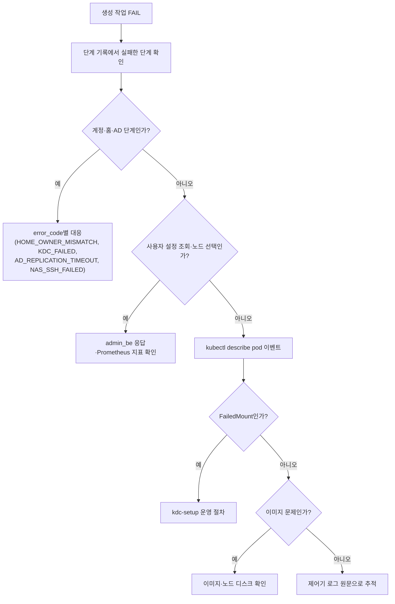
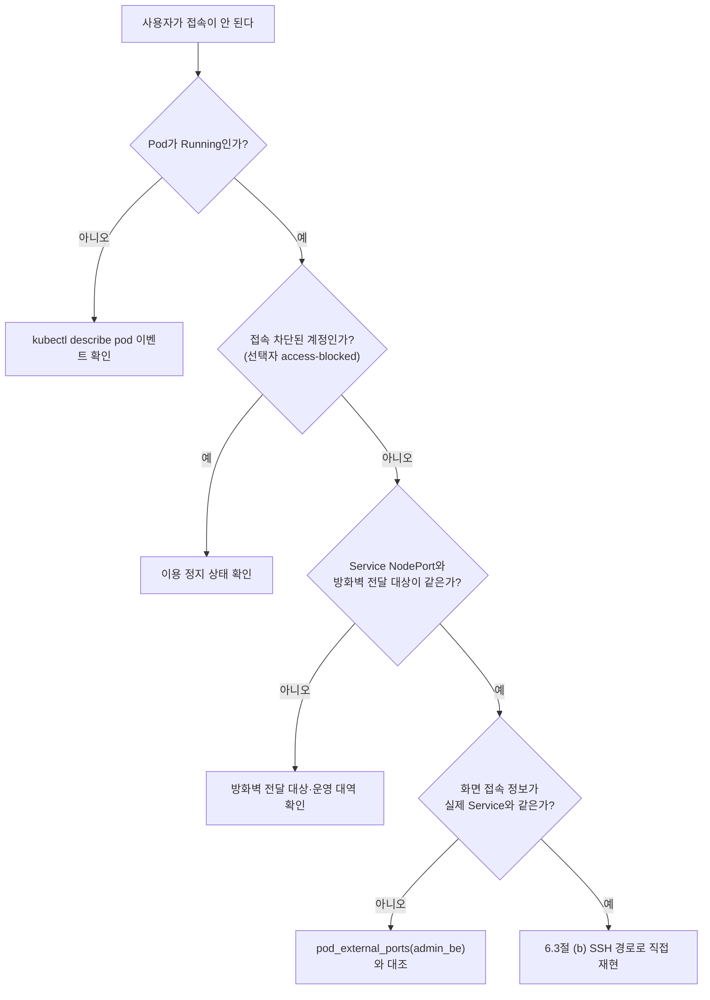

# 운영 매뉴얼

## 이 문서에서 다루는 내용

- config-server 배포 상태 확인, 주요 리소스 이름
- 작업(생성·회수·이동·비밀번호·그룹·포트·접속·홈) 뒤에 무엇을 점검해야 하는지
- 오류 응답, 잔여 리소스, NodePort 기록, Secret을 어떤 순서로 확인해야 하는지

## 빠른 이동

| 필요할 때 | 문서 |
| --- | --- |
| 작업 단계와 실패 지점을 먼저 본다 | [시스템 아키텍처](../design/시스템-아키텍처.md) |
| API 입력과 오류 형식을 본다 | [API 레퍼런스](API-레퍼런스.md) |
| 포트 DB·작업 이력과 복구 기준을 본다 | [데이터베이스](../design/데이터베이스.md) |
| Helm 값과 Secret 이름을 본다 | [Helm 차트 레퍼런스](Helm-차트-레퍼런스.md) |

config-server 배포, 작업 확인, 문제 확인·복구 방법을 정리한다. 작업이 만들어지는 순서는 [시스템 아키텍처](../design/시스템-아키텍처.md), 용어는 [기초 개념](../design/기초-개념.md)에서 확인한다. **keytab·개인키·비밀번호·토큰의 실제 값은 문서나 로그에 적지 않는다.**

---

## 1. 작업 전에 확인할 것

1. **변경은 작업으로 등록한다.** 모든 변경 API는 등록만 하고 202로 돌아온다. 끝났는지는 `GET /operations/<kind>/<request_id>`의 `phase`로 확인한다. 보통은 admin_be가 등록하고 결과를 기다리므로 운영자가 직접 등록할 일은 드물다.
2. **운영은 `baseline` 방식이다.** 단계가 실패하면 재시도하지 않고 뒷정리 후 실패로 끝난다. 결과를 확인한 뒤 원인을 풀고 admin_be에서 다시 시도한다.
3. **작업 전후 값을 기록한다.** 사용자 이름, 신청 번호, Pod 이름, UID/GID, 선택 노드, NodePort를 적어 둔다. 문제가 생기면 단계 기록과 대조해 어디서 멈췄는지 확인한다.
4. **실패 뒤에는 같은 요청을 바로 반복하지 않는다.** 단계 기록(`/steps`)과 실제 자원을 먼저 보고 일부만 만들어진 것이 없는지 확인한다.
5. **비밀 값은 출력하지 않는다.** keytab, SSH 개인키, DB 비밀번호, 토큰, shadow 내용은 화면·로그·이슈 어디에도 남기지 않는다. 저장소 세 곳이 모두 공개라 Actions 로그도 누구나 본다.
6. **Kubernetes 리소스를 직접 지우기 전에 기록을 확인한다.** Pod나 Service 한쪽만 지우면 포트 배정 기록과 실제 상태가 더 어긋난다.
7. **API는 내부 토큰으로만 부른다.** 토큰 없이 열린 것은 `GET /health` 하나다. 토큰은 셸 변수에만 담는다(3.3절).
8. **operation에는 실제 사용자가 있다.** 배포·재시작·정리는 사용자 영향부터 확인한다. 시험은 실험 스택에서 한다.

---

## 2. 이름과 접속 주소

### 2.1 주요 이름과 값 (operation)

| 항목 | 값 |
| --- | --- |
| 네임스페이스 | `ailab-operation` |
| Helm 릴리스 | `config-server-operation` |
| API 서버 Deployment | `config-server-operation` |
| 제어기 Deployment | `config-server-operation-controller` |
| API Service | `containerssh-config-service` (80 → 8000) |
| admin_be | 같은 네임스페이스의 `admin-prod` |
| 스택 DB | `mysql-0` (Service `infra-mysql`·`log-mysql`·`admin-mysql`) |
| 실행 방식 | `baseline` |
| 사용자 Pod 이름 | `ailab-<username>-<무작위>` |
| UID 대역 / 공용 GID 대역 | 21000~49999 / 70000~79999 |
| 사용자 NodePort 대역 | 30000~30079 |
| Pod Ready 최대 대기 | 500초 |
| 노드 신원 확인 최대 대기 | 900초 |
| 진행 상태 보존 | 최종 갱신 후 1시간 |
| 작업 결과 보존 | 하루(이후 phase만 남음) |

config-server 관련 리소스에는 옛 이름인 `containerssh` 접두사가 남아 있다. ContainerSSH 프록시는 배포하지 않는다.

### 2.2 네임스페이스

| 네임스페이스 | 배포 대상 |
|-----------|--------------|
| `ailab-operation` | 운영 스택 전체: config-server(API·제어기), MySQL, Redis 두 대, admin_be, 프론트엔드, **사용자 Pod** |
| `ailab-baseline`, `ailab-noprobe`, `ailab-full` | 실험 스택. 구성은 operation과 같다 |
| `ailab-infra` | 구 운영. 0개로 내려 두었다. SSH 키 Secret과 Helm 값을 스택 배포가 원본으로 읽으므로 지우지 않는다 |
| `ailab-frontend` | ingress 컨트롤러. 스택 화면의 입구다 |
| `monitoring` | Prometheus·Grafana |

레거시 네임스페이스 `containerssh`, `cssh`가 남아 있을 수 있다. 지금 서비스는 쓰지 않는다.

### 2.3 관리할 때 쓰는 명령

| 대상 | 방법 |
|--------|------|
| Grafana | 관리 서버의 Grafana NodePort. 로그인 정보는 Secret에서 조회한다 |
| config-server 로그 | `kubectl -n ailab-operation logs deploy/config-server-operation` (API), `...-controller` (작업 실행) |
| 스택 DB | `kubectl -n ailab-operation exec -it mysql-0 -- sh -c 'mysql -uroot -p"$MYSQL_ROOT_PASSWORD"'` |
| Swagger | `kubectl port-forward`로 연 뒤 토큰을 붙여 `/apispec_1.json`을 받는다. `Try it out`은 실제 계정·Pod를 바꾸므로 운영에서는 쓰지 않는다 |

작업 실행 로그는 **제어기**에 남는다. API 서버 로그에는 등록·조회만 남는다.

---

## 3. 작업 전 상태 확인

매일 한 번, 또는 배포·작업 전에 아래를 확인한다.

### 3.1 config-server가 떠 있는지

```bash
ns=ailab-operation
kubectl -n "$ns" get deploy,sts,pod,cronjob
kubectl -n "$ns" get events --sort-by=.lastTimestamp | tail -30
```

- API 서버와 제어기 Deployment가 1/1 Ready이다.
- `mysql-0`, `redis-bg-master`가 Ready이다.
- 새 Warning 이벤트와 반복 재시작이 없다.
- CronJob이 쌓이지 않았다(동시 실행 금지라 하나 이상 돌면 이상이다).

### 3.2 현재 배포 설정

```bash
kubectl -n "$ns" get deploy config-server-operation -o jsonpath='{.spec.template.spec.containers[0].image}{"\n"}'
helm -n "$ns" history config-server-operation | tail -5
helm -n "$ns" get values config-server-operation
```

| 항목 | 확인할 값 |
| --- | --- |
| 이미지 | 배포한 릴리스 태그로 만든 이미지 |
| 프로세스 | gunicorn 워커 4개, timeout 700초, 종료 유예 630초 |
| 실행 방식 | `verifyMode: baseline` |
| 장애 주입 | `faultInjection: false` |
| 제어기 | `controller.enabled: true` |
| 계정 대장 | NFS `kubeSharePath` → `/kube_share` |
| 비밀 마운트 | NAS, FARM, FARM AD SSH 키가 read-only |
| 내부 API 토큰 | Secret `config-server-api-token` → `CONFIG_API_TOKEN` |
| SSH 호스트 키 | Secret `config-server-ssh-known-hosts` → `/etc/ssh-known-hosts` |

config-server 계정의 Kubernetes 권한도 확인한다.

```bash
sa=system:serviceaccount:$ns:config-server
kubectl auth can-i create pods -n "$ns" --as="$sa"
kubectl auth can-i create pods/exec -n "$ns" --as="$sa"
kubectl auth can-i patch services -n "$ns" --as="$sa"
kubectl auth can-i list nodes --as="$sa"
kubectl auth can-i list services --all-namespaces --as="$sa"
```

`services` 패치 권한은 접속 차단·해제에, 전체 Service 조회는 다른 네임스페이스가 쓰는 NodePort를 피하는 데 필요하다.

### 3.3 API 응답과 로그

```bash
kubectl -n "$ns" port-forward svc/containerssh-config-service 8000:80 &
cs=http://127.0.0.1:8000
# 토큰은 화면에 찍지 않고 변수에만 담는다
token=$(kubectl -n "$ns" get secret config-server-api-token -o jsonpath='{.data.token}' | base64 -d)

curl -fsS "$cs/health"
curl -fsS -H "X-Internal-Token: $token" "$cs/health/details"
kubectl -n "$ns" logs deploy/config-server-operation-controller --since=30m
```

`/health`는 `{"status":"OK","run_mode":"baseline"}`를 돌려준다. 프로세스만 확인하고 DB, Redis, Prometheus, NAS, FARM, AD는 보지 않는다. `/health/details`의 `oplog_write_failures`(작업 이력 기록 실패 수)가 늘지 않는지 본다.

### 3.4 사용자 Pod와 접속 Service

```bash
kubectl -n "$ns" get pod -l username -o wide
kubectl -n "$ns" get svc -l app=ailab-nodeport
```

각 Service의 `pod_name` 라벨이 실제 Pod와 같은지 본다. 연결 대상이 없는 Service나 Failed Pod를 발견해도 바로 지우지 않는다. 접속이 차단된 계정의 Service는 선택자에 `ailab.dgu/access-blocked`가 붙어 연결 대상이 없는 것이 정상이다.

특정 Pod의 실행 설정을 확인할 때는 필요한 필드만 뽑는다.

```bash
pod_name='점검할_ailab_Pod_이름'
kubectl -n "$ns" get pod "$pod_name" -o jsonpath='{.spec.nodeName}{"\n"}{.spec.containers[0].image}{"\n"}{.spec.priorityClassName}{"\n"}'
kubectl -n "$ns" get pod "$pod_name" -o jsonpath='{range .spec.volumes[*]}{.name}{"\t"}{.hostPath.path}{"\n"}{end}'
kubectl -n "$ns" get pod "$pod_name" -o jsonpath='{range .spec.containers[0].env[*]}{.name}{"\n"}{end}'
```

- FARM 홈이 `/home`에, Kerberos ccache가 `/run/user/<uid>`에 hostPath로 연결되어 있다.
- `NVIDIA_VISIBLE_DEVICES`가 GPU UUID 목록(GPU 없으면 `void`)이다. 컨테이너 안에서 `nvidia-smi`로 신청한 종류만 보이는지 확인한다.
- **사용자 Pod에는 keytab, `/kube_share`, 이미지 저장소가 없어야 한다.**
- 재시작으로 변경분을 이어받은 Pod는 이미지가 `ailab.local/user-image/...`이다.

아래 명령은 중복된 NodePort만 출력한다. 아무것도 나오지 않아야 한다.

```bash
kubectl get svc -A -o jsonpath='{range .items[*].spec.ports[*]}{.nodePort}{"\n"}{end}' | grep -v '^$' | sort -n | uniq -d
```

### 3.5 GPU와 NFS 상태

| 대상 | 방법 |
|------|------|
| 통합 대시보드 | Grafana |
| 스토리지 응답성 | Grafana 대시보드 `storage-latency-health` — NFS 장애 의심 시 먼저 본다 |
| Prometheus 직접 질의 | `kubectl -n monitoring port-forward svc/monitoring-kube-prometheus-prometheus 9090:9090` |

Prometheus는 노드 선택과 컨테이너에 보일 GPU를 정하는 데도 쓴다. 조회가 모두 실패하면 생성 작업의 노드 선택 단계가 실패한다.

---

## 4. 배포와 롤백

### 4.1 배포 방법

어느 저장소에 push해도 자동 배포는 없다. 배포는 admin_infra의 **Deploy Proposed Stack** 워크플로로만 한다([브랜치·배포 규칙](../../브랜치-규칙.md)).

| 입력 | 값 |
| --- | --- |
| `stack` | `operation`, `baseline`, `noprobe`, `full` |
| `ref` / `fe_ref` / `be_ref` | admin_infra-proposed / admin_fe / admin_be의 브랜치·태그·커밋 |
| `action` | `up`(띄우기·재배포) / `down`(내리기) |

**operation은 네 저장소에 같은 이름으로 찍은 릴리스 태그 `vX.Y.Z`만 받는다.** 세 ref가 같은 태그가 아니면 워크플로의 확인 단계가 막는다. 브랜치를 주면 배포할 때마다 다른 코드가 올라가 무엇이 떠 있는지 알 수 없기 때문이다.

```bash
gh workflow run deploy-proposed-stack.yaml -R CSID-DGU/admin_infra \
  -f stack=operation -f ref=v3.3.71 -f fe_ref=v3.3.71 -f be_ref=v3.3.71
```

워크플로는 세 저장소의 ref로 이미지를 만들어 올린 뒤, 배포 서버에서 `ops/proposed-stack/stack-up.sh`를 실행한다. 스크립트가 하는 일은 다음과 같다. 여러 번 실행해도 결과가 같다.

1. 대역 선언(`uid-ranges.yaml`)이 다른 스택과 겹치지 않는지 검사한다.
2. 네임스페이스, SSH 키 Secret, DB 비밀번호·토큰을 준비한다(처음 만든 값은 유지).
3. MySQL·Redis를 띄우고 `infra-sql/`의 테이블 정의를 적용한다.
4. SSH 호스트 키를 수집한다.
5. admin_be·프론트엔드를 적용하고, 그동안 config-server를 Helm으로 설치한다(`--wait`).
6. 시험 계정으로 작업을 등록해 제어기가 실제로 처리하는지 확인하고, 그 흔적을 지운다.

operation은 operation 동작이 실제로 바뀌는 변경이 있을 때만, 사용자에게 영향이 적은 시간에 배포한다.

### 4.2 배포 전 확인

1. **다른 작업 진행 여부** — 같은 스택에서 누가 시험하거나 값을 바꾸고 있으면 시점을 맞춘다.
2. **진행 중인 작업** — 끝나지 않은 작업이 있는지 확인한다([데이터베이스](../design/데이터베이스.md) 5.1절). 배포 중 제어기가 다시 뜨면 `baseline`은 그 작업을 이어하지 않고 `INTERRUPTED`로 끝낸다.
3. **태그** — 네 저장소에 같은 태그가 있는지, 태그가 가리키는 커밋이 의도한 것인지 확인한다.
4. **CI** — 태그 커밋의 테스트가 통과했는지 확인한다.

### 4.3 배포 뒤 확인

```bash
kubectl -n "$ns" rollout status deploy/config-server-operation --timeout=5m
kubectl -n "$ns" rollout status deploy/config-server-operation-controller --timeout=5m
kubectl -n "$ns" logs deploy/config-server-operation --since=10m | tail -50
```

1. `/health`의 `run_mode`가 `baseline`이다.
2. 워크플로의 마지막 단계(시험 계정 작업)가 성공했다.
3. 기존 사용자 Pod와 Service가 그대로다.
4. 실제 승인 한 건이 들어오면 단계 기록을 끝까지 확인한다.

### 4.4 롤백

이전 태그로 같은 워크플로를 다시 실행한다. `helm rollback`은 쓰지 않는다. 다음 배포 때 워크플로 값으로 다시 덮이고, admin_be·프론트엔드와 버전이 어긋난다.

롤백은 **코드만** 되돌린다. 계정 대장, 포트 배정 기록, Kubernetes Service, FARM 노드의 keytab은 그대로다. 배포 사이에 끝나지 않은 작업이 있었으면 그 작업의 단계 기록과 실제 자원을 함께 확인한다.

---

## 5. 계정 관리

계정 정보는 `/kube_share`의 계정 대장에 있다. 계정은 **작업 안에서만** 만들고 바꾸고 지운다. 대장을 직접 편집하지 않는다.

### 5.1 조회

계정 조회 API는 없다. 신청의 작업 결과와 단계 기록으로 확인한다.

```bash
request_id='신청_번호'
curl -fsS -H "X-Internal-Token: $token" "$cs/operations/provision/$request_id"
curl -fsS -H "X-Internal-Token: $token" "$cs/operations/provision/$request_id/steps"
```

관리자 화면 신청 상세의 타임라인이 같은 기록을 보여 준다.

### 5.2 생성 뒤 확인

1. 작업 결과 `phase`가 `SUCCESS`이고 `result`에 uid·gid가 있다.
2. NAS 홈의 숫자 소유자가 그 UID이고 권한이 `711`이다.
3. FARM AD 사용자의 uidNumber가 같다.
4. keytab Secret이 **있는지만** 확인한다(내용은 보지 않는다).

```bash
target_user='사용자명'
kubectl -n "$ns" get secret "krb5-keytab-$target_user" -o custom-columns=NAME:.metadata.name,CREATED:.metadata.creationTimestamp
```

### 5.3 그룹

그룹은 admin_be의 그룹 기능이 `POST /operations/group`으로 등록한다. 결과는 `GET /operations/group/<그룹 작업 번호>`로 본다. 떠 있는 Pod의 그룹 목록과 NAS 그룹 캐시도 작업이 맞추지만, NAS 반영에는 몇 분 걸린다. 늦으면 30분 주기 재조정이 다시 맞춘다.

### 5.4 비밀번호

비밀번호 재설정 신청이 승인되면 admin_be가 `POST /operations/password`를 등록한다. 실패의 `error_detail`에 `rolled_back`이 참이면 아무것도 바뀌지 않은 것이다. 거짓이면 대장·Secret·Pod 중 일부만 바뀌었을 수 있으니 같은 요청을 다시 등록해 맞춘다(같은 해시를 다시 쓰므로 결과가 같다).

### 5.5 회수

계정 회수는 admin_be가 우분투 계정을 회수 중(RELEASING)으로 바꿨을 때 등록한다(관리자의 계정 삭제·사용자 비활성화, 마지막 컨테이너 종료 뒤 1년 미사용). 그 사용자의 컨테이너 회수가 모두 끝나기를 기다린 뒤, 컨테이너를 썼던 노드마다 `delete_account: true` 작업을 하나씩 등록한다. 한 노드라도 실패하면 RELEASING으로 남고 관리자에게 알린다. 계정을 지울 노드를 모르면 `ACCOUNT_NODE_UNKNOWN`, 같은 사용자의 컨테이너가 남아 있으면 `ACCOUNT_IN_USE`로 보류된다.

회수 뒤에는 다음을 확인한다.

- 작업 결과 `phase`가 `SUCCESS`이다.
- 사용자 Pod와 Service가 없다.
- keytab Secret이 없다.
- 해당 FARM 노드에서 사용자 타이머와 keytab이 없다.
- **NAS 홈 디렉터리는 남아 있다**(보존이 규칙이다).

### 5.6 홈 삭제

보존 기간이 지난 홈은 admin_be의 홈 정리 예약 작업이 `POST /operations/home`을 등록해 지운다. `HOME_IN_USE`·`HOME_OWNER_MISMATCH`·`HOME_ROOT_UNREACHABLE`은 지우지 않고 멈춘 것이다. 특히 소유자 불일치는 다른 사람의 홈일 수 있으니 NAS에서 실제 소유자를 확인하기 전에는 손대지 않는다.

---

## 6. 사용자 Pod 관리

### 6.1 만들기

Pod는 승인 뒤 생성 작업이 만든다. 진행 상황은 관리자 화면에 보인다. 직접 볼 때는 다음과 같다.

```bash
curl -fsS -H "X-Internal-Token: $token" "$cs/requests/$request_id/status"
```

`stage`는 `started` → `selecting_node` → `allocating_nodeport` → `deploying_krb5` → `creating_pod` → `pulling_image` → `starting_container` → `creating_services` → `ready` 순서로 바뀐다(실패는 `failed`). 이미지를 노드에서 처음 받으면 `pulling_image`가 수 분 걸린다. 새 계정은 AD 복제 대기와 노드 신원 확인 때문에 `deploying_krb5`가 몇 분 걸릴 수 있다.

작업 결과의 `pod_name`, `node`, `ports`를 기록하고 실제 리소스를 확인한다.

```bash
pod_name='결과의_Pod_이름'
kubectl -n "$ns" get pod "$pod_name" -o wide
kubectl -n "$ns" get svc -l "pod_name=$pod_name"
kubectl -n "$ns" get secret "$pod_name-account" -o custom-columns=NAME:.metadata.name
```

Pod가 Ready이고, 포트마다 Service가 있고, 로그인 비밀번호 Secret이 있으며, SSH·Jupyter에 실제로 접속되면 생성이 끝난 것이다. 실제 로그인과 홈 읽기·쓰기까지 확인하는 점검 스크립트가 있으면 그것을 쓴다.

### 6.2 지우기

신청이 있는 Pod는 **회수 작업**으로만 지운다. 관리자 화면의 삭제 기능 또는 만료 처리가 등록한다. 신청 기록이 없는 고아 Pod만 `DELETE /pods/<pod_name>`으로 지운다(admin_be도 신청이 있거나 작업 중인 Pod는 이 경로를 막는다).

```bash
curl -fsS -X DELETE "$cs/pods/$pod_name" -H "X-Internal-Token: $token"
```

응답의 `progress`에서 각 단계의 완료 여부를 본다.

| 필드 | 의미 |
| --- | --- |
| `servicesDeleted` | 연결된 NodePort Service 삭제 완료 |
| `nodeportsReleased` | 포트 배정 행 삭제 완료 |
| `podDeleteRequested` | Kubernetes 삭제 요청 접수 |
| `podDeleted` | 실제 Pod 삭제 확인 |

**`kubectl`로 Pod만 지우지 않는다.** Service와 배정 행이 남는다. 정리(reconcile)는 같은 `pod_name`의 Service가 하나라도 남아 있으면 그 Pod의 배정 행을 지우지 않는다.

### 6.3 사용자 Pod에 들어가 확인하기

**(a) `kubectl exec`.** 사용자의 SSH 설정·비밀번호와 관계없이 root로 들어간다. 프로세스, 마운트, 홈 권한을 볼 때 쓴다.

```bash
kubectl -n "$ns" exec -it "$pod_name" -- bash
```

**(b) 사용자가 쓰는 SSH 경로.** 접속하지 못한다는 문의는 이 경로로 재현한다. 사용자에게 안내한 외부 주소와 포트를 쓴다.

```bash
kubectl -n "$ns" get svc -l "pod_name=$pod_name"   # ssh 용도 Service의 NodePort
ssh -p <안내한_외부_포트> <username>@<안내한_주소>
```

교내망에서는 되는데 외부에서만 안 되면 Service의 NodePort가 운영 대역(30000~30079) 안인지, 방화벽 전달 대상이 같은지 확인한다.

**(c) 컨테이너에 들어갈 수 없을 때.**

```bash
kubectl -n "$ns" logs "$pod_name"
kubectl -n "$ns" describe pod "$pod_name"   # 이벤트(FailedMount 등)
```

노드에 들어가 컨테이너 런타임을 직접 볼 수도 있다(`crictl ps`, `crictl logs`).

### 6.4 Pod가 멈췄거나 노드에 문제가 있을 때

config-server는 Pod가 죽은 것을 감지해 다시 만들지 않는다. 노드가 끊겨도 Pod를 지우지 않는다(노드 장애 허용). 노드가 돌아오면 같은 Pod가 다시 돈다.

1. 사용자 이름, 신청 번호, Pod 이름, 노드, 이미지, NodePort를 기록한다.
2. Pod가 Failed인지, 노드가 NotReady인지, 애플리케이션만 응답하지 않는지 구분한다.
3. FARM 홈과 AD·keytab Secret은 지우지 않는다.
4. 노드가 살아 있으면 **재시작**(6.5절)으로 같은 노드에서 다시 만든다. 변경분을 유지한다.
5. 노드가 오래 돌아오지 않으면 **이동**으로 다른 노드에 만든다. 변경분은 유지되지 않는다.

admin_be는 승인 완료된 신청의 컨테이너가 멈추면 오류 채널에 한 번 알린다.

### 6.5 이동과 재시작

관리자 화면의 이동·재시작이 `POST /operations/migrate`를 등록한다. 사용자도 자기 컨테이너를 재시작할 수 있다.

| | 이동 | 재시작 |
| --- | --- | --- |
| 노드 | GPU가 더 여유 있는 후보로 | 지금 노드 |
| 변경분(설치한 패키지 등) | **유지 안 됨** | 유지(굽기 실패 시 작업 실패, 기존 Pod 유지) |
| NodePort | 새로 배정 | 새로 배정 |
| 로그인 비밀번호 | 기존 Pod에서 이어받음 | 같음 |
| 실행 중 프로세스 | 끊김 | 끊김 |

- 이동은 `force`를 끄면 개선 비율(기본 0.2)을 넘을 때만 옮기고, 아니면 "건너뜀"이다.
- 새 Pod가 준비된 뒤에 기존 Pod를 정리한다. 새 Pod가 실패하면 기존 Pod는 그대로다.
- 포트가 바뀌면 admin_be가 사용자에게 새 접속 정보를 메일로 보낸다.
- 재시작의 변경분이 50GiB를 넘으면 `IMAGE_CHANGES_TOO_LARGE`로 실패한다. 사용자에게 큰 파일을 홈으로 옮기게 안내한다.

```bash
curl -fsS -H "X-Internal-Token: $token" "$cs/operations/migrate/$request_id"
curl -fsS -H "X-Internal-Token: $token" "$cs/operations/migrate/$request_id/steps"
```

### 6.6 포트 변경과 접속 차단

- **포트 변경**은 떠 있는 Pod를 다시 만들지 않고 추가 포트만 바꾼다. 실패하면 같은 작업을 다시 등록해 이어서 끝낸다.
- **접속 차단**은 이용 정지된 계정의 모든 접속 포트를 막는다. Service와 포트 배정은 그대로라 풀면 같은 포트로 다시 접속된다. `ACCESS_SUPERSEDED`는 더 나중 결정이 이미 반영됐다는 뜻이라 실패가 아니라 정상적으로 물러난 것이다.

### 6.7 만료된 신청 정리

자원 회수는 admin_be의 예약 작업이 한다. 매일 08:00(KST)에 만료 예정 알림을 보내고, 만료일이 지난 신청마다 회수 작업을 등록한다. 결과는 작업 결과 폴러가 확인해 반영한다. 만료는 **컨테이너만** 회수하고 계정은 남긴다. 회수가 실패하면 관리자에게 알림이 간다. 자세한 상태 전이는 backend 문서를 본다.

---

## 7. 문제가 생겼을 때

### 7.1 먼저 확인할 순서

```text
작업 결과 phase / error_code
  └─ 단계 기록 (/steps — 어느 단계에서 몇 번째 시도에 무슨 코드로)
      └─ 제어기 로그
          └─ 연결된 서비스 (admin_be·MySQL·Redis·Prometheus·NAS·FARM·AD)
              └─ Kubernetes 실제 리소스
                  └─ 포트 배정 기록·FARM 노드 잔존 상태
```

`baseline`의 실패는 뒷정리를 마친 상태다. 다만 계정 되돌리기가 보류(`held:...`)됐거나 실패(`failed:...`)했으면 결과의 `error_detail`에 남는다. 그 경우 계정·AD·Secret이 남아 있으니 확인한다.

### 7.2 증상별로 먼저 볼 곳

| 증상 | 확인 | 해결 |
|------|------|------|
| `ErrImagePull` / Ready 대기 초과 | `kubectl describe pod` 이벤트, 단계 기록의 `image_pull_seconds` | 이미지 이름·태그, 노드 디스크. 큰 이미지는 노드에 미리 받아 둔다 |
| `FailedMount` (krb5) | `describe pod`의 FailedMount 이벤트 | [kdc-setup 운영](../kdc-setup/operations.md) |
| 새 계정의 홈이 `nobody` | 노드에서 `id <user>`, NAS 홈 소유자 | AD 복제·노드 캐시 문제. 작업이 신원 확인을 기다리지만 그래도 생기면 노드의 캐시를 확인한다 |
| `HOME_OWNER_MISMATCH` | NAS에서 홈 소유자, 대장의 UID | 사람이 UID를 맞춰야 풀린다. 재시도로 풀리지 않는다 |
| `EXPECTED_UID_CONFLICT` | 그 UID를 쓰는 계정·그룹·홈 | 번호가 재발급된 흔적이다. 누구의 홈인지 확인한 뒤 처리한다 |
| `USERNAME_CONFLICTS_GROUP` | 예약 이름 목록, 대장의 그룹 | 사용자가 다른 계정명을 쓰게 한다 |
| 외부 접속 불가(내부는 정상) | Service의 NodePort, 방화벽 전달 대상, 안내한 외부 주소 | 운영 대역 밖 포트가 배정됐는지, 전달 대상을 확인한다 |

### 7.3 승인과 접속 문제 확인 순서

**트리 1 — 승인이 실패했다**



**트리 2 — 사용자가 접속이 안 된다**



### 7.4 사용자 설정 조회 실패 (`FETCH_USER_CONFIG`)

1. `admin-prod` Deployment와 Service 상태
2. 신청이 승인 상태이고 설정이 있는지
3. config-server에서 admin_be 내부 주소로의 응답(토큰 포함)
4. 응답의 image, gpu_nodes, GPU 종류, additional_ports 형식
5. 3초 제한(`HTTP_TIMEOUT_SEC`) 안에 응답하는지

### 7.5 노드 선택 실패 (`SELECT_NODE`, `NODE_LIST_FAILED`)

```bash
kubectl get node -o custom-columns=NAME:.metadata.name,TAINTS:.spec.taints
```

- admin_be가 준 후보 이름이 실제 노드와 일치하는지 확인한다.
- Prometheus가 각 후보의 GPU 지표를 돌려주는지 확인한다. 지표가 없으면 0점으로 계산돼 오히려 선택될 수 있다.
- 신청한 GPU 종류가 그 노드에 있는지 확인한다. 없으면 Pod 스펙 단계에서 실패한다(이미지 기본값으로 모든 GPU가 보이는 것을 막기 위해서다).

### 7.6 NodePort 배정 또는 Service 생성 실패

1. 포트 배정 기록에서 같은 Pod의 행을 조회한다([데이터베이스](../design/데이터베이스.md) 5.1절).
2. 운영 대역(30000~30079)이 다 찼는지 확인한다. 대역이 작아서 고갈될 수 있다.
3. 다른 네임스페이스의 Service가 같은 번호를 쓰는지 확인한다.

배정 기록과 Service가 다르다는 이유만으로 행이나 Service를 바로 지우지 않는다.

### 7.7 Pod Ready 실패

```bash
kubectl -n "$ns" describe pod "$pod_name"
kubectl -n "$ns" get events --field-selector "involvedObject.name=$pod_name"
```

| 증상 | 우선 확인 |
| --- | --- |
| `ImagePullBackOff`, `ErrImagePull` | 이미지 이름, 태그, 레지스트리 접근 |
| `ErrImageNeverPull` | 재시작으로 구운 이미지가 노드에서 사라졌다. 노드 이미지 정리를 확인한다 |
| `CreateContainerConfigError` | 환경 변수, hostPath, Secret |
| `CrashLoopBackOff` | 이미지 entrypoint, UID/GID, ccache, 그룹 이름 충돌 |
| Pending | 지정 노드의 상태, 우선순위 등급, 디스크 |

### 7.8 Kerberos 배포 또는 홈 접근 실패

`deploying_krb5` 단계에서 실패하면 다음을 확인한다.

1. 사용자 keytab Secret 메타데이터
2. 선택 노드가 FARM 노드 목록에 있는지
3. 노드 신원 확인(`check-identity`)이 900초 안에 `ready`가 됐는지
4. 선택 노드의 `decs-krb-refresh@<user>` 로그
5. ccache 소유권과 TGT
6. FARM 홈 마운트와 NAS 소유권

상세 명령은 [kdc-setup 운영](../kdc-setup/operations.md)을 따른다.

### 7.9 MySQL 또는 Redis 장애

- **MySQL 장애**는 작업 등록(작업 시작 행)과 포트 배정·계정 대장 잠금을 막는다. 등록이 503(`JOB_LOG_UNAVAILABLE`)으로 실패한다.
- **Redis 장애**는 작업 입력·결과를 잃게 한다. 등록이 503(`JOB_STORE_UNAVAILABLE`)으로 실패하고, 진행 상황 조회가 `unknown`이 된다. Redis는 AOF로 영속화되어 있어 다시 뜨면 대기 중인 작업 입력이 돌아온다.

### 7.10 삭제가 중간에 멈췄을 때

| 실제 상태 | 다음 조치 |
| --- | --- |
| Service만 삭제됨 | 사용자 접속 중단을 알리고 배정 기록과 Pod 상태를 확인한다 |
| Service·배정 삭제, Pod 남음 | 같은 회수를 다시 등록한다(이미 지운 단계는 성공으로 지나간다) |
| Pod 삭제, 노드 keytab 남음 | `krb5_cleanup_pending`을 확인한다. 30분 재조정이 다시 정리한다 |
| 계정 삭제, NAS 홈 남음 | 정상이다. 홈은 보존 기간이 지난 뒤 지운다 |

수동으로 정리하기 전에는 admin_be 예약 작업이나 재조정이 같은 대상을 다시 처리하지 않는지 확인한다.

---

## 8. 기록과 실제 상태 비교

### 8.1 Pod·Service

```bash
kubectl -n "$ns" get pod -l username -o custom-columns=NAME:.metadata.name,USER:.metadata.labels.username,NODE:.spec.nodeName,PHASE:.status.phase
kubectl -n "$ns" get svc -l app=ailab-nodeport -o custom-columns=NAME:.metadata.name,USER:.metadata.labels.username,POD:.metadata.labels.pod_name,NODEPORT:.spec.ports[0].nodePort
```

Pod가 없는 Service, Service가 없는 Running Pod, 배정 기록과 다른 포트를 목록으로 남긴다. **이 단계에서는 지우지 않는다.** 고아 판정은 노드 점검(server-state) 쪽 몫이고, config-server는 원인만 고친다.

### 8.2 계정·AD·NAS

문제가 있는 사용자에 대해 다음 값을 한 줄씩 비교한다. 값이 다른 행이 볼 곳이다.

| 확인 위치 | 비교 값 |
| --- | --- |
| 계정 대장 | 사용자 이름, UID, GID, 그룹 |
| FARM AD | sAMAccountName, uidNumber, gidNumber, 그룹 멤버십 |
| NAS | 홈 경로, 숫자 소유자, 모드(`711`) |
| 선택 노드 | `id <user>`, ccache 소유 UID |
| Pod | `id`, 홈 소유권, ccache 경로 |

---

## 9. 코드나 설정을 바꾼 뒤 확인할 것

### 9.1 시험

- `pytest config-server`와 `(cd harness && pytest)`가 통과해야 한다. PR마다 CI가 같은 명령을 돌린다.
- 생명주기 전이나 오류 코드를 바꾸면 E2E 카탈로그(`harness/e2e/catalog.yaml`)에 사례·시험·면제(이유 필수) 중 하나로 넣는다. CI가 빠진 것을 잡는다.
- 실험 스택에 올려 `python -m harness.e2e run --stack <스택>`으로 전 사례를 돌린다. 이 도구는 operation에서 실행·정리를 거부한다.

### 9.2 API 또는 계정 로직

- 응답 형식(`step`, `error`, `detail`, `progress`)을 유지한다.
- 계정 파일 쓰기와 되돌리기를 함께 시험한다.
- NAS, AD, Secret 중간 실패를 각각 시험한다.
- 이름 규칙·계정 파일 칸 검사를 우회할 경로가 없는지 확인한다.

### 9.3 Pod 명세 또는 사용자 이미지

- UID/GID와 그룹 환경 변수를 양쪽에서 같은 이름으로 쓴다.
- `/home`과 `/run/user/<uid>` hostPath를 함께 확인한다.
- SSH 22, Jupyter 8888, noVNC 6080, 추가 포트를 다시 시험한다.
- 컨테이너 안에서 신청한 종류의 GPU만 보이는지 확인한다.
- 노드의 containerd/kubelet cgroup 설정을 바꾼 경우, `daemon-reload` 뒤에도 떠 있는 GPU Pod의 `nvidia-smi`가 정상인지 확인한다.

### 9.4 문제 확인에 쓰는 설정값

| 키 | 위치 | 역할 |
|----|------|------|
| `POD_READY_MAX_WAIT_SEC` (500초) | `main.py` | Ready 대기 한도. 이동·재시작도 같은 값 |
| `NODE_IDENTITY_WAIT_SEC` (900초) | 환경 변수 | keytab 배포 전 노드 신원 확인 한도 |
| `RUN_MODE` | `verifyMode` | 실행 방식 |
| `STEP_MAX_ATTEMPTS` (3), `STEP_RETRY_DELAY_SEC` (2) | 환경 변수 | `noprobe`·`full`의 단계 재시도 |
| `JOB_LEASE_TTL_SEC` (30) | 환경 변수 | 작업 소유권 만료 |
| `LEDGER_LOCK_TIMEOUT_SEC` (30) | 환경 변수 | 계정 대장 잠금 대기 |
| `USER_IMAGE_MAX_ADDED_BYTES` (50GiB) | 환경 변수 | 재시작 변경분 상한 |
| `HTTP_TIMEOUT_SEC` (3.0) | `main.py` | admin_be·Prometheus 호출 한도 |
| `PROM_URL` | `main.py` | 노드 선택용 Prometheus 주소 |

코드 상수를 바꾸면 이미지를 새로 만들어야 하므로 PR → 태그 → 워크플로 경로를 쓴다.

---

## 10. 하지 않는 작업

- shadow, keytab, SSH 개인키, DB 비밀번호, 토큰을 화면·로그·이슈·일반 문서에 붙이지 않는다.
- 사용자 확인 없이 Running Pod와 홈을 지우지 않는다.
- 배정 행만 지우거나 Service만 지우지 않는다.
- `helm upgrade --set`이나 `kubectl edit`으로 operation 값을 바꾸지 않는다. 다음 배포 때 사라지고 무엇이 떠 있는지 알 수 없게 된다.
- operation에 브랜치를 배포하지 않는다. 태그만 올린다.
- operation에서 장애 주입을 켜지 않는다.
- E2E·측정 도구를 operation에 돌리지 않는다.
- 이동이 컨테이너 시스템 변경을 보존한다고 사용자에게 안내하지 않는다. 재시작만 보존한다.
- 대체된 ContainerSSH·사용자 PVC 차트, 레거시 restart 스크립트를 쓰지 않는다.
- D-state(디스크 I/O에 걸려 죽지도 살지도 못하는 프로세스 상태)가 있는 FARM 노드에서 NFS 복구를 반복하지 않는다.

---

## 11. 참고 문서

- 작업 단계와 규칙 — [시스템 아키텍처](../design/시스템-아키텍처.md)
- 배경 용어 — [기초 개념](../design/기초-개념.md)
- API 전체 명세 — [API 레퍼런스](API-레퍼런스.md)
- 배포값·Secret 이름·차트 구조 — [Helm 차트 레퍼런스](Helm-차트-레퍼런스.md)
- 작업 이력·포트 배정 테이블 — [데이터베이스](../design/데이터베이스.md)
- FARM AD·Kerberos·NFS 장애 — [kdc-setup 운영](../kdc-setup/operations.md)
